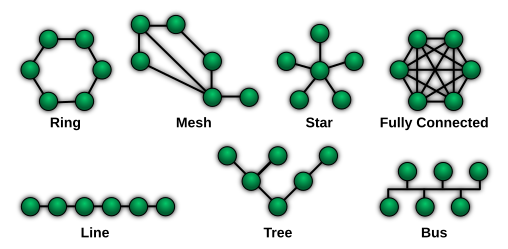
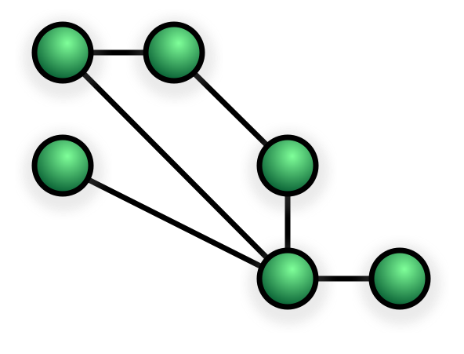

CPU 核数越来越多，片上又集成了 GPU、NPU、DSP、图像处理器和多级缓存。它们不仅要访问内存，还要交换控制消息、缓存行和张量数据。早期 SoC 常用共享总线连接这些模块；当主设备和带宽需求变多后，单一共享通路很容易变成拥塞点。**片上网络（Network-on-Chip，NoC）**把通信组织成网络：端点通过网络接口接入，数据经过交换节点和链路到达目的端。

NoC 不是“芯片里跑的以太网”。它借用了网络中的拓扑、路由、交换和流控思想，但针对片上距离短、时钟高、能耗和面积敏感、流量模式相对可预测等特点做了硬件化设计。本文从一笔读请求出发，逐层拆解 NoC 的组成与关键权衡。

## 一、为什么需要 NoC

最简单的片上互连是共享总线：多个主设备共享一组地址、数据和控制线，由仲裁器决定谁能使用总线。规模较小时它结构简单、易于验证；随着模块数和并发请求增长，冲突、仲裁延迟和总线负载会逐渐显现。总线的物理布线也需要把许多端点连到同一片共享资源上。

交叉开关（crossbar）可以让多个输入同时连接到不同输出，提供更高并发度，但端口数增加时交叉点、布线和仲裁成本增长很快。它适合规模有限、需要低延迟高带宽的局部连接，却不一定适合把全芯片所有模块都接在一个巨大交叉开关上。

NoC 把整体互连拆成多个较小的路由器和点到点链路。数据可在不同链路上同时传输，网络也更容易按物理布局扩展。代价是每跳会引入路由、排队和仲裁开销，网络还要处理拥塞、死锁、服务质量及错误恢复等问题。

| 互连方式 | 优点 | 主要代价 | 常见定位 |
| --- | --- | --- | --- |
| 共享总线 | 简单、面积小、广播方便 | 共享带宽，竞争随主设备增多而加剧 | 小型 SoC、低速外设 |
| 交叉开关 | 多对端点可并发通信，路径短 | 端口数增加时代价高，布线复杂 | 小规模高带宽互连 |
| NoC | 可扩展并发、可分层或按流量定制 | 多跳延迟、路由器面积和验证复杂度 | 多核、异构计算、大型 SoC |

这些方式并非互斥。实际芯片常把 NoC、交叉开关、总线和专用点到点链路组合使用。

## 二、NoC 的基本组成

典型 NoC 可以分成四部分：

1. **端点（endpoint）**：CPU、缓存、内存控制器、DMA、NPU 或外设等通信参与者。
2. **网络接口（NI/NIC）**：把端点的事务协议转换成网络内部的数据包，并在接收侧还原。它可能负责切包、重组、标识流量类别、处理响应关联和协议转换。
3. **路由器（router）**：读取包头并选择输出端口，仲裁共享输出，再把数据转发到下一跳。
4. **链路（link）**：连接两个路由器或路由器与端点，承载编码后的数据和控制信息。物理实现包括导线、流水级及相关时钟/握手逻辑。

可以把路径想成：

```text
CPU/设备 → 网络接口 → 路由器 → 路由器 → 内存控制器网络接口
                       ↑ 数据沿链路逐跳前进 ↑
```

网络接口通常是协议边界。上层可能使用 AXI、CHI 或厂商自定义事务协议；NoC 内部则使用自己的包格式、流控单位和路由信息。NoC 的存在不意味着所有端点都直接“讲同一种协议”。

## 三、拓扑：路由器如何连接

拓扑描述路由器和链路的连接关系。常见选择如下：



> 图片来源：[Wikimedia Commons：NetworkTopologies.svg](https://commons.wikimedia.org/wiki/File:NetworkTopologies.svg)，公有领域作品。此图展示的是通用网络拓扑；片上网络会根据芯片布局和通信流量选择、组合这些连接方式。

- **二维网格（2D mesh）**：每个节点通常连接北、南、东、西邻居，边缘节点少一些端口。规则、易扩展，也容易映射到芯片平面布局；远距离通信可能需要多跳。



> 图片来源：[Wikimedia Commons：NetworkTopology-Mesh.svg](https://commons.wikimedia.org/wiki/File:NetworkTopology-Mesh.svg)，公有领域作品。图中是通用网格网络示意；NoC 通常会在每个网格节点连接处理单元或其他 IP。

- **环（ring）**：节点首尾相连，布线和节点连接相对简单；随着节点数上升，最坏路径和拥塞可能变大。双向环可在两个方向中择路。


> 图片来源：[Wikimedia Commons：RingNetwork.svg](https://commons.wikimedia.org/wiki/File:RingNetwork.svg)，公有领域作品。

- **树或分层网络**：适合按层次组织模块或聚合带宽，但树根、上层链路可能成为热点。
- **交叉开关或部分交叉开关**：可提供短路径和较高并发，通常用于局部区域或少量端点。
- **定制拓扑**：根据端点位置、流量矩阵和物理约束组合网格、环、专用链路或多个子网络。

二维网格中，常见的 XY 确定性路由是先沿 X 方向走到目标列，再沿 Y 方向走到目标行。若源坐标为 `(xs, ys)`、目的坐标为 `(xd, yd)`，则先处理 `xd-xs`，再处理 `yd-ys`。它规则且易实现，但路径选择少，热点附近的负载不一定均匀。自适应路由可以根据拥塞选择可用路径，不过会增加控制复杂度，而且必须额外证明不会形成死锁。

逻辑拓扑只是起点。真实芯片上，路由器的物理位置、链路长度、跨越的区域、时钟域和宏单元阻挡都会影响实现。设计者可能选择让逻辑上的一跳跨越多个物理区段并插入流水级，也可能建立层次化网络来缩短高频关键路径。

## 四、数据单位：消息、包、flit 与 phit

不同资料对术语的细节可能略有差别，工程上常见的层次是：

- **事务/消息（transaction/message）**：端点要完成的一次操作，例如读一个缓存行。
- **包（packet）**：在 NoC 中路由的单位，通常包含头部、载荷和尾部信息。
- **流控单元（flit, flow-control digit）**：流控与缓冲分配使用的单位。一个包可以由头 flit、若干体 flit 和尾 flit 构成。
- **物理传输单元（phit, physical digit）**：链路一次能发送的位数。有些实现中一个 flit 正好一拍传完，有些 flit 会跨多个物理传输周期。

头部通常携带目的地址或路由信息、虚通道/服务类别、长度等字段；尾部可能标记包结束并释放占用资源。数据包的切分与重组通常由网络接口完成，具体分工取决于实现。

## 五、路由器内部：从输入到输出

一个典型输入缓冲式路由器包含：输入端口及缓冲、路由计算、虚通道分配、交换分配、交叉开关和链路输出。每个周期（或流水阶段）里，路由器会推进一个或多个 flit：

1. **缓冲写入**：输入 flit 到达后进入相应输入缓冲或虚通道缓冲。
2. **路由计算（RC）**：头 flit 根据目的地和当前节点确定可选输出端口。体 flit 通常沿着头部已经确定的路径前进。
3. **虚通道分配（VA）**：若采用虚通道，为该包申请下游对应端口上的一个虚通道资源。
4. **交换分配（SA）**：多个输入可能同时想使用同一输出。仲裁器选择本周期获准通过的输入。
5. **交叉开关传输（ST）**：被选中的 flit 穿过交叉开关并发送到输出链路。

这些阶段可以流水重叠。路由器的实际延迟取决于缓冲组织、分配算法、时序切分、链路流水级和是否支持旁路；不能简单把所有 NoC 的“一跳”都视为固定一拍。流水线可以提高吞吐，但会增加首包延迟与缓冲/寄存器开销。

## 六、交换与流控：拥塞时如何处理


### 存储转发与直通转发

**存储转发（store-and-forward）**要求路由器先接收完整个包，再开始向下游转发。它的实现直观，但每跳都要等完整包到齐，缓冲需求也较大。

**直通转发（cut-through）**可在包尚未完整到达时就开始转发。常见的虫孔流控（wormhole）进一步把包拆成 flit：头 flit 先占据路径，体 flit 紧跟着穿过多个路由器。这样只需较小的每跳缓冲，但一个受阻的包可能跨多个路由器占用缓冲资源，阻塞会沿路径传播。

### 基于信用的反压

下游缓冲有限，不能无条件继续发送。常见的**信用流控（credit-based flow control）**会让下游告知上游：“你在某虚通道里还有多少空闲缓冲槽”。上游只有在持有可用信用时才能发送对应 flit；下游取走 flit 并释放槽位后，再把信用返还。信用粒度、返回延迟和每条链路的缓冲深度共同影响吞吐。

另一种常见思想是 ready/valid 握手：发送端给出 valid，接收端给出 ready，双方在握手成立时完成一次传输。具体 NoC 可以采用信用、握手或专有协议，不能只凭“NoC”一词推断流控方式。

### 虚通道（Virtual Channel, VC）

多个虚通道共享一条物理链路，但各自拥有独立的缓冲状态和流控状态。某个包因下游拥塞而停住时，同一物理链路上的其他 VC 仍可能发送，从而减少队头阻塞（head-of-line blocking）。

VC 并不会创造额外的物理带宽；它用缓冲和仲裁资源换取更好的隔离与利用率。VC 数量增加可能提高性能或支持不同服务类别，同时也增加缓冲面积、功耗、仲裁逻辑和验证工作。不同 VC 之间若依赖关系设计不当，仍可能发生死锁。

## 七、路由、仲裁与死锁

路由算法回答“下一跳可以走哪里”，仲裁回答“多个竞争者谁先用共享资源”。常见策略包括固定优先级、轮询、年龄优先级或带权仲裁。固定优先级简单，但低优先级流量可能长期饥饿；轮询较公平，却不一定符合实时流量的时限要求。

虫孔流控下，死锁可能来自多个包各自占有一部分缓冲，同时等待对方占有的资源。一个常用分析工具是**通道依赖图**：若存在从通道 A 等待 B、从 B 等待 C、最终又从某通道回到 A 的环，就需要检查是否存在可导致死锁的资源依赖环。XY 路由在常见二维网格和相应假设下能限制转向关系以避免某些环；增加自适应转向、多个子网或协议依赖后，必须重新分析完整依赖关系。

工程上避免死锁不是“选了 XY 就万事大吉”。还要检查请求/响应网络是否互相等待、VC 分配与释放条件、端点是否会持有资源等待回包、以及不同流量类别间是否存在依赖环。需要时可使用独立虚通道/子网、限制路由转向，或为协议定义无环的资源获取次序。

## 八、性能指标与简单估算

常看的 NoC 指标包括：

- **吞吐率（throughput）**：单位时间或周期通过某条链路、某个路由器或整个网络的数据量。
- **延迟（latency）**：从源端发出到目的端接收的时间，可分成端点/网络接口、路由器流水、链路传播、排队和重组等部分。
- **带宽利用率**：实际有效载荷与可用链路容量的比例。头部、尾部、空闲周期及重传/协议开销会降低有效利用率。
- **拥塞与尾延迟**：平均值之外还应关注高分位延迟，以及热点流量导致的长时间排队。
- **能耗与面积**：包括链路翻转、缓冲读写、路由器逻辑、时钟树和重复发送等成本。

若链路宽度为 `W` bit、频率为 `f` Hz、每拍最多传一个 flit，则理想原始带宽为 `W × f` bit/s。以 128 bit、1 GHz 为例，单向链路原始上限是 128 Gbit/s，也就是 16 GB/s（十进制单位）；有效载荷带宽还要扣除协议开销和气泡。全双工链路通常可分别计算两个方向，不能把单向容量误当成端到端应用带宽。

端到端延迟可以粗略拆为：

```text
总延迟 = 端点处理 + 网络接口 + 各跳路由器/链路 + 排队 + 目的端处理
```

在无拥塞且流水稳定时，一个包的首 flit 延迟主要受跳数和流水阶段影响；包的最后一个 flit 还要考虑包长和链路传输时间。拥塞时排队延迟可能占主导。因此只报“路由器几级流水”不足以描述应用实际延迟，还需要流量模型、包长、映射和热点情况。

## 九、QoS 与流量隔离

NoC 中会混合不同性质的流量：实时视频流、CPU 缓存未命中、DMA 大块搬运、控制消息等。若所有请求只按尽力而为方式竞争，高带宽流量可能挤压对时限敏感的请求。

常见手段包括将流量分类到不同 VC 或子网、为端口/虚通道配置优先级、带宽预留、整形和准入控制。真正的服务保证需要端到端考虑：仲裁策略、缓冲容量、最坏路径竞争、时钟与链路速率、以及端点能否按约定产生流量。单纯配置“高优先级”并不自动等于有界延迟保证。

## 十、缓存一致性与 NoC 的关系

NoC 负责搬运事务，并不天然定义缓存一致性。多核一致性协议（例如 MESI 类协议或基于目录的协议）定义缓存行状态及请求、探测、响应等消息；NoC 负责把这些消息送到相应的缓存、目录或内存端点。

一致性协议会影响 NoC 流量结构：广播式 snoop 可能产生大量多播/广播流量；目录协议通常把请求集中到目录节点，热点与流量路径会随之变化。反过来，网络的死锁特性也会影响协议设计：请求、探测和响应通道若形成循环等待，协议可能无法前进。因此一致性协议与互连常需联合验证，但职责边界仍然清楚：协议定义语义，NoC 提供传输和服务。

## 十一、NoC 与 AXI/CHI、片外网络的边界

AXI、CHI 等定义事务或一致性互连协议；NoC 描述网络化的传输结构。SoC 可以在 NoC 边缘接入 AXI/CHI 端点，通过网络接口把协议事务映射为内部包。某些产品会把自家 NoC、协议适配器和一致性功能作为一个互连 IP 一起提供，因此产品名称可能覆盖多层职责。

片上 NoC 与数据中心网络也不同。片上网络的端点、拓扑和负载多由芯片设计者控制，链路距离短且资源受面积/功耗约束；它通常不以 IP 路由、交换机级拥塞控制、长距离物理链路和复杂网络管理为中心。不过二者可以共享路由、排队、流控和 QoS 等基础概念。

## 十二、设计 NoC 时的实际步骤

一个实用的设计流程可以概括为：

1. **列出通信端点和事务语义**：主设备、从设备、缓存、内存、带宽、优先级、响应路径及一致性要求。
2. **建立流量矩阵**：记录谁向谁发送多少数据、突发长度、读写比例、时间相关性与峰值流量，而不只看全芯片总带宽。
3. **映射到物理布局**：确定端点位置、可走线区域、时钟域和电源域，估算链路长度与可用宽度。
4. **选择拓扑、路由和流控**：结合面积、延迟、并发、可预测性和死锁约束。
5. **配置缓冲与 QoS**：根据往返流控延迟、突发大小和目标吞吐评估缓冲深度及隔离方式。
6. **仿真与压力测试**：覆盖均匀随机流量、热点、对向流量、突发、拥塞、极端包长和故障场景；检查平均延迟与尾延迟。
7. **综合、布局布线后复测**：物理线长、拥塞、插入流水级和时钟频率会改变抽象模型中的性能。
8. **形式化/协议级验证**：验证无死锁、无饥饿（若要求）、顺序语义、信用守恒、请求响应匹配和错误恢复。

核心问题通常不是“哪种拓扑最先进”，而是给定目标工作负载和物理约束后，哪些通信会成为瓶颈，以及增加的缓冲、链路和控制逻辑是否值得。

## 十三、总结

NoC 是一种把 SoC 内通信拆成网络化路由、交换与流控的互连架构。理解它时可以沿着一笔事务追踪：端点提出请求，网络接口封装成包，路由器逐跳计算路径并仲裁输出，流控限制发送速率，目的端网络接口再把包交还给协议端点。

记住几组边界即可建立清晰的心智模型：拓扑决定节点怎么连，路由决定包往哪走，仲裁决定竞争时谁先走，流控决定缓冲满时能不能继续走，协议决定这笔事务代表什么。NoC 的性能最终由这些机制与实际流量、芯片布局共同决定。

## 参考资料

- [MIT 6.5900：On-Chip Networks II — Router](https://csg.csail.mit.edu/6.5900/Lectures/L16.pdf)，涵盖路由器结构与虚通道流控。
- [AMD Versal NoC Packet Switch 产品指南（PG313）](https://docs.amd.com/r/en-US/Versal-Adaptive-SoC-Programmable-Network-on-Chip-and-Integrated-Memory-Controller-1.0-LogiCORE-IP-Product-Guide-PG313/NoC-Packet-Switch)，具体厂商 NoC 中路由、虚通道与信用流控的示例。
- [Stanford MAST Lab：Evaluating Bufferless Flow Control for On-chip Networks](https://mast.stanford.edu/pubs/evaluating_bufferless_flow_control_for_on_chip_networks/)，对比缓冲式虚通道与无缓冲偏转流控。
