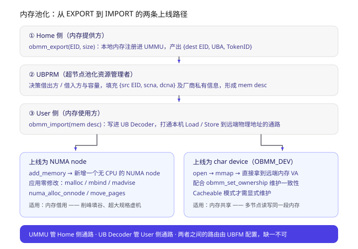
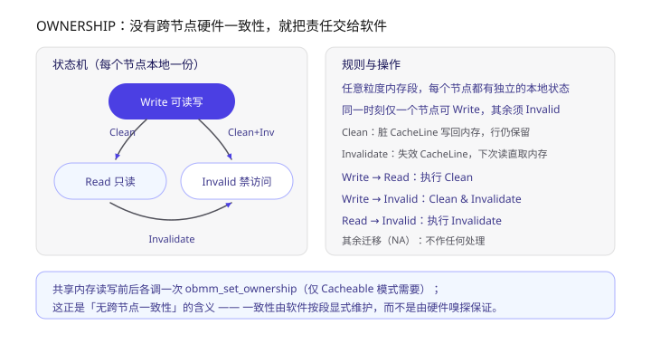
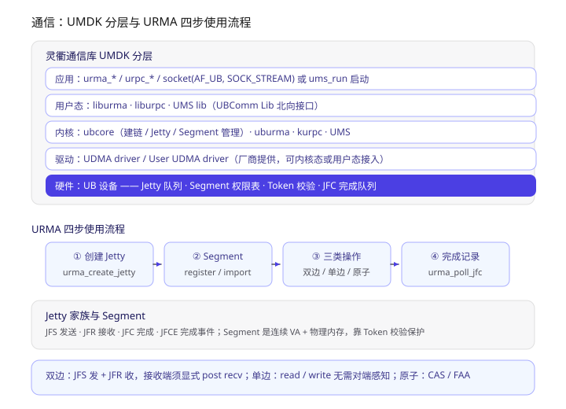
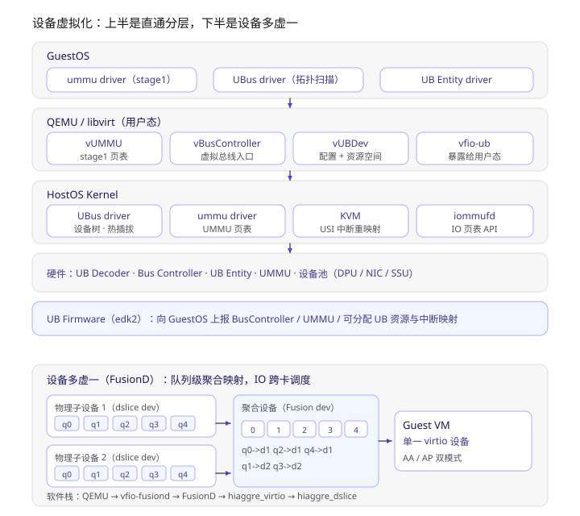
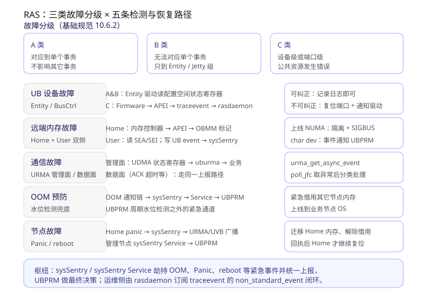

> 学习材料：*灵衢使能操作系统参考设计 2.0*（57 页，下称 **OS 参考设计**）、*灵衢内存池化关键技术和应用*、*灵衢设备虚拟化关键技术和应用*、*灵衢系统高阶服务关键技术和应用*。
> 同系列第一篇讲的是协议本身（六层栈、事务类型、UMMU 查表），这一篇讲**协议落到 OS 里长什么样**；第三篇《灵衢 UnifiedBus 学习笔记（三）：系统高阶服务、可靠性与编程编译》接着往上走一层。文中「4.3.2」「6.2」这类编号对应 OS 参考设计的章节，方便回查原文。

**一句话概括**：灵衢对操作系统的改造可以浓缩成一句话 —— **在 Linux 原有的「内存管理 / 通信 / 设备管理 / 虚拟化」四套框架上各开一个口子，把 UB 的总线能力接进去**，让远端内存看起来像一个 NUMA node、让 UB 设备看起来像一个 PCI 设备、让跨节点通信看起来像一个 socket。应用不用改代码，改的是内核里的那几层。

读下来最关键的几点，按递进关系排：

1. **访存模型换了个主语**：传统是 Host-Device（以 CPU 为中心，三类访存路径各写一套），UB 改成 **User / Home** —— 谁发起访问谁是 User，谁提供内存谁是 Home，同步（Load/Store）和异步（DMA）两种打法共用一套凭据。
2. **内存池化的抓手是 EXPORT / IMPORT 两个接口**：Home 侧 `obmm_export` 产出 `{EID, UBA, TokenID}`，User 侧 `obmm_import` 后可以选择上线成 NUMA node（应用零修改）或字符设备（mmap 后用）。
3. **没有跨节点硬件一致性，就用 Ownership 把责任交给软件**：每段内存在每个节点有独立的 Invalid / Read / Write 状态，靠 Clean 与 Invalidate 两个动作维护。
4. **UBTurbo 解决"远端内存慢"的问题**：芯片内置冷热统计阵列 + SMAP 迁移，分级内存场景下实测从 AutoNUMA 的 60% 出头拉到 96%~99%。
5. **设备虚拟化做的是两件事**：UB 设备直通（vUMMU / vBusController / vUBDev / vfio-ub 四件套）和设备多虚一（FusionD 队列级聚合）。
6. **可靠性被拆成 A/B/C 三类错误 × 五条检测路径**，`sysSentry` 是紧急事件的统一枢纽，`UBPRM` 是最终决策者。

---

## 一、OS 组件的全貌：四个口子

OS 参考设计 2.1 节把操作系统灵衢组件（UB OS Component）定义在**计算节点的 CPU 上**，它不是另起炉灶，而是在 OS 原有四套框架上做扩展：

| 扩展 | 挂在哪套框架上 | 包含什么 | 对应用的意义 |
| --- | --- | --- | --- |
| **Device Mgmt** | Linux `bus/device/driver` 模型 | UBus Driver（ubfi / ubus / vendor_ubus）、vfio-ub、ubutils | UB 设备热插拔、拓扑扫描、配置空间访问、sysfs + udev |
| **Memory Mgmt** | DMA/SVA 框架 + NUMA 内存管理 | libummu / ummu-core / ummu driver、libobmm / OBMM、UB Decoder driver、UBMM Lib、UBTurbo | 远端内存借用与共享，`malloc` 无感使用 |
| **Communication** | socket / 异步通信框架 | UMDK：ubcore / uburma / liburma、kurpc / liburpc、UMS | URMA 单边双边、URPC 远程调用、socket 兼容 |
| **Virtualization** | qemu / libvirt / vfio 框架 | vfio-ub、vUMMU、vBusController、vUBDev、KVM USI 重映射 | UB 设备直通虚机，池化设备按需弹性分配 |

有两个角色贯穿全文，必须先分清：

- **UBFM**（UB Fabric Manager）：互联结构管理器，**管硬件资源怎么分配**，是"执行者"。
- **UBPRM**（UB Pooled Resource Manager）：超节点内的**池化资源管理者**，是"决策者"——接受来自 k8s、OpenStack 或管理员的资源分配请求，也可以按策略自主调度（比如内存由谁借给谁），然后调 UBFM 落实。UBPRM 由用户自行实现，UB Service Core 里的 **UBS Engine** 是它的一种实现。

> 一句话记忆：**UBPRM 决定"给谁"，UBFM 决定"怎么连"，驱动负责"能用"**。

## 二、设备管理：从 BIOS 的一张表到一棵设备树

UB 设备的发现链路是：`BIOS/UB Firmware` 上报 **UBRT 表**（UB Root Table，记录寄存器地址、与中断控制器和 UMMU 的关联关系、可供 UB 分配的系统资源）→ `ubfi` 解析并注册平台设备、生成 Bus Controller → `ubus` 扫描 Bus Controller port，完成拓扑扫描、网络地址分配、路由表配置、EID 分配 → UB Entity 注册到 UB 总线。

驱动模型直接沿用 Linux 那套，新增三个数据结构：

| 结构 | 对应 | 说明 |
| --- | --- | --- |
| `ub_bus_type` | `bus_type` | 启动阶段把 UB 总线注册进系统 |
| `struct ub_entity`（含 `struct device`） | device | 协议里每个 UB Entity 实例化一个 |
| `struct ub_driver`（含 `struct device_driver`） | driver | 厂商驱动的统一编程接口 |

除此之外还有一套**设备服务模型**（`ub_service_bus_type` / `ub_service_device` / `ub_service_driver`），用来给 Bus Controller、UB Switch 这类组件注册 RAS、热插拔等公共服务。它的 `bus_type` 只定义了 `match` 操作，按 **serviceID** 匹配——注意这是"服务"而不是"设备"，所以不走设备驱动那套 probe 资源初始化。

一个 UB 设备驱动的 probe 函数典型要做六件事，顺序基本固定：

```text
ub_set_hostinfo（设置主机信息，如 EID）
  → ub_entity_enable（使能 Entity）
  → ub_iomap（映射资源空间）
  → 访问配置空间做设备初始化
  → request_irq（注册中断）
  → 注册到 netdev / nvme 等子系统
```

remove 时严格倒序（先从子系统注销，再 `free_irq`、`iounmap`、禁用设备、清除 hostinfo）。维测侧给了两个工具：**`lsub`** 看拓扑与配置空间、**`setub`** 改写配置空间，配合 `/sys/bus/ub` 和 `/sys/bus/ub_service` 两个 sysfs 目录。

## 三、内存管理：访存模型从 Host-Device 变成 User / Home

这是整个内存章节的立论（4.1）。传统总线是 Host-Device 模型：以 Host（CPU）为中心，Host 访问 Device 内存、Device 访问 Host 内存、Device 访问 Device 内存——**三类路径各写一套实现**。UB 把它们统一成一套：

- 一次访存流程里，**发起方叫 User，目的方叫 Home**；
- User 可以用**同步（Load/Store）**或**异步（DMA）**两种方式访问 Home 侧内存；
- 能力由两个驱动分别打通：**`ummu driver` 管 Home 侧通路，`UB Decoder driver` 管 User 侧通路**，两者之间的路由还需要 UBFM 配好才能真正连通。

Home 侧提供四类导出接口，差别在于"导出的是什么地址"：

| 接口 | 谁用 | 导出内容 | 特点 |
| --- | --- | --- | --- |
| **EXPORT** | 管控面 | 指定大小的物理内存资源，供其他节点导入 | 内存借用/共享的主力接口 |
| **DMA** | 内核态 | 把指定物理内存映射为 UBA | 拿到 IOVA 当 UBA 配给设备 |
| **KSVA** | 内核态 | 内核中的指定 VA 地址段 | 额外权限表限制，只允许访问被授权的内核 VA 范围 |
| **USVA** | 用户态 | 本进程地址空间的 VA 段（此时 **UBA == VA**） | 用来实现用户态设备驱动；`ummu_allocate_tid` 申请 TokenID → `ummu_grant` 授权 VA → 拼出 `{EID, TokenID, UBA}` |

User 侧拿到访存凭据后只有两条路：**异步**用 DMA/URMA 引擎发起，**同步**则调 `obmm_import` 把凭据写进 UB Decoder，之后对指定物理地址的 Load/Store 就自动走到 UB 总线上去了。

## 四、内存池化：EXPORT / IMPORT 与两种上线形态



> 上图上半是三步链路：Home 侧 export 出凭据 → UBPRM 补 routing 信息形成 mem desc → User 侧 import 打通通路；下半是 import 之后的两种上线形态，左边走 NUMA、右边走字符设备。

**为什么需要它**：内存池化那份材料给了两个数字——`P(单节点最大内存使用率 ≤ 50%) = 90%`，`P(平均内存使用率 ≤ 25%) = 70%`；虚拟化场景下 **30%~50% 的内存根本没被使用**。这些内存被"焊死"在各自节点的槽位上，谁也够不着。

**流程**（对应 OS 参考设计 4.3.1）：

1. Home 侧 `obmm_export(EID, size)` → 生成 UBA 与 TokenID，得到 `{dest EID, UBA, TokenID}`；
2. UBPRM 填充 `{src EID, scna, dcna}` 及各厂商私有信息，形成完整的 **mem desc**；
3. User 侧 `obmm_import(mem desc)` 上线。

关键是**上线成什么**：

- **上线为 NUMA node**：走内核 `add_memory`，多出一个"没有 CPU 的 NUMA node"。应用的 `malloc` / `mbind` / `madvise` / `numa_alloc_onnode` / `move_pages` 全部照旧，**二进制不用改**——这就是 glibc / libnuma 那条"透明接口"路径。openEuler 的示意图里，借来的内存直接表现为 `NUMA1 远端内存`。
- **上线为 char device（OBMM_DEV）**：`open` + `mmap` 拿到 VA 直接用。这条路径配合 `obmm_set_ownership` 使用，是**共享内存**场景的入口。

借用与共享的差别也就在这里：借用是一个 User 独占（走 NUMA 或 char device 都行，NUMA 更省事）；共享是多个 User 同时映射同一段（必须走 char device，因为要显式管一致性）。

## 五、Ownership：没有跨节点硬件一致性时怎么做共享



> 上图左边是三态迁移图（Write / Read / Invalid 及触发的动作），右边是规则与两种操作的含义。

这是我觉得整套设计里最有意思的一处取舍：**UB 明确不提供跨节点缓存一致性**，而是给每段内存在每个节点配一份本地 Ownership 状态，让软件显式维护。

- **Invalid**：本节点不能读写；
- **Read**：本节点只读；
- **Write**：本节点可读写，且**同一时刻只能有一个节点持有 Write，其余必须全部 Invalid**。

迁移时的动作只有两个：**Clean**（把脏 CacheLine 写回内存，行仍保留）和 **Invalidate**（失效 CacheLine，下次读直接访存）。对应关系是 `Write→Read` 做 Clean，`Write→Invalid` 做 Clean & Invalidate，`Read→Invalid` 做 Invalidate，其余迁移标 NA 即不处理。

接口是 `obmm_set_ownership`，规则很朴素：**读写这段内存的前后各调一次**，且只在 Cacheable 模式需要。代价是应用要显式参与，收益是省掉了硬件一致性目录的开销和复杂度——考虑到 UB 要连的是上千个节点，这个取舍是合理的。

## 六、UBTurbo：远端内存慢，就用冷热迁移补

借来的内存有 access 时延劣势，OS 参考设计给了一个可选加速组件 **UBTurbo**（4.5），它做两件事：

1. **SMAP 冷热识别与数据迁移**：利用芯片在内存访问路径上集成的**冷热统计阵列**（软硬协同判热，避免软件扫描开销），把热数据留在本地、冷数据放到远端，并周期性交换。
2. **分级内存远近比例调整**：通过 `OutSetWaterMark` 初始化、`OutMemMigrate` 提交进程与可迁出最大比例，让 SMAP 按进程的数据冷热分布**动态调整远近端内存配比**。

高阶服务那份材料给了对比数据（本地 : 远端容量 = 3 : 1，以全本地内存性能为 100%）：

| 负载 | Linux AutoNUMA | 软硬结合迁移（UBTurbo） |
| --- | --- | --- |
| Redis | 63.38 | **98** |
| Memcache | 65.58 | **99.35** |
| Keydb | 59.65 | **96.69** |

也就是说在 3:1 的分级配比下，软硬结合方案能把损耗压到 1%~4%，而 AutoNUMA 会掉到 60% 出头。**"内存池化能不能用"的答案基本系在 UBTurbo 身上**——没有它，借来的内存只能放冷数据。

## 七、通信：UMDK = URMA + URPC + UMS



> 上图上半是 UMDK 的五层分层（应用 → 用户态库 → 内核核心 → 厂商 UDMA 驱动 → UB 硬件），下半是 URMA 的四步使用流程和 Jetty / Segment 要点。

**UMDK**（灵衢内存语义开发包）是分布式通信软件库，对下接厂商的 UDMA driver（内核态/用户态均可），对上提供三种语义：

### URMA（统一远程内存访问）

三个特性值得记：**平等访问**（异构算力之间免 CPU 介入直接通信）、**无连接**（复用 UB 传输层的可靠服务，应用间不建端到端连接，资源开销低）、**弱事务序 + 多路径**（允许乱序执行与乱序完成，避免队头阻塞，使能底层多路径）。

资源抽象是 **Jetty + Segment**：

| 概念 | 是什么 | 细分 |
| --- | --- | --- |
| **Jetty** | 消息语义收发、内存语义命令下发的载体 | JFS（发送）/ JFR（接收）/ JFC（完成）/ JFCE（完成事件） |
| **Segment** | 一段连续 VA 地址空间（需分配物理内存对应） | 本地 `urma_register_seg`，远端 `urma_import_seg` |
| **Token** | 访问控制凭据 | 管理面创建时指定 TokenValue，经安全通道交换给发送方，硬件发包携带、收包校验 |

三步操作：**双边**（`urma_post_jetty_send_wr` / `urma_post_jetty_recv_wr`，接收端必须显式 post recv，服务端可批量提交提高吞吐）、**单边**（read/write，本端进程独立完成，对端应用无感知，适合搬大量数据）、**原子**（CAS 与 FAA）。

完成通知有两种模式：**轮询**（`urma_poll_jfc`，低时延场景）和**中断**（`urma_rearm_jfc` → `urma_wait_jfc`，低频场景省 CPU）。注意操作返回成功**只代表命令入队**，必须看完成记录才算完成；完成记录里的 `user_ctx` 用来关联到具体哪个操作，`completion_len` 只对接收侧有效。

### URPC（统一远程过程调用）

URMA 解决的是内存语义，但 XPU 之间功能层协议不同，互访仍要协议转换。URPC 的思路是：**任意硬件组件之间的关系都可以描述成"基于内存对象的函数调用"**，两个特点是去 CPU 中心化的平等调用、以及**引用传参**（传的是参数数据地址，Worker 自己去搬）。

流程较长但很直白：`urpc_init` → server `urpc_func_register` 拿函数 id → client `urpc_channel_create` → 双方 `urpc_queue_create`（queue 可按场景映射成 Jetty）→ server `urpc_server_start` → client `urpc_channel_server_attach` 交换 queue 与函数信息 → `urpc_func_call` → worker `urpc_func_poll` / `urpc_func_exec` → `urpc_func_return` → client `urpc_func_poll` 取回结果。

### UMS（socket 兼容）

目标是**应用零修改或极少修改**就用上灵衢。两种方式：把 `socket(AF_INET, SOCK_STREAM, 0)` 改成 `socket(AF_UB, SOCK_STREAM, 0)`，或者启动脚本前面加 `ums_run`（例如 `ums_run gaussdb -D /data2/lite/data -M primary`）。内核里 UMS 用 URMA Jetty 异步通信或 LD/ST 语义做加速。

## 八、UBS Comm 的三个关键技术

高阶服务材料把通信侧的生态兼容拆成三件：

| 技术 | 北向 | 南向 | 效果 |
| --- | --- | --- | --- |
| **UBSocket** | POSIX socket，`LD_PRELOAD` 接管 | bypass 内核 TCP/IP，转 UB 内存语义 | Redis 吞吐 **+100%**，应用零修改 |
| **ROUB** | Verbs 语义 | Verbs 转 UB 高性能内存语义 | 存量 RDMA 应用平移 |
| **HCOM** | 统一私有 API | 自适应传输：**短包（< 8K）用 LD/ST 同步语义降时延，长包（> 8K）用 URMA 异步语义吃带宽** | TB 级带宽、1 μs 级时延，多路径多平面毫秒级切换 |

HCOM 那条"按包长选同步/异步"的策略，正好呼应第一篇里传输层的四种模式——**协议栈每层可配置，最终在这里变成了运行时自适应**。

其他实测收益：Kafka +20%、分布式存储 ceph +10%、BRPC 吞吐 +20%+。

## 九、设备虚拟化：先池化，再直通



> 上图上半是直通的四层（GuestOS / QEMU 用户态 / HostOS Kernel / 硬件）与 UB Firmware 的上报职责；下半是设备多虚一的队列级聚合映射。

**动因**（设备虚拟化材料）：单服务器资源固定配比、按峰值静态分配，导致 **DPU 平均带宽利用率 < 20%、算力利用率 20%~30%**，而 DB 类业务的带宽诉求又可能超过单 DPU 上限。解法是把 1:X 的单一资源抽象换成 **M:N 的融合抽象**，按负载动态调整。

直通路径上的八个组件（OS 参考设计 6.2）：

1. **UB_MGR**：通过 libvirt XML 创建和管理 UB 虚机；
2. **vUMMU**：给虚机模拟 UMMU，建立 stage1 页表（GVA→GPA），并把页表地址同步到物理 UMMU；
3. **vBusController**：模拟 Bus Controller，虚机内的 UBus driver 靠它做拓扑扫描和配置访问；
4. **vUBDev**：模拟 UB 设备模型，提供完整的配置空间、资源空间与虚拟拓扑；
5. **UB Firmware（edk2）**：把 Bus Controller、UMMU、可分配的 UB 资源以及与中断控制器的映射关系上报给 GuestOS；
6. **vfio-ub**：把 UB 设备暴露给用户态 qemu；
7. **KVM**：USI 中断重映射，提供虚拟 USI 中断注入或透传；
8. **iommufd / vfio-type1**：提供用户空间管理 IO 页表的 API，完成 UMMU 页表配置。

运维侧有两个概念要分清：**BusInstance** 分 `Static_Server`（物理机自己）和 `Dynamic_Server`（UBFM 给虚机建的），用 `lsub -b` 或 `cat /sys/bus/ub/instance` 查；虚机 XML 要配三样东西——`<controller type='ub'>`（ports num 不配默认 128，UBus Driver 的 port index 是 8 bit，所以**上限 256**）、`<iommu model='ummu'>` + `<iommufds>`、以及 `<hostdev type='ub'>` 指定设备 guid。

一个容易踩的坑：**因为 UMMU 权限表要求内存连续，虚机必须配大页**（`<memoryBacking><hugepages>`）。维测则用 qemu 新增的 hmp 命令：`info ub` 列设备、`info ub [id]` 看详情、`info ub-config id offset len` 读配置空间。

## 十、设备多虚一：队列级聚合映射

传统高可靠（比如网卡 bond）要 guest 感知配置，而且只能聚合单一设备类型。UB 的做法是**统一聚合设备模型**：

- 支持 virtio-net / virtio-blk / virtio-scsi 多设备类型；
- 支持 **AA、AP 双模式**，同时提升吞吐与可靠性；
- 关键机制是**队列级的聚合映射**——队列是处理 IO 任务的最小工作单元（doorbell + 队列内存 + 数据内存），聚合层把聚合设备的队列按映射关系分发到不同物理子设备，从而实现 **IO 跨卡调度**。

软件栈自下而上是：`hiaggre_dslice`（物理子设备驱动，向上提供框架定义的 ops）→ `FusionD framework`（按 ops 模拟出聚合设备）→ `hiaggre_virtio`（把设备空间访问翻译成 virtio 行为并按映射转发）→ `vfio_fusiond`（附加上 PCI 或 UB 设备模型，通过标准 VFIO 接口暴露给 qemu）→ QEMU → GuestOS。

## 十一、RAS：三类错误 × 五条路径



> 上图顶部是基础规范 10.6.2 的 A/B/C 三类故障分级，下面五行分别是 UB 设备、远端内存、通信、OOM、节点故障的检测链与恢复动作。

**故障分级**是理解 RAS 的钥匙：

- **A 类**：物理拓扑完好，错误能对应到**单个事务**，不影响其它事务；
- **B 类**：物理拓扑完好，但无法对应到单个事务，只能定位到 **UB Entity / TP Channel / Jetty**，需要对错误单元的全部资源做处理；
- **C 类**：**设备级或端口级的公共资源**出错。

五条检测与恢复路径：

| 场景 | 检测链 | 恢复动作 |
| --- | --- | --- |
| UB 设备故障 | A&B：Entity 驱动读配置空间状态寄存器（虚机场景由 vfio-ub + KVM 上报）；C：Firmware 触发 FHI/ERI → APEI → traceevent + UBus Driver + rasdaemon | 可纠正只记日志；不可纠正复位端口并通知驱动 |
| 远端内存故障 | Home：内存控制器 → Firmware → APEI → OBMM 标记不可借出；User 读失败走 SEA/SEI 中断；User 写失败走 UB event → UBus Driver → sysSentry | NUMA 上线：APEI 隔离 + 发 **SIGBUS** 给业务；char device：事件通知 UBPRM 重新申请 |
| 通信故障 | 管理面（B 类）：UDMA 配置空间状态寄存器 → uburma/liburma → 业务；数据面（A 类，如 ACK 超时）走同一路径 | `urma_get_async_event` + `urma_ack_async_event`，或 `urma_poll_jfc` 取异常状态分类处理 |
| OOM 预防 | UBPRM 周期性水位检测（可能来不及）→ OOM 通知链 → sysSentry → sysSentry Service → UBPRM | 触发**紧急借用**其他节点内存并上线到本节点 |
| 节点故障 | Home 侧 panic/reboot → sysSentry → **URMA/UVB 通道**广播 → 管理节点 sysSentry Service → UBPRM | 迁移 Home 侧内存、解除借用关系；**回执后 Home 才继续复位**（超时未回也一样复位） |

最后一条尤其值得注意：**节点要复位前，先把借出去的内存"托付"出去**，否则借用方会跟着一起挂。这里的 `sysSentry` / `sysSentry Service` 扮演的是紧急事件（OOM / Panic / reboot）的统一劫持与上报通道，`UBPRM` 拿决策权，`rasdaemon` 订阅 traceevent 的 `non_standard_event` 做运维侧闭环。

## 十二、回到全景：UB Service Core 的收益阶梯

把四份材料放在一起看，UB Service Core（UBS Engine / UBS Mem / UBS Comm / UBS IO / UBS Virt）给出的收益是**分层的**，取决于应用愿意改多少：

| 应用改造程度 | 收益 |
| --- | --- |
| 完全不改，OS 提供 POSIX 接口 | 直接获得内存借用、UBSocket 等能力（Redis 吞吐 +100%） |
| 集成 UBS Core 加速库 / 运行时，少量适配 | 约 **+30%** 性能 |
| 针对 UB 深度修改和架构优化 | **+50% 以上** |

六大核心能力与对应的量化口径：

1. **内存借用**：LD/ST 语义，支持透明（malloc/free）与非透明（`ubsmem_lease_malloc`）两种方式，单节点可借入 **TB 级**；典型收益是消减集群碎片 **25%**、Redis 集群 +10%。
2. **内存共享**：Global Buffer Pool 直写消除 IO 放大，原子语义实现分布式锁与全局事务号，数据库场景性能 **+20%**、内存省 **30%**、线性度 **> 0.75**、跨节点 RPC 时延**百 ns 级**。
3. **UB Turbo**：见第六节，分级内存损耗压到 1%~4%。
4. **UBS COMM**：UBSocket / ROUB / HCOM，通信性能 +30%。
5. **资源池化（以 DPU 为例）**：带宽聚合提升单点峰值、跨多卡冗余备份、虚机迁移时设备不变、运行时动态分配。
6. **UB-CloudEnabler**：遵循 Kubernetes / OpenStack 扩展机制（扩展 Scheduler、Nova Scheduler、Cyborg 设备抽象），让容器和虚机平滑接入池化资源调度。

材料里还给了整机口径的目标：利用率 **+30%**、推理端到端 **+20%**、通信性能 **+30%**、超节点可靠性 **99.9%**、资源超配 **+25%**，以及从单节点 3 个 9 走到超节点 4 个 9、挑战 5 个 9。UB Service Core 计划在 **2026 年 H1 完全贡献至 openEuler 社区**。

## 十三、学习路径与参考

如果要把这套东西真正吃透，我给自己排的顺序是：

1. **先把协议栈读顺**（同系列第一篇）：六层栈、四类事务、ROI/ROT/ROL 服务模式、UBMD 四级查表。不理解这些，OS 参考设计里的 `UBA` / `TokenID` / `UB Decoder` 就只是名词。
2. **精读 OS 参考设计第 3、4 章**：设备管理（UBRT → ubfi/ubus → 驱动模型）与内存管理（User/Home、EXPORT/IMPORT、OWNERSHIP）。这两章是 UB OS Component 的骨架。
3. **动手看 sysfs**：`/sys/bus/ub`、`/sys/bus/ub_service`、`/sys/devices/platform/ummu_tid_root`、`/sys/devices/obmm` —— 把文中的抽象结构和真实目录对上。
4. **读虚拟化章节并对照 XML**：`lsub` / `lsub -b` / `info ub` 三条命令加上 controller、iommu、hostdev 三段配置，能建立起"池化设备怎么进虚机"的完整链路。
5. **补上 RAS**：重点是 A/B/C 三类错误的划分依据，以及 sysSentry 在 OOM 与节点故障两条路径上的位置。
6. **再回头看高阶服务**：把六大核心能力映射到"协议能力 → OS 组件 → 应用收益"这条链上，检验自己能不能反向推出来。
7. **延伸**：`UB-Service-Core-SW-Arch-RD-2.0`（Service Core 软件架构）、`UB-Mgmt-OM-SW-Arch-and-IF-RD-2.0`（管理运维），以及 `6-超节点可靠性关键技术`、`8-超节点编程编译关键技术` 两份材料。

参考：

- 《灵衢基础规范 2.0》（541 页，术语与协议细节的权威来源）
- 《灵衢使能操作系统参考设计 2.0》（本文主线，57 页）
- 《基于灵衢的超节点参考架构白皮书》
- 《灵衢内存池化关键技术和应用》《灵衢设备虚拟化关键技术和应用》《灵衢系统高阶服务关键技术和应用》（openEuler 峰会材料）
- 灵衢官网 <https://www.unifiedbus.com>；UB Service Core 社区页 <https://www.openeuler.org/zh/projects/ub-service-core/>
