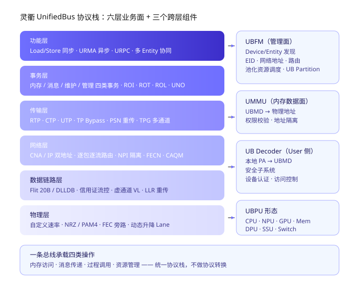
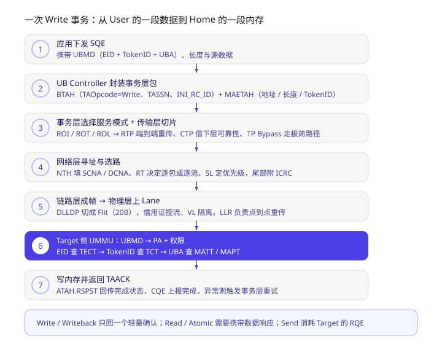
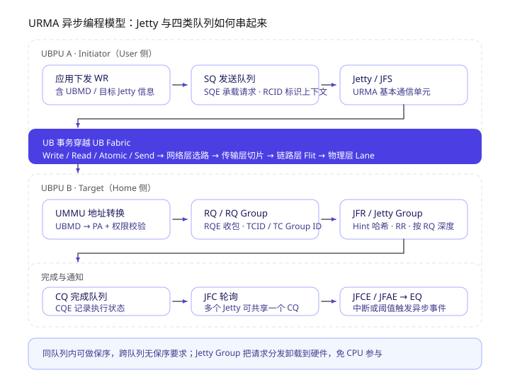
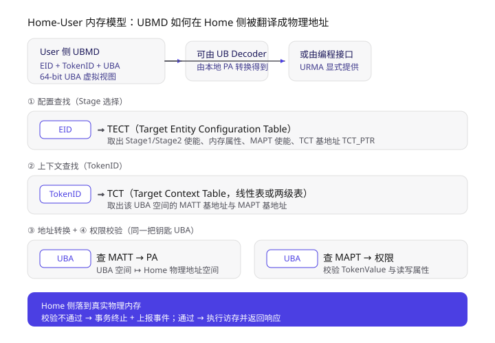
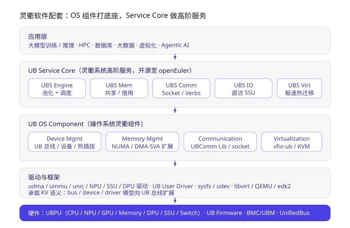

> 学习材料：*UB 基础规范 2.0*（541 页）、*基于灵衢的超节点参考架构白皮书*、*灵衢总线技术和软件参考设计*。
> 这是一篇**边读规范边梳理的学习笔记**，不是二手科普：所有数字与定义都来自上面三份材料，章节编号（如 7.4.2、9.4）对应基础规范，方便回查原文。
> 姊妹篇《灵衢 UnifiedBus 学习笔记（二）：操作系统怎么改》接着讲这套协议在 OS 里怎么落地（内存池化、设备虚拟化、通信栈、RAS）。

**一句话概括**：灵衢（UnifiedBus，UB）想把以前被 PCIe、以太网、RDMA、CXL 各管一摊的事情，收编到**一条总线**上 —— 用统一编址 + 统一事务 + 统一编程模型，让 CPU / NPU / GPU / 内存 / SSU 这些异构部件在一个 UB Domain 内**地位平等地互相访存、发消息、调函数**，从而把一台数据中心"变成一台计算机"。

读下来最关键的几点，按递进关系排：

1. **需求是被算力/带宽的剪刀差逼出来的**：近 8 年单节点算力涨约 40 倍，节点间带宽只涨 4~8 倍，通信成了大模型训练的主要开销。
2. **UB 的解法不是更快的网卡，而是换一层抽象**：所有操作归约为内存访问、消息传递、过程调用、资源管理四类，用单一协议栈承载，消灭协议转换开销。
3. **"平等"是有硬件支撑的**：Entity + EID + Token + UMMU 让任意 UBPU 直接访问别人，不需要第三方（比如 CPU）中转。
4. **六层协议栈每层都可配置**：一口一个数百 GB 的集合通信和一次几十字节的 KV Cache 搬运，走的是不同的传输层模式。
5. **内存语义靠 UMMU 落地**：UBMD（EID + TokenID + UBA）经 TECT → TCT → MATT/MAPT 四级查表变成物理地址并完成鉴权。
6. **软件栈开源在 openEuler**：UB OS Component 打底座，UB Service Core 提供内存池化、通信、IO、虚拟化等系统级高阶服务。

---

## 一、先问为什么：超节点要解的是哪几个矛盾

白皮书把 AI 时代的困境量化得很直接：

- **算力与带宽的剪刀差**： GPT4 1.8T 级别模型，在 TP8/PP16/EP8/SP4/DP64@seq8k/bs8k 配置下，单次迭代**每张卡**的 TP 通信量 336 GB、EP 268 GB、DP 86 GB；而 8 年间单节点算力涨约 40 倍，节点间带宽只涨 4~8 倍，通信无法被计算掩盖，MFU 上不去。
- **推理时延被通信钉死**：DeepSeek V3 每 Token 要过 58 层 MoE，即 58 轮 Dispatch/Combine 跨节点动态通信，最小粒度只有 **7 KB**；要在 TPOT ≤ 10 ms 的前提下做大 Batch，单次 Dispatch/Combine 必须 < 10 μs —— 这正是 RoCE 很难受的区域。
- **资源孤岛**：传统云平台 20%~25% 内存搁浅，近半数虚机有 30%~50% 内存没被使用；分布式存储 SSD 带宽利用率约 25%。
- **数据库/OLAP 的新要求**：想要多主架构和线性度 > 0.75，就得跨节点共享内存，且访问时延要压到**百 ns 量级**（白皮书明确点名：低于当前 RDMA 的 1/10）。

超节点参考架构给出的六条特征，正好对应这四组矛盾：**总线级互联**（百 ns 同步内存语义 / 2~5 μs 异步内存语义、TB/s 级带宽）、**协议归一**、**平等协同**、**全量池化**、**大规模组网**（单节点到 8192 卡线性度 > 90%，经 UBoE 到百万卡）、**高可用性**（8192 卡范围光互连 MTBF > 6000 小时）。

| 场景 | 传统架构痛点 | UB 超节点的收益（白皮书口径） |
| --- | --- | --- |
| 大模型预训练 | 集合通信量爆炸，通信掩盖不住 | DeepSeek V3 在 PP8/DP64/EP64 下，未掩盖通信比例降低 **80%**，训练性能最高提升 3 倍以上 |
| 中心推理 | 多专家小包高频通信 + KV Cache 超 HBM 容量 | 多层次 KV Cache 卸载 + NPU 直通传输，以查代算 |
| 后训练 / RLHF | 多模型参数与梯度反复同步 | 模型传输从秒~数十秒级降到毫秒~秒级，32K Batch 候选生成从数十秒降到秒级 |
| 虚拟化 | 内存搁浅、热迁移慢（100~200 ms） | 内存超分 > 25%，分配率 80%→95%，热迁移低至 **50 ms**，内存冷热分级损耗 < 5% |
| 数据库 | 主节点单点，线性度 < 70% | 共享内存支撑多主架构，线性度 > 0.75，TPC-C +20%、TPC-H +65% |
| 分布式存储 | SSD 带宽利用率约 25%，GC 抢 CPU | 存储池化 + SSU 卸载，IOPS +25%~35%，EC 重构速度快 6 倍 |
| 大数据 / HPC | Shuffle 与 I/O 瓶颈、CPU 平均使用率仅峰值 50% | Spark 执行效率 +30%、Shuffle 优化 +10%、HPC 典型应用 E2E +8%~10% |

## 二、一组核心名词与一张协议栈图

规范里反复出现的几个概念，先把它们锚定：

- **UBPU**（UB Processing Unit）：支持 UB 协议栈的处理单元，可以是 CPU、NPU、GPU、Memory、DPU、SSU、Switch。
- **UB Controller**：UBPU 里执行协议栈并提供软硬件接口的组件，位于拓扑叶子位置。
- **UMMU**：做 UB 内存地址映射和访问权限校验 —— 它是"共享内存"能安全成立的硬件根。
- **UB Switch**：交换节点，可选组件（UBPU 内嵌），负责端口间转发。
- **UB Link / UB Domain / UB Fabric**：点到点连接 / 全部用 UB Link 连起来的 UBPU 集合 / Domain 内所有 Switch 与 Link 的集合。
- **UBoE**（UB over Ethernet）：用以太/IP 承载 UB 事务，实现**跨 UB Domain** 互通（UB over UDP，目的端口固定 4792）。
- **Entity**：设备分配自身资源的**基本单元**，也是 UB Domain 内的通信对象。给它配 **EID** 才能通信，出厂带全局唯一 **GUID**，用 **Class Code** 声明自己提供什么服务，用 **UPI**（UB Partition ID）做访问隔离。



> 上图：左侧是六层协议栈及每层的关键机制，右侧是三个跨层组件 —— UBFM 管资源、UMMU 管内存数据面、UB Decoder 与安全子系统分别在 User 侧做地址转换和访问控制。

## 三、数据包是怎么层层加头的

UB 走的是标准的"每层加头"路线，Application Payload 从上往下依次被套上：

```text
功能层  →  事务层 TAH（BTAH/ATAH + 若干扩展头）
        →  传输层 TPH（RTPH / UTPH / CTPH，或 TP Bypass 不加）
        →  网络层 NTH（16/24-bit CNA 或 IP 头）
        →  数据链路层 LPH + DLLDP（切成 Flit）
        →  物理层 编码扰码后上 Lane；包尾统一加 32-bit ICRC
```

规范在附录 B 用 **LPH.CFG** 区分整包的类型组合。值得记住的三个"基本单位"：

| 单位 | 大小 | 说明 |
| --- | --- | --- |
| Flit（微片） | 20 字节 | 数据链路层的基本单位 |
| DLLDB（数据块） | 1~32 个 Flit | 组成一个数据链路层数据包 |
| Cell（信元） | — | 信用证的基本单元，用于链路层流控 |

## 四、物理层：自定义速率、非对称链路与 Lane 弹性

- 一个 **Port** 由 TX + RX 组成，各自包含 1/2/4/8 条 **Lane**；两端 Port + 中间双向 Lane 构成一条 **Link**。**UB 支持非对称链路** ——TX 和 RX 的 Lane 数可以不等，还能在不中断业务的情况下动态改宽度（写 SSD 密集而读稀疏的设备就不用浪费一半 SerDes）。
- 两种模式：**PHY Mode-1** 支持自定义速率（4.0 Gbps 起，NRZ 或 PAM4）；**PHY Mode-2** 对齐 802.3 标准速率（2.578125 / 25.78125 NRZ，53.125 / 106.25 PAM4）。背板场景可选到 **118 Gbps**/Lane、40 dB 插损。
- PCS 做 RS-FEC 编解码和扰码，**支持 FEC Bypass**（链路质量好时为省时延直接跳过），也支持多种 FEC 模式动态切换；帧定界用 **AMCTL**（eBCH-16 编码的控制码字）。
- 链路管理状态机（Link_Idle → Probe → RXEQ_Optimize → Discovery → Config → Link_Active，外加 Retrain / Change_Speed / Equalization）负责速率、宽度、极性翻转、Lane 顺序翻转、均衡等协商。这套状态机也是"降 Lane 继续跑、修好后再升回来"的实现载体。

## 五、数据链路层：一条 Link 内的可靠递送

- 状态机：DLL_Disabled → **DLL_Param_Init**（协商信用证返还粒度、ACK 粒度、VL 使能）→ **DLL_Credit_Init**（初始化信用证）→ **DLL_Normal**。
- **信用证（Credit）流控**是 UB 链路层的地基：发送方必须先有信用才能发，支持独占模式和共享模式；注意它带来的逐级反压也是后面网络层要防死锁的原因。
- **虚通道（VL）**：不同流量映射到不同 VL，配合 SL-VL 映射做差分服务，同时是"被动网"里打破环路依赖的手段之一。
- **LLR（Link Layer Retry）**：点到点重传，解决链路闪断、误码丢包 —— 白皮书说它保证单 Lane 故障时"点对点零丢包"，内存语义可直接在上面跑。

## 六、网络层：双地址格式 + 逐包/逐流 + 三种拥塞标记

网络层最值得记的是**它同时允许"长得像 IP"和"长得像总线"**：

1. **16-bit CNA 格式**：SCNA + DCNA + CCI + LBF + SL，最省字节，Domain 内短路径用。
2. **24-bit CNA 格式**：地址放大到 24 bit，其余同上。
3. **IP 地址格式**：在标准 IP 头**前面**加 UB 的 RT/CCI/NPI 域段，UB over UDP **目的端口 4792**、不分片、checksum 置 0 —— 这是跨 Domain 走以太的通道。

**路由类型 RT（2 bit）**是"上层告知网络层怎么碎片化"的旋钮：

| RT | 负载均衡模式 | 选路策略 |
| --- | --- | --- |
| 00 | 逐流 | 全部可达路径 |
| 01 | 逐包 | 全部可达路径 |
| 10 | 逐流 | 最短路径集 |
| 11 | 逐包 | 最短路径集 |

需要保序就用逐流，追求带宽利用率就用逐包 —— 这个选择权交给了上层。

其余三个特性：

- **NPI（25 bit = 1 bit 权限 + 24 bit ID）网络隔离**：不同 ID 完全隔离；同 ID 再看权限位（high-high、high-low 可通，low-low 不可通）。UB Controller 有严格/宽松两种模式，UB Switch 可按端口做过滤或 NPI 替换。
- **拥塞标记**塞在 CCI 里，三种：**CAQM**（带 bandwidth Hint 与 Increase 确认，主动队列管理）、**FECN**（2 bit 表示轻/重拥塞，且与 IP ECN 互相转换）、**FECN_RTT**（额外带时间戳，走 CNP 带回）。
- **死锁避免**三招：路由防死锁、VL 主动切换、超时丢包解死锁。起因正是链路层信用证的反压会在交换网里形成环形依赖。
- **ICRC**：32-bit，以太多项式 0x04C11DB7，覆盖"包中不会被改动的域段"（CCI/LBF、IPv4 的 TTL/Header Checksum/ToS 等计算时替换为全 1）。

## 七、传输层：四种模式决定了这笔交易走哪条路

传输层 entities：**TPEP**（端点）→ **TP Channel**（端到端连接，可被多对 Initiator/Target 共享）→ **TPG**（通道组，统一负载均衡）。

| 模式 | 可靠性来源 | 多路径负载均衡 | 拥塞控制 | 典型用法 |
| --- | --- | --- | --- | --- |
| **RTP** | 端到端自身（PSN + 重传） | 基于 TP Channel | 基于 TP Channel | 大规模、要求端到端无损 |
| **CTP** | 联合下层（如链路层 LLR） | 基于 Entity | 基于目的 Entity + VL | 链路质量高、UBPU 直连 |
| **UTP** | 不保证 | 无 | 无 | 带内建立连接等丢包不敏感业务 |
| **TP Bypass** | 无传输层 | 无 | 无 | Load/Store 同步访存，极致低时延 |

可靠机制的骨干：**PSN** 编号、**TPACK/TPNAK**（可带 TA 完成状态，还能携带 RNR / Page Fault / Completer Error）、**TPSACK**（BitMap 64~1024 bit 选择性确认，支持乱序接收）、**CNP**（单独拥塞通知包）。拥塞算法可选 LDCP / CAQM / DCQCN，建链时协商。

顺带一提 RTP 的**重传机制**里有个有意思的细节：当接收端事务层资源不足、连响应都返回不了时，可以通过传输层应答携带"异常事务响应"通知发起端重试，而这个机制本身就是后面"避免死锁"的关键一环。

## 八、事务层：四类事务 + 四种服务模式

事务层把上层的诉求归约为四类：**内存事务**（Write / Write_with_notify / Write_with_be / Writeback / Read / 9 种 Atomic）、**消息事务**（Send / Send_with_immediate / Write_with_immediate）、**维护事务**（Prefetch_tgt）、**管理事务**（Management）。

**四种事务服务模式**是整个 UB 语义的核心旋钮：

| 模式 | 可靠性 | 保序责任方 | 包能否乱序传输 |
| --- | --- | --- | --- |
| **ROI** | 可靠 | Initiator（发送端）保序 | 可以 |
| **ROT** | 可靠 | Target（目的端）保序 | 可以 |
| **ROL** | 可靠 | 下层协议保序 | 由下层决定 |
| **UNO** | 不可靠 | 无保序 | 可以 |

不同模式对下层的要求不同。以 Write_with_notify（写完数据还要写一个"通知字"）为例：ROI 模式下必须**等所有 Write 的 TAACK 都回来**才发 Notify 包；ROT 模式下 Target 有保序能力，Notify 可以随 Write 一起发；ROL 模式下靠下层保序。这个例子很直观地说明了"保序责任放在哪一层"会直接改变编程模型的握手次数。

包格式上，请求必有 **BTAH**（TAOpcode 8 bit、TASSN 16 bit、ODR 执行序/完成序、INI_RC_Type/ID 等），响应必有 **ATAH**（RSPST 携带 SC / RNR / Page Fault / Completer Error / "已交介质控制器但未落盘"等状态）。按需挂载的扩展头：**MAETAH**（内存地址 64 bit + TokenID 20 bit + Length）、**MTETAH**（TCID/TC Group ID + Hint）、**TVETAH**（TokenValue 32 bit 安全校验）、**TAIDETAH**、**OFSTETAH**（1 KB 粒度偏移）、**IMMETAH**、**NTFETAH**、**BEETAH**。注意 UB 为每个热路径都准备了**精简格式**（如精简 MAETAH 把 Length 压缩成 `64B × 2^length`），就是为了把 7 KB 的 KV Cache 小包的头开销压下来。



> 上图：一次 Write 事务的端到端路径 —— 1~5 步是 User 侧逐层封装与下发，第 6 步是 Target 侧 UMMU 完成地址转换与鉴权（图中标蓝），第 7 步回 TAACK 并上报 CQE。Write/Writeback 只回一个轻量确认，Read/Atomic 才需要带数据响应。

## 九、功能层：两套编程模型与 Jetty 体系

UB 向上提供两种姿态：

1. **Load/Store 同步访问** —— 处理器的 Load/Store 指令经片上总线进 UB Controller，被翻译成 Read/Write/Atomic 事务。UB 不绑定指令集；在服务器内/机架内这种链路质量好的场景，它直接用 **TP Bypass + 精简包**，靠链路层重传兜底，省掉全部传输层开销。
2. **URMA 异步访问** —— 通过 **Jetty** 发起，适合大块搬数据和消息传递。

Jetty 家族值得单独记：

- **标准 Jetty**（绑 SQ + RQ）、**单边 Jetty**（JFS 只绑 SQ，JFR 只绑 RQ；JFS 访问内存段时 Target **不需要**创建 JFR）、**Jetty Group**（Target 侧多个 Jetty 组成组，由硬件按 Hint 哈希 / Round Robin / RQ 深度分发，**免 CPU 参与**，还能挑 NUMA 亲和的那个）。
- 队列四件套：**SQ**（SQE，RCID）/ **RQ**（RQE，TCID）/ **CQ**（CQE）/ **EQ**，外加 **JFC**（轮询完成）、**JFCE**（中断完成）、**JFAE**（异步异常）。**同一队列内可保序，跨队列无保序要求** —— 这句话几乎是 UB 并发设计的总纲。
- Jetty 状态机 Reset → Ready → Suspend → Error，配合 Exception Mode（continue / suspend）决定出错后是继续跑还是暂停排空 SQ。



> 上图：上半部分是 Initiator 侧（应用 WR → SQ → Jetty/JFS），中间紫色带是一次 UB 事务穿越 Fabric 的路径，下半部分是 Target 侧（UMMU → RQ/RQ Group → JFR/Jetty Group），最下面是 CQ → JFC/JFCE → EQ 的完成与通知链路。

再往上是三个"高级功能"：

- **URPC**：Client → Server → Worker 三角色，**任意 UBPU 都能主动发起函数调用**（例如 NPU 直接远程调用 SSU 做存储写）。参数传递三种：值传递（内联，0.5 RTT）、值传递（外联，1.5 RTT）、**引用传递**（Worker 自己按地址去拉，1.5 RTT，但把拉取时机开放给执行方 —— AI 训练这种"传参与计算需要互相掩盖"的场景正是它的主场）。
- **多 Entity 协同**：把融合操作、集合通信、全局维护抽象成**一次功能调用**，由 UB 拆解成多个底层事务分布执行。这一层就是 HCCL 这类集合通信库将来可以直接对接的接口面。
- **内存借用 vs 内存共享**：借用是独占（单一借用方），共享是多方；访问方式分 **Cacheable**（保持本地 Cache 一致性）与 **Non-Cacheable**（更适合纯数据交换）。共享 + Cacheable 靠 **Ownership** 状态机（Invalid / Write / Read）保证跨节点一致性，Write→Invalid 需要 Clean&Invalidate，Write→Read 只需 Clean。

最后别忘了规范专门写了一节**死锁避免**：UBPU 既是内存使用者又是提供者，正反两个方向的 Writeback 可能互相堵住 TAACK；UMMU 页表访问、Page Fault 处理都可能产生走同一端口的次生访问。UB 给的武器是请求重试、虚通道隔离、事务类型区分、以及"事务层把资源不足状态作为响应回给发起端重试"。

## 十、内存管理：UBMD 是如何变成物理地址的

这是我最想搞明白的一节。**Home-User 模型**里，Home 是内存物理资源的拥有者，User 是访问者；User 手里的凭证叫 **UBMD = EID + TokenID + UBA**：

- **EID**：目标内存在哪个 Entity；
- **TokenID**：目标 UBA 空间及其权限集合；
- **UBA**（64 bit）：Home 提供给 User 看的一段虚拟地址。

User 侧的 UBMD 有两条来源 —— 由 **UB Decoder** 从本地 PA 查表得到（Load/Store 路径），或由 URMA 编程接口显式提供。



> 上图：UMMU 的四步流水线 —— EID 查 TECT 拿配置与 TCT 指针，TokenID 查 TCT 拿 MATT/MAPT 基地址，最后用 UBA **同时**查 MATT（得 PA）和 MAPT（得权限）。（准确说是"四级结构、三次查表 + 一次并行双查"。）

几个容易忽略的点：TECTE 里有 **ST_MODE** 控制 Stage 1 / Stage 2 是否启用（Stage 2 配合 S2_VMID 用于虚拟化场景的第二级翻译），有 **MEM_ATTR / SECURE_SEL / PRIV_SEL / INST_SEL** 这类"属性选择"位让 Home 强制覆盖访问属性；还内置了流量监控标识 MTM_ID/MTM_GP 与事件合并能力 —— 虚拟化场景里的冷热内存识别就是靠类似的页面访问统计做的。

## 十一、资源管理：UBFM 是怎么当"系统管理员"的

- **UBFM** 管理 Domain 内所有 Entity 与 Port，按 **GUID** 识别资源、按 **EID** 让 Entity 互相可寻址；大型 Domain 可部署多个 UBFM 实例分管 Sub Domain（服务器内 UBFM 职责可由主机软件承担）。
- 配置管理模型：**一个 UB Controller/Switch 内含若干 Entity（≤65536）+ 若干 Port（≤16384）**，Entity 0 额外承担各层公共资源和其它 Entity 的配置管理。每个 Entity 有 CFG0/CFG1 配置空间（CFG0 只有 UBFM 可写，用户的管理消息靠 NTH.Mgmt 位与 UPI 匹配来鉴权）与最多三段资源空间。
- **MUE**（Management UB Entity）：从 Entity 0 开始连续的若干 Entity，为其它 Entity 提供 TP Channel 等共享资源；虚拟化场景里它还托管 Jetty 上下文，缩小虚机攻击面。
- **UB Partition / UPI**：一个 Entity 只属一个分区，跨分区不可互访；UPI 默认 0（等于不能通信），由 UBFM 可信配置。
- **功能调用**三种方式：MMIO 映射（把 Entity 资源空间映射到自己地址空间后读写）、Message（UB Controller 发命令）、URPC。
- **USI 中断**用 Write 事务语义承载（Write 一段"中断地址"即触发），Type 1 用寄存器组、Type 2 用中断向量表 + 中断地址表 + Pending bitmap。
- **错误上报**分三类：A 类走 CQ（随事务的 CQE）、B 类走 EQ（找不到对应 CQ 的异常）、C 类走 Error Message Queue 上报给 UBFM；远端错误则用 Inline Error（响应包 Status / 包上 Poison 标记）或 Error Message 传回。

## 十二、高可用：四层叠加的可靠机制

| 层次 | 机制 | 覆盖的故障 |
| --- | --- | --- |
| 物理层 | 动态降/升 Lane、降/升速 | 单 Lane 故障、光模块通路保护（2+2 备份） |
| 链路层 | LLR 点到点重传 + 信用证流控 | 链路闪断、误码丢包，做到点对点零丢包 |
| 网络层 | 多路径 + RT 逐包/逐流 | 单路径故障、拥塞热点 |
| 传输层 | RTP 端到端重传（PSN/TPSACK） | 端到端丢包 |
| 系统级 | 分层 RAS、故障隔离与就近处理 | 组件级失效 |

这套组合的目标是"应用无感知的 μs 级检错和容错"。

## 十三、软件配套：操作系统要改什么



> 上图：自上而下是应用层、UB Service Core、UB OS Component、驱动与框架、硬件。中间两层的分工是 —— **OS Component 负责"能用"**（设备、内存、通信、虚拟化四大扩展），**Service Core 负责"好用"**（内存池化、μs 级通信、IO、极速热迁移等高阶服务）。

**UB OS Component** 四个扩展：

1. **Device Mgmt**：在 bus/device/driver 模型上扩展 UB 总线与 UB 设备，支持热插拔与配置。
2. **Memory Mgmt**：在 NUMA、DMA/SVA 框架上扩展 UB 总线域内的内存语义访问，实现跨节点/跨设备的内存借用与共享。
3. **Communication**：UBComm Lib + socket 接口，实现跨节点通信与远程调用。
4. **Virtualization**：基于 KVM / vfio 提供 UB 设备直通（vfio-ub）。

**UB Service Core** 六个组件：UBS Engine（资源池化与调度、N 坏 N-1 高可用，控制面核心）、UBS Mem（统一内存编程：共享/借用）、UBS Comm（用户态 Socket / Verbs over UB）、UBS IO（亲和近端全局数据缓存、直访 SSU）、UBS Virt（极速热迁移、快速启动、无感借用）、Compiler & Runtime / Serverless。

开源节奏（材料中的路标）：2025.9 起 UB OS Component 与 UB Service Core 陆续开源至 openEuler，2025.12.30 openEuler 24.03 LTS SP3 发布支持 UB，2026.3 完成 UB Service Core 开源。

## 十四、和其它互联技术的对照

| 维度 | PCIe | RDMA / RoCE | UB |
| --- | --- | --- | --- |
| 目标范围 | 单机内，树形拓扑 | 数据中心网络 | 单机 → 超节点 → 跨 Domain（UBoE） |
| 编程模型 | MMIO / DMA（偏 IO） | Verbs / Send-Recv / RDMA Read-Write | Load/Store 同步 + URMA 异步 + URPC |
| 内存语义 | 主机侧 | 双边为主，时延 μs 级 | **百 ns 级同步语义 / 2~5 μs 异步语义** |
| 保序职责 | 强序 | 由 QP/传输决定 | ROI / ROT / ROL / UNO 显式可选 |
| 设备角色 | Root Complex 主导，主从 | 网卡为中心 | **UBPU 地位平等，任意两者直访** |
| 资源管理 | 配置空间 | 应用层/OOB | 带内：UBFM + Entity + UB Partition |
| 可靠性 | 端到端有限 | 传输层重传 | 物理/链路/网络/传输四层叠加 |

一句话总结区别：**PCIe 是"CPU 视角的总线"，RoCE 是"网络视角的 RDMA"，UB 想做的是"系统视角的总线"** —— 把内存语义直接放进信令的产物。

## 十五、学习路径

1. **先建立坐标系**：白皮书第 1~2 章（挑战 + 参考架构）+ 基础规范第 1~2 章（术语 + 协议栈总览）。先把名词表啃下来：**Entity / EID / GUID / UBA / UBMD / Token / Class Code / UPI** 这几个词不留死角，后面所有章节才能读顺。
2. **打穿一条竖直的数据路径**：沿着本文第三节和第八节，把 "Load/Store → TAH → TPH → NTH → Flit → Lane" 亲手画一遍，重点理解 TP Bypass 为什么能让 Load/Store 那么快。
3. **啃内存管理（第 9 章）**：TECT → TCT → MATT/MAPT 是 UB 内存语义的地核，建议对着 tables 把 UBMD 的每一 bit 去向画成图（本文的图 4 就是这么来的）。
4. **横向对比传输层四模式**：拿 RTP/CTP/UTP/TP Bypass 去套具体业务（集合通信大包 vs KV Cache 7 KB 小包 vs AllReduce 控制面），理解"同一套事务层，不同传输组合"。
5. **读软件参考设计**：`UB-Software-Reference-Design-for-OS-2.0-zh`（57 页）与 `UB-Service-Core-SW-Arch-RD-2.0-zh`（26 页）是配套的 OS 侧参考设计，下一步重点。openEuler 侧对应 UB OS Component SIG 与 UB Service Core SIG。
6. **带着问题回来看热点**：下一轮我打算顺着"池化"主题读 `3-灵衢内存池化` 和 `5-灵衢设备虚拟化`，并把 `UB-Mesh`（nD-FullMesh）那篇论文读了 —— 它是 UB 大规模组网思路的直接产物。

## 参考

- 灵衢官方网站（规范下载）：<https://www.unifiedbus.com>
- 《UB 基础规范 2.0》(UB-Base-Specification-2.0-zh) —— 本文第 2~12 节的主要来源
- 《基于灵衢的超节点参考架构白皮书》(UB-SuperPoD-Architecture-White-Paper-zh)
- 《灵衢总线技术和软件参考设计》
- UB-Mesh: a Hierarchically Localized nD-FullMesh Datacenter Network Architecture：<https://arxiv.org/abs/2503.20377>
- 配套待读：UB-Software-Reference-Design-for-OS-2.0-zh、UB-Service-Core-SW-Arch-RD-2.0-zh、UB-Mgmt-OM-SW-Arch-and-IF-RD-2.0-zh
