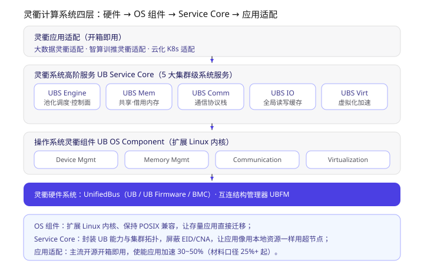
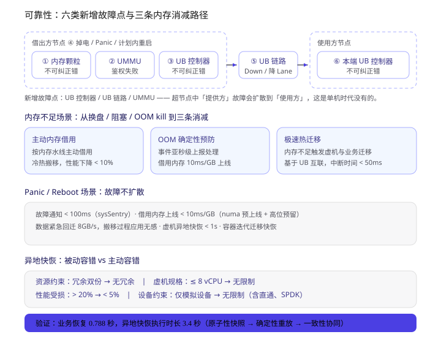
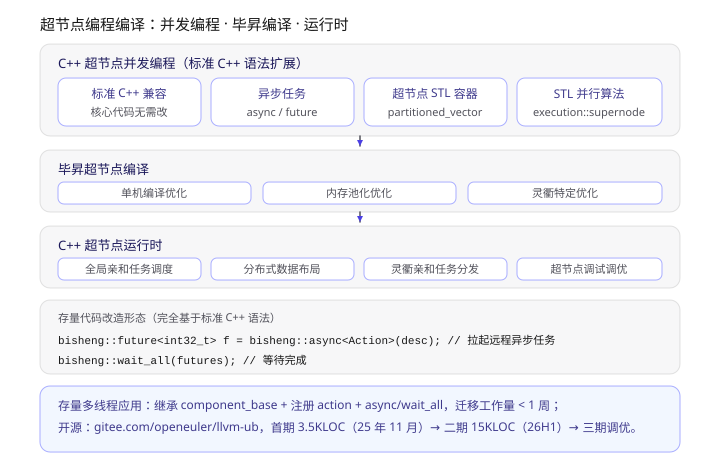
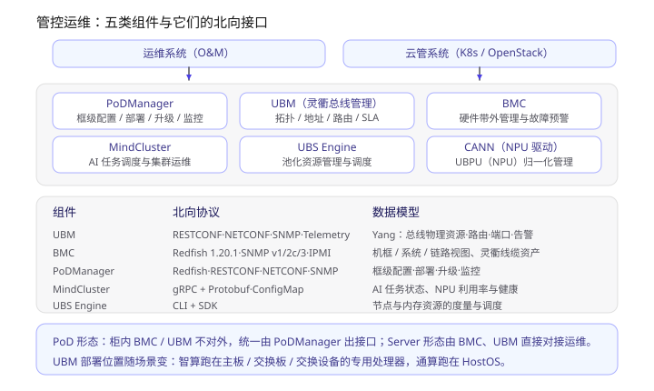

> 学习材料：*灵衢系统高阶服务软件架构参考设计 2.0*（26 页，下称 **Service Core 参考设计**）、*超节点可靠性关键技术*、*超节点编程编译关键技术*、*基于灵衢的超节点管控运维软件架构与接口参考设计 2.0*（28 页）、*灵衢系统高阶服务关键技术和应用*。
> 前两篇分别讲了协议本身和它在 OS 里的落地，这一篇把剩下的四份读完：**集群级系统服务、可靠性、编程编译、管控运维**。第四篇《灵衢 UnifiedBus 学习笔记（四）：超节点是怎么连起来的》补的是最后一块——组网与拓扑（UB-Mesh）。文中「3.2.2」「4.3」这类编号对应 Service Core 参考设计的章节。

**一句话概括**：如果说 UB OS Component 让操作系统"认得"灵衢，那 **UB Service Core 就是让应用"用得上"灵衢**——它在集群层面封装掉 EID、CNA 这些 ID 体系和拓扑细节，把池化内存、跨节点通信、全局缓存、虚拟化加速包装成五类服务；再往上还有可靠性兜底（故障不扩散）、编程模型（C++ 直接写超节点）和管控运维（Redfish / NETCONF 那一套）。

读下来最关键的几点：

1. **四层分工很清楚**：硬件系统（UB + UBFM）→ OS 组件（扩展内核、保 POSIX）→ Service Core（集群级服务）→ 应用适配（开源开箱即用）。
2. **UBS Engine 是控制面核心，也是 UBPRM 的一种实现**：内部拆成 EngineBase / uCache / RMRS / VirtAgent 四个模块，分别对应基础池化、全局 IO 缓存、碎片再利用、虚机削峰填谷。
3. **UBS Mem 把"内存"拆成四种语义**：统一编址（MemFabric）、共享（SHMEM）、缓存（MemCache，弱一致、高带宽）、存储（MemStore，强一致、低时延）。
4. **UB 把故障域扩大了**：新增 UB 控制器、UB 链路、UMMU 三类故障点，且"提供方故障会扩散到使用方"——可靠性材料的核心就是这个扩散怎么消减。
5. **可靠性有明确的时间指标**：故障通知 < 100 ms、借用内存上线 10 ms/GB、数据回迁 8 GB/s、虚机恢复 < 1 s（实测业务恢复 0.788 s）。
6. **编程模型想让 C++ 直接写超节点**：`bisheng::async` + `future` + `partitioned_vector` + `execution::supernode`，目标是存量多线程应用一周内迁移。

---

## 一、全景：灵衢计算系统分四层



> 上图从上到下是应用适配、UB Service Core、UB OS Component、灵衢硬件系统；底部三行是每一层各自要解决的问题。

Service Core 参考设计 2.1 把整个系统拆成四层，每层的职责边界很干净：

1. **灵衢硬件系统**：UnifiedBus（UB / UB Firmware / BMC）+ **UBFM**，负责总线级互联、协议归一、平等协同、全量池化、大规模组网、高可用，并"优化计算互联 SLA（时延、带宽、可靠性）"。
2. **操作系统灵衢组件**：扩展 Linux 内核原生支持超节点，**同时保持 POSIX 接口兼容**，让存量应用能直接迁移。
3. **灵衢系统高阶服务（UB Service Core）**：充分发挥内存池化、通信、分布式操作的优势，同时**简化资源管理与调度的复杂性**。
4. **灵衢应用适配**：围绕大数据、智算训推、云化 K8s 等主流开源做适配，实现开箱即用。

为什么要多出 Service Core 这一层？文档 2.2 说得很直白：**传统 Linux 是为单机准备的，它调度的资源是单节点内的资源**（内存、PCIe 设备）。超节点把几十上百个节点连成一个资源池，中间必须有一层来"封装 UB 底层能力、集群拓扑等，简化并兼容现有生态，让应用用本地资源一样使用超节点资源"。目标是**使能应用加速 30~50%**。

## 二、UBS Engine：控制面核心

UBS Engine 的定位是"超节点控制引擎"，也就是**第二篇里反复出现的 UBPRM 的一种参考实现**。它提供四项核心能力：

1. **简单易用**：屏蔽 EID、CNA 等 UB ID 体系，统一对接集群 UBFM 和 OS，对外只给一套简化北向 API；
2. **资源池化 + 负载感知调度**：构造内存池化、DPU 池化，支持业务感知的节点间内存动态调度；
3. **去中心化**：支持 **N 节点场景下最多 N-1 节点失效**的高可用，目标是 3 个 9 → 4 个 9；
4. **开放管控信息**：支持与 Prometheus 生态兼容的监控度量，部署、巡检、日志等运维能力北向开放。

内部拆成四个模块（3.2.2），这个拆解很能说明它在解什么问题：

| 模块 | 干什么 | 解决什么 |
| --- | --- | --- |
| **EngineBase** | UB 逻辑资源创建删除（bus instance、bonding eid 等）+ 内存池化基础管理（调度、借用、归还、故障处理） | 底座，整体去中心化 |
| **uCache** | 把集群各节点剩余内存组成**全局 IO 缓存池** | IO 瓶颈应用 |
| **RMRS** | 基于集群内存碎片分布，用内存借用把碎片重新利用起来 | 多开虚机、提升资源利用率 |
| **VirtAgent** | 基于各节点内存使用信息做**削峰填谷** | 虚拟化资源利用率 |

六个典型使用场景（3.3）：共享内存（数据库/大数据主备同步）、虚拟化内存超分（按水线自动借用，避免虚机因内存不足退出）、虚拟化内存碎片（把冷数据放到远端碎片内存，腾空本地内存）、超大规模虚机（**组合集群内存创建 3T 以上规格**）、IO 加速（借内存扩展 PageCache）、节点内存不足（OOM 流程触发快速借用）。

## 三、UBS Mem：把"内存"拆成四种语义

UBS Mem 的核心职能有四个（4.1），区分它们的维度是**一致性强度与带宽/时延取向**：

| 组件 | 提供什么 | 一致性 / 性能取向 | 典型场景 |
| --- | --- | --- | --- |
| **MemFabric** | 分布式系统的**内存统一编址与数据访问**基础能力 | 基础设施，基于 UB/RoCE 做跨机统一虚拟编址，基于 xDMA 做统一数据访问 | 所有上层语义库的底座 |
| **SHMEM** | 超节点内共享内存服务 | 通算：**CPU 直驱的跨机 C2C 共享内存**，软件维护 Cache Coherence；智算：**NPU 直驱的跨机 D2D 共享内存** | 数据库多主、Global Buffer Pool |
| **MemCache** | 内存缓存服务 | **弱一致 + 高带宽**（利用 UB 多通路并发） | 大模型推理 **KV Cache** |
| **MemStore** | 内存存储服务 | **强一致 + 极低时延**（利用 UB Memory C2C），支持多副本 | 金融场景的多副本内存存储 |

架构上只有两层：**语义层**（SHMEM / MemCache / MemStore API）和**基础设施层**（屏蔽语义层与硬件差异，提供统一编址与数据访问）。这个分层其实照搬了"存储层次"的思路——把远端内存按一致性和性能要求切成缓存和存储两种用法。

注意 SHMEM 那句"软件实现跨机器 Cache Coherence 维护"，正好对应第二篇第 5 节的 **Ownership**：C2C 场景没有硬件一致性，靠软件按段维护。

## 四、UBS Comm：四个关键特性（补一个 HCAL）

第二篇里我按峰会材料的说法写了 UBSocket / ROUB / HCOM 三个，Service Core 参考设计里是四个，命名也略有差异：

| 特性 | 北向 | 南向 / 关键机制 | 场景 |
| --- | --- | --- | --- |
| **HCOM** | 统一 UB Native API | 屏蔽 RDMA、TCP、URMA、SHM 等低级 API 的差异，自适应发挥硬件能力 | 通用高性能通信 |
| **Socket** | 兼容 socket（即峰会材料里的 UBSocket） | 数据面 **Bypass TCP/IP**，应用零修改 | Redis 等存量网络应用 |
| **HCAL**（异构通信加速库） | CPU ↔ xPU 直传（D2H 等） | 借道通信提升 KV Cache 性能；**以插件形态接入 NIXL / Transfer Engine** | AI 推理 KV Cache 传输 |
| **RoUB** | **RDMA Verbs 语义** | 把 UB 网络接口转成 verbs 接口 | 存量 RDMA 应用无感迁移 |

**HCAL 是我这次新学到的一个点**：它把"CPU 和 xPU 之间搬数据"这件事单独拎出来做成库，并且主动去适配 NIXL / Transfer Engine 这两个生态中间件——说明灵衢在推理 KV Cache 这条链路上是想直接接进现有生态，而不是另立标准。

架构同样两层：**北向接口层**（Socket + UB Native）与**南向适配层**（屏蔽应用层与硬件差异，支持跨代际演进）。

## 五、UBS IO：缩短 IO 路径

UBS IO 的两个主要功能：

1. **UBS IO 缓存**：基于超节点做**应用亲和的全局数据读写缓存**，缩短 IO 访问路径；
2. **NPU Direct SSD / SSU**：bypass Memory 上的数据直通到本地 SSD/SSU，提高本地 DRAM 带宽利用率，加速 HBM ↔ SSD/SSU 的传输。

五个功能模块（6.2.2）：

- **APP-Aware acceleration**：识别应用数据访问模式，**提前预取或淘汰**；
- **多协议支持**：POSIX / HDFS / block；
- **Cache Daemon**：缓存空间管理、数据访问、跨节点数据读取；
- **Metadata Acceleration**：用网卡 / DPU 硬件加速 IO 元数据访问；
- **HBM Direct**：HBM 到存储介质（SSD/SSU）或存储系统（如 OceanDisk）的直通。

四个场景：Spark/Hive 数据分析 IO 加速（存算分离下加速状态数据保存）、**大模型训练 CKPT 加速**（缓存加速保存、预取缩短故障恢复时间）、**推理 KV Cache 加速**（HBM 数据直通本地或远端存储，提高带宽）、HPC 小文件缓存（利用节点间高速网络快速访问海量小文件）。

## 六、UBS Virt：三件套

UBS Virt 是虚拟化场景套件，三大职能是网络使能、超级虚拟化使能、xPU 虚拟化加速。拆成三个特性：

**① Virt OVS**（网络虚拟化）：Network Configuration 模块配置 **EID、UPI、TP、优先级**等事务层和传输层属性来实现多租隔离与 QoS；**UVS（Unified Virtual Switch）** 模块做虚拟网络 TP 层协商建链；Table Management 持久化 SIP / DIP / vTP 表项以支持重启恢复；外加 CLI 工具。

**② Virt Optimizer**（智算虚拟化调优）：加速套件（NPU 加速库，覆盖计算/存储/网络）+ Agent（Host/Guest 自动化探测调优，Guest 内 HDK 虚拟化驱动与 Hypervisor 协同加速）。

**③ Virt VM**（超大规格虚机）：九个模块值得记一下——配置管理（解析云管下发的超节点拓扑）、Timer Sync（**超节点内 Guest OS 时间同步**）、I/O Handler、Interrupt Handler（vGIC 中断转发）、Heartbeat Handler（探测 UB 链路与 QEMU 状态），以及 KVM 侧的 Page Table Management（GPA/HVA 映射）、Interrupt Handler（MSIX 转发）、**Distributed Memory Management（Host OS 内存状态同步：share / modify / pin）**、Timer Sync。

其中 **Distributed Memory Management** 那一项是"跨节点虚机"才需要的——单机虚机的内存状态不需要在 Host 之间同步。

## 七、可靠性：六类故障点与三条消减路径



> 上图上半是借出方 → UB 链路 → 使用方的链路上标出的六个故障点（①~⑥）；下半是内存不足场景的三条消减、Panic 场景的四个时间指标，以及被动容错与主动容错的对比。

### 新增了什么风险

超节点把内存借来借去，同时也**把故障域扩大了**。可靠性材料列了六类故障模式：

| # | 故障模式 | 分类 | 影响 | 目标与措施 |
| --- | --- | --- | --- | --- |
| ① | 借出方内存颗粒不可纠正错误 | 借出方内存颗粒故障 | 单点 panic、业务终止 | **远端内存故障主机不宕机**：故障隔离、内存故障预测 + 虚机热迁移、借用内存专款专用、精细化处理免挂死 |
| ② | UMMU 不可纠正错误 / 鉴权失败 | UB 控制器 / UMMU 故障 | 同上 | 同上 |
| ③ | 借出方 UB 控制器不可纠正错误 | UB 控制器故障 | 同上 | 同上 |
| ④ | OS Panic / 异常掉电 / 计划内重启 | 整机故障 | **借用节点业务终止** | **业务无影响**：Panic/Reboot 场景借用内存数据回迁 |
| ⑤ | 端口 Down / 链路损坏 / **降 Lane（亚健康）** | UB 链路故障 | 跨节点不可访问 / 性能下降 | 故障不扩散、业务无影响：链路冗余、链路质量检测与故障隔离 |
| ⑥ | 使用方本端 UB 控制器不可纠正错误 | UB 控制器故障 | — | 同 ②③ |

核心矛盾一句话：**"超节点中资源提供方故障，可扩散至使用方"**。所有消减措施都围绕"切断扩散"展开。

### 三条消减路径（内存不足场景）

传统单机在内存不足时的三条路都是坏的：换出到磁盘（性能下降）、同步整理内存（业务阻塞）、OOM killer 杀进程（业务终止）。超节点给的三条替代路径是：

1. **主动内存借用**：按系统内存水线主动触发，配合冷热搬移，**业务性能下降 < 10%**；
2. **OOM 确定性预防**：进程/虚机在 OOM 前触发紧急借用，OOM 事件**亚秒级上报处理**，借用内存 **10 ms/GB** 上线；
3. **极速热迁移**：内存不足时触发虚机与业务迁移，基于 UB 高速互联使**迁移中断时间 < 50 ms**。

### Panic / Reboot 场景：抢时间

这一组数字是整个可靠性材料里最有信息量的：

- 故障通知 **< 100 ms**（sysSentry 基于 UB 链路的快速故障通知）；
- 内存极速决策调度 **< 3 ms**；
- 借用内存快速上线 **< 10 ms/GB**（靠 **numa 预上线 + 高位预留**）；
- 数据紧急回迁 **8 GB/s**，搬移过程**应用无感**；
- 虚机异地快恢：业务恢复 **< 1 s**。

另外还有一条很容易忽略的设计：**"借用内存专款专用"**——借来的内存不能被内核随便动用，防止故障影响内核导致整机 panic。

### 异地快恢：被动容错代替主动容错

传统 HA 恢复要 3~5 分钟，而基于 Qemu COLO 这类主动容错方案又有硬伤。材料给了对比：

| 维度 | 主动容错 | 被动容错（灵衢方案） |
| --- | --- | --- |
| 资源约束 | 冗余备份（内存/CPU 双份） | **无** |
| 虚机规格约束 | ≤ 8 vCPU | **无限制** |
| 性能受损程度 | > 20% | **< 5%** |
| 设备约束 | 仅支持模拟设备 | **无限制** |

三个关键技术：**虚机原子性快照**（对 VCPU 陷出事件、IO、网络包做实时原子快照，双缓存保护状态完整性）、**虚机确定性重放**（从池化内存恢复快照，回溯到上一个检查点，对丢失的 in-flight 事件做确定性重放）、**虚机一致性协同控制**（备节点预创建备虚机，故障前同步状态，故障后秒级拉起）。

实测：**业务恢复 0.788 秒，异地快恢执行时长 3.4 秒**。开源节奏是 2025 年 11 月首批开源（openeuler/kernel、openeuler/sysSentry、openeuler/ubs-engine），26 年 H2 增强特性逐步开源。

## 八、编程编译：让 C++ 直接写超节点



> 上图是三层结构（C++ 并发编程 / 毕昇超节点编译 / C++ 超节点运行时），中间是存量代码的改造形态示例，底部是开源计划。

**问题**很实在：超节点是区别于传统集群的新硬件形态，而 MPI、RDMA 这套面向多机的分布式编程模式**用不上灵衢的总线优势**；同时通用计算/HPC 有大量存量 C/C++ 单机多线程应用，"颠覆式"改造成分布式成本太高。

**解法**是三件套（材料里的硬件背景是 TaiShan 950 SuperPoD，2026 Q1，最大 16 节点、最大 48T 内存，支持内存 / SSD / DPU 池化）：

1. **C++ 超节点并发编程**：扩展 C++ 标准多线程并发接口，使能分布式编程，让存量多线程代码**微改造达成分布式化**；
2. **毕昇超节点编译**：在单机编译基础上，针对灵衢内存池化场景和访存硬件特性做优化；
3. **C++ 超节点运行时**：把超节点当整体，基于亲和性做数据和任务调度，并实现高速任务分发。

落到代码上，改造量确实很小——**完全基于标准 C++ 语法，核心函数与数据结构无需修改**：

```cpp
// 1. 继承 component_base，让 class 可以被远程创建和访问
template <typename T>
class BuildGraph : public bisheng::components::component_base<BuildGraph<T>> { ... };

// 2. 注册成员函数，使能远程执行
BISHENG_DEFINE_COMPONENT_ACTION(BuildGraph, DoVectorCluster, DoVectorClusterAction);

// 3. 拉起远程异步任务 + 等待完成
bisheng::future<int32_t> f = bisheng::async<DoVectorClusterAction>(targetTaskDesc);
bisheng::wait_all(futures);
```

配套还有两块：**超节点 STL 容器**（`partitioned_vector`、`unordered_map`，数据按 partition 以 round-robin 分布到各 locality，支持两段式遍历）和**超节点 STL 并行算法**（在 `std::execution::seq/par/par_unseq/unseq` 之外新增 `bisheng::execution::supernode` 与 `bisheng::execution::npu`）。

运行时做两件事：**数据亲和的全局任务调度**（兼顾访存亲和性与全局负载均衡）和**分布式动态数据布局管理**（按冷热与亲密度在运行时迁移数据）。

开源计划：<https://gitee.com/openeuler/llvm-ub>，首期约 3.5 KLOC（25 年 11 月，基本编程接口）→ 二期约 15 KLOC（26 H1，高级接口与运行时）→ 三期约 5 KLOC（调试调优）。

## 九、管控运维：五类组件与它们的北向接口



> 上图上半是运维系统/云管系统与五个管控组件的对接关系，下半是各组件的北向协议与数据模型。

管控运维这份材料（28 页）主要讲的是**接口**，对开发者来说是最"工程"的一份。五个组件：

| 组件 | 定位 |
| --- | --- |
| **UBS Engine** | 控制引擎，池化资源管理与调度（即第二节那个） |
| **MindCluster** | 智算集群系统软件，AI 任务的资源感知、调度、稳定运行 |
| **PoDManager** | PoD 形态下**框级统一运维**管理软件（配置、部署、升级、监控） |
| **UBM**（UnifiedBus Management） | 灵衢总线的管控面软件 |
| **BMC** | 硬件带外管理核心部件（健康监测、远程控制、故障预警） |

**UBM 值得单独说**，它的功能正好是协议栈在网络层的管理面映射（4.2）：

- **总线 Fabric 使能**：拓扑管理（支持 **UB MESH、CLOS** 拓扑，动态感知设备/链路变化）、互联地址管理（**CNA & EID 的分配与回收**）、CNA 路由管理；
- **总线资源管理**：UBPU / Entity 资源与 UB Memory 转发能力的规划配置，提供 URMA 建链服务和虚机 UB 总线资源服务；
- **总线业务 SLA 管理**：拥塞避免、**VL 管理、信用证管理**——这三项正好对应第一篇里网络层和链路层的机制；
- **运维管理**：故障定界、性能监测、Telemetry 主动推送；
- **北向接口**：NETCONF / RESTCONF / SNMP Trap / Telemetry。

部署形态有差异：**PoD 形态下柜内 BMC 和 UBM 不对外提供接口，统一由 PoDManager 出接口**；Server 形态下 BMC 与 UBM 直接对接运维系统。UBM 的运行位置也随场景变：智算跑在主板 / 交换板 / 交换设备的专用处理器，**通算跑在 HostOS**。

接口矩阵（按材料第 3 章整理）：

| 组件 | 协议 | 数据模型 |
| --- | --- | --- |
| UBM | RESTCONF / NETCONF / SNMP Trap / Telemetry | 基于 **Yang 模型**的总线物理资源、路由管理、端口管理、告警 |
| BMC | **Redfish 1.20.1** / SNMP v1·v2c·v3 / **IPMI 1.5·2.0** | 机框 / 系统 / 链路视图，新增灵衢线缆、池化节点等资产与故障管理 |
| PoDManager | Redfish（HTTP/1.1、HTTP/2，JSON）/ RESTCONF / NETCONF / SNMP / Telemetry | 物理资源、任务、事件、证书服务模型 |
| MindCluster | gRPC + Protobuf / ConfigMap / Prometheus | AI 任务状态、AI 处理器资源与利用率 |
| UBS Engine | CLI / SDK | 节点与内存资源的监控度量与调度管理 |

一句话总结这一章：**灵衢没有发明新的运维协议，而是把 Redfish / NETCONF / SNMP / IPMI / Prometheus 这一整套既有生态接了进来**，只在数据模型侧扩展了"灵衢线缆""池化节点""总线物理资源"这些新对象。

## 十、三篇串起来的全景

| 层次 | 关键机制 | 对应本篇/前篇 |
| --- | --- | --- |
| 协议 | 六层栈、四类事务、ROI/ROT/ROL、UBMD 四级查表 | 第一篇 |
| OS | UBRT→ubfi/ubus、User/Home 访存、EXPORT/IMPORT、Ownership、UMDK、vfio-ub、RAS 五路径 | 第二篇 |
| 集群服务 | UBS Engine / Mem / Comm / IO / Virt | 本篇二~六节 |
| 可靠性增强 | 六类故障点、三条消减、异地快恢 | 本篇七节 |
| 编程模型 | Matrix C++ 并发编程 + 毕昇编译 + 超节点运行时 | 本篇八节 |
| 管控运维 | UBM / BMC / PoDManager / MindCluster + Redfish·NETCONF·SNMP·IPMI | 本篇九节 |

**下一步我打算做的**：

1. 找一台装了 openEuler + 灵衢的环境，把第二篇提到的 sysfs 路径（`/sys/bus/ub`、`/sys/devices/obmm`）和 `lsub` / `urma_admin` / `ums_admin` 实际跑一遍，把抽象结构对上真实目录；
2. 跟 <https://gitee.com/openeuler/llvm-ub> 的代码，看 `bisheng::async` 的 action 注册与分发到底怎么落到 URMA / URPC 上；
3. 读 UB-Mesh 论文，把"UB MESH 拓扑"这一块补上（管控材料里只提了名字）；
4. `UB-Service-Core-SW-Arch-RD` 里每个组件都只给了架构图没有接口细节，等开源仓库（ubs-engine、sysSentry）放出来后对照实现再看一遍。

参考：

- 《灵衢基础规范 2.0》——术语与协议细节的权威来源
- 《灵衢使能操作系统参考设计 2.0》——第二篇主线
- 《灵衢系统高阶服务软件架构参考设计 2.0》——本篇主线
- 《基于灵衢的超节点管控运维软件架构与接口参考设计 2.0》
- 《超节点可靠性关键技术》《超节点编程编译关键技术》《灵衢系统高阶服务关键技术和应用》
- 灵衢官网 <https://www.unifiedbus.com>；UB Service Core 社区页 <https://www.openeuler.org/zh/projects/ub-service-core/>
- 开源仓库：<https://gitee.com/openeuler/ubs-engine>、<https://gitee.com/openeuler/sysSentry>、<https://gitee.com/openeuler/llvm-ub>
