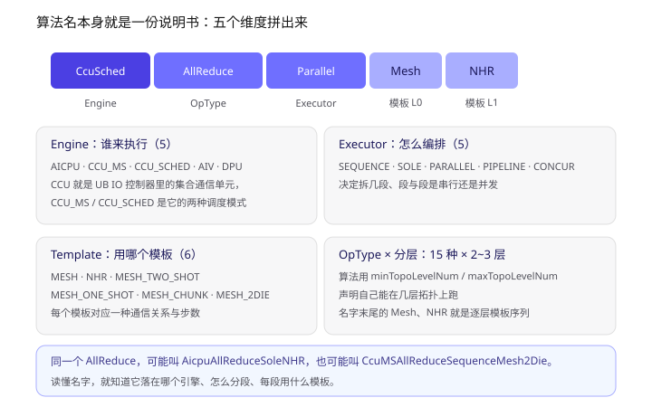
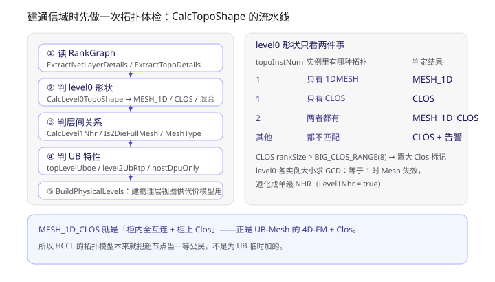
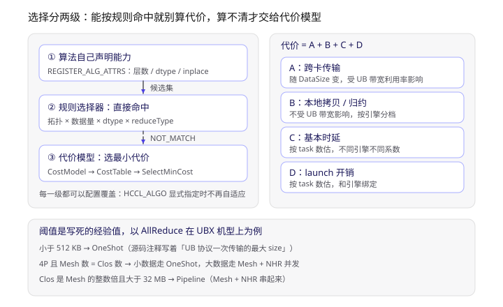
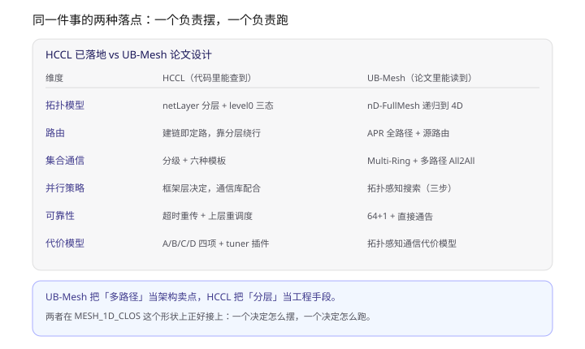

> 材料：`C:\gitRepo\hccl` 仓库源码（CANN HCCL 的新一代实现）+ 仓库自带文档 `docs/zh/user_guide/coll_algo_intro/`。文中的文件路径都是仓库内相对路径，函数名可以直接搜到。
> 姊妹篇《灵衢 UnifiedBus 学习笔记（四）：超节点是怎么连起来的》讲的是**硬件怎么摆**；这一篇讲**摆好之后，软件怎么在里面选算法**。两篇在「柜内全互连 + 柜上 Clos」这个形状上正好接上。

**一句话概括**：HCCL 选算法不是一堆 if/else，而是分三层——算法自己声明「我在什么拓扑下能用」，规则选择器按「拓扑 + 数据量 + dtype」直接命中，命不中才交给 A/B/C/D 四项代价模型取最小。读懂 `CcuSchedAllReduceParallelMeshNHR` 这种名字，等于读懂了它的三层。

要点：

1. **算法名是个五元组**：Engine（5 种）× OpType（15 种）× Executor（5 种）× Template（6 种）× 分层数（2~3）。
2. **建通信域时先做一次拓扑体检**：`CalcTopoShape` 十二步，最后落成 `MESH_1D` / `CLOS` / `MESH_1D_CLOS` 三态。
3. **`MESH_1D_CLOS` 就是「柜内全互连 + 柜上 Clos」**——正是上一篇 UB-Mesh 的 4D-FM+Clos。
4. **GCD 等于 1 时 Mesh 失效**，自动退化成单级 NHR；文档里「NHR-HCF 取最大公约数」的出处就在这里。
5. **两级选择器**：规则优先，`NOT_MATCH` 才走代价模型；tuner 插件还能在代价模型上再改一刀。
6. **代价是 A+B+C+D 四项**，比教科书的 α-β 模型多了 launch 项，而且 A 项注释里明确写了「受 UB 带宽利用率影响」。
7. **阈值是硬编码经验值**，连「UB 协议一次传输最大 512 KB」这种都写在常量注释里——所以别把某个阈值当规格背。

---

## 一、先把一个算法名拆开



> 上图最上面把 `CcuSchedAllReduceParallelMeshNHR` 拆成五段，下面四张卡是前四个维度的取值集合；第五个维度（分层）藏在名字末尾的 `Mesh`、`NHR` 里，是逐层的模板序列。

`src/ops/op_common/selector/hccl_algo_dims.h` 里把四个维度写成了枚举，非常直白：

| 维度 | 取值数 | 取值 |
| --- | --- | --- |
| Engine | 5 | `AICPU` / `CCU_MS` / `CCU_SCHED` / `AIV` / `DPU` |
| Executor | 5 | `SEQUENCE` / `SOLE` / `PARALLEL` / `PIPELINE` / `CONCUR` |
| Template | 6 | `MESH` / `NHR` / `MESH_TWO_SHOT` / `MESH_ONE_SHOT` / `MESH_CHUNK` / `MESH_2DIE` |
| OpType | 15 | AllReduce / AllGather / ReduceScatter / AlltoAll(V/VC) / Send / Recv … |

所以名字是可以逐段读的：

```
CcuSched  AllReduce      Parallel        Mesh      NHR
Engine    OpType         Executor        L0 模板    L1 模板
```

再举两个真实的：

- `CcuMSAllReduceSoleMeshOneShot` —— CCU 的 MS 模式、单段、单个 Mesh 模板、大数据用小包直发（OneShot）。
- `AicpuBroadcastSequenceMeshConcurNHR` —— AICPU 引擎、SEQUENCE 编排、L0 是 Mesh、L1 是 NHR、中间还夹了个 Concur（并发）。

**这里有个读源码才会发现的坑**：`hccl_algo_dims.h` 里 Engine 是 `CCU_MS / CCU_SCHED` 两分，而 `selector/cost_model.h` 里的 `EngineType` 又是 `AICPU / CCU / CCU_CIR_MODE / AIV / CPU`。同一个仓库里两套枚举不完全对齐——所以看到 Engine 相关的分支，得先确认它用的是哪一套。这种不一致不是 bug，是两处代码演化节奏不同，但足以让只读文档的人猜错。

---

## 二、拓扑体检：CalcTopoShape



> 上图左边是通信域初始化时 `CalcTopoShape` 的执行顺序（简化成五组），右边是 `CalcLevel0TopoShape` 的判定表，以及两条会影响后续所有选择的特殊规则。

入口在 `src/ops/op_common/topo_info/topo_host.cc` 的 `CalcTopoShape`，顺序是写死的：

```cpp
ExtractNetLayerDetails   // 拿 netLayer 列表、每层实例数、每实例 rank 数
CalcLevel1Nhr            // L1 是否退化成 NHR
ExtractTopoDetails       // 每层有哪些 topo 实例、什么类型、含哪些 rank
CalcLevel0TopoShape      // L0 是 MESH_1D / CLOS / MESH_1D_CLOS
Is2DieFullMesh           // 双 die 是否全互连
IsLevel0PcieMix          // L0 是否 PCIe 混插
CalcLevel0MeshType       // SINGLE_DIE / TWO_DIE_REGULAR / TWO_DIE_NOT_REGULAR
CalcTopLevelUboe         // 顶层是否 UBoE
CalcLevel2UbRtp          // L2 是否走 UB RTP
CalcHostDPUOnly          // 是否只有 host 侧 DPU
CalcDeviceFormFactor     // 本卡是不是 POD 机型
BuildPhysicalLevels      // 建物理层视图，供代价模型用
```

这一串结果全部塞进 `TopoInfoWithNetLayerDetails`（同目录 `alg_param.h`），后面所有选择器都只读这个结构体。**换句话说：拓扑识别只做一次，选择做很多次。**

这个结构体值得单独看一眼，它其实是整套逻辑的「输入契约」：

```cpp
u32 topoLevelNums;
Level0Shape level0Topo;      // CLOS / MESH_1D / MESH_1D_CLOS
bool Level0Nhr, Level1Nhr, Level1Hd;
bool is2DieFullMesh, level0PcieMix, level0BigClosRange;
bool topLevelUboe, level2UbRtp, hostDpuOnly;
bool level0Symmetric, level1Symmetric;
bool isPod;
Level0MeshType level0MeshType;
NetLayerDetails netLayerDetails;   // 每层实例数、每实例 rank 数
std::vector<PhysicalLevelInfo> physicalLevels;
```

`topLevelUboe`、`level2UbRtp` 这两个字段很能说明问题：**UB 在 HCCL 的拓扑模型里不是「一种网卡」，而是可以出现在不同层级的不同传输形态**（顶层走 UBoE，第二层走 UB RTP）。这也解释了为什么选择器里会出现 `SelectMeshUBXAlgo` 这种函数。

---

## 三、level0 三态，和两条会改变一切的规则

`CalcLevel0TopoShape` 的逻辑短到可以全文背下来，它只看两件事：**这一层有几个 topo 实例**、**实例里是哪种拓扑**。

| topoInstNum | 实例里的拓扑类型 | 判定 |
| --- | --- | --- |
| 1 | 只有 `COMM_TOPO_1DMESH` | `MESH_1D` |
| 1 | 只有 `COMM_TOPO_CLOS` | `CLOS` |
| 2 | 两种各一个 | `MESH_1D_CLOS` |
| 其他 | 都不匹配 | 默认 `CLOS` + 打 WARNING |

每一条判定都还带一个校验：拓扑的 `rankSize` 必须等于这一层的 `localNetInsSizeOfLayer`，不等就报错。这个校验很关键——它保证「我以为的拓扑」和「RankGraph 里的拓扑」是一回事，而不是两边各自演进。

**规则一：大 Clos 标记。**

```cpp
if (rankNumForTopoType[COMM_TOPO_CLOS].at(0) > BIG_CLOS_RANGE) {  // BIG_CLOS_RANGE = 8
    topoInfo->level0BigClosRange = true;
}
```

超过 8 个 rank 的 Clos 会被单独标记，后面有些算法会据此换模板。

**规则二：GCD 退化（这条最有意思）。**

`CalcLevel1Nhr` 干了这么件事：取 level0 各实例的 rank 数，求最大公约数。

```cpp
u32 gcd = instSizeList[0];
for (...) { /* 辗转相除 */ }
// 注释原文：当 Level0 GCD 为 1 时，Mesh 无意义，需要退化为单级 NHR
```

举文档里的例子：超节点间各个 Server 卡数一致、但 Server 数不一致时（比如 4 卡 + 2 卡 → GCD 2），还能切出对称的逻辑超节点；一旦 GCD 掉到 1，框内 Mesh 就切不齐了，只能把整层当成一个单级 NHR 来做。

**这就是 `algo_intro.md` 里那段「NHR-HCF 通过计算超节点间 Server 数的最大公约数，将通信域切分为多个对称分布的逻辑超节点」的源码出处。** 文档讲的是现象，源码给的是实现——两边对着看才能确认自己理解对了。

---

## 四、两级选择器



> 上图左边是选择的三步（声明 → 规则命中 → 代价模型），中间虚线是「没命中就往下走」的回退路径；右边是代价模型的四项。底部是 AllReduce 在 UBX 机型上的几条实际阈值。

**第一级是「算法自己声明」。** 每个算法在注册时就写清楚自己的适用条件，在 `src/ops/<op>/algorithm/executor/` 下随处可见：

```cpp
REGISTER_EXEC_V2_MULTI(
    HcclCMDType::HCCL_CMD_BROADCAST, AicpuBroadcastSequenceMeshConcurNHR,
    BroadcastSequenceMesh1dNHRNHRExecutor, TopoMatchTwoLevel,
    AicpuTempScatterMesh1DZAxisDetour,     // Scatter L0（框内，Z 轴绕路）
    InsTempScatterNHR,                     // Scatter L1（框间）
    InsTempScatterNHR,                     // Scatter L2（跨超节点）
    InsTempAllGatherNHR,                   // AllGather L2
    InsTempAllGatherNHR,                   // AllGather L1
    InsTempAllGatherMesh1D1DZAxisDetour);  // AllGather L0

REGISTER_ALG_ATTRS(AicpuBroadcastSequenceMeshConcurNHR,
    topo.minTopoLevelNum = 2; topo.maxTopoLevelNum = 2;
    topo.supportLevel0Topos = LEVEL0_TOPO_MESH_1D;
    topo.isSupportLevel1Nhr = false;
    op.unsupportedDataTypes = UNSUPPORTED_64BIT; ...);
```

注意 `REGISTER_EXEC_V2_MULTI` 后面那一串模板：**这就是「分层」这个维度在代码里的样子**。有意思的是，哪怕这个算法只声明两级拓扑（`minTopoLevelNum = 2`），模板列表也照样写满六段——Scatter 的 L0/L1/L2 加 AllGather 的 L2/L1/L0。段位是固定的，**真正用几段由 `minTopoLevelNum` / `maxTopoLevelNum` 卡住**。

而且首尾两段都是 `ZAxisDetour` 变体——框内绕路，专门用来规避「一个 rank 通过同一个端口给多个 rank 发数据」的一打多问题。

**第二级是规则选择器。** 每个算子一个 `XxxAutoSelector`，比如 `src/ops/all_reduce/selector/all_reduce_auto_selector.cc`，逻辑就是一连串带注释的短路判断：

```cpp
if (IsTwoLevelNetLayer(...) && userRankSize == 2 && dataSize >= AR_2P_DETOUR_DATA_SIZE) {
    return SelectorStatus::NOT_MATCH;   // 2P 大数据回退给 AICPU
}
if (level0Topo == Level0Shape::MESH_1D) {
    if (level0MeshType == Level0MeshType::TWO_DIE_REGULAR) {
        selectAlgName = IsSmallData(dataSize) ? "CcuMSAllReduceSoleMesh2Die"
                                              : "CcuMSAllReduceSequenceMesh2Die";
    } else if (IsSmallData(dataSize)) {
        selectAlgName = "CcuMSAllReduceSoleMeshOneShot";
    }
    ...
} else if (level0Topo == Level0Shape::MESH_1D_CLOS) {
    return SelectMeshUBXAlgo(topoInfo, selectAlgName, dataSize);
}
```

**第三级是代价模型。** `SelectorEngine::Run` 的私有方法把流程写得很清楚：`InitCostModel` → `TunerEnrichCostTable` → `SelectMinCost`。也就是说，规则没命中时，把候选算法全算一遍代价，取最小的；tuner 插件还允许在中间插一脚改 cost。

文档里那句「若通过 `HCCL_ALGO` 指定了算法，自适应不再生效」，对应的是 `needSoftPolicyCheck` 这个字段：用户显式配置或 tuner 接管时置 false，软策略检查直接跳过。

---

## 五、代价模型：A + B + C + D

教科书上讲集合通信用 Hockney 的 α-β 模型（`D = α + nβ + nγ`），`algo_intro.md` 里也是这么写的。但代码里的 `CostModelParam` 是四项：

| 项 | 含义（注释原文） |
| --- | --- |
| **A** | 跨卡传输时间随 DataSize 变化的趋势，**会受到 UB 带宽利用率的影响** |
| **B** | 本地传输时间随 DataSize 变化的趋势，**不受 UB 带宽利用率影响** |
| **C** | 基本时延的常数项 |
| **D** | launch 开销 |

比 α-β 多的那一项是 D（launch）。这是个很工程化的修正：算法拆得越细，task 数越多，每次下发的固定开销就越不可忽略——`CalcLatencyParams(taskNum, engine, C)` 和 `CalcLaunchParams(taskNum, engine, D)` 都是按 **task 数 × 引擎系数** 算的，而且引擎不同系数不同（AICPU 和 CCU 的下发代价不是一个量级）。

`CostModelManager` 里 A 和 B 也是分开算的：`CalcMeshParam` / `CalcNHRParams` 算跨卡的 A，`CalcLocalCopyParams` / `CalcLocalReduceParams` 算本地的 B。带宽表有 8 个（本地拷贝、本地归约、跨片、跨片归约，再各自分 CCU 普通 / CCU 环形两套）。

还有一个设计我很喜欢：`AlgNetMeta` 里每个算法登记的是一组「段」：

```cpp
std::vector<CommTopo> netTypes;        // 每段用哪种互联形态
std::vector<float> dataRatios;         // 每段传多少比例
std::vector<u32> rankSizes;            // 每段多少 rank
std::vector<AlgoType> algoTypes;       // 逐段算法类型
```

注释举的例子是 **Parallel 的 4 段 `[MESH, NHR, NHR, MESH]`**。也就是说，代价模型不是给「一个算法」估一个价，而是给「一串段」估一个总和——这才配得上分层通信。

---

## 六、分层通信：为什么 RS 和 AG 的顺序相反

`algo_intro.md` 那张分级表值得单独记，因为它解释了「顺序」不是随便排的：

| 算子 | 阶段一 | 阶段二 | 阶段三 |
| --- | --- | --- | --- |
| ReduceScatter | **Server 间** RS | Server 内 RS | / |
| AllGather | **Server 内** AG | Server 间 AG | / |
| AllReduce | Server 内 RS | Server 间 AR | Server 内 AG |

- **ReduceScatter 先间后内**：要让第 i 个 rank 最终拿到第 i 份结果，必须先在远端把数据块对齐，否则块不连续。
- **AllGather 先内后间**：同理，先把本机的块拼连续了，再往远处发。
- **AllReduce 是内 → 间 → 内**：它不要求中间态有 RS/AG 的语义，于是可以把数据量大的那一段放在带宽更高的 Server 内。

第三行的自由度是关键——**一旦算子的中间态语义被放松，就能按带宽重新摆放阶段**。这和上一篇 UB-Mesh 里 Multi-Ring「把流量往空闲链路上搬」是同一类思路：拓扑有层次，就把工作往带宽高的层挪。

---

## 七、拿 UBX 机型当例子

`MESH_1D_CLOS` 这个形状（柜内全互连 + 柜上 Clos）在代码里走 `SelectMeshUBXAlgo`，规则只有三条：

```cpp
if (isMeshNumEqualToClosNum && userRankSize <= 4) {          // 4P mesh
    selectAlgName = IsSmallData(dataSize) ? "CcuMSAllReduceSoleMeshOneShot"
                                          : "CcuMSAllReduceConcurMeshNHRMultiLink";
} else if (isClosNumMultipleOfMeshNum && !IsSmallData(dataSize)) {
    if (dataSize < 32MB) return NOT_MATCH;                   // 中等数据交给别人
    selectAlgName = "CcuMSAllReducePipeLineMeshNHR";
} else if (userRankSize <= 8) {
    selectAlgName = "CcuMSAllReduceSoleMesh";                // 跨 4P 回退
} else {
    return NOT_MATCH;
}
```

读这段能看出三个设计取向：**小数据比步数、大数据比流水**（小数据走 OneShot 省固定开销，大数据走 Pipeline 让柜内柜间链路并发）；**单一算法只覆盖一段数据量区间**（中等数据主动 `NOT_MATCH`，让别的算法接手）；**能力不足就老实回退**（超过 8 卡且不满足前两类，直接交给 AICPU）。

顺带把几个阈值列出来，体会一下它们的「经验值」属性（`all_reduce_auto_selector.cc` 和 `auto_selector_base.h` 顶部）：

| 常量 | 值 | 注释 |
| --- | --- | --- |
| `SMALL_COUNT_512KB` | 512 KB | **UB 协议一次传输的最大 size** |
| `AR_ONESHOT_1D_MAX_DATA_SIZE` | 16 KB | 1D OneShot 上限 |
| `AR_FLATTEN_MAX_DATA_SIZE` | 512 KB | 拍平（flatten）上限 |
| `OMNI_UBX_AR_MS_DATA_SIZE` | 32 MB | UBX 上 MS 模式的数据量门槛 |
| `AR_CCU_MAX_RANK_SIZE` | 64 | CCU 能覆盖的最大 rank 数 |

第一行那句注释值得停一下：**HCCL 里判断「是不是小数据」，用的是 UB 一次传输能力**。硬件能力直接变成了软件阈值，这是 UB 和集合通信库耦合得最紧的一处证据。

---

## 八、和 UB-Mesh 对一下



> 上图六行是同一件事在两个层面的做法对照；底部一句是我自己的判断：一个决定怎么摆，一个决定怎么跑。

| 维度 | HCCL（代码里能查到） | UB-Mesh（论文里能读到） |
| --- | --- | --- |
| 拓扑模型 | netLayer 分层 + level0 三态 | nD-FullMesh 递归到 4D |
| 路由 | 建链即定路，靠分层绕行 | APR 全路径 + 源路由 |
| 集合通信 | 分级 + 六种模板 | Multi-Ring + 多路径 All2All |
| 并行策略 | 框架层决定，通信库配合 | 拓扑感知搜索（三步） |
| 可靠性 | 超时重传 + 上层重调度 | 64+1 + 直接通告 |
| 代价模型 | A/B/C/D 四项 + tuner | 拓扑感知通信代价模型 |

两个判断：

**一、HCCL 没有「多路径」这个概念，UB-Mesh 有。** 翻遍选择器，输入只有拓扑形状、层数、数据量、dtype、reduceType、inplace——没有一个是「用哪条路」。路径在 UB 的传输层和链路层就定死了，HCCL 是**被动使用**。而 UB-Mesh 的 APR 恰恰把「多路径」当成第一性能力，连 AllReduce 的 Multi-Ring 都是靠「环外空闲链路」才跑满的。

这不是 HCCL 做得差，而是分层不同：**设备侧给你多少条路，通信库才能用多少条路。** 如果哪天 UB 把 APR 的多路径能力开放给上层，HCCL 的选择器里大概会多出一个维度。

**二、两者的「拓扑感知」粒度不同。** HCCL 的感知是**枚举式**的（三种 level0 形状 + 若干布尔标记 + 数据量阈值），能覆盖的产品形态是有限集合，所以规则式选择器够用；UB-Mesh 的感知是**计算式**的（代价模型 + 搜索），因为它要面对的是任意 nD 组合。前者工程上更稳，后者扩展性更好。

一个有意思的巧合：两边都有 "Detour" 这个词。UB-Mesh 的 Detour 是"绕路以利用非最短路径"，HCCL 的 `ZAxisDetour` 是"框内走 Z 轴绕路以规避一打多"。**同名不同义**——读到的时候别直接类比。

---

## 学习路径

1. **先读文档两张表**：`docs/zh/user_guide/coll_algo_intro/algo_intro.md` 的算法适用场景 + 分级通信表。先建立「哪种拓扑配哪种算法」的直觉。
2. **再看 `hccl_algo_dims.h`**：五分钟就能把五个维度记住，之后看任何算法名都不再是乱码。
3. **然后读 `topo_host.cc` 的 `CalcTopoShape`**：十二个 `CHK_RET` 串起来，函数本体不到二十行，但每一步都往 `topoInfo` 里写一个后面要用到的标记。重点看 `CalcLevel0TopoShape` 和 `CalcLevel1Nhr`。
4. **接着读一个算子的 selector**（推荐 AllReduce，因为分支最全）：`src/ops/all_reduce/selector/all_reduce_auto_selector.cc`。看不懂的分支就回去查常量定义。
5. **最后看代价模型**：`selector/cost_model.h` 的注释写得比正文清楚，`CostModelManager` 的私有方法名基本就是计算步骤。
6. **想验证的话**：打开 `HCCL_ALGO` 指定算法，对比 `HCCL_DEBUG` 里打出来的 `selectAlgName`，确认自适应确实被绕过——这是最省事的实验。

## 参考

- `C:\gitRepo\hccl`（CANN HCCL 开源仓）。本文涉及的关键路径：
  - `docs/zh/user_guide/coll_algo_intro/{algo_intro.md, hierarchical_comm_principle.md, RHD.md, NHR.md, AHC.md}`
  - `src/ops/op_common/selector/{hccl_algo_dims.h, cost_model.h, cost_table.h, selector_engine.h, auto_selector_base.h}`
  - `src/ops/op_common/topo_info/{topo_host.cc, physical_level_build.cc}`
  - `src/ops/op_common/inc/alg_param.h`
  - `src/ops/all_reduce/selector/all_reduce_auto_selector.cc`
  - `src/ops/*/algorithm/executor/*`（`REGISTER_EXEC_V2_MULTI` / `REGISTER_ALG_ATTRS` 的用法示例）
- 姊妹篇：《灵衢 UnifiedBus 学习笔记（四）：超节点是怎么连起来的》——那一篇讲硬件怎么摆，这一篇讲软件怎么在里面跑。
