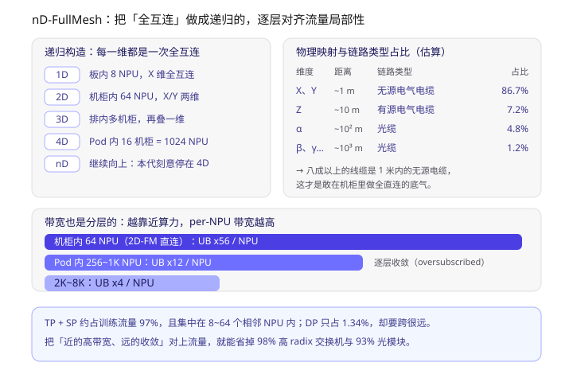
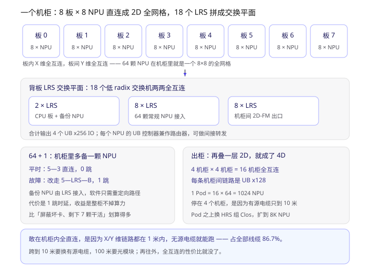
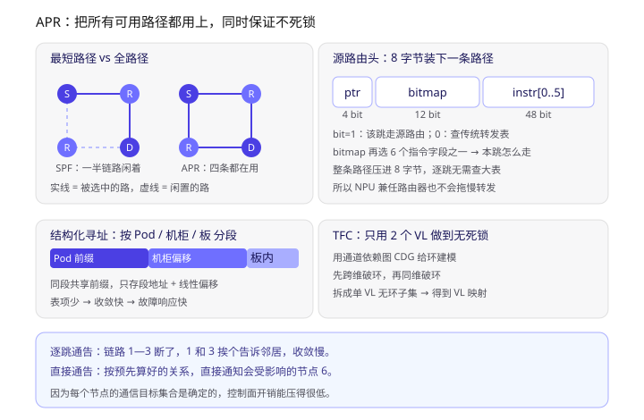
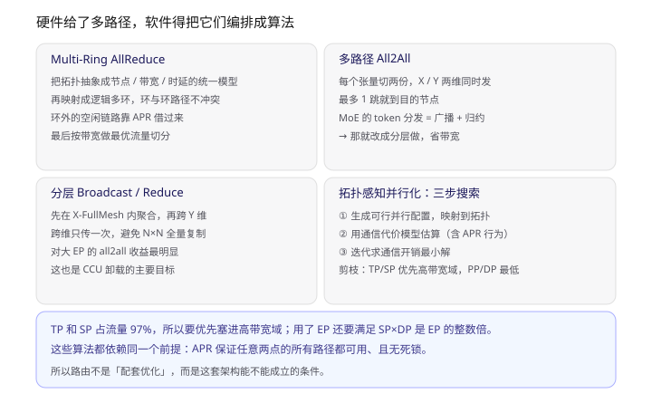
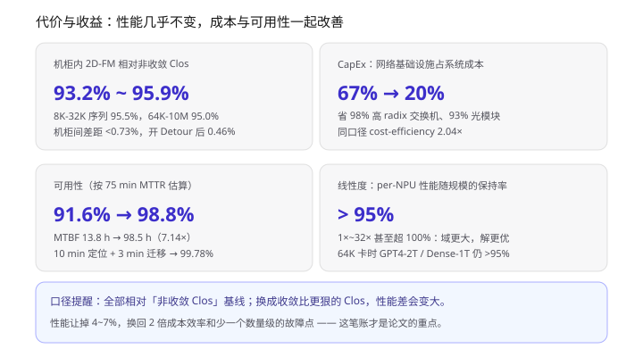

> 学习材料：*UB-Mesh: a Hierarchically Localized nD-FullMesh Datacenter Network Architecture*（arXiv:2503.20377v3，14 页，Huawei，34 位作者，下称 **UB-Mesh 论文**）、*超节点和关键应用场景*（16 页胶片）。文中「3.3.1」「Sec. 4.1」这类编号对应论文原文章节，方便回查。
> 前三篇分别讲协议本身、协议在 OS 里的落地、以及集群级服务与可靠性。这一篇补的是最后一块拼图：**这么多节点到底怎么连起来**。前几篇里出现过两次“nD-FM”，一直没展开——它其实是一篇独立论文的主题。

**一句话概括**：UB-Mesh 的判断很直接——LLM 训练的流量极度局部（TP + SP 占 97%），所以拓扑不该做成对称 Clos，而该做成**递归的全互连**：近处全直连、远处逐层收敛。代价是让出 4~7% 的训练性能，换回 2.04 倍成本效率和 7.2 个点的可用性。

读下来最值得抓住的几点：

1. **立论来自一张流量分解表**：TP 52.9% + SP 44.08%，DP 只有 1.34%，而 DP 恰恰要跨最远。整篇论文的拓扑设计都是围着这个不均匀分布做的。
2. **nD-FullMesh 是递归定义**：1D 板内 → 2D 机柜 → 3D 排 → 4D Pod，每一维都是一次全互连。本代刻意停在 4D，对应 1024 NPU。
3. **积木只有四种，但全用同一根总线**：NPU `UB x72`、CPU `UB x32`、LRS `UB x72`、HRS `UB x512`。这个 72 正好等于 56 + 12 + 4——分层带宽不是拍出来的。
4. **机柜是基本单元**：8 板 × 8 NPU = 64 颗，18 个 LRS 两两全互连拼成一个交换平面，输出 4 个 `UB x256`。
5. **64+1 是“多买一颗卡换整柜不掉算力”**，代价只是把 0 跳变 1 跳。
6. **机柜之上又回到 Clos**——不是妥协，是为了让云能按域切分后仍保满带宽。
7. **APR 是架构成立的前提**：源路由 + 结构化寻址 + TFC（只用 2 个 VL 就做到无死锁），外加“直接通告”做快速故障恢复。
8. **数字**：93.2~95.9% 的性能、CapEx 网络占比 67%→20%、可用性 91.6%→98.8%、线性度 >95%。

---

## 一、先看四条硬要求和三条原则

论文开头把下一代 AI 数据中心的要求列成 R1~R4（Sec. 1），每一条都带着量级：

| 要求 | 内容 | 论文给的量级 |
| --- | --- | --- |
| **R1 大规模** | 模型与数据一起涨，卡数跟着涨 | LLAMA-3 预训练要 16K GPU 跑 54 天；10 万卡集群已经落地 |
| **R2 大带宽** | AI 节点互联带宽远高于 CPU 节点 | 单节点 > 3.2 Tbps，约 CPU 节点的 10 倍；集群总带宽是传统 IaaS 的 10~100 倍 |
| **R3 低成本** | 带宽涨 10~100 倍，不能带着成本一起涨 | 对称 Clos 会把互联成本也推高 10~100 倍 |
| **R4 高可用** | 10 万节点 ≈ 100 万个光模块 | 单链路 MTBF 5 年的前提下，整集群 raw MTBF 掉到 **30 分钟以内** |

R4 那个数字值得停一下：不是“偶尔坏”，是平均半小时坏一次。所以可靠性不能只靠“把硬件做可靠”，必须同时靠**架构少放易坏件**和**坏了能自愈**。后面 64+1 和直接通告就是这两条各自的落点。

对应的三条设计原则（P1~P3）：

- **P1 拓扑跟着流量走**：传统数据中心流量均匀随机，LLM 训练流量确定性极强、局部性极强。
- **P2 计算与通信都要感知拓扑**：拓扑对了，并行策略、路由、集合通信算法不对，照样跑不满。
- **P3 系统要能自愈**：链路坏了自动换路，卡坏了自动换卡。

### 那张真正决定设计的流量表

P1 不是口号，它有数据（Table 1，基于自研 MoE-2T 模型）：

| 并行方式 | 通信模式 | 单次传输量 | 次数 | 总量 | 占比 |
| --- | --- | --- | --- | --- | --- |
| TP | AllReduce | 360 MB | 4992 | 1775 GB | **52.9%** |
| SP | AllGather | 180 / 360 MB | 4992 / 1664 | 1462.5 GB | **44.08%** |
| EP | AlltoAll | 10.5 MB | 4992 | 51.19 GB | 1.54% |
| PP | P2P | 192 MB | 26 | 4.875 GB | 0.14% |
| DP | AllReduce | 711.75 MB | 64 | 44.48 GB | 1.34% |

读这张表要注意两点。第一，**TP + SP 合计 97%**，而这两类流量通常只发生在 8~64 个相邻 NPU 之间；第二，**DP 只占 1.34% 却必须跨很远**，因为它要在整个数据并行域上同步梯度。

一句话：**近处要极大带宽，远处只需要小带宽。** 对称 Clos 的问题就在于它给远处和近处一样多的带宽——贵，而且贵在不需要的地方。

峰会胶片里的几组数字可以对照着看：8 年间单卡算力涨了约 40 倍，节点内带宽涨 6 倍，节点间带宽只涨 4 倍；TP=8 时不可掩盖通信占比 15~20%，引入 EP 后 30~40%，再加序列并行超过 40%。带宽和算力的剪刀差，就是“通信墙”。

---

## 二、nD-FullMesh：把“全互连”做成递归的



> 上图上半左边是递归展开的五层（1D 到 nD），右边是每一维对应的物理距离与链路类型占比；下半三条横条是同一次递归在带宽上的体现——越往外，per-NPU 带宽越低。

定义本身很短（Sec. 3.1）：**同一层里每个节点和其余所有节点直连，叫 1D full-mesh；相邻的两个 1D 全互连再两两直连，就是 2D；如此递归到 nD。**

落到物理上：

| 维度 | 物理范围 | 规模 |
| --- | --- | --- |
| 1D | 单板 | 8 NPU |
| 2D | 单机柜 | 64 NPU |
| 3D | 一排机柜 | 多机柜 |
| 4D | 一个 Pod | 16 机柜 = 1024 NPU |
| 5D+ | 楼层、楼 | 本代不做 |

这个设计有四条好处，前两条是性能，后两条是钱：

1. **带宽可以分层收敛**（oversubscribed）：近处给足，远处收敛，正好对上第一节的流量分布。
2. **大部分传输 0~2 跳就完成**：论文的估计是，结合数据放置和集合通信优化后，占大头的 TP/SP 流量基本都在 0~2 跳内解决。
3. **少用交换机和光模块**：Table 2 的链路类型占比很说明问题——`X/Y` 维（约 1 米）用无源电气电缆占 **86.7%**，`Z` 维（约 10 米）用有源电缆占 7.2%，再往外的光缆只占 4.8% + 1.2%。
4. **对 all2all 友好**：这一点是相对 3D Torus 的关键差异——全互连天然支持任意对任意的模式，而 Torus 在 all2all 上很吃亏。

顺带把论文 Sec. 2.3 的拓扑对比整理一下，这张表能解释“为什么不是别的方案”：

| 拓扑 | 连接方式 | 成本 | 对 LLM 训练的问题 |
| --- | --- | --- | --- |
| **Clos** | 二/三层交换机对称连接 | 高（大量高性能交换机 + 光模块） | 贵，但性能与灵活性最好 |
| **3D Torus** | 相邻节点直连 | 低 | 带宽低，all2all 不好走 |
| **Dragonfly** | 交换机分组全互连 + 长距线缆 | 中 | 仍需全带宽，P2P / AllReduce 表现差 |
| **Fugaku Tofu** | 6D Torus | 低 | 同 Torus |
| **UB-Mesh** | nD 递归全互连 + 少量交换 | 低 | 性能差 4~7% |

---

## 三、积木：四种硬件，一根总线

Table 3 是全文最“硬件”的一页，值得记住：

| 器件 | 角色 | UB IO 能力 |
| --- | --- | --- |
| **NPU** | AI 计算 | `UB x72`（**两个** UB IO 控制器合起来） |
| **CPU** | 主机 | `UB x32`（一个控制器） |
| **LRS** | 低 radix 交换 | `UB x72` |
| **HRS** | 高 radix 交换（Pod 级） | `UB x512` |

这里有个我一开始没看出来的自洽关系。Fig. 7(a) 标注了三层 per-NPU 带宽：机柜内 `UB x56`、Pod 内 `UB x12`、SuperPod 层 `UB x4`。三者相加：

```
56 + 12 + 4 = 72  ← 正好等于 NPU 的 UB x72
```

再往下推一层（**这段是我的推算，论文没写**）：机柜内是 8×8 的 2D 全网格，每颗 NPU 在每个维度要连 7 个对端，两个维度共 14 条链路；`56 / 14 = 4`，即每条链路 4 个 lane。这个数字和“机柜间链路是 `UB x128`”（8 个 LRS 出口聚合）也能对上量级。

### 为什么坚持用一根总线

传统 GPU 训练系统是混合互联（Fig. 6-a）：CPU↔GPU、CPU↔网卡走 PCIe，机内 GPU 之间走 NVLink，机间走 IB / RoCE。三种协议、三套驱动、三次转换。

UB-Mesh 的做法是把它们全换成 UB（Fig. 6-b），好处论文列了三条：

- **IO 资源可以柔性分配**：NPU 的 72 个 lane 怎么切给机柜内、怎么切给机柜间，是配置问题而不是硬件问题。这一点直接支撑了前面 56/12/4 的分法。
- **硬件可以池化**：UB 的 P2P 能力让 DDR、CPU、NPU、网卡都能被“别人”用上——这正是第二篇里 `obmm_export`/`obmm_import` 那套内存池化、第三篇里 UBS Engine 的物理前提。
- **省掉协议转换**：驱动、通信库、框架只需要对付一套语义。

站在第一篇的角度看，这里说的“一根总线”就是那六层协议栈；`x72`、`x32`、`x128`、`x256`、`x512` 是它在物理层上的 lane 记账方式。**协议统一不是为了好看，是为了让 lane 能当货币用。**

---

## 四、机柜内：64 颗卡与 18 个 LRS



> 上图从上到下是：8 块 NPU 板（每板 8 颗）、背板上的 18 个 LRS 分三组全互连、以及 64+1 备份和出柜后的第二层 2D。底部一行说明为什么全直连的边界画在机柜。

Sec. 3.3.1 的细节：

- **8 块 NPU 板 × 8 颗 = 64 颗**，板内是 X 维全互连，板间是 Y 维全互连，合起来就是机柜内的 2D full-mesh。
- **18 个 LRS 两两全互连**，构成一个交换平面（switch plane），分工是：**2 个**给 CPU 板和备份 NPU、**8 个**给 64 颗常规 NPU、**8 个**做机柜间连接。整个平面输出 **4 个 `UB x256` IO**。
- **NPU 自己也是路由器**：因为 UB IO 控制器本身带路由能力，机柜内可以做间接转发。这句话很轻，但它是后面 APR 必须“高效转发”的原因——上万颗 NPU 同时当路由器，路由表查得慢一点就是全局问题。
- **CPU 板是独立的**：CPU 不再和 NPU 同板，而是通过交换机挂进来。这样 CPU/NPU 比例可调，才能谈 CPU/NPU/DDR 的资源池化。

最后这条别当成工程细节看。传统服务器里 CPU:NPU 是焊死的 1:4 或 1:8；一旦 CPU 从板上挪走，比例就变成一个调度参数——第二篇里“统一内存池 + 按需配比”、第三篇里 UBS Engine 的 VirtAgent，都建立在这个自由度上。

---

## 五、64+1：多买一颗卡，换整柜不掉算力

机柜里其实有 **65 颗** NPU。多出来的那一颗通过 LRS 挂在 64 颗旁边（Fig. 8-b），平时不用。

故障发生时的动作（Fig. 9）：假设 NPU-3 坏了，管理系统激活备份卡 B 顶替它的位置，原来所有通向 NPU-3 的直连链路被重定向——比如 `5—3` 这条 0 跳的直连，改成 `5—LRS—B` 这条 1 跳路径。

论文对这个取舍说得很坦白：路由从直连变成一跳，时延略有增加；但比起“屏蔽掉 NPU-3、剩下 7 颗继续跑”，这个代价小得多——因为后者会同时损失算力和机柜内带宽，而机柜内带宽恰恰是 LLM 训练的主要矛盾。

我的理解是：这是把 RAID 的 hot spare 思路搬到了整卡粒度。区别在于**切换靠软件重定向路径，而不是硬件倒换开关**——所以它要求路由系统能快速收敛，这就又回到 APR 和“直接通告”上了。三件事是连在一起的：备份卡提供冗余度，APR 提供可切换的多路径，直接通告让切换足够快。

---

## 六、出柜：再叠一层 2D，就是 4D

机柜之上重复同样的动作（Sec. 3.3.3）：

- 一行里 **4 个相邻机柜** 用各自 LRS 的机柜间端口直接互连，成一个 1D full-mesh；
- 机柜列的方向上再来一次，**4 × 4 = 16 个机柜**，成 2D full-mesh；
- 每条机柜间链路是 `UB x128`；
- **1 Pod = 16 机柜 × 64 = 1024 NPU**。

为什么偏偏是 4 个而不是 8 个？论文给的理由很物理：**有源电缆的可达距离**。Table 2 里 `Z` 维（约 10 米）才用有源电缆，占 7.2%；再远就得上光模块，成本和故障率都跳一个台阶。所以“全互连”这一层能覆盖多大，是被线缆物理特性而不是拓扑美学决定的。

对照峰会胶片的口径也能对上：超节点域支持 **64~8K 卡**，其中 64 是机柜、1024 是 Pod、8K 是 SuperPod。

---

## 七、Pod 之上：为什么又回到 Clos

到 SuperPod 这一层，UB-Mesh 主动放弃了全互连（Sec. 3.3.4），改用 HRS 组**对称 Clos**：

- 理由不是技术做不到，而是**云上要能切分**。中小规模训练任务用不满一个 SuperPod，对称 Clos 让云管可以按需划出子域，并保证每个子域内都是满带宽。
- HRS 是 `UB x512`，用它做 Pod switch，SuperPod 规模到 **8K NPU**。
- 再往外是 DCN，Clos 组织，可以扩到 **10 万 NPU 以上**。接 DCN 有两种方式：走 UB 交换机（Solution-a），或者走 CPU 板上的网卡（Solution-b）。

这段值得单独记一笔，因为它暴露了这套设计的真实逻辑：**“全互连”不是信仰，而是一道成本-可达性的边界题。** 1 米内无源电缆全直连划算，10 米内有源电缆还能接受，100 米往上就必须收敛。所以边界画在机柜（2D）和 Pod（4D），而不是“越大越好”。

---

## 八、APR：五条要求，三件套

到了 SuperPod，拓扑是 4D-FullMesh + Clos 的混合体，而且**每颗 NPU 都是路由器**。论文先列了路由系统必须满足的五条（Sec. 4）：

1. 支持混合拓扑；
2. 转发要高效（NPU 数量太大，不能靠大表）；
3. 支持**非最短路径**（全互连下两点之间有多条不同距离的路，不用就浪费带宽）；
4. 故障恢复要快；
5. 不能死锁。

现有的三套路由都不够（Table 4）：

| 路由方案 | 用在哪 | 缺什么 |
| --- | --- | --- |
| LPM + BGP | 通用 DCN | 不支持混合拓扑、无法走非最短路径 |
| Host-based Routing | IB | 转发开销大、无故障容错 |
| DOR（维度顺序路由） | Tofu、TPU | 只能最短路径 |
| **APR** | UB-Mesh | — |

所以 APR 由三个机制拼起来（Sec. 4.1）：

### 1）源路由：8 字节装下一条路径



> 上图左边是 SPF 与 APR 的路径使用对比，右边是 8 字节源路由头的字段划分；下半两块是结构化寻址和 TFC 死锁避免；底部是逐跳通告与直接通告的差别。

包头里加 8 个字节：

- **4 bit `ptr`**：指向 bitmap 里的位偏移；
- **12 bit `bitmap`**：第 i 位的值表示第 i 跳怎么转发——`1` 表示这一跳用源路由，`0` 表示走传统转发表；
- **6 个 8 bit 指令字段**（共 48 bit）：`bitmap` 选中其中一个，告诉本跳具体怎么走。

总计 64 bit。设计意图是：**能压进包头的就别查表**。逐跳只要移位 + 选字段，不做前缀匹配。

### 2）结构化寻址：按 Pod / 机柜 / 板 分段

地址空间按物理位置切段，同一段里的 NPU 共享前缀，于是表里只需要存“段地址”，段内用线性偏移定位。

收益是三重的：表空间小、路由表生成和分发快、收敛快。第三点很关键——第五节的 64+1 切换、第九节的故障恢复，都靠“快”才能成立。

### 3）TFC：只用 2 个 VL 就无死锁

这是我认为全文最硬的一段。nD-FullMesh 里有大量环结构，APR 又允许多跳，用有限的 VL 做无死锁流控很难。TFC 的做法（Sec. 4.1.3）：

- 用**通道依赖图（CDG）**给死锁建模；
- 把拓扑按维切成子图，子图内统一转向规则和 VL 约束；
- 先做**跨维破环**，把约束集拆成单 VL 的无环子集；再做**同维破环**，算幂集元素的排列与笛卡尔积；
- 由此生成全路径组合和 VL 映射。

结果：**2 个 VL**。这个数字放在第一篇的语境里才有分量——链路层 VL 是稀缺资源（受 buffer 和信用约束），能用 2 个 VL 覆盖全路径无死锁，等于把路由的自由度换成了 buffer 的节省。

顺便厘清一个容易混的点：第一篇讲的 **RT 逐包逐流**、**CAQM/FECN** 是“流量在链路上怎么摊开、怎么反馈拥塞”，属于负载均衡；APR 是“包该走哪条路”，属于路径选择。两者是叠加关系——APR 先把可用路径集合放大，负载均衡再在这个集合里摊。

---

## 九、故障恢复：把通告从“逐跳”改成“直达”

链路 1—3 断了，传统做法是逐跳通告：1 和 3 各自告诉邻居，邻居再告诉邻居，慢慢传开（Fig. 12-a）。

UB-Mesh 的做法是**直接通告**：因为每个节点的通信目标集合是确定的，故障信息可以按预先算好的关系，直接发给会受影响的节点（比如直接通知节点 6），跳过中间跳（Fig. 12-b）。

这本质上是拿“拓扑已知”换“控制面开销”。传统网络不敢这么干，是因为目标集合不确定；一旦拓扑固定、目标集合可枚举，通告就可以做成一次定向推送。

这条和第三篇里的可靠性材料是同一个思路的两层：那边讲的是**故障不扩散**（sysSentry、内存迁移、虚机快恢），这边讲的是**网络层自愈**。上层能不能在 100 ms 内收到通知，取决于这里收敛得够不够快。

---

## 十、软件侧：拓扑感知的集合通信与并行化

硬件给了多路径，算法得会用。Sec. 5 给了两类优化。



> 上图四个格子分别是 Multi-Ring AllReduce、多路径 All2All、分层 Broadcast/Reduce、以及并行化的三步搜索；底部说明它们共同依赖 APR 这个前提。

### 集合通信

- **Multi-Ring AllReduce**：先把拓扑抽象成“节点数 + 连接关系 + 链路带宽 + 时延”的统一模型，再把集合通信映射成逻辑多环，保证环与环路径不冲突；环外的空闲链路通过 APR 借过来补带宽；最后按各路径的实际带宽做最优流量切分。
- **多路径 All2All**：每个张量切两份，沿 X 维和 Y 维同时发，最多 1 跳到达。全互连在这里的价值最直观——路径多到可以“并行铺开”。
- **分层 Broadcast / Reduce**：MoE 的 token 分发在语义上等价于“多次广播 + 归约”，所以改成分层做：先在 X-FullMesh 内聚合，再跨 Y 维传一次，避免 N×N 的全量复制。

### 藏在 IO 控制器里的 CCU

Sec. 7 提了一个容易被忽略的部件：**Collective Communication Unit（CCU）**，是 UB IO 控制器里的一个协处理器。

它的行为是：执行指令、直接读写 HBM、发起 NPU 间传输、用片上 SRAM 做 inline reduce。效果是**省掉“应用 buffer → 通信 buffer”这次冗余拷贝**，从而少占 HBM 带宽；同时用 checkbit 的细粒度同步保证 reduce 顺序确定；还能和计算核协作做计算-通信 overlap。

对做集合通信的人（比如 HCCL 那条线）来说，这一条的含义很直接：**Reduce 从“软件在内存里做”下沉到了“IO 控制器在传输路径上做”**。这也解释了为什么 UB 敢说自己能撑大规模 EP 的 all2all——光靠带宽是不够的，还得把归约挪出计算核。

### 并行化

Sec. 5.2 是一个三步搜索：

1. 生成可行的并行配置，映射到 UB-Mesh 拓扑；
2. 用拓扑感知的通信代价模型评估（模型里要准确刻画 APR 和上面的集合通信算法，论文说用自研仿真设施校准）；
3. 迭代找通信开销最小的配置。

两个约束值得记：

- **剪枝**：TP/SP 通信量大，优先放进高带宽域；PP/DP 优先级最低。
- **MoE 的硬约束**：要求 `SP × DP` 是 `EP` 的整数倍。

---

## 十一、数字：性能、成本、可用性、线性度



> 上图四张卡分别是训练性能、CapEx 占比、可用性、线性度；底部两行是口径提醒和这笔账的实质。

**性能**（Sec. 6.2、6.3）：机柜内 2D-FM 相对非收敛 Clos 达到 **93.2%~95.9%**（按模型平均）；按序列长度看，8K-32K 为 95.5%，64K-10M 为 95.0%。机柜间 2D-FM 与 Clos 的差距更小——GPT4-2T 上用朴素最短路径只掉 0.73%，开 Detour + Borrow 后只剩 **0.46%**。

顺带一个工程结论：机柜间带宽默认取 `UB x16` 是算过的。`x8 → x16` 在 8K-32K 序列上只提升 0.44%，而 `x16 → x32` 在 64K-10M 上能提升 1.85%——所以短序列场景没必要堆机柜间带宽。

**成本**（Sec. 6.4）：网络基础设施占系统成本的比例从 **67% 降到 20%**；省掉 **98% 的高 radix 交换机** 和 **93% 的光模块**；OpEx 降约 35%（OpEx 约占 TCO 30%）；最终 cost-efficiency **2.04×**。论文还给了几档 Clos 基线的 CapEx 降幅 1.18× / 1.26× / 1.65× / 2.46×——注意这句原文的“数字—基线”对应写得有点含混（Fig. 21 画的是五根柱子），严谨起见只取“相对基线 2.04× 效率”这个总口径。

**可用性**（Sec. 6.6）：AFR 从 632.8 降到 88.9，对应 MTBF 从 **13.8 小时升到 98.5 小时**（7.14×）；按 75 分钟 MTTR 算，可用性 **91.6% → 98.8%**（提升 7.2 个点）。再加自研监控（10 分钟定位 + 3 分钟迁移），可到 **99.78%**。这个提升的来源很朴素：把光模块和交换机换成了电气电缆。

**线性度**（Sec. 6.5）：1×~32× 区间全部 **超过 100%**（规模变大反而每卡更高效，因为高带宽域更多、并行策略的搜索空间更大）；到 64K 卡（64×）时 GPT4-2T 和 Dense-1T 仍保持在 **95% 以上**。

**口径提醒**：这些数字全部相对“非收敛（non-oversubscribed）Clos”这个最贵的基线。换成收敛比更狠的 Clos 比，性能差距会变大、成本优势会变小。读这类论文时基线选择比数字本身更值得看。

---

## 十二、把四篇串起来

| | 讲什么 | 尺度 | 核心问题 |
| --- | --- | --- | --- |
| 第一篇 | UB 协议本体 | 一次事务 | 包怎么组织、怎么保序、怎么寻址 |
| 第二篇 | 协议落到 OS | 一个节点 | 设备/内存/虚拟化怎么改内核 |
| 第三篇 | 集群级服务与可靠性 | 一个集群 | 池化、故障不扩散、编程模型 |
| **第四篇** | **组网拓扑** | **一个机房** | **上千节点怎么摆、怎么路由** |

四篇连起来看，有一条线索是重复出现的：**UB 的每一次“简化”，代价都被推到了别处，然后用软件补回来。**

- 不做跨节点硬件一致性 → 用 Ownership 把责任给软件（第二篇）；
- 用一根总线替掉三种互联 → 需要 UBFM 统一管拓扑和资源（第二、三篇）；
- 拓扑做成全互连但分层收敛 → 需要 APR 保证多路径可用且无死锁（本篇）；
- 备件常驻 → 需要路由能快速重定向 + 直接通告（本篇、第三篇）。

换句话说，这套架构的复杂度没有消失，只是从“硬件一致性协议 + 多套互联”搬到了“路由 + 管理面 + 编程模型”。

## 学习路径

1. **先读论文 Sec. 2.2 和 Table 1**：不理解 97% 这个数，后面所有设计都像拍脑袋。
2. **再读 Sec. 3.3.1~3.3.3**，配合 Fig. 7/8 把 8 板 → 64 卡 → 18 LRS → 16 机柜 → 1024 的账算一遍。算通了，`56 + 12 + 4 = 72` 这种自洽关系自己会跳出来。
3. **然后啃 Sec. 4.1.3 的 TFC**：这段只有一页，但涉及 CDG 和破环，值得单独找 turn-model 的资料补。这是全文唯一“跳过了细节”的地方（论文自己说 due to page limits）。
4. **最后回头看 Sec. 5**：集合通信和并行化那部分，本质是把拓扑知识写进算法和代价模型，和 HCCL 里按拓扑选算法（Ring / RHD / NHR）是同一类问题。
5. 想动手的话，可以拿 `hccl` 仓库里的拓扑感知选路逻辑对照着看——那部分已经拆在《HCCL 是怎么按拓扑选算法的》里了；或者用 ns-3 / 自写模拟器把 4D-FullMesh 上的 AllReduce 跑一遍，验证 Multi-Ring 的收益。

## 参考

- Heng Liao et al., *UB-Mesh: a Hierarchically Localized nD-FullMesh Datacenter Network Architecture*, arXiv:2503.20377v3, 2025. <https://arxiv.org/abs/2503.20377>
- 《超节点和关键应用场景》，openEuler 社区，2025（灵衢峰会材料）。
- 同系列前三篇：《灵衢 UnifiedBus 学习笔记》《UnifiedBus OS 参考设计学习笔记》《灵衢 UnifiedBus 学习笔记（三）：系统高阶服务、可靠性与编程编译》。
- 前置阅读：*UB-Base-Specification-2.0*（VL、LC、RT/CAQM 等链路层机制），*UB-Mgmt-OM-SW-Arch-and-IF-RD-2.0*（拓扑与资源的管理面）。
- 后续：《灵衢 UnifiedBus 学习笔记（五）：消息是怎么保证不丢的》—— 把本文跳过的 TFC 那页往下撑开：链路层信用证与 Retry Buffer、网络层 RT 与死锁三招、传输层 PSN 与四种重传组合。
