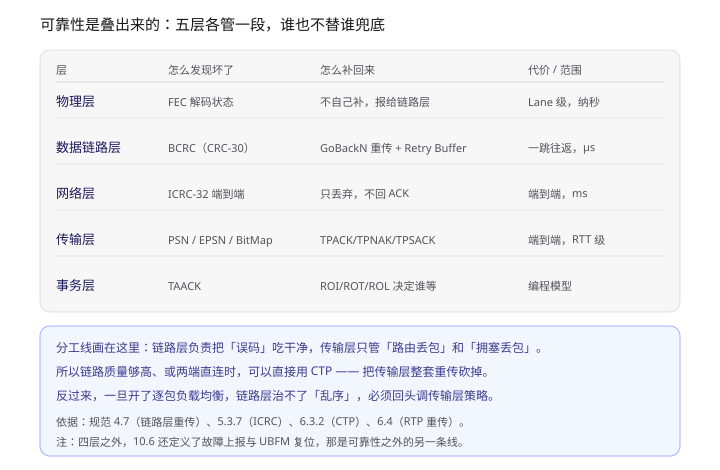
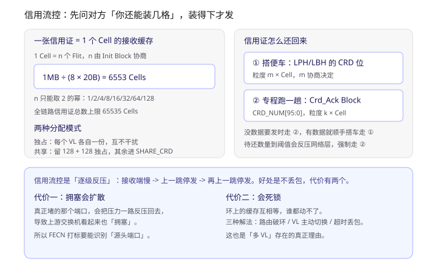
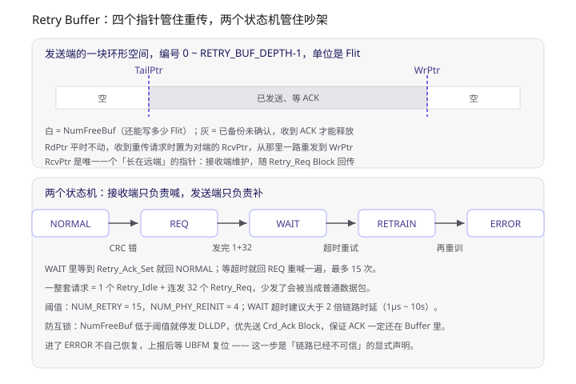
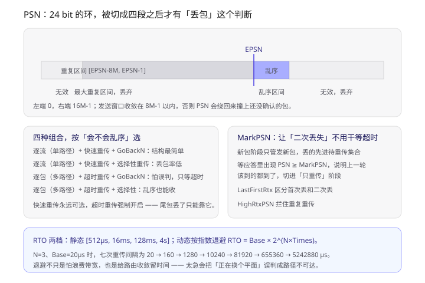
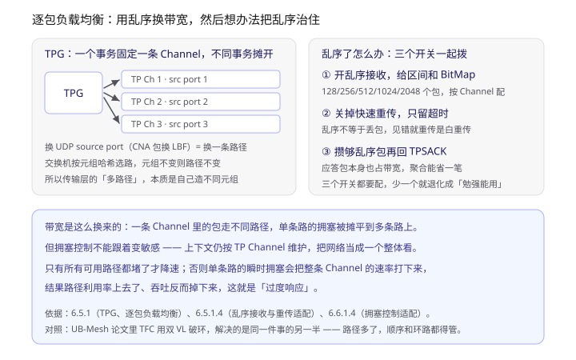

> 这是灵衢 UB 系列的第五篇。前四篇分别讲了协议本体、协议在 OS 里的落地、集群级服务与可靠性、UB-Mesh 组网拓扑；这一篇回到基础规范里被前几篇压缩掉的三章：**数据链路层（第 4 章）、网络层（第 5 章）、传输层（第 6 章）**。事务层与功能层的逐字段细读见第六篇《一个事务的完整解剖》。文中「4.7.3.2.2」「6.4.2.3.1」这类编号都对应基础规范章节，方便回查。

一句话概括：**UB 的可靠性不是靠某一层做到端到端，而是让每一层只处理自己那一类错误，然后把「谁该等多久」交给最上面。**

读完这一篇，你应该能回答这几个问题：

- 为什么链路层已经在逐跳重传了，传输层还要再重传一次？
- 信用流控和重传是两套独立机制，它们分别在防什么？
- 逐包负载均衡明明会更省带宽，为什么大部分场景默认不用？
- `TPNAK` 和 `TPSACK` 到底差在哪，为什么一个带期望 PSN、一个带 BitMap？

---

## 一、先划清责任：五层各管一段

很多人第一次读 UB 规范会觉得「重传机制怎么讲了两遍」——4.7 讲链路层重传，6.4 讲传输层重传。其实这是**两类不同的错误**，用两套不同成本的机制去治。



> 上图是一张职责表：物理层只做 FEC 解码、不做恢复；链路层用 BCRC 加 Retry Buffer 做逐跳重传；网络层只做 ICRC 校验后丢弃、不回 ACK；传输层用 PSN 加应答做端到端重传；事务层用 TAACK 和服务模式决定谁等。底部说明分层原则，以及 CTP 为什么能砍掉传输层重传。

关键的那条分界线是：

| 错误类型 | 由谁产生 | 谁负责治 | 为什么 |
|---|---|---|---|
| 链路误码（光/电信号翻转） | 物理介质 | 物理层 FEC + 链路层重传 | 一跳之内就能修，不必惊动端侧 |
| 缓存满导致的丢包 | 接收端缓存不足 | 链路层信用流控（事前预防，不丢） | 丢了再传不如压根不丢 |
| 路由/拥塞导致的丢包 | 中间交换机 | 传输层 RTP 重传 | 只有端侧才知道「这条业务流少了哪个包」 |
| 数据被篡改 | 任意环节 | 网络层 ICRC 后丢弃 | 宁可丢，也不能把坏数据交上去 |

所以 **CTP 能砍掉传输层重传**（6.3.2）：它把可靠性整个卸载给链路层，适用于 UBPU 直连或链路质量极高的场景——因为这种情况下端到端丢包的概率本来就趋近于零，再挂一套端到端重传只是白白增加开销。反过来，一旦跨了多级交换机（尤其开了逐包负载均衡），链路层就无能为力了，必须靠 RTP。

---

## 二、第一道墙：信用证，让缓存永远不溢出

链路层做的是**预防**，不是恢复。手段是信用流控（4.6）。

### 2.1 一张信用证 = 一个 Cell 的接收缓存

基本单位不是 Flit，是 **Cell**：`1 Cell = n 个 Flit`，`n` 只能取 `{1,2,4,8,16,32,64,128}`，由 Init Block 的 `FLOW_CTRL_SIZE` 协商确定。

规范 4.6.1.2 给了一个可直接验算的例子：接收缓存 1MB、`n = 8`、Flit 20 字节，则

```
1MB / (8 × 20B) = 6553 Cells
```

向下取整，保证缓存不会溢出。这 6553 张信用证再分给启用的各个 VL，原则是 `INIT_CRD0 + … + INIT_CRD8 ≤ 6553`。全链路信用证总数上限是 **65535 Cells**。

发送一个 DLLDP 消耗多少信用证？**Flit 数 ÷ 每 Cell 的 Flit 数，向上取整**（4.6.2 注 3）。规范特意强调「消耗和返还的计算方式必须一致」，否则计数器会漂移——这类细节在硬件实现里是最容易出 bug 的地方。

### 2.2 独占还是共享

- **独占模式**：每个 VL 各拿一份，互不干扰。简单，但容易浪费——某个 VL 空闲时它的信用证别人用不了。
- **共享模式**：所有信用证汇总进一个 `SHARE_CRD` 计数器，但**仍要给每个 VL 分一份独占的保底量**，避免某个 VL 长期饥饿。

规范里共享模式的例子很直观：6553 张总信用证，VL0 和 VL1 各独占 128 张，剩下 `6553 - 256 = 6297` 张进 `SHARE_CRD`。发送时**优先用共享的**，共享的不够再用本 VL 独占的凑——因为共享的用掉之后会还回公共池，独占的用掉只回自己。这个「先公后私」的顺序是共享模式能提高利用率的关键。

### 2.3 信用证怎么还回来

有两条通道，粒度不同：

| 通道 | 载体 | 粒度参数 | 典型场景 |
|---|---|---|---|
| 搭便车 | DLLDP 的 `LPH.CRD` / `LBH.CRD` 位 | `DATA_CREDIT_GRAIN_SIZE`，取 2 的幂 | 反正有数据要发，顺手带回去 |
| 专程跑一趟 | `Crd_Ack Block` 的 `CRD_NUM[95:0]` | `CTRL_CREDIT_GRAIN_SIZE`，取 2 的幂 | 本端没数据要发，但信用证必须还 |



> 上图左侧是 Cell 换算与独占/共享两种分配模式，右侧是两个返还通道及其粒度参数；底部用两栏说明逐级反压的两个副作用：拥塞扩散和死锁。

返还规则里有一条很值得记（4.6.3 第 3 条）：**当待返还信用证累积到阈值时，要反压网络层、强制发送 Crd_Ack Block**。原因是如果本端发送方向一直没数据，信用证就一直还不回去，对端的发送窗口会被慢慢饿死。这条规则是「别让对端因为我的静默而卡住」的兜底。

信用流控有个很好的性质（规范原话）：**发送端实时知道对端缓存剩余空间，接收端不需要考虑链路时延提前反压**。这是 credit 机制相对「窗口 + 时延估计」的根本优势——它把「缓存够不够」变成了一个确定性的计数问题，而不是一个估计问题。

代价也很明确，就是图里那两条：**拥塞会沿着反压链扩散**（所以 FECN 打标要能识别源头端口，5.3.5.2），以及**环路依赖会形成死锁**（5.3.6）。

---

## 三、第二道墙：Retry Buffer 与两个状态机

信用流控防的是「缓存溢出」，防不了「信号翻转」。后者由 4.7 的误码检测与重传处理。

### 3.1 备份什么、谁在管

CRC 模式下，发送端给每个 Block 加 `BCRC`（30 bit CRC + 1 bit ERROR_FLAG），发出时在 Retry Buffer 里备份一份（Null Block、Retry Block 除外）。注意备份范围包括 **DLLDP 和 DLLCB**——也就是说 ACK 本身也会被备份、也可能丢。这一点是后面「防互锁」存在的前提。

空间管理用五个参数（4.7.3.2.2）：

| 参数 | 维护方 | 含义 |
|---|---|---|
| `NumFreeBuf` | 发送端 | 还能备份多少 Flit；收到 ACK 时按 ReleaseSize 增加 |
| `WrPtr` | 发送端 | 最新备份位置，每发一个 Flit 前进一格 |
| `TailPtr` | 发送端 | 最早的、还没被 ACK 的 Flit 位置 |
| `RdPtr` | 发送端 | 下一个要重传的位置，平时不动，收到重传请求才被置为对端的 `RcvPtr` |
| `RcvPtr` | **接收端** | 期望接收的 Flit 在对端 Buffer 中的位置，随 `Retry_Req Block` 回传 |

`RcvPtr` 是唯一一个「长在远端」的指针，理解这一点，整条重传链路就通了：接收端发现 CRC 错，把它记着的 `RcvPtr` 塞进请求包发回去；发送端把 `RdPtr` 设成这个值，从那里一路重发到 `WrPtr`。

释放空间有两种 ACK（4.7.3.2.3）：DLLDP 的 `LPH.ACK` 位（释放 `DATA_ACK_GRAIN_SIZE` 个 Flit），或 `Crd_Ack Block` 的 `ACK_NUM`（释放 `ACK_NUM × CTRL_ACK_GRAIN_SIZE`）。

### 3.2 两个状态机



> 上图上半部分是 Retry Buffer 的环形布局：白色是空闲（`NumFreeBuf`）、灰色是已备份待确认；下半部分是接收端的 `RETRY_REQ_SM`（5 态）和发送端的 `RETRY_ACK_SM`（2 态）组成的处理链，底部列出阈值与防互锁规则。

几个数字值得单独记住：

- **一整套请求 = 1 个 `Retry_Idle` + 连发 32 个 `Retry_Req`**。规范说得很直白：少发了「可能导致 DLLDP 与重传请求识别混乱」。这是个朴素的信号可靠性设计——用长度换辨识度。
- **`NUM_RETRY_THRESHOLD = 15`**（同一个 `RcvPtr` 连续重试次数）→ 进 `RETRAIN`；**`NUM_PHY_REINIT_THRESHOLD = 4`** → 进 `ERROR`。
- **`WAIT` 态超时阈值建议大于 2 倍链路时延，范围 1μs ~ 10s**。这个「2 倍」不是拍脑袋，是为了容纳「请求过去 + 应答回来」一个来回。
- **进了 `ERROR` 不自己恢复**，上报后等 UBFM 复位。这是把「链路已不可信」显式声明出来，而不是死循环重试。

### 3.3 一个容易漏掉的坑：错误 DLLDP 不触发重传

4.8.3 讲了一个很特殊的场景：链路层为了降时延，可能不等整个 DLLDP 攒齐就按 DLLDB 粒度往下发。这时候如果发现读到的数据本身有问题（比如内存 ECC 错），包已经发出去一半了，收不回来。

解法是在**最后一个 Flit 的 `ERROR_FLAG`** 上标错。接收端**照常接收、照常往上送，不触发重传**，等到 DLLDP 攒齐的地方再整包丢弃。

这条设计把两类错误彻底分开了：

- **链路误码** → FEC / BCRC / 重传 负责修，不往上传染；
- **数据本身错了** → 标记后交上层丢弃，链路层不假装能修。

---

## 四、中间那层：网络层只管送，不管补

网络层（第 5 章）在可靠性这条线上的角色很克制：**校验、丢弃、不重传**。

### 4.1 RT：一个 2 bit 字段，决定了保序责任归谁

`NTH` 里的 `RT` 只有 2 bit，但它其实是「上层把保序责任交给谁」的开关（5.3.2.1）：

| RT | 负载均衡 | 选路策略 | 含义 |
|---|---|---|---|
| `00` | 逐流 | 全部可达路径 | 同一流固定走一条路，天然保序 |
| `01` | 逐包 | 全部可达路径 | 每个包独立选路，不保序 |
| `10` | 逐流 | 最短路径集 | 保守版：只在最短路径里挑 |
| `11` | 逐包 | 最短路径集 | 激进版：多路径 + 只走最短 |

规范那句话是这个字段的全部意义：**「当上层协议需要网络层提供保序传输时，应选择逐流；不需要时可选逐包。」**

注意这里的因果方向——不是网络层「做不到保序」，而是**它把保序做成了一个显式选项**。选了逐包，就等于上层答应自己处理乱序（也就是 6.5 那一整套适配）。

### 4.2 ICRC：为什么一堆域段要「填全 1」再算

`ICRC` 是 32 bit、位于包尾，用 `0x04C11DB7` 多项式、初值 `0xFFFFFFFF`，覆盖「数据包中不可被改变的域段」（5.3.7）。

关键在于「不可被改变」这四个字。包在传输过程中有些字段**一定会被改**：`CCI`（拥塞标记）、`LBF`（负载均衡因子）、IP 的 `TTL` / `Header Checksum` / `TOS`、UDP 的 `checksum`。这些字段如果参与校验，每跳都得重算 ICRC，端到端保护就退化成了逐跳校验。

所以规范的做法是：**计算时把这些字段全部替换成全 1**。发送端和接收端做同样的替换，校验值就只反映「不该变的部分有没有变」。

这是个很干净的思路：**端到端校验要保护的是「内容」，不是「信封上的邮戳」。**

### 4.3 NPI 与死锁

`NPI` 25 bit = 1 bit 权限 + 24 bit 分区 ID（5.3.3.1）。规则有点绕但值得记：

- 不同 ID → 隔离，不通；
- 相同 ID → 再看权限位：`high-high` 和 `high-low` 可以通，**`low-low` 不通**；
- ID = 0 是无效值（未配置前禁止发 IP 包），**ID = 1 是默认分区**。

两种工作模式（5.3.3.2）：`Strict` 不信任软件栈（一个 Entity 的所有网口同属一个 NPI），`Loose` 信任软件栈（每个网口可以属于不同 NPI，由网口自己检查）。交换机侧还能做 **NPI 替换**，用于管理员不信任端侧的场合。

死锁这块（5.3.6）给了三招组合使用：

1. **路由防死锁**：选特定路由算法破环；
2. **VL 主动切换**：配置特定节点的 Input VL → Output VL 映射，强制切通道拆掉环路依赖；
3. **超时丢包解死锁**：队列超时未调度就整队丢弃。

第二招是 UB 多 VL 存在的**真正理由**——不是为了 QoS，是为了破环。这一点在 UB-Mesh 论文的 TFC 里被推到了极致：只用 2 个 VL 就做到全路径无死锁。

---

## 五、第三道墙：PSN 与四种重传组合

RTP 是真正端到端的可靠层（6.4）。

### 5.1 PSN 与四个区间

`PSN` 24 bit，范围 `0 ~ 16M-1`，初始值在建立 TP Channel 时**随机协商**（`0 ~ 16M-1`），每个 Channel 独立维护。随机初始值的作用是让不同 Channel 的 PSN 错开，避免同一时刻大量包共享同一序列号。

接收端维护 `EPSN`（期望收到的下一个 PSN），据此把收到的包分到四个区间：

| 区间 | 范围 | 处理 |
|---|---|---|
| 正序 | `PSN == EPSN` | 接收，`EPSN += 1` |
| 重复 | `[EPSN-8M, EPSN-1]` | 丢弃，回 TPACK |
| 乱序 | `[EPSN+1, EPSN+乱序区间大小]` | 视配置：丢弃（GoBackN）或接收（选择性/乱序使能） |
| 无效 | 其它 | 丢弃，不回应答 |



> 上图把 24 bit 的 PSN 空间拉直成一条轴：左段无效、中段是最大重复区间 `[EPSN-8M, EPSN-1]`、`EPSN` 之后一小段是乱序区间、右段又回到无效。下半部分左右两栏分别是四种重传组合的适用场景和 MarkPSN 机制，底部给 RTO 的两档配置与退避序列。

两个硬约束：

- **发送窗口**：最大可发 PSN 减去最小待确认 PSN 不超过 `8M-1`。否则 PSN 绕一圈回来，会撞上还没确认的包，重复区间和正常包分不清。
- **乱序区间大小**只能从 `{128, 256, 512, 1024, 2048}` 里选，按 TP Channel 配。

### 5.2 四种组合，按「会不会乱序」选

规范表 6-7 给的组合很值得抄下来当决策表：

| 重传算法 | 需要快速重传吗 | 适用负载均衡 | 适用丢包率 |
|---|---|---|---|
| GoBackN | 配快速重传 | 逐流（单路径） | 非常低 |
| GoBackN | 不配 | 逐包（多路径） | 非常低 |
| 选择性重传 | 配快速重传 | 逐流（单路径） | 低 |
| 选择性重传 | 不配 | 逐包（多路径） | 低 |

规律是：**「会不会乱序」决定要不要关快速重传，「丢包率高低」决定用 GoBackN 还是选择性重传。**

为什么多路径必须关快速重传？因为「收到乱序包」在多路径下**根本不等于丢包**——它可能只是走了另一条更慢的路，晚到而已。此时立刻重传就是纯浪费，还会让网络更堵。

超时重传则**强制开启**，规范明确说它是快速重传的兜底：「例如在尾包丢失发生时，会触发超时重传」。尾包丢失接收端根本感知不到（没有后续包触发乱序），只能靠发送端等超时。

### 5.3 TPNAK 与 TPSACK：一个说「我要什么」，一个说「我有什么」

| 应答 | 携带 | 语义 | 发送端动作 |
|---|---|---|---|
| `TPACK` | `PSN` = 已按序接收的最大 PSN | 累积确认 | 更新发送状态 |
| `TPNAK` | `PSN` = `EPSN`（期望收到的） | 「我卡在这了」 | 从该 PSN 起重传后续所有 |
| `TPSACK` | `RTPH.PSN` + `SAETPH.BitMap` + `MaxRcvPSN` | 「这几段我收到了」 | 只重传 BitMap 里为 0 的 |

有个细节很能体现设计者的克制（6.4.2.3）：**当接收端申请不到 BitMap 时，会丢弃乱序包，但 `MaxRcvPSN` 仍然更新**。因为 `MaxRcvPSN` 单调递增，发送端就能靠它判断「这个包确实到过对端，只是对方缓存不够」，从而不去重传它。相当于用 1 个域段补上了 BitMap 缺失的信息。

### 5.4 MarkPSN：让二次丢失不用干等超时

选择性重传配快速重传有个尴尬：首次丢失能靠 `TPSACK` 立刻发现并重传，但**如果这次重传又丢了**，发送端分不清「是又丢了」还是「还在路上」，只能等超时。而超时时间本身很难设（见 5.5）。

`MarkPSN` 机制（6.4.2.3.1）把整个过程切成两个交替阶段：

- **新包发送阶段**：只发新包，检测到丢的先进待重传集合，不立即重传；
- **丢包重传阶段**：只重传上一阶段记录的丢失包，不发新包。

阶段切换靠 `MarkPSN`——它记录「上一轮切换后发出的第一个新包 PSN」。当应答里出现 `PSN ≥ MarkPSN` 的包被接收，说明 `MarkPSN` 及之前的包「要么收到了、要么确实丢了」，此时才切进重传阶段。这样二次丢失就能被快速识别，不必干等 RTO。

配套还有两个辅助变量：`LastFirstRtx`（区分首次丢和二次丢，大于它的算首次丢，立即进重传集合）、`HighRtxPSN`（记录重传过的最大 PSN，拦住重复重传）。

规范也老实承认两种边界情况会让它退化回超时：**重传完成后没新包可发**、**尾包丢失**。

### 5.5 RTO：静态四档，动态指数退避

静态超时只能在 `[512μs, 16ms, 128ms, 4s]` 四档里选。动态超时用指数退避：

```
RTO = Base_time × 2^(N × Times)
```

`Base_time` 取 `4 ~ 2097152`（μs），`N` 是用户配置的系数，`Times` 是已重传次数。规范给的例子是 `N=3`、`Base=20μs`、最多重传 7 次：

| 次数 | 1 | 2 | 3 | 4 | 5 | 6 | 7 |
|---|---|---|---|---|---|---|---|
| 间隔（μs） | 20 | 160 | 1280 | 10240 | 81920 | 655360 | 5242880 |

规范列了退避的三个好处，第三条最容易被忽略也最有意思：**给路由收敛留时间**。一条端到端 TP Channel 在网络上可能有多条可达路径，某个平面故障时路由需要重新收敛；如果超时间隔太小，`TPEP` 会在路由下发完成之前就判定「路径不可达」，这是**误判**，不是真故障。

---

## 六、多路径：把乱序造出来，再想办法治住

6.5 是整章里最工程化的一节。

### 6.1 两个手段，可以叠加

想要一对 UBPU 之间跑满带宽，有两条路：

1. **建多条 TP Channel**，由 `TPG` 管理调度；
2. **在一条 Channel 内逐包换路径**。

`TPG` 的规则很清晰（6.5.1.1）：把不同事务操作分发到不同 Channel（RoundRobin、或优先选拥塞轻的），但**同一个事务操作必须落在同一个 Channel**——因为同一事务的包需要保序。一个 Channel 只能属于一个 TPG。

### 6.2 传输层怎么「造」多路径

这一手很土但很有效（6.5.1.3）：**给每个包换 UDP source port（CNA 格式下换 `LBF`）**。

交换机是按元组哈希选路的，元组不变则路径不变。那么反过来说，**改了元组就等于换了条路**。规范在 6.5.1.2 的例子就是这么做的：同一个目的、4 个 TP Channel，分别绑 `source port 1/2/3/4`，其中 1、2 走物理端口 1，3、4 走物理端口 2。



> 上图左侧是 TPG 把不同事务分到三条 TP Channel、各自绑不同 source port 从而走不同路径；右侧是接收端要拨的三个开关（开乱序接收、关快速重传、攒够再回 TPSACK）；底部说明拥塞控制为什么不能跟着变敏感。

### 6.3 三个开关必须一起拨

| 开关 | 做什么 | 不拨会怎样 |
|---|---|---|
| 开乱序接收 | 配乱序区间 `128 ~ 2048`，维护 BitMap | 乱序包全丢，等于白开多路径 |
| 关快速重传 | 只用超时重传 | 见乱序就重传，越传越堵 |
| 聚合 TPSACK | 攒够 N 个乱序包再回 | 应答包本身把带宽吃掉一截 |

还有一招配套的（6.5.1.4.1）：**限制 TP Sender 的最大发送窗口**，把单个 Channel 的在途包数压住，乱序度就自然可控；不够的部分用多 Channel 补。

这段设计逻辑挺值得琢磨：它不是「把乱序修好」，而是**「把乱序控制在可接受范围内，然后承认它」**。

---

## 七、拥塞控制：窗口、inflight 和 CAQM

传输层的拥塞控制（6.6）有几个变量定义得比较精确，值得抄下来（表 6-10）：

| 变量 | 含义 |
|---|---|
| `cw` | 拥塞窗口，单位默认 1 字节（建 Channel 时协商） |
| `inflight` | 已发出但未确认的数据量 |
| `data_size_sent` | 已注入网络的总量 |
| `data_size_recvd` | 已被接收端确认的量 |
| `aval_win` | `cw - inflight`，还能发多少 |

`inflight = data_size_sent - data_size_recvd`。特殊之处在于**重传时怎么更新**：

- **GoBackN 重传**：`data_size_sent` 直接回退到 `TPNAK` 里的 `Ack_seq`，`inflight` 归零——相当于「放弃所有在途流量，从头再来」；
- **选择性重传**：`data_size_sent` 只减去需要重传的那部分包的大小；
- **超时重传**：直接把 `inflight` 置 0，等下一个应答回来再恢复计算。

这个差异不是细节，它决定了两种重传算法在**拥塞控制视角下的行为完全不同**：GoBackN 一次重传等于「自罚清零」，选择性重传则温和得多。

### CAQM：让交换机批准你加窗

`CAQM` 是端网协同的做法（6.6.1.3）：发送端随包携带「我想加多少窗口」的请求（`I=1` + `Hint`），路径上每个交换机根据自身空闲转发能力决定批不批，结果随包到接收端，再由应答带回发送端。

发送端按 `C`（拥塞标记）和 `I`（请求确认）两个比特决定动作（表 6-11）：

| C | I | 发送端行为 |
|---|---|---|
| >0 | 0 | 降低拥塞窗口 |
| >0 | 1 | 同时有增有减：增量看 `Hint`，减量看 `C` |
| 0 | 1 | 增加窗口，增量由 `Hint` 给出 |
| 0 | 0 | 保持不变 |

这个「交换机可以拒绝你的加窗请求，还可以顺手把自己的拥塞程度填回 `Hint`」的设计，比单纯的 ECN 打标信息量大得多：**它把「拥塞反馈」从单向通知变成了双向协商。**

### 逐包下的拥塞控制：把网络当整体

6.6.1.4 这段很短但很关键。逐包负载均衡下，同一个 Channel 的包走不同路径，如果拥塞控制对每条路径的拥塞都精细响应，就会出现：**某一条路瞬时空了，整条 Channel 降速**——路径利用率上去了，吞吐反而掉下来。

规范给的建议是：上下文仍按 Channel 维护，但**把网络当整体看，只有所有可选路径都拥塞了才降速**。

---

## 八、把一次丢包走一遍

把上面的机制串起来，看逐包 + 选择性重传 + 关快速重传这个组合下，`PSN=m+1` 丢了会发生什么：

1. **链路层先兜**：如果只是某一跳的 BCRC 错了，接收端发 `Retry_Req_Set`，发送端从 `RcvPtr` 起重传，**传输层完全不知道**。
2. 假设链路层没兜住（比如交换机缓存溢出丢包），`m+2` 到了接收端，`EPSN` 还停在 `m+1`，落进乱序区间，BitMap 记下 `m+2` 已收，回 `TPSACK(PSN=m, [1,0,1])`。
3. 因为关了快速重传，发送端**不立即重传**，只更新接收状态。
4. `RTO` 到（首次 20μs 起，逐次翻倍），发送端重传 `m+1`。
5. 接收端收到 `m+1`，`EPSN` 追上，回 `TPACK(m+3)`——累积确认把 `m+1~m+3` 一起确认掉。
6. 发送端 `inflight` 回落，`cw` 按 CAQM 反馈调整。

如果第 4 步的重传又丢了，这时 `MarkPSN` 就该出场了：等应答里出现 `PSN ≥ MarkPSN` 的包被接收，就切进「丢包重传阶段」重新传一次，不用再等一个更长的 RTO。

---

## 九、几个我觉得反直觉的点

**一、链路层的 GoBackN 回退起点是 Flit，不是包。** 规范原文是「重传 CRC 校验出错的 Block 或 FEC 解码失败的帧对应的首个 Flit，以及 Retry Buffer 中该 Flit 之后的所有 Flits」。粒度到 Flit（20 字节）意味着回退量可能很小，这和 TCP 的「回退一个 MSS」是两种不同量级的设计。

**二、Retry Buffer 里备份了 DLLCB，所以 ACK 本身也会丢。** 这正是「防互锁」存在的理由：双方都等着对方的 ACK 来释放 Buffer，而自己的 ACK 又发不出去，因为 Buffer 满了。解法是给 `NumFreeBuf` 设一个优先级阈值——低于阈值就停发普通数据，只发 `Crd_Ack Block`。这是**用一个明确的"紧急通道"打破对称僵局**。

**三、网络层校验但不重传，价值在「别让坏数据上去」。** 它做 ICRC 校验、不通过就丢，然后什么都不做。这个「什么都不做」其实是有意的：它的职责边界就是保证「交上去的数据是对的」，至于「少了数据怎么办」，那是传输层的事。

**四、选择性重传不一定比 GoBackN 快。** 它需要接收端支持乱序接收、维护 BitMap、申请 BitMap 资源（申请不到就退化成丢包），实现复杂度高得多。规范把它标成「可选支持」，并把 GoBackN 留给「丢包率非常低」的场景——因为在这种场景下，几乎不会真的触发重传，简单就赢了。

**五、快速重传在多路径下是负优化。** 一般直觉是「越早发现越早恢复」，但多路径下「乱序」是正常现象，把正常现象当异常处理，只会制造不必要的重传。

---

## 十、学习路径

如果要把这一块真正吃透，我建议按这个顺序：

1. **先把 4.7.3.2 的五个指针在纸上画一遍**：`NumFreeBuf / WrPtr / TailPtr / RdPtr / RcvPtr`。只有 `RcvPtr` 在远端这一件事想通了，重传流程就不用背了。
2. **再读 6.4.1 的 PSN 区间图（图 6-16）**：把「重复区间为什么是 `[EPSN-8M, EPSN-1]`」自己推一遍（因为发送窗口上限是 `8M-1`）。
3. **然后拿表 6-7 当决策表**：随便给一个场景（比如「跨三级交换机 + 逐包 + 千分之一丢包」），判断该配哪套组合，再去 6.4.2 对照流程验证。
4. **最后看 6.5.1.4 和 6.6.1.4**：这两节讲的是「多路径的代价怎么还」，也是 UB 和传统 RDMA 差异最大的地方。
5. 动手的话，可以拿 `hccl` 仓库里的算法选择和 UB 的重传策略对照——HCCL 那侧根本没有「多路径」这个概念（见上一篇），路径在 UB 传输层就已经定死了，通信库只是被动接受。这个落差本身很说明问题。

## 参考

- 《UB Base Specification 2.0（中文版）》第 4 章（数据链路层）、第 5 章（网络层）、第 6 章（传输层）——本篇所有数字与定义均出自这三章。
- 同系列：《灵衢 UnifiedBus 学习笔记》（协议本体）、《灵衢 UnifiedBus 与 OS 参考设计》、《灵衢系统高阶服务与可靠性》、《UB-Mesh 超节点组网拓扑》。
- 相关：UB-Mesh 论文（arXiv:2503.20377v3）Sec. 6 的 APR 与 TFC —— 论文里被跳过细节的「2 个 VL 破全环」，其理论基础正是本篇第四节讲的 VL 主动切换防死锁。
