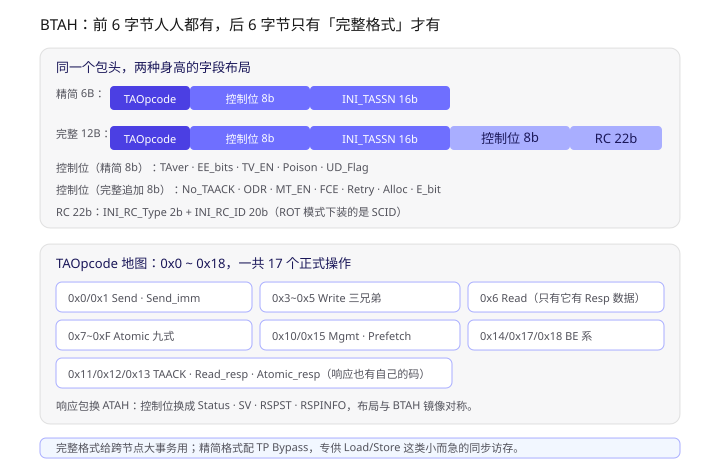
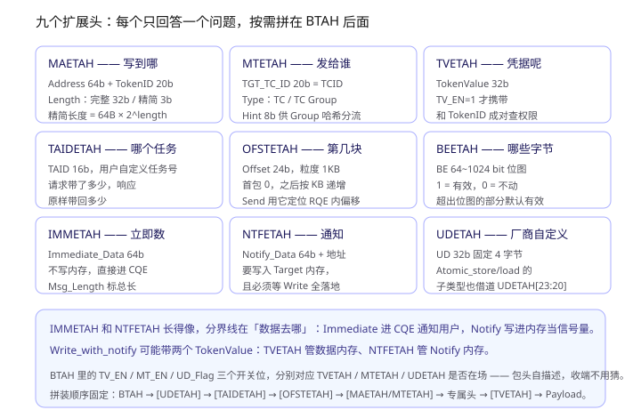
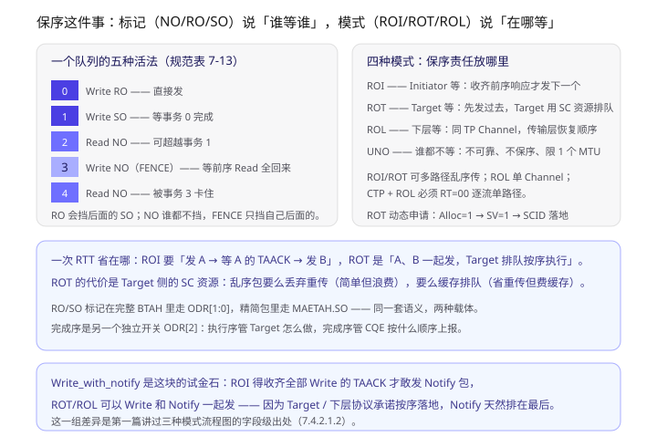
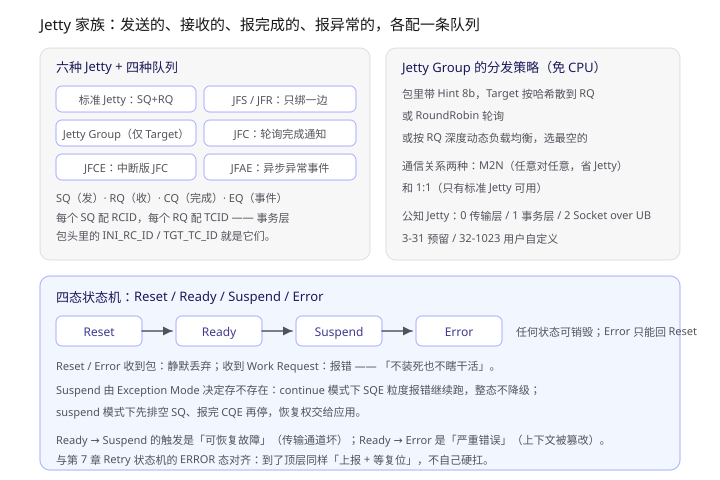
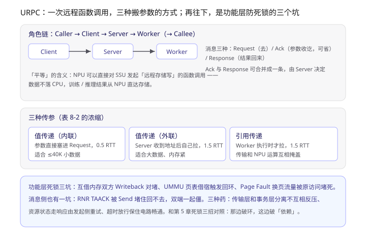

> 灵衢 UB 系列第六篇。前五篇把协议栈概览、OS 落地、集群服务、UB-Mesh 拓扑、链路/网络/传输层的可靠性机制都过了一遍；这一篇拆最后两块：**事务层（第 7 章）和功能层（第 8 章）**。文中「7.2.1」「8.2.2.3」这类编号对应基础规范章节，方便回查。

一句话概括：**传输层以下解决「包怎么不丢不乱」，事务层解决「这一包到底要干什么」，功能层解决「用户拿什么姿势来干」。**

读完这一篇，你应该能回答：

- BTAH 的完整格式 12 字节、精简格式 6 字节，多出来的 6 字节买了什么能力？
- ROI / ROT / ROL 省下的那一个 RTT，代价是什么资源？
- Immediate 数据和 Notify 数据都走「最后一个包」，差别在哪？
- Jetty 有六种，为什么收发完成异常要配四种队列？

---

## 一、先看全景：事务层在协议栈里的位置

第 7 章开篇（7.1）把事务层的职责说得很清楚：接收上层编程模型（Load/Store 同步访问、URMA 异步访问）的调用，联合下层完成 Initiator 和 Target 之间的事务操作。四种事务类型：

| 类型 | 干什么 | 子类型 |
|---|---|---|
| 内存事务 | 直接访问对端内存 | Write / Read / Atomic |
| 消息事务 | 把消息交给对端处理 | Send |
| 维护事务 | 更新对端运行时状态 | Prefetch_tgt |
| 管理事务 | 设备管理、故障上报 | Management |

一个值得注意的细节（7.1）：**针对 Load/Store 同步访问发起的事务，事务层可选使用 TP Bypass 模式以及精简包格式**。这句话是理解整个包头设计的钥匙——精简格式不是「低配版」，而是给「小而急」的同步访存专门开的一条快车道。

---

## 二、BTAH：12 字节里塞进了一个事务的全部身份

### 2.1 两种身高

> 上图上半部分把精简 BTAH（6 字节）和完整 BTAH（12 字节）的字段并排画出来；下半部分是 0x0~0x18 的 TAOpcode 操作码地图，底部一句话点出两种格式的分工。

所有事务请求必须携带 BTAH（7.2.1）。前 6 字节两种格式共享：

- **TAOpcode（8 bit）**：操作码，决定整个包怎么被解析；
- **TAver（2 bit）**：版本号，当前为 0；
- **EE_bits（2 bit）**：执行环境安全属性，区分 TEE / Non-TEE；
- **TV_EN / Poison / UD_Flag**：三个开关位，分别预告 TVETAH、Payload 毒标记、UDETAH 是否在场；
- **INI_TASSN（16 bit）**：事务请求编号，响应原样带回，Initiator 靠它认领自己的事务。

完整格式多出的 6 字节（7.2.1 表 7-1）：

| 域段 | 买到的能力 |
|---|---|
| No_TAACK | CTP 下可以要求 Target 别回 TAACK（网络极可靠时省一笔） |
| ODR（3 bit） | 执行序 NO/RO/SO + 完成序开关 |
| MT_EN | 预告 MTETAH（消息事务的目标上下文） |
| FCE | 要求 Target 产生 Fast Completion Event |
| Retry | 首发还是重传 |
| Alloc | ROT 动态模式下申请 SCID |
| E_bit | 排他性校验 |
| INI_RC_Type + INI_RC_ID（22 bit） | 发起方上下文索引；ROT 模式下装的是 SCID |

**每个开关位都对应一个可选扩展头**——包头自描述，收端不用猜。这是整个 TAH 设计最一致的一条原则。

### 2.2 TAOpcode 地图

17 个正式操作码值得数一遍（7.2.1 表 7-1）：

- 消息：`0x0 Send`、`0x1 Send_with_immediate`
- 写：`0x3 Write`、`0x4 Write_with_immediate`、`0x5 Write_with_notify`、`0x14 Write_with_be`、`0x17 Writeback`、`0x18 Writeback_with_be`
- 读：`0x6 Read`
- 原子：`0x7~0xF` 九式（compare_swap / swap / store / load / fetch_add / sub / and / or / xor）
- 管理/维护：`0x10 Management`、`0x15 Prefetch_tgt`
- 响应：`0x11 TAACK`、`0x12 Read_response`、`0x13 Atomic_response`

响应包换 ATAH（7.2.2），布局与 BTAH 镜像对称：控制位换成 `Status`（精简格式的远端鉴权结果）、`SV`（SCID 是否申请到）、`RSPST + RSPINFO`（状态 + 信息）。其中 `RSPST` 的几个值值得记：

- `3'b000 SC`：Payload **已写入内存**；
- `3'b101`：包正确接收，**已交给介质控制器但未保证落盘**——这个区分很细，专门给持久化场景用的；
- `3'b001 RNR`：接收资源不足，`RSPINFO` 变成 `RNR_Timer`，`RNR_Timeout = 2μs × 2^RNR_Timer`，编码范围 [0,19]；
- `3'b010 Page Fault`：同样复用 `RSPINFO` 当 timer。

**一个域段，三种含义，按 `RSPST` 切换**——这种「域段复用」在第 6 章的 `CETPH` 里也见过，是 UB 包头设计的惯用手法。

### 2.3 TAACK 聚合

7.3.1.1 定义了 TAACK 后向聚合：`ATAH.RSPST = 3'b000 或 3'b101` 时，`RSPINFO` 表示聚合个数。`TAACK(TASSN=N)` 且 `RSPINFO=9`，意味着 N~N+9 共 10 个响应一次到齐。

限制同样明确：**异常 TAACK 不支持聚合**——出错的事务必须单独报，不能被淹没在批量确认里。

---

## 三、九个扩展头：每个只回答一个问题

> 上图九宫格按「写到哪 / 发给谁 / 凭据呢 / 哪个任务 / 第几块 / 哪些字节 / 立即数 / 通知 / 自定义」排列，底部说明 IMMETAH 与 NTFETAH 的分界、双 TokenValue 场景和拼装顺序。

7.2.3~7.2.12 逐个定义了九个扩展头。与其背字段，不如记住每个头回答的问题：

| 扩展头 | 回答的问题 | 关键字段 |
|---|---|---|
| MAETAH | 写到哪 | Address 64b + TokenID 20b + Length |
| MTETAH | 发给谁（哪个 RQ） | TGT_TC_ID 20b + Hint 8b |
| TVETAH | 凭据是什么 | TokenValue 32b |
| TAIDETAH | 属于哪个任务 | TAID 16b |
| OFSTETAH | 是大事务的第几块 | Offset 24b，1KB 粒度 |
| IMMETAH | 立即数是什么 | Immediate_Data 64b |
| NTFETAH | 通知写到哪 | Notify 地址 + Token + Data 64b |
| BEETAH | 哪些字节有效 | BE 64~1024 bit 位图 |
| UDETAH | （厂商自定义） | UD 32b |

几个容易混的点单独说：

**一、Length 的两种宽度。** 完整 MAETAH 的 Length 是 32 bit，精简格式只有 3 bit——因为精简格式约定数据长度 = `64B × 2^length`，0 对应 64B，7 对应 8192B。Load/Store 类小事务的长度本来就是 64B 的整数倍，3 bit 够用。

**二、Immediate 和 Notify 的分界线在「数据去哪」。** 两者都在最后一个包、都依附于「前序包全部处理完」这个条件，但：

- **Immediate（IMMETAH）**：不写内存，直接放进 CQE 上报给 Target 侧的用户——它是「通知」；
- **Notify（NTFETAH）**：写进 Target 的指定内存——它是「信号量」，Target 侧的代码可以轮询这个地址。

所以 `Send_with_immediate` 只消耗 Target 的 RQE（消息语义），而 `Write_with_notify` 的 Notify 包要访问 Target 内存（内存语义 + 消息语义）。

**三、Write_with_notify 可能同时带两个 TokenValue。** TV_EN=1 时，TVETAH 里的 TokenValue 管 Write 数据的内存段，NTFETAH 里的 `Notify_TokenValue` 管 Notify 写入的内存段——两块内存、两套权限，缺一不可（7.2.9 注 1）。

**四、UDETAH 是个口袋。** 厂商自定义 4 字节，但协议自己也往里塞东西：`Atomic_store / Atomic_load` 的子类型（ADD/CLR/EOR/SET/SMAX/SMIN/UMAX/UMIN）就借道 `UDETAH[23:20]`（7.4.2.3.2 表 7-16）——这两个操作码不再细分新 opcode，而是用一个域段二次寻址。

---

## 四、保序：标记说「谁等谁」，模式说「在哪等」

### 4.1 NO / RO / SO

事务执行序（7.3.2.2）三个标记：

- **NO**：无保序要求，随便插队；
- **RO（Relaxed Order）**：自己可以先走，但会**阻塞后面带 SO 的事务**；
- **SO（Strong Order）**：必须等前面带 RO 或 SO 的事务执行完。

规范表 7-13 的五事务例子值得在脑子里跑一遍（Write RO → Write SO → Read NO → Write NO(FENCE) → Read NO）：事务 2 是 NO，可以超越还在等待的事务 1；事务 3 带 FENCE，要等前序所有 Read 的响应回来才能发，还会把事务 4 卡在队列里。**FENCE 是应用/处理器层的机制，和 RO/SO 是两套东西，但可以配合**——规范特意注明了这一点。

### 4.2 四种模式

> 上图左侧是表 7-13 的五事务示例，右侧是四种模式的分工和 ROT 动态申请 SCID 的三步；底部两栏分别讲 ROI/ROT 的 RTT 差异来源和 Write_with_notify 在三种模式下的行为差异。

四种事务服务模式（7.3.3）本质是**保序责任的三种摆放位置加一个不摆放的**：

| 模式 | 谁保序 | 代价 | 收益 |
|---|---|---|---|
| ROI | Initiator | 要等前序响应才发下一个（一个 RTT 一个事务） | 包可以在路上乱序 |
| ROT | Target | Target 要拿 SC 资源记 TASSN 和标记 | 省一个 RTT，包仍可乱序 |
| ROL | 下层协议 | 要么单 TP Channel，要么单路径 | 事务层零负担 |
| UNO | 没人 | 不可靠、不保序 | 限一个 MTU，最轻 |

ROI/ROT 允许多路径乱序传输；ROL 的约束最细（表 7-14）：RTP 下要保序的事务走**同一个 TP Channel**（路上可以乱，接收侧传输层恢复顺序），CTP / TP Bypass 下则**必须 RT=00 逐流单路径**——因为这两者自己没有恢复顺序的能力。

ROT 的动态申请（7.3.3.3）三步走：请求包 `Alloc=1` → 响应 `SV=1` 且 `INI_TASSN` 里是分配到的 SCID → 之后的事务把 `INI_RC_Type` 设为 SC、`INI_RC_ID` 装上 SCID。Target 拿到 SCID 后反查 RCID 填回响应。**SCID 是 Initiator 在 Target 侧租的一块「记账空间」。**

### 4.3 Write_with_notify：三种模式的行为差异

7.4.2.1.2 用同一件事在三种模式下走了一遍，这是检验是否真懂保序的最好例子：

- **ROI**：Initiator 必须收齐所有 Write 的 TAACK，才敢发 Notify 包——因为没人替它保证 Notify 不会跑赢 Write；
- **ROT**：Write 和 Notify 一起发，Target 保证 Notify 等所有 Write 落地后才写；
- **ROL**：Write 和 Notify 一起发，下层保证按序递交。

第一篇讲过的「三种模式流程图差异」，字段级出处就在这里。

---

## 五、事务类型里的门道

### 5.1 Atomic：九式操作，一个例外

Atomic 九式（表 7-16）里有个容易忽略的设计：`Atomic_store` 和 `Atomic_load` 除了操作码，还要靠 `UDETAH[23:20]` 指定 8 种运算（ADD/CLR/EOR/SET/SMAX/SMIN/UMAX/UMIN）。其余七式（compare_swap / swap / fetch_xxx）操作码自含语义。

Payload 规约（7.4.2.3.2）：连续携带 Operand1 + Operand2，等长；只用一个操作数时 Operand2 仍要保留占位。地址必须对齐（4B Atomic 要 4B 对齐），长度支持 1/2/4/8/16/32/64 B。

**最重要的例外在重传**（7.3.1.1）：Atomic Response 处理中出 RNR / Page Fault 时**不能重传**。规范给的例子极好地说明了为什么：`Atomic_fetch_add` 把 X 加到 1，响应回写时 Page Fault；如果重传，Target 会把 X 加到 2、把 1 当作响应返回——**重传本身就改变了状态**。Request 阶段出错可以重传（操作还没发生），Response 阶段不行。这是「幂等性」三个字在协议里的具体形状。

### 5.2 Read：只有 Request 能切片

7.4.2.2 明确：Read 支持 Request 切片，**不支持 Response 切片**——否则一个 Request 编号对应多个 Response 编号，TASSN 对不上。RTP 下一个切片的响应可以超过一个包；CTP / TP Bypass 下一个切片一个包。

### 5.3 Send 与 Write 的队列差异

`Send` 事务要消耗 Target 的 RQE（7.4.3.1），长度约束分档：CTP / TP Bypass 下只能一个包；RTP 下不切片（所有包同一个 TASSN、走同一 TP Channel——用 Channel 保序）。**Send 的「一个切片」约束是怕 Target 等切片数据等太久，白白占住 RQE。**

`Write_with_immediate` 和 `Write_with_notify` 的差异在第 3 节已经说过：Immediate 包消耗 RQE（消息语义），Notify 包访问内存（内存语义）。

### 5.4 Writeback：不能被阻塞

7.4.2.1.4 只有一句但分量很足：**Writeback 处理要求无阻塞执行，不能被普通读写阻塞，否则存在死锁风险**。为什么？想想功能层的死锁场景（8.2.7.2）：A、B 互借内存、互相 Writeback，如果 Writeback 之间互相等，就是死锁。Cache 回写走的就是 Writeback 事务——它是内存借用场景的「清道夫」，清道夫自己不能堵在路上。

### 5.5 Prefetch_tgt：唯一允许「静默丢弃」的事务

维护事务 Prefetch_tgt（7.4.4.1）：Target 无需返回 TAACK，可选是否真的预取；通信异常直接静默丢弃、不上报。**预取本来就是「锦上添花」，丢了也不影响正确性**——整个协议栈里唯一一个对可靠性零要求的事务。

---

## 六、功能层：Jetty 家族与四种队列

### 6.1 六种 Jetty

> 上图左侧是六种 Jetty 与 SQ/RQ/CQ/EQ 的绑定关系，右侧是 Jetty Group 的免 CPU 分发策略和公知 Jetty 编号表；下半部分是四态状态机及其触发条件。

8.2.2 把 Jetty 分成三类六种：

- **标准 Jetty**：SQ + RQ 都绑，能发能收；
- **单边 Jetty**：JFS 只绑 SQ（发）、JFR 只绑 RQ（收）——用 JFS 访问 Target 内存段时，**Target 甚至不用创建 JFR**；
- **Jetty Group**：只在 Target 侧，绑一 组 RQ，Initiator 只指 Group，Target 按策略分发（Hint 哈希 / RoundRobin / RQ 深度负载均衡），**分发不需要 CPU 参与**。

再加三个「事件 Jetty」：JFC（轮询完成）、JFCE（中断版完成）、JFAE（异步异常）。

四种队列（8.2.3）各配一个 ID：**SQ→RCID、RQ→TCID、CQ→CQE、EQ→事件**。第 7 章包头里的 `INI_RC_ID` 和 `MTETAH.TGT_TC_ID`，追到底就是这两张队列的索引。「队列是 FIFO，同队列的事务才能谈保序」——事务序的定义域在这里。

公知 Jetty 编号（表 8-1）也值得记：0 交换传输层信息、1 交换事务层信息、**2 是 Socket over UB**（第二篇讲 UBSocket 时提到过它）、3-31 预留、32-1023 用户自定义。

### 6.2 四态状态机

Jetty 状态机（8.2.2.3）四态：Reset / Ready / Suspend / Error。三个细节：

1. **Reset / Error 态收到包：静默丢弃；收到 Work Request：返回错误**。「不装死也不瞎干活」——和第 5 章网络层 ICRC 的「校验后丢弃不回应」是同一种克制。
2. **Suspend 态是否存在由 Exception Mode 决定**：`continue` 模式下 SQE 粒度报错继续跑、整态不降级；`suspend` 模式下先排空 SQ、报完 CQE 再停。
3. **可恢复故障（传输通道坏）→ Suspend；严重错误（上下文被篡改）→ Error**。恢复权交给应用，协议只负责把状态亮出来。

### 6.3 内存借用与 Ownership

8.2.6 是第二篇 Ownership 章节的协议侧出处。三态（Invalid / Write / Read）和四条转移操作（Clean&Invalidate / Clean / Invalidate / 不处理）都在这里定义；规范同样明确「同一时刻一个节点 Write 则其余全 Invalid」。值得补记的一条：**Cacheable 用于借用（单访问者，无一致性问题），共享场景才需要 Ownership 折腾**；通信为主的程序用 Non-Cacheable 反而更快。

### 6.4 URPC：三种传参，一个亮点

> 上图上半部分是 Caller→Client→Server→Worker 的角色链和三种消息；中间是三种传参方式的 RTT 与适用场景；底部是功能层死锁的三个典型场景与三种解药。

URPC（8.5）三个角色：Client（发起）、Server（接收分配）、Worker（执行）。三种消息：Request / Ack（可省）/ Response（Ack 可与 Response 合并）。

三种传参（表 8-2）的数字值得背下来：

| 方式 | 参数传递耗时 | 谁拉数据 | 适用 |
|---|---|---|---|
| 值传递（内联） | 0.5 RTT | 随 Request 直接到 | 小数据（存储场景 ≤40K） |
| 值传递（外联） | 1.5 RTT | Server 拉 | 大数据、内存紧 |
| 引用传递 | 1.5 RTT | Worker 执行时拉 | 传输和运算互相掩盖 |

**引用传递是亮点**：把「什么时候拉参数」的决定权交给 Worker，让参数搬运和函数执行的时间线重叠起来——AI 训练/推理场景里就是「H2D 传输和 NPU 计算互相掩盖」这件大事。数据路径也短：Client 直接到 Worker，不经 Server 中转。

「平等函数调用」的例子（8.5.2）值得单独记：**NPU 直接向 SSU 发起远程存储写的函数调用**——数据从 NPU 直达存储，CPU 全程不在路径上。

### 6.5 死锁：功能层的四个坑

8.2.7 列的内存侧三坑 + 消息侧一坑，比想象的具体：

1. **互借内存对堵**：A 借 B、B 借 A，双方同时 Writeback 更新对端，TAACK 被反向 Writeback 堵住——两边资源耗尽；
2. **页表借宿**：UMMU 页表放在借用来的内存上，读页表的操作又触发对同一端口的访问——回环；
3. **Page Fault 换页**：处理 Page Fault 的流量（对外部存储或对其它 UBPU）被原始访问流量堵住；
4. **消息队列对堵**：A、B 互发 Send，RQ 不足互相回 RNR TAACK，TAACK 又被 Send 堵住回不去。

三种解药（8.2.7.3）：**传输层和事务层分离**（功能层资源不足不反压下层）、**资源状态走响应由发起侧重试**、**超时放行**。

和第 5 章网络层死锁三招对照着看很意思：那边破的是「环」（路由/VL/丢包），这边破的是「依赖」（原生操作和次生操作的电路耦合）。**层次不同，但哲学相同：死锁只能在系统设计层面消除，不能靠重试硬扛。**

---

## 七、把一个 Write_with_notify 全流程走一遍

拿本篇所有部件串一次（ROI 模式、完整包格式、RTP 传输层）：

1. 应用创建 Jetty、导入 Target 内存段信息（EID / TokenID / UBA / TokenValue），绑定 SQ/CQ；
2. 应用下发 Work Request 到 SQ，UB Controller 调度 SQE，拆成事务操作；
3. 事务层为每个 Write 切片分配 TASSN，封装 `BTAH(TAOpcode=0x3, ODR=RO) + MAETAH(地址/长度/TokenID) + TVETAH(TokenValue) + Payload`；超过 MTU 的切片，`MAETAH.Address` 逐包加 MTU；
4. 传输层按 TPG 分发到 TP Channel，网络层逐包或逐流选路；
5. Target 收包，UMMU 四步查表（TECT→TCT→MATT/MAPT），TokenValue 校验，写内存，回 `TAACK(TASSN 原样带回, RSPST=SC)`；
6. **Initiator 收齐所有切片的 TAACK**（ROI 的代价就在这），才发最后一个包：`BTAH(TAOpcode=0x5) + MAETAH + NTFETAH(Notify 地址/Token/8B 数据)`；
7. Target 确认所有 Write 落地，把 Notify 数据写进指定内存，回 TAACK；
8. CQE 进 CQ，应用轮询 JFC（或 JFCE 中断）拿到完成通知。

如果第 6 步用的是 ROT，Write 和 Notify 可以一起发——Target 的 SC 资源保证 Notify 最后执行。**一个 RTT 的差距，就这样从字段设计一路传导到应用时序。**

---

## 八、几个我觉得值得停下来想的点

**一、精简格式是为 Load/Store 量身定做的。** 6 字节 BTAH + 3 bit Length（64B 粒度）+ 低 6 bit 地址为零——每一刀都砍在「同步访存包小、急、可预期」这个前提上。TP Bypass 让它跳过传输层，链路层 LLR 兜底（第一篇讲过的百 ns 级同步内存语义）。**协议里的「精简」从来不是妥协，是场景特化。**

**二、TASSN 是整个事务层的「主键」。** 请求带出、响应带回、切片各领一个、ROT 靠它记账、TAACK 聚合按连续段打包。理清了 TASSN 的流转，事务层一半的状态机就通了。

**三、域段复用是双刃剑。** `RSPINFO` 一个域段按 `RSPST` 切三种含义（聚合数/RNR timer/错误码），省了位宽，但实现时必须先判 `RSPST` 再解释——这类字段是写解析代码时最容易埋 bug 的地方。

**四、Atomic 的重传限制是「幂等性」的教科书案例。** 协议没有用「幂等」这个词，但 Request 可重传、Response 不可重传的规则，就是按「操作是否已经发生」划的线。

**五、功能层的死锁坑全和「借」有关。** 借内存、借页表、借队列——「平等互访」架构的代价是依赖关系变成了网状，原生/次生操作可能共用电路。UB 给的是原则（分离、重试、超时）而不是定理，实现者要自己做依赖分析。

---

## 九、学习路径

1. **先读 7.2.1 表 7-1**，把 BTAH 完整格式的 15 个域段过一遍，重点理解每个开关位和扩展头的对应关系；
2. **再读 7.3.3 四种模式 + 表 7-14/7-15**，拿 Write_with_notify 当试金石，在三种模式下各走一遍流程；
3. **然后读 8.2.2~8.2.3**，画出六种 Jetty 和四种队列的绑定图——这张图是 URMA 编程的心智模型；
4. **最后读 8.2.7 死锁**，把三个内存坑的依赖链在纸上画出来，体会「原生操作 vs 次生操作」这个分类；
5. 动手验证的话，找有真机的环境跑 `urma_admin` 看 Jetty / 队列的创建接口，对照第 7 章的域段定义看每个 API 参数落到哪个字段——这正好接上系列第一篇留的作业。

## 参考

- 《UB Base Specification 2.0（中文版）》第 7 章（事务层）、第 8 章（功能层）——本篇所有字段与定义均出自这两章。
- 同系列前五篇：《灵衢 UnifiedBus 学习笔记》（协议本体）、《OS 参考设计》、《系统高阶服务与可靠性》、《UB-Mesh 组网拓扑》、《消息是怎么保证不丢的》。
- 关联：第 9 章内存管理（UMMU 四步查表）在第一篇已拆过；TAH 各扩展头与 hcomm 侧 `ub_conn_lite` 的 WQE 构造（WriteWithNotify 原语）可以对照着看——那是这套包格式在代码里的落地。
