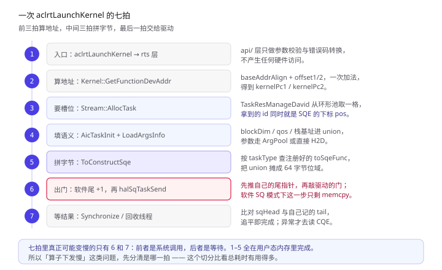
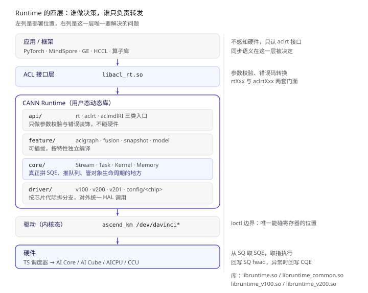
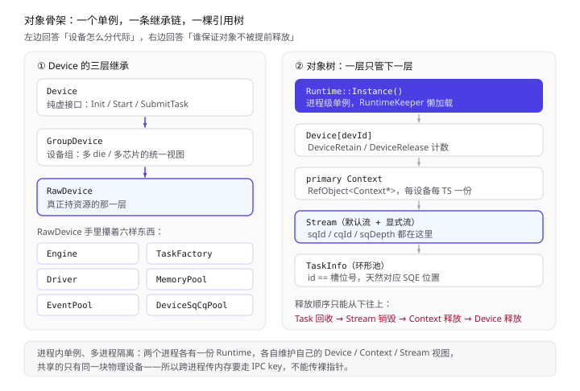
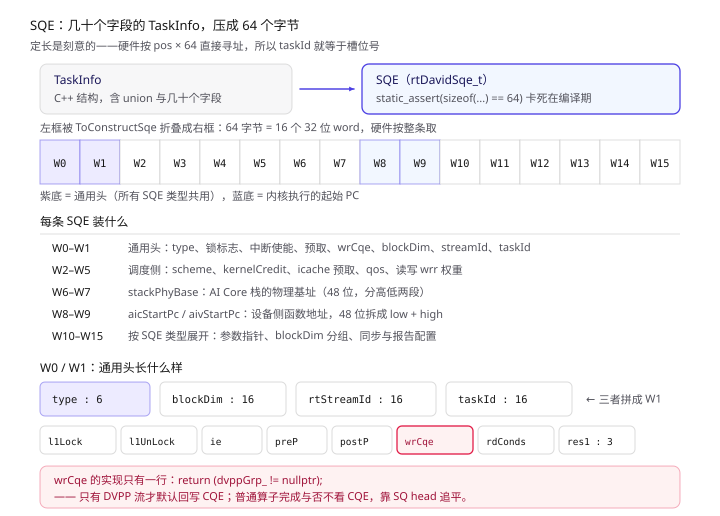
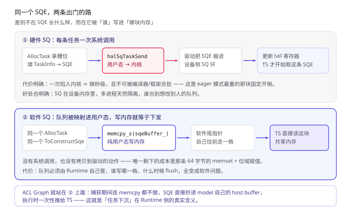
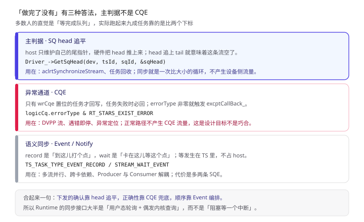
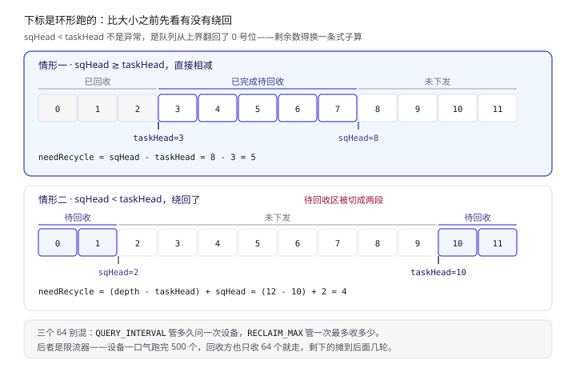
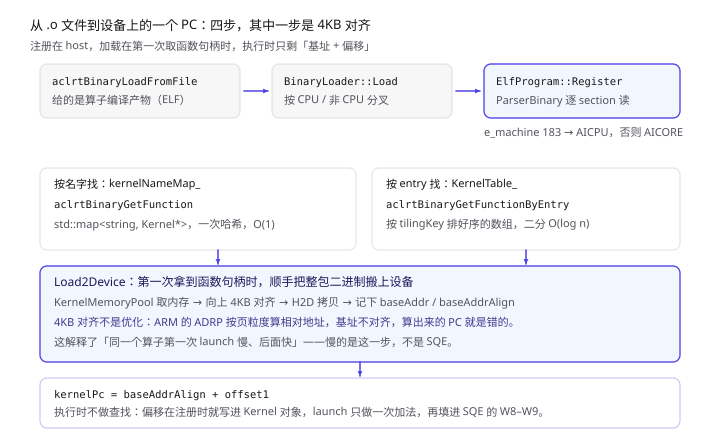
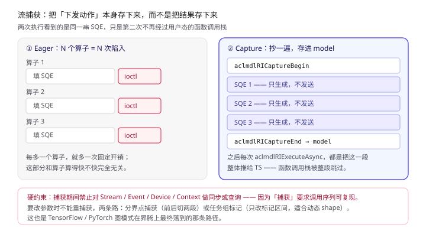

前面几篇 HCCL 的文章反复用到一个词：**SQE**。AICPU 模式在 AI CPU 上生成 SQE，CCU 模式把 SQE 换成微码指令，Task Cache 靠刷新 SQE 里的地址重放——但那些 SQE 最后是怎么离开用户态、又怎么被硬件取走的，一直悬着没说。

这篇补上那一环。

一句话概括：

> **CANN Runtime 干的事，是把一次 C 函数调用翻译成 64 个字节，塞进一条环形队列，然后用三种不同的方式判断「它到底做完了没有」。**

递进地看，你可以从四个角度切进去：

- **位置**：它在 CANN 中间那层，上面是框架和通信库，下面是内核态驱动。四层目录划分决定了「哪一层能做决策」；
- **对象**：进程级单例 + 设备三层继承 + 引用计数，回答「谁保证 Stream 不被提前释放」；
- **数据**：一条 SQE 定长 64 字节，一个任务最多占 5 条，`taskId` 就是队列下标；
- **时间**：下发的确认靠 `sqHead` 追平、正确性靠 CQE 兜底、顺序靠 Event 编排。

> 本文所有结论来自 CANN 开源仓库 `runtime`（本地路径 `cann-runtime/`），关键处标注 `文件:行号` 或文档章节。看不懂的代码块可以直接跳，每段后面都有大白话。
> 与 HCCL 系列的关系：**HCCL 是 SQE 的大客户，Runtime 是 SQE 的产房。**《HCCL 实现原理》里那条「下发—完成往返」的账，最后就是在这里结的。
> 续篇两篇：第二篇《SQE 到了设备侧：AI CPU 调度器怎么接活》讲 SQE 出了用户态之后，TS 怎么把它翻译成另一种格式投给 aicpusd；第三篇《算子怎么被调起来：AI CPU Engine 解剖》接着讲 aicpusd 拿到任务之后，怎么打开 `.so`、查符号、把函数真正调起来。

---

## 〇、读之前：先认 6 个词

**必须懂（贯穿全文）：**

| 词 | 一句话 | 打个比方 |
| --- | --- | --- |
| **SQ / CQ** | Submission Queue / Completion Queue，提交队列与完成队列 | 传菜口与取餐口 |
| **SQE** | SQ Entry，定长 64 字节的任务描述符 | 一张**点菜单**，格式固定，机器能读 |
| **Stream** | 一条有顺序的任务队列，绑定一对 SQ/CQ | 一条**单独的传送带** |
| **TaskInfo** | Runtime 内部的任务对象，C++ 结构，字段几十个 | 你脑子里想的「我要做这道菜」 |
| **Engine** | 提交引擎，Stars（新）/ HWTS（旧）两条实现 | 传菜员 |
| **CQE** | CQ Entry，完成事件，**只有异常或特定流才写** | 出问题时的**退单回执** |

**混个脸熟就行：**

| 词 | 一句话 |
| --- | --- |
| **Pc / startPc** | AI Core 上函数入口地址，48 位，在 SQE 里拆成 low + high 两段 |
| **blockDim** | 这个算子要铺多少个核 |
| **tilingKey** | 同一算子的不同编译产物用它对号入座 |
| **primary Context** | 每个设备的主上下文，跨线程共享（所以默认流也共享） |
| **RefObject / ObjAllocator** | Runtime 里的引用计数包装，管 Device / Context / Program 的生死 |
| **DVPP** | 视觉预处理子系统，**唯一默认写 CQE 的普通场景** |

把这六个词按发生顺序串起来：**你在 Stream 上 launch 一个算子 → Runtime 从池子里取一个 TaskInfo → 按任务类型查出对应的「拼字节」函数 → 拼出 64 字节 SQE → 推进软件尾指针 → 敲一下驱动 → 等 head 追上来。**



> 左列是七拍的顺序，右列是每一拍的实质动作。红色的第 6 拍是唯一可能陷入内核的地方，第 7 拍是唯一可能阻塞的地方。

---

## 一、Runtime 在哪一层：它其实是台「用户态编译器」

CANN 里 Runtime 的位置常被一句话带过——「框架和驱动之间的桥梁」。但「桥梁」这个词太软，容易让人以为它只是转发。看它的四层目录划分就清楚多了。

`docs/zh/design/architecture.md` §1.1 把 Runtime 内部切成四层，而且**目录结构就是这四层**：

| 层 | 目录 | 职责 | 是不是能干实事 |
| --- | --- | --- | --- |
| 接口层 | `src/runtime/api/` | `rt` / `aclrt` / `aclmdlRI` 三类入口，参数校验、错误码转换 | 不碰硬件 |
| 特性层 | `src/runtime/feature/` | ACL Graph、Model、Fusion、Snapshot，可插拔 | 只编排核心层 |
| 核心层 | `src/runtime/core/src/` | Device / Context / Stream / Task / Kernel / Memory / Event | **全在这层** |
| 驱动适配层 | `src/runtime/driver/` + `config/` | 按芯片代际（v100 / v200 / v201）拆分支，统一 HAL 调用 | 屏蔽差异 |

同一份文档 §1.2 给了部署视图，这一串库名值得记一下，出问题的时候排查版本对不上就是查这里：

- `libacl_rt.so` —— ACL 运行时接口
- `libruntime.so` —— Runtime 主体
- `libruntime_v100.so` / `libruntime_v200.so` —— 代际适配，按芯片加载
- `libruntime_common.so` —— 公共部分



> 左列是部署位置（用户态 → 内核态 → 硬件），右列是每一层唯一要解决的问题。注意第四层往下就是 `ascend_hal.h` 的 HAL 接口，再往下才进内核。

**这里有个判断值得说清楚**：为什么接口层和核心层要分那么干净？因为接口层要处理的是「用户传错了参数」这类问题，核心层要处理的是「硬件没按预期干活」这类问题。两者的错误码、日志、恢复策略完全不同。分层不是审美，是为了让错误能被分诊。

顺带把进程模型也定下来（§1.2）：

- 单进程可管多设备，`aclrtSetDevice` 切换；
- 单进程可建多 Context，每个 Context 绑一个 Device；
- 一个 Context 可建多 Stream，Stream 是并行的最小单位；
- **多进程完全隔离**，各自维护自己的资源状态。

最后一条很关键：因为进程隔离，跨进程传设备内存**不能传裸指针**，必须走 IPC key（`aclrtIpcMemGetExportKey` / `aclrtIpcMemImportByKey`）。HCCL 跨进程建链时踩的坑，根子在这儿。

---

## 二、对象骨架：一个单例，一条继承链，一棵引用树

Runtime 的对象模型有三件事值得单独看，因为它们直接决定了很多「玄学」行为。

### 2.1 进程级单例，懒加载

`Runtime::Instance()` 是入口，但它内部不是简单的 `new Runtime()`——第一次访问会走 `RuntimeKeeperGetRuntime()`，由静态全局对象 `g_runtimeKeeper` 完成创建（`docs/zh/design/modules/runtime/runtime.md` §4.2）。

这层包装解决了一个很实际的问题：**全局对象的构造顺序**。Runtime 的构造要读芯片型号、加载插件 so、初始化 Driver，这些动作不能发生在 `main` 之前的静态初始化阶段。

### 2.2 Device 的三层继承

`docs/zh/design/modules/device/device.md` §1 写得很直白：**Device（接口）→ GroupDevice（设备组）→ RawDevice（实际设备）**。

为什么要中间插一层 GroupDevice？因为一颗芯片可能有多个 die，一组芯片可能组成一个逻辑设备。上层希望「把这一坨当成一台机器」，下层又要精确控制每个 die 的资源配额。GroupDevice 就是那个「把一坨当一台」的适配层。

真正攥着资源的是 `RawDevice`，它手里有六样东西：`Engine`、`Driver`、`TaskFactory`、`MemoryPool`、`EventPool`、`DeviceSqCqPool`。

### 2.3 引用计数：谁保证 Stream 不被提前释放

`runtime.md` §4.2 提到 `RefObject` 管着两类东西：

```cpp
RefObject<Context *> priCtxs_[RT_MAX_DEV_NUM][RT_MAX_TS_NUM];   // 主上下文
ObjAllocator<RefObject<Program *>> *programAllocator_;          // 程序
```

规则很朴素：**Device 被 retain 时，它的 primary Context 一起被 retain；Context 被 release 时，它下面所有 Stream 先销毁。** 所以释放顺序只能是自下而上：

```
Task 回收 → Stream 销毁 → Context 释放 → Device 释放
```



> 左边是继承链，右边是对象树。注意 `TaskInfo` 的「id == 槽位号」这条——它不是一个实现细节，而是整个 SQE 寻址方案的基础，第四节会展开。

这里有个很常见的困惑：**默认流为什么不能显式销毁？** 因为它属于 primary Context，生命周期跟 Context 绑定。你 `aclrtResetDevice` 的时候它跟着一起没了，所以不需要（也不允许）单独 `aclrtDestroyStream`。

---

## 三、主线：一次 `aclrtLaunchKernel` 的七拍

现在走一遍完整路径。这条链路是理解后面所有内容的地基。

### 3.1 前三拍：算地址、要槽位

```
aclrtLaunchKernel(funcHandle, numBlocks, argsData, argsSize, stream)
  → rtLaunchKernelByFuncHandleV3
  → ApiImpl::LaunchKernel
  → StreamLaunchKernelV2        // src/runtime/core/src/launch/aix_starsv2.cc
```

`StreamLaunchKernelV2` 里做了两件准备动作：

```cpp
// 1. 算设备侧函数地址：一次加法
error = kernel->GetFunctionDevAddr(kernelPc1, kernelPc2);

// 2. 要一个任务槽位
kernelTask = stm->AllocTask(nullptr, TS_TASK_TYPE_KERNEL_AICORE, error, 1U, UpdateTaskFlag::SUPPORT);
```

**第一件事**看起来平淡，其实是整个设计的关键取舍：内核二进制的设备基址在加载时就已经确定（第七节），所以执行期只需要 `baseAddrAlign + offset`，**没有任何查找**。

**第二件事**是 `Stream::AllocTask`，它的分发逻辑在 `stream.cc:4937-4956`：

```cpp
TaskInfo* Stream::AllocTask(TaskInfo* pTask, tsTaskType_t taskType, rtError_t& errorReason,
                            uint32_t sqeNum, UpdateTaskFlag flag) {
    if (IsTaskGroupUpdate() && flag != UpdateTaskFlag::NOT_SUPPORT_AND_SKIP) {
        return HandleTaskGroupUpdate(taskType, flag, errorReason);   // 模型更新路径
    }
    if (IsAutoSplitSq()) {
        return AllocAutoSplitTaskInfo(&task, this, sqeNum);          // 大包自动切分路径
    }
    if (GetCaptureStatus() != RT_STREAM_CAPTURE_STATUS_NONE) {
        return AllocCaptureTask(taskType, sqeNum, pTask, errorReason); // 流捕获路径
    }
    return AllocNonCaptureTask(this, pTask, taskType, errorReason, sqeNum); // 普通路径
}
```

四条路径，一条都不能少：**捕获路径**决定了 SQE 是发给硬件还是存进 model，**AutoSplit 路径**决定了超大任务怎么拆成多条 SQE。这两条分支合起来，基本覆盖了「为什么我的代码行为和预期不一样」的一大半原因。

槽位本身来自 `TaskResManageDavid::AllocTaskInfoAndPos`，一个环形池：

```cpp
const uint32_t taskDesTailIdx = (tail + sqeNum) % taskPoolNum_;
if (/* 环形队列翻转判断，见 task.md §4.2.2 */) {
    return RT_ERROR_TASKRES_QUEUE_FULL;
}
pos = tail;
*task = &taskRes_[pos].taskInfo;
// 多 SQE 任务：所有槽位共享同一个 id == pos
while (tail != taskDesTailIdx) {
    taskRes_[tail].taskInfo.id = pos;
    tail = (tail + 1U) % taskPoolNum_;
}
```

注意那句注释：**一个任务占多条 SQE 时，所有槽位共享同一个 `id`，而 `id` 就等于首槽位的 `pos`。** 后面的回收靠 `sqeNum` 一起推进。

### 3.2 中间两拍：填语义、拼字节

拿到槽位后，`AicTaskInit` 填 `TaskInfo.u.aicTaskInfo`（blockDim、qos、栈基址、kernel 指针），`LoadArgsInfo` 把参数搬上设备（ArgPool 或直接 H2D）。

然后是最核心的一步：

```cpp
// src/runtime/core/src/task/inc/runtime_task_manager.h
using PfnTaskToSqe = void (*)(TaskInfo* taskInfo, void* const sqe, const TaskSqeInfo& sqeInfo);

struct TaskFuncSingle {
    PfnTaskToCmd               toCommandFunc;
    PfnTaskToSqe               toSqeFunc;          // ← 拼 SQE 的函数
    PfnDoCompleteSucc          doCompleteSuccFunc; // 完成后的处理
    PfnTaskUnInit              taskUnInitFunc;
    PfnWaitAsyncCpCompleteFunc waitAsyncCpCompleteFunc;
    PfnPrintErrorInfo          printErrorInfoFunc;
    PfnTaskSetResult           setResultFunc;
    PfnTaskSetStarsResult      setStarsResultFunc;
};

void ToConstructSqe(TaskInfo* taskInfo, void* const sqe, const TaskSqeInfo& sqeInfo);
```

这套注册表的设计意图很明确：**任务类型 × 芯片代际** 二维索引到一组回调。`Runtime::Init()` 时按 `CHIP_TYPE` 调 `RegTaskFunc` 一次性注册，运行时用 `ToConstructSqe` 统一入口查表调用。

好处是加一种新任务类型不用改主流程；代价是——**你必须知道当前芯片注册了哪些回调**。调试时如果发现某个任务的 SQE 字段全零，八成是查表没命中。

### 3.3 后两拍：出门、等结果

```cpp
// src/runtime/core/src/task/task_submit/v100/task_submit.cc:642
error = engine->AddTaskToStream(taskInfo, sendSqeNum);   // ① 先推自己的软件尾指针

// ...

// :651
struct halTaskSendInfo sendInfo = {};
sendInfo.type      = DRV_NORMAL_TYPE;
sendInfo.sqe_addr  = sqe;
sendInfo.sqe_num   = sendSqeNum;
sendInfo.tsId      = tsId;
sendInfo.sqId      = sqId;

error = StarsSendTask(taskInfo, stm, sendInfo, devId, cqId);  // ② 再敲驱动
```

**顺序值得注意：先推进软件尾指针，再敲驱动。** 因为 `AddTaskToStream` 只是改内存里的一个计数器（第五节会看到它连系统调用都不是），而 `StarsSendTask` 才可能陷入内核。如果后者失败，前面那个推进要回滚——所以 `TaskResManageDavid` 里有个 `RollbackTail()`。

到这里七拍走完。整个过程里，**只有第 6 拍可能陷入内核，只有第 7 拍可能阻塞**。这个切分比盯总耗时有用的多：算子下发慢，先问是哪一拍慢。

---

## 四、SQE 解剖：64 字节定长，与一个 `wrCqe` 的真相

### 4.1 为什么必须定长

`src/runtime/core/src/task/inc/runtime_task_manager.h` 开头几个常量，把这件事钉死在编译期：

```cpp
constexpr uint32_t SQE_SIZE_UNIT = 64U;                                     // :21
constexpr uint32_t SQE_NUM_PER_TASK_MAX = SQE_NUM_PER_DAVID_TASK_MAX;
constexpr uint32_t SQE_SIZE_PER_TASK_MAX = SQE_SIZE_UNIT * SQE_NUM_PER_TASK_MAX;  // :23
static_assert(SQE_SIZE_UNIT == (1U << 6U), "SQE unit must remain 64 bytes");      // :42
static_assert(SQE_SIZE_PER_TASK_MAX == 320U, "per-task SQE buffer must hold five 64-byte units"); // :45
```

三个数字：**64 字节一条，一个任务最多 5 条，合计 320 字节。**

定长不是为了省地方，是为了**寻址**。硬件拿到 `taskId` 就能算出 `base + taskId × 64`，不需要任何长度表——源码里写这条寻址就是一个移位：`sqeAddr = sqBaseAddr + (pos << SHIFT_SIX_SIZE)`（`SHIFT_SIX_SIZE = 6`）。这也就解释了上一节那个「多 SQE 任务共享同一个 id」的设计——`id` 不是逻辑编号，它是**首槽位的物理下标**。

### 4.2 通用头：所有 SQE 共用的一小段

`src/runtime/core/inc/sqe/arch5162/stars_sqe.hpp:84`：

```cpp
struct rtStarsSqeHeader {
    /* word0 */
    uint8_t type    : 6;   // SQE 类型：AIC / AIV / MEMCPY / EVENT ...
    uint8_t l1Lock  : 1;
    uint8_t l1UnLock: 1;
    uint8_t ie      : 1;   // 中断使能
    uint8_t preP    : 1;   // 前预取
    uint8_t postP   : 1;   // 后预取
    uint8_t wrCqe   : 1;   // ★ 是否回写 CQE
    uint8_t rdConds : 1;   // 读条件
    uint8_t res1    : 3;
    union {
        uint16_t blockDim;    // type = 0/1/2 时是核数
        uint16_t sqeSubType;  // 其他类型是子类型
        uint16_t res;
    } u;

    /* word1 */
    uint16_t rtStreamId;
    uint16_t taskId;
};
```

这 8 个字节里有三个字段值得单独说：

- **`blockDim` 与 `sqeSubType` 共用同一块空间**——因为「算子任务」和「非算子任务」不会同时需要这两个语义。这种 union 复用在同一份 SQE 里到处都是。
- **`rtStreamId` + `taskId` 一共 32 位**，正好拼成 word1。所以一条 SQE 天然知道自己属于哪条流、是第几个任务。
- **`wrCqe`** —— 下面单独讲，它是本文最反直觉的一个点。

### 4.3 `wrCqe` 的真相

直觉上，任务完成了总要通知 host 一声吧？CQE 不就是干这个的？

看实现：

```cpp
// src/runtime/core/src/stream/stream.hpp:439
bool GetStarsWrCqeFlag() const
{
    return (dvppGrp_ != nullptr); // all dvpp task need cqe in stars
}
```

**只有绑定了 DVPP 组的流，默认才回写 CQE。** 普通算子流一律是 0。

那任务完成怎么知道？靠第六节要讲的 `sqHead` 追平。

这里还有一层细节，`src/runtime/core/inc/task/task_base.hpp:94` 定义了三种语义：

```cpp
enum TaskWrCqeFlag {
    TASK_WR_CQE_DEFAULT,  // 跟随 stream->GetStarsWrCqeFlag()
    TASK_WR_CQE_NEVER,    // 绝不写
    TASK_WR_CQE_ALWAYS    // 必写
};
```

而 `common_task_v200_base.cc:98-108` 里有一段更能说明问题——写值类任务不是直接用流的默认值，而是按任务自带的 `cqeFlag` 三选一：

```cpp
switch (writeValTsk->cqeFlag) {
    case TASK_WR_CQE_DEFAULT:
        evSqe->header.wrCqe = taskInfo->stream->GetStarsWrCqeFlag();
        break;
    case TASK_WR_CQE_NEVER:
        evSqe->header.wrCqe = 0U;
        break;
    default:                      // TASK_WR_CQE_ALWAYS
        evSqe->header.wrCqe = 1U;
        break;
}
```

也就是说：**「写不写 CQE」是一个任务级的、可被特例覆盖的策略**，不是全局约定。同一份头文件里的这三行枚举注释，比任何文档都说得清楚。



> 上：64 字节按 16 个 32 位 word 排布，紫底是通用头，蓝底是起始 PC。下：W0/W1 的字段拆解，红色那个就是 `wrCqe`。

### 4.4 AIC / AIV / MIX：一条 SQE 里的两个 PC

`src/runtime/inc/sqe/aic_aiv_sqe_common.hpp` 里分了三支：

| 模式 | 构造函数 | PC 怎么填 |
| --- | --- | --- |
| 纯 Cube | `ConstructAicSqePart` | `aicStartPc` = funcAddr，`aivStartPc` = 0 |
| 纯 Vector | `ConstructAivSqePart` | `aicStartPc` = 0，`aivStartPc` = funcAddr |
| MIX | `ConstructMixSqePart` | 两个都填，再用 `ratio` 定 Cube:Vector 的配比 |

MIX 分支里那个 `mixType` 有多个取值（`MIX_AIC`、`MIX_AIC_AIV_MAIN_AIC` 等），决定谁是主、谁是辅。这解释了为什么 Ascend C 里同一个 MIX 算子在不同配比下性能差那么多——**配比是写进 SQE 的硬件参数，不是编译器优化的结果。**

顺带一个容易忽略的：`ConstructMixSqePart` 里调 `CheckBlockDim`，`blockDim` 超过该类型核数只打 warning，不报错。所以「我铺了 64 个核但只用了 24 个」这种情况，代码是能跑完的，只是白铺。

---

## 五、两条出门的路：硬件 SQ 与软件 SQ

这是 Runtime 里最值得单拎出来的一节，因为它是所有「下发性能优化」的地基。

`src/runtime/core/src/task/task_submit/v100/task_submit.cc:433` 的 `StarsSendTask`，核心就一个 if：

```cpp
static rtError_t StarsSendTask(TaskInfo* const taskInfo, Stream* const stm,
                               halTaskSendInfo& sendInfo, const uint32_t devId, const uint32_t cqId)
{
    drvError_t drvRet = DRV_ERROR_NONE;
    if (!stm->IsSoftwareSqEnable()) {
        // 路径一：陷入内核，驱动把 SQE 搬进设备侧 SQ 环
        drvRet = halSqTaskSend(devId, &sendInfo);
    } else {
        // 路径二：纯用户态 memcpy 到映射好的环
        const uint64_t sqeBytes = GetTaskSqeBytes(taskInfo->sqeNum);
        const auto ret = memcpy_s(
            static_cast<void*>(GetSqeAddr(stm->GetSqeBuffer(), taskInfo->pos)), sqeBytes,
            static_cast<void*>(sendInfo.sqe_addr), sqeBytes);
        // ...
    }
    // ...
}
```

两条路，代码只差这几行，代价差一个数量级：

| | 硬件 SQ | 软件 SQ |
| --- | --- | --- |
| SQE 写到哪 | 设备侧 SQ 环（驱动代写） | 用户态映射的环（自己写） |
| 每任务开销 | 一次 ioctl，微秒级 | 一次 64 字节 memcpy，纳秒级 |
| 隔离性 | 驱动保证，多进程天然隔离 | Runtime 自己管，谁写哪格是软件问题 |
| 尾指针推进 | 驱动更新 tail 寄存器 | 软件自己维护 + 批量 flush |

**为什么不是所有流都走软件 SQ？** 因为「谁写哪一格」这件事一旦交给软件，就要自己保证：不会和回收线程撞车、不会写出环边界、flush 的时机对得上 TS 的取指节奏。`Stream` 里那一堆锁（`StreamLock` / `StreamSyncLock` / `StreamRecycleLock`）和 `taskPosHead_` / `taskPosTail_` 两个原子变量，都是为了这个。



> 上：硬件 SQ，每条任务一次陷入；下：软件 SQ，写内存即下发。底部的 ACL Graph 是软件 SQ 的进一步延伸——连 memcpy 都省掉了。

一个实用推论：**如果你在 profiler 里看到大量 `SqTaskSend` 时间，那说明当前走的是硬件 SQ。** 想让这部分消失，要么开流捕获，要么确认软件 SQ 是否可用。

---

## 六、怎么知道做完了：三种判据

这一节回答那个最容易被想当然的问题。

### 6.1 主判据：`sqHead` 追平

`Stream` 自己维护一个尾指针，硬件推上来一个头指针，**两者相等就是队列空了**：

```cpp
// docs/zh/design/modules/stream/stream.md §4.1
rtError_t Stream::SynchronizeExecutedTask(const uint32_t taskId, const mmTimespec &beginTime, int32_t timeout) {
    uint16_t sqHead = static_cast<uint16_t>(MAX_UINT16_NUM);
    while (true) {
        if (sqHead == GetTaskPosTail()) {
            return RT_ERROR_NONE;
        }
        if (!device_->GetIsDoingRecycling()) {
            device_->WakeUpRecycleThread();
        }
        error = device_->Driver_()->GetSqHead(Device_()->Id_(), Device_()->DevGetTsId(), sqId_, sqHead);
        if (IsTaskExcuted(finishedId, taskId)) {
            return RT_ERROR_NONE;
        }
    }
}
```

注意 `GetSqHead` 是**查询**而不是**等待**。所以流同步在实现上是「轮询 + 偶尔陷入内核问一次」，不是「挂起等一个中断」——这也解释了为什么 `aclrtSynchronizeStream` 在任务已经跑完时开销极小，一次查询就能确认。

### 6.2 异常通道：CQE

既然正常路径不写 CQE，那 CQE 什么时候来？

`stars_engine.cc:291` 的 `StarsCqeReceive` 给出了完整处理：

```cpp
void StarsEngine::StarsCqeReceive(const rtCqReport_t& logicCq, TaskInfo* const runTask) const {
    SetStarsResult(runTask, logicCq);
    DoTaskComplete(runTask, GetDevice()->Id_());
    // ...
    const tsTaskType_t taskType = runTask->type;
    if ((taskType != TS_TASK_TYPE_EVENT_RECORD) && (taskType != TS_TASK_TYPE_GET_STARS_VERSION) &&
        ((logicCq.errorType & RT_STARS_EXIST_ERROR) != 0)) {
        if (Runtime::Instance()->excptCallBack_ != nullptr) {
            Runtime::Instance()->excptCallBack_(RT_EXCEPTION_TASK_FAILURE);
        }
    }
}
```

**CQE 是错误上报通道为主。** `errorType` 非零就回调 `excptCallBack_`，这就是框架侧「算子执行失败」异常的源头。

### 6.3 语义同步：Event / Notify

跨流、跨卡的依赖，本身就是一类任务——`TS_TASK_TYPE_EVENT_RECORD` / `TS_TASK_TYPE_STREAM_WAIT_EVENT` / `TS_TASK_TYPE_NOTIFY_RECORD` / `TS_TASK_TYPE_NOTIFY_WAIT`（见 `task.md` §2.2 的任务分类表）。

语义很干净：

- `record` = 「到这儿打个点」——往一个硬件同步寄存器里置位；
- `wait` = 「卡在这儿等这个点」——**等待发生在 TS 里，不占 host 时间**。

所以 `aclrtRecordEvent` + `aclrtStreamWaitEvent` 组合出来的跨流依赖，host 侧的成本只是下发两条 SQE。



> 三行的区别：主判据是「比两个下标」，异常通道是「读完成队列」，语义同步是「在硬件里等」。绝大多数人以为的第一种其实是第二种。

### 6.4 回收的五个触发点

任务对象是复用的，所以「回收」和「完成判定」是同一件事的两面。除了每个任务下发时都做的那次检查，还有几个「额外催一下」的时机：

| 触发条件 | 入口 | 源码位置 |
| --- | --- | --- |
| 每发 64 个任务 | `TryRecycleTask` | `stars_engine.cc:795` / `task_recycle.cc:115` |
| 下发时 SQ 空位不够 | `TryToReclaimTask` | `task_david.cc:328` |
| 流同步（中途） | `WakeUpRecycleThread` | `stream.cc:2077 / 2114 / 2131` |
| 流销毁 | `TaskReclaimByStream` | `stream.cc:2909` |
| 异步回收线程 | `RecycleThreadDoForStarsV2` | `task_recycle.cc:322` |

前两条的注释在源码里写得很直白，直接抄过来：

```cpp
// stars_engine.cc:795
// Do task recycling every 64 tasks send
rtError_t StarsEngine::TryRecycleTask(Stream* const stm)
{
    const uint32_t taskTail = stm->GetTaskPosTail();
    if (stm->GetBindFlag() || (stm->GetPendingNum() == 0U) ||
        ((taskTail % TASK_QUERY_INTERVAL_NUM) != 0U)) {
        return RT_ERROR_NONE;   // 没到 64 的整数倍，这轮不查
    }
    // ...接下来才去查 sqHead、回收对象
}
```

**「每 64 个」的真相是「每 64 次才去问一次设备」。** 严格说这不是「攒够 64 个再回收」，而是**把查询频率降下来**：每个任务都发一次 `ioctl` 问 `sqHead` 到哪了，系统调用开销会把下发吞吐吃掉；攒到 64 个问一次，平均下来每次下发只摊到 1/64 次查询。代价是最坏情况下有 63 个任务已经完成却还没被回收，占着池子不放。

名字也说明了它的本职：`TASK_QUERY_INTERVAL_NUM`，`stars_engine.cc:47` 的注释是 `// Shared memory query interval.`——它是**查询间隔**，回收只是查询的副作用。

顺带说清一件事：这个仓里有**三个不同的 64**，别混。

| 常量 | 值 | 真实语义 |
| --- | --- | --- |
| `TASK_QUERY_INTERVAL_NUM` | 64 | 每 64 个任务查一次 sqHead（上面这条） |
| `TASK_RECLAIM_MAX_NUM` | 64 | **单次查询最多回收 64 个**，见 `GetRecycleHead` |
| `ASNC_THREAD_TASK_RECLAIM_MAX_NUM` | 64 | 异步回收线程里的唤醒间隔 |

第二个容易被误读成「一次回收 64 个」，它实际是个**限流器**。`stars_engine.cc:368` 的 `GetRecycleHead` 里，如果 `sqHead` 已经跑到 `taskHead` 前面超过 64 个，就把本次回收的终点硬卡在 `taskHead + 64`：

```cpp
// stars_engine.cc:368（有删节）
void StarsEngine::GetRecycleHead(const uint16_t taskHead, const uint16_t sqHead,
                                 const uint32_t rtsqDepth, uint16_t& recycleHead) const
{
    if (sqHead >= taskHead) {
        if ((TASK_ID_SUB(sqHead, taskHead)) > TASK_RECLAIM_MAX_NUM) {
            recycleHead = TASK_ID_ADD(taskHead, static_cast<uint16_t>(TASK_RECLAIM_MAX_NUM));
        }
    } else {
        // flip occurs —— 环形队列绕回，跨过 0 号位
        const uint16_t needRecycleTask = (static_cast<uint16_t>(rtsqDepth) - taskHead) + sqHead;
        if (needRecycleTask > TASK_RECLAIM_MAX_NUM) {
            recycleHead = static_cast<uint16_t>(
                static_cast<uint32_t>(taskHead + TASK_RECLAIM_MAX_NUM) % rtsqDepth);
        }
    }
}
```

函数上方的注释是 `// In order not to affect the sending, at most 64 tasks can be reclaim once time`——**为了不阻塞下发，一次最多回收 64 个**。假设设备一口气跑完了 500 个任务，回收方不能拿着这 500 个一次做完（那是纯 host 侧长循环），而是分 8 批摊到后面几次下发里。这是一个「回收也不能长尾」的设计。

注意那个 `else` 分支：`sqHead < taskHead` 不是异常，是环形队列绕回了。此时剩余待回收数要算成 `(depth - taskHead) + sqHead`，而不是 `sqHead - taskHead`。这种「翻转」判断在 SQ/CQ 里到处都是，写驱动的人基本靠肌肉记忆。



> 上半是没绕回：两个下标直接相减，待回收区是连续的一段。下半是绕回来了：待回收区被切成两段（队尾一段 + 队头一段），剩余数得按 `(depth - taskHead) + sqHead` 算。底部那条提醒：三个 64 是三个不同的开关，别当成一回事。

---

## 七、Kernel 怎么变成设备上的一个 PC

第三节那句 `baseAddrAlign + offset` 看着简单，但「基址」和「偏移」是哪来的，得单独说。

### 7.1 注册：解析 ELF

`aclrtBinaryLoadFromFile` → `BinaryLoader::Load` → `ElfProgram::Register` → `ParserBinary`。

```cpp
// src/runtime/core/src/kernel/program.cc
rtError_t ElfProgram::ParserBinary() {
    elfData_->obj_size = binarySize_;
    kernels_ = ProcessObject(RtPtrToPtr<char_t *>(binary_), elfData_);
    if (elfData_->elf_header.e_machine == 183U) {
        SetDefaultKernelAttrType(RT_KERNEL_ATTR_TYPE_AICPU);
    } else {
        SetDefaultKernelAttrType(RT_KERNEL_ATTR_TYPE_AICORE);
    }
    SetMachine(elfData_->elf_header.e_machine);
    SetStackSize(elfData_->stackSize);
    soName_ = elfData_->so_name;
}
```

**`e_machine == 183` 就是 AICPU**（源码注释原文 `// 183:aicpu machine`）。183 在标准 ELF 里正好是 `EM_AARCH64`——这个不是巧合：AI CPU 本身就是一颗 ARM 核，跑的是标准 AArch64 ELF；反倒是 AI Core 的二进制才是特殊机器类型。所以这里**不需要任何自定义 magic**，看标准字段就够。

解析完，`UnifiedKernelRegister` 做**两步注册**：

```cpp
rtError_t ElfProgram::UnifiedKernelRegister() {
    rtError_t error = RegisterAllKernelCommon();   // ① 按名字进 kernelNameMap_
    const std::map<std::string, Kernel *>& kernelNameMap = GetKernelNameMap();
    for (auto iter = kernelNameMap.begin(); iter != kernelNameMap.end(); ++iter) {
        Kernel* kernelObj = iter->second;
        if (kernelObj->GetFunctionEntryType() == KernelFunctionEntryType::KERNEL_TYPE_NOT_SUPPORT_FUNCTION_ENTRY) {
            continue;
        }
        bool isRepeated = false;
        error = AllKernelAdd(kernelObj, isRepeated);  // ② 按 tilingKey 进有序数组
    }
    return RT_ERROR_NONE;
}
```

两张表，对应两种查找方式：

| 查找方式 | 接口 | 底层 | 复杂度 |
| --- | --- | --- | --- |
| 按名字 | `aclrtBinaryGetFunction` | `kernelNameMap_`（`std::map<string, Kernel*>`） | O(1) |
| 按 entry | `aclrtBinaryGetFunctionByEntry` | `KernelTable_`（按 tilingKey 排好序的数组） | O(log n) |

为什么要两种？因为**框架侧通常知道名字，编译器生成的代码只知道 entry**。同一个算子在不同 tiling 下是不同 entry，所以 entry → kernel 的映射必须能按 key 排好序做二分。

### 7.2 加载：4KB 对齐是硬要求

`Load2Device` 的流程（`kernel.md` §4.1）：

```
KernelMemoryPool 取内存 → 向上 4KB 对齐 → H2D 拷贝 → 记 baseAddr / baseAddrAlign
```

**4KB 对齐不是优化，是 ARM 的 `ADRP` 指令要求。** ADRP 按 4KB 页计算 PC 相对地址，如果内核代码的基址不是 4KB 对齐，`ADRP` 算出来的地址就是错的。这种「架构约束穿透到运行时设计」的例子在 CANN 里不少。

这里还解释了一个日常现象：**同一个算子第一次 launch 慢、后面快。** 慢的是这一步——设备侧加载（分配 + 对齐 + H2D）。而且它是在 `aclrtBinaryGetFunction` 里**顺手**触发的，不是在你以为是 `launch` 的那一行。



> 上排是注册（host 侧，解析 ELF、建两张表），中间是两张表对应两种查找，下排是加载与地址计算。执行期只剩最后一次加法。

---

## 八、内存：不是 `malloc`，是策略

Runtime 的内存接口看起来和 `malloc` 差不多，但有三个地方不一样，都会咬人。

### 8.1 对齐规则是分型号的

`docs/zh/api_ref/11-01_device_memory_malloc_and_free.md` 写得很细：

- **首地址 64 字节对齐**（所有型号）；
- Ascend 950PR/950DT：`size` 向上对齐到 32 字节整数倍；
- Atlas A2/A3 等：`size` 向上对齐到 32 字节后再**多加 32 字节**（1GB 大页例外，只对齐不多加）。

为什么多给 32 字节？因为那批硬件上有些访问模式会越界预取一小段。所以「我申请了 100 字节，为什么占了 160」不是 bug。

### 8.2 `policy` 只有一层意思：页大小

`aclrtMalloc` 的第三个参数不是「要不要用缓存」之类，而是在大页（2MB）和普通页（4KB）之间选：

| 策略 | 含义 |
| --- | --- |
| `ACL_MEM_MALLOC_HUGE_FIRST` | 优先大页，不够退普通页 |
| `ACL_MEM_MALLOC_HUGE_ONLY` | 只用大页，不够就报错 |
| `ACL_MEM_MALLOC_NORMAL_ONLY` | 只用普通页 |
| `ACL_MEM_MALLOC_HUGE1G_ONLY` | 只用 1GB 大页 |

大页省 TLB miss，小页省空间。**海量小张量用 HUGE_ONLY 是自找麻烦**——4KB 也要占 2MB，几十万个张量直接把大页池吃光，然后 `aclrtMalloc` 就在你以为还早的时候开始失败。

### 8.3 异步拷贝是一条任务，不是一次 memcpy

`aclrtMemcpyAsync` 名字里有 memcpy，但它做的事是**组装一条 `TS_TASK_TYPE_MEMCPY` 任务下发到流里**。所以：

- 它遵守流的顺序（排在同一个流里的算子前后）；
- 它的「完成」也是靠 `sqHead` 追平，不是拷贝完成中断；
- 它的方向（H2D / D2H / D2D / 跨设备）决定了走哪条硬件通路，但**对 API 使用者是一个参数差异**。

顺带一个坑：`ACL_MEMCPY_HOST_TO_BUF_TO_DEVICE` 这个看起来很怪的方向，意思是「Runtime 会把 host 内存缓存一份，你调用完就可以释放源内存」。没有它的话，异步拷贝期间你释放源 buffer 就是悬垂指针。

---

## 九、特性层三件事：Graph / Fusion / Snapshot

特性层（`src/runtime/feature/`）是 Runtime 里最像「产品功能」的部分。三个特性各解决一类问题，但底层都建立在前面几节之上。

### 9.1 ACL Graph：把「下发动作」本身存下来

这是第五节软件 SQ 的延伸。设计初衷写在架构文档 §2.1 里：

> 在主流框架（如 PyTorch）采用的 Eager 模式下，每个操作或任务都是边下发边执行……随着性能优化的深入，这些 Host 开销逐渐成为瓶颈。

捕获的语义很直接：

```c
aclmdlRICaptureBegin(stream, mode);
  // 这一段的 kernel / memcpy / event 只生成 SQE，不发给硬件
  myKernel<<<8, nullptr, stream>>>(...);
  myKernel<<<8, nullptr, stream>>>(...);
aclmdlRICaptureEnd(stream, &modelRI);

// 之后反复执行
aclmdlRIExecuteAsync(modelRI, stream);
```

**硬约束**：捕获期间禁止对 Stream / Event / Device / Context 做同步或查询（架构文档 §2.1 原文）。因为捕获要求调用序列可复现——你中途 `aclrtSynchronizeStream` 一下，序列就断了。

要改参数又不能重新捕获时，两条路：

| 方式 | 做法 | 适合 |
| --- | --- | --- |
| 分界点捕获 | 把待改任务前后切成两个 model | 大量任务要更新 |
| 任务组标记 | `aclmdlRICaptureTaskGrpBegin/End` 标记区间，只改这段 | 少量任务更新、动态 shape |



> 左：Eager 模式下每个算子一次陷入；右：捕获时只生成不发，执行时整段推给 TS。两者的 SQE 内容完全一样。

### 9.2 Fusion：解决的是「流之间的资源看不见」

`rtFusionLaunch` 支持把 AI Core / AI CPU / CCU 三类子任务合成一个融合任务提交。架构文档 §2.3 把动机说得很清楚：

> 调度器并不感知不同流上任务的相关性，也就不会确保这些并行任务资源满足后同时调度。因此传统调度方式要么会导致先调度的任务等待后调度的任务，导致核空闲浪费，甚至会产生任务死锁问题。

关键词是 **gang-sched**：**等融合任务所需的所有计算单元都满足了，才一起发起调度。** 这解决的不是速度问题，是死锁问题。

对 HCCL 读者来说这个特性尤其相关：`CCU + AI Core` 的融合调度，正是「通算并行」在 Runtime 这一侧的支撑。CCU 那篇讲的 `rtFusionLaunch` 落地细节，根子在这个接口。

### 9.3 Snapshot：跳过初始化

`aclrtSnapShot*` 系列，把 Context / 算子 / Driver / 设备全栈状态存下来，故障后直接从快照点恢复。架构文档 §2.2 给的量化动机是「单次恢复耗时可达十余分钟」，快照后「压缩至分钟以内」。

这个特性跟日常调优关系不大，但在长时训练任务上很值钱——它省掉的是容器调度、进程重建、建链、算子编译这一长串串行动作。

---

## 十、几个能立刻用上的判断

把前九节压成几条可以直接用的经验：

**1. 分不清「下发慢」还是「计算慢」时，先切七拍。**
1–5 拍全在用户态，6 是系统调用，7 是等待。只有 6 和 7 会变慢。`ASCEND_RT_LAUNCH_BLOCKING=1` 可以把 6、7 合并进 launch，专门用来隔离「算子自身有问题」还是「调度有问题」——但只能在调试时开，否则性能会塌。

**2. 「第一次慢」通常是加载，不是首帧。**
`Load2Device` 在 `aclrtBinaryGetFunction` 里触发，包含分配 + 4KB 对齐 + H2D。

**3. 同步不等于等中断。**
`aclrtSynchronizeStream` 是轮询 `sqHead`，任务已完成时几乎零成本；任务未完成时是「轮询 + 偶发陷入」。所以「同步调用多」本身不一定是问题，「同步调用打断了流水」才是。

**4. CQE 是错误通道，不是完成通道。**
如果你在等 CQE 判断完成，方向就错了。正常任务是 `sqHead` 追平，CQE 只在 `wrCqe=1`（DVPP 流、强制指定、异常）时出现。

**5. `EE1023` 是调度资源不够，不是内存不够。**
它指 Stream / Event / Notify / 异步拷贝队列这类硬件调度资源耗尽（`docs/zh/FAQ/EE1023_insufficient_resource.md`）。排查顺序固定：**创建销毁是否配对** → `npu-smi info` 看占用 → 多进程是否抢同一设备。内存申请失败是 `aclrtMalloc` 直接返回错误，不会给你这个码。

---

## 十一、学习路径

按这个顺序读，比从头啃源码省力：

1. **先读文档，不读代码**：`docs/zh/design/architecture.md`（400 行，全局）+ `docs/zh/quick_start/Runtime_programming_model.md`（同步/异步的语义边界）。
2. **再读模块设计**：`docs/zh/design/modules/` 下 9 篇共 5800 行，`stream.md` / `task.md` / `kernel.md` 三篇必读，其余按需。
3. **然后对着代码看三条链**：
   - 下发链 `launch/aix_starsv2.cc` → `task/task_submit/v100/task_submit.cc`
   - 回收链 `engine/stars/stars_engine.cc` → `task/task_recycle/`
   - 注册链 `kernel/program.cc` → `kernel/kernel_table.cc`
4. **动手验证**（比读十遍有用）：
   - `example/0_quickstart/4_custom_kernel_launch` 跑通一次自定义 kernel 下发；
   - 开 `ASCEND_GLOBAL_LOG_LEVEL=1` 抓一次 launch 的完整日志，对照七拍找时间戳；
   - 用 `msprof` 看 `SqTaskSend` 在总耗时里的占比，验证第五节的两条路径。

**还没搞清楚的（留给后面）**：

- **TS 硬件的取指与 `sqHead` 推进时机**。本文只讲到「SQE 出了用户态」，TS 怎么从 SQ 取指、什么时候推 `sqHead`，runtime 仓里没有这部分材料。**（续篇已经补了「TS 派活给 AI CPU 之后」那半段，但 TS 自身仍未展开。）**
- **`libhccd.so` 内部怎么组织通信 SQE**。第二篇追到了「runtime 把 HCCL 的设备侧 .so 装好、挂好符号表」，第三篇追到了「AE 把符号地址交出去、不关心符号里面写了什么」——再往里就是 hcomm / hccl 仓的地盘了。
- **Fusion 的 gang-sched 实现**。文档只给了语义，没给调度器的判定条件。
- **`ASCEND_RT_LAUNCH_BLOCKING` 的完整链路**。它把 6、7 拍合起来，具体插在哪一层还要对代码。

---

## 参考

- CANN 开源仓库 `runtime`（`gitcode.com/cann/runtime`），本文所有源码引用均来自该仓 `master` 分支。
  - `docs/zh/design/architecture.md` —— 四层架构、部署视图、进程模型、三个特性
  - `docs/zh/design/modules/` —— 9 个模块共 5817 行设计文档（`context` / `device` / `event` / `kernel` / `memory` / `model` / `runtime` / `stream` / `task`），含大量行号级代码定位；`stream` / `task` / `kernel` 三篇是本文的主干依据
  - `docs/zh/api_ref/11-01_device_memory_malloc_and_free.md` —— 内存对齐规则
  - `docs/zh/env_vars/ASCEND_RT_LAUNCH_BLOCKING.md` —— 同步 launch 的适用范围
- 本站相关文章：
  - **《SQE 到了设备侧：AI CPU 调度器怎么接活》—— 本文的第二篇，讲 SQE 出用户态之后的那一半**
  - **《算子怎么被调起来：AI CPU Engine 解剖》—— 本文的第三篇，讲任务落到 AI CPU 之后怎么被 `dlopen` / `dlsym` 叫起来**
  - **《ACL Graph：流捕获到底捕获了什么》—— 同仓的另一条线。前三篇讲「一个任务怎么走完全程」，那篇讲「怎么让成千上万个任务只走一次」**
  - 《HCCL 实现原理》—— 通信域、算子算法与「下发—完成往返」的账
  - 《HCCL 的 CCU 模式：把整个通信算法编译进硬件》—— 注册期展开、微码驻留，与本文第五节是同一件事的两种极端
  - 《HCCL 的 AICPU 模式：通信任务到底在哪展开》—— device 侧生成 SQE 的另一条路径
