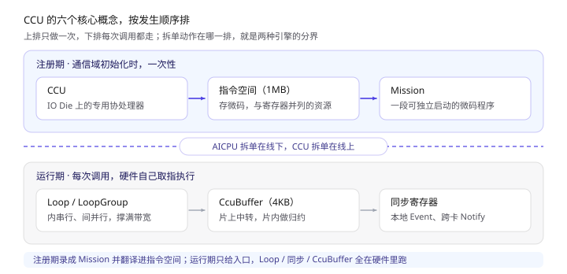
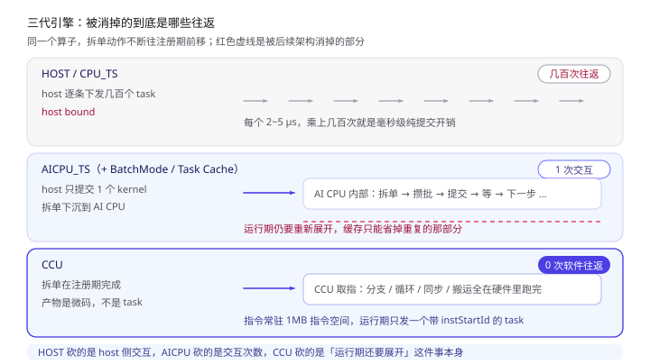
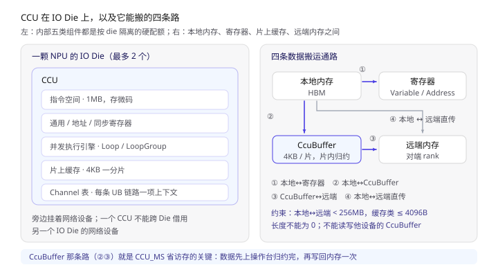
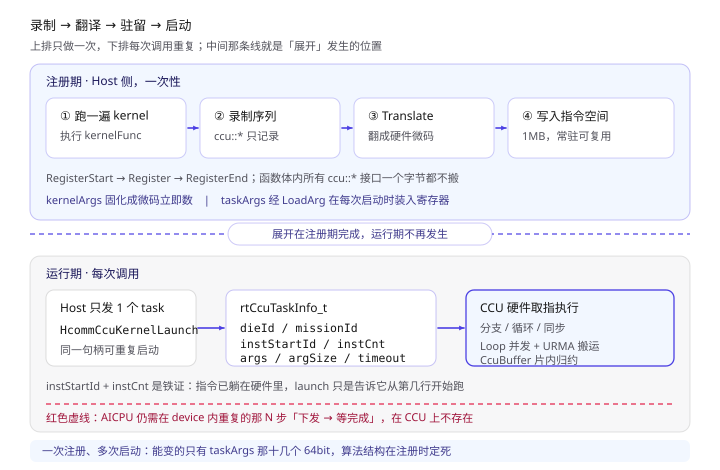
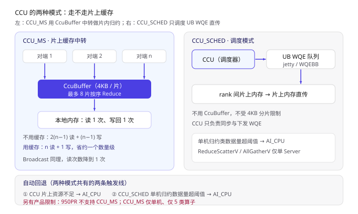
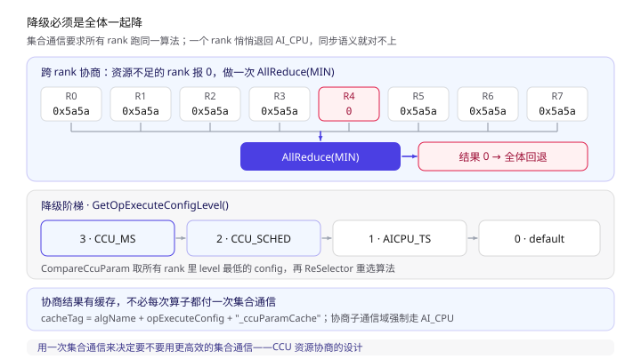

姊妹篇《HCCL 的 AICPU 模式：通信任务到底在哪展开》讲的是**把展开动作从 host 搬进 NPU**。那一步把 host-device 交互从几百次压到了 1 次，但 device 内部仍然在「一步步下发 task、等完成、再下发下一步」。这一篇讲的是把这条路走到头的那个引擎：**CCU**。

一句话概括：

> **CCU 不是一块更快的 CPU，而是一台把整个通信算法预先编译成微码、常驻在片上指令空间里、运行期自己取指执行的专用协处理器。**

递进地看，它和前面几种模式的差别是四层：

- **HOST（CPU_TS）**：host 把算法拆成几百张搬运单，一张一张下发，几百次往返；
- **AICPU_TS**：host 只发一个 kernel，AI CPU 在 device 侧拆单，交互降到 1 次，但拆单仍发生在**运行期**；
- **AICPU + Task Cache**：第二次连单子都不重拆，只刷新地址重放——但前提是要命中缓存；
- **CCU**：拆单发生在**注册期**，而且拆出来的不是「一堆 task」，是**一段微码**。运行期 host 只发一个带起始指令号的 task，剩下的分支、循环、同步、搬运全由硬件自己跑完。

> 本文所有结论均来自 CANN 开源仓库源码与随仓文档，本地路径 `hccl/`、`hcomm/`，关键出处标注为 `文件:行号` 或文档章节。
> **看不懂的代码块可以直接跳过**，每段前后都有大白话总结。

---

## 〇、读之前：先认 6 个词

**必须懂（贯穿全文）：**

| 词 | 一句话 | 打个比方 |
| --- | --- | --- |
| **CCU** | Collective Communication Unit，NPU 里专职跑集合通信的协处理器，位于 IO Die | 仓库里自带的一台**自动分拣机**，不用再叫搬运工 |
| **指令空间** | CCU 片上存微码的地方，源码里预留 1MB | 分拣机里插着的**一卷打孔纸带** |
| **Mission** | 一次注册进指令空间的、可独立启动的微码程序 | 纸带上的**一段程序** |
| **CcuBuffer（MS）** | CCU 片上缓存，4KB 一分片，可做片内归约 | 分拣机手边的一小块**操作台** |
| **Loop / LoopGroup** | 硬件级并发单元：Loop 内串行、Loop 间并行，LoopGroup 把一组 Loop 复制多份 | 同时开几条**传送带** |
| **同步寄存器** | 本地用 Event、跨卡用 Notify 的置位/等待，CCU 自己在硬件里等 | 传送带之间的**联锁开关** |

**混个脸熟就行：**

| 词 | 一句话 |
| --- | --- |
| **XN / CKE** | 同步寄存器的硬件编号资源，按 die 分配 |
| **Channel / jetty** | UB 链路的上下文与队列，CCU 用它发 WQE |
| **URMA / WQE** | 统一远端内存访问，以及走 UB 通道的搬运单格式（WQE 就是姊妹篇里说的「顺丰单」） |
| **die / IO Die** | 一颗 NPU 可能有两个 IO Die，CCU 与网络设备都挂在上面，资源按 die 隔离 |
| **token** | 远端访问一块内存的「钥匙」，CCU 用 `WriteVariableWithNotify` 把它交换给对端 |
| **resDesc** | 资源描述符，注册前用来查「这个 kernel 要占多少片上资源」 |

把这六个词按发生顺序串起来：**注册期把 C++ 写的算法录成 Mission，翻译后写进指令空间；运行期 launch 一次，CCU 取指执行，用 Loop 撑满带宽、用同步寄存器等对端、用 CcuBuffer 省访存。**



> 上排是注册期（一次性），下排是运行期（每次调用）；中间那条竖线就是两种模式的分界——AICPU 的「拆单」在下排，CCU 的「拆单」在上排。

---

## 一、为什么还要有 CCU：把往返这笔账算到底

在《HCCL 实现原理》第七、八节里留了一个论断：**步数 = 下发—完成往返次数**。小张量的瓶颈往往不是带宽，而是这个固定开销。三种引擎其实是在不同层级上砍它：

| 引擎 | 谁在拆单 | 拆单发生在 | 运行期交互 | 占计算核 |
| --- | --- | --- | --- | --- |
| HOST / CPU_TS | Host CPU | 每次调用 | 几百次 host-device 往返 | 否 |
| AICPU_TS | NPU 上的 AI CPU | 每次调用 | host 只发 1 个 kernel，device 内部仍有 N 步 task | 占 AI CPU 核 |
| **CCU** | **Host 侧注册器（只做一次）** | **通信域初始化时** | **host 只发 1 个 task，device 内部 0 次软件往返** | **不占任何计算核** |

注意最后一行的措辞：CCU 运行时**根本不存在「重新展开」这个动作**，所以连 Task Cache 都不需要。AICPU 那套「攒批 → 缓存 → 刷地址重放」优化，在 CCU 上是被架构本身消掉的问题，而不是被优化掉的问题。

`hcomm/docs/zh/comm_op_dev_guide/prog_models_concepts/comm_engine.md` 表 1 给的定位是：CCU 优势「减少访存带宽与计算核占用，高带宽、低时延」，约束「受限于片上资源，支持的通信域数量有限」，且**只支持 Ascend 950PR & 950DT 系列产品**。第六节会解释这条约束到底卡在哪。



> 上：HOST 逐条下发；中：AICPU 把展开下沉，但 device 内仍有 N 步；下：CCU 的展开在注册期完成，运行期只剩一次 launch。红线标出的就是被消掉的部分。

---

## 二、CCU 是什么：IO Die 上的一台专用小机器

按 `hcomm/docs/zh/comm_op_dev_guide/prog_models_concepts/CCU_models_concepts.md` §「系统架构」，CCU 是**位于 IO Die 上的专用集合通信协处理器**。它内部有五样东西（同文档 §「基础概念」）：

| 组件 | 作用 |
| --- | --- |
| 片上缓存 | 以 **4KB 分片**为基础操作单元，支持多片片内归约 |
| 寄存器 | 通用寄存器（参数/数据，支持赋值与加法）、同步寄存器（Wait / Set）、地址寄存器（未来会被通用寄存器取代） |
| 并发执行引擎 | 提供 Loop 并发与循环执行指令的能力 |
| 指令空间 | 存 CCU 执行的指令序列，源码里预留 **1MB**（`hcomm/src/base_comm/resources/ccu/ccu_device/ccu_res_specs.h:42`） |
| Channel 表 | 每项包含一条 UB 通信链路的上下文 |

对应到代码里的资源枚举，`hcomm/include/ccu/ccu_res_defs.h:28-38` 列了 8 类：`LOOP`、`CCU_BUF`、`VARIABLE`、`ADDRESS`、`EVENT`、`CCU_THREAD`、`INSTRUCTION`、`CASC_CNT`。其中 `INSTRUCTION` 是**和寄存器、缓存并列的硬资源**——这一点是理解 CCU 全部约束的钥匙：一个 kernel 能编进多少指令，是有上限、且要提前占位的。

**它能搬什么**（同文档 §「数据搬运能力」）：

- 本地内存 ↔ 通用/地址寄存器；
- 本地内存 ↔ CcuBuffer；
- CcuBuffer ↔ 远端内存；
- 本地内存 ↔ 远端内存；
- 写远端同步寄存器、把本地 Variable 写到远端 Variable。



> 左：CCU 在 IO Die 上，旁边挂着 Channel 表与网络设备；右：本地内存、寄存器、CcuBuffer、远端内存四者之间的搬运方向，其中 CcuBuffer 那条路是 `CCU_MS` 模式省带宽的关键。

---

## 三、核心机制：录制 → 翻译 → 驻留 → 启动

这一节是全篇的重点。先给结论：**Host 在注册阶段会真的把 kernel 函数跑一遍，但函数体里所有 `ccu::*` 接口一个字节都不搬，只是把操作序列记下来。**

`hcomm/docs/zh/api_ref/comm_op_dev/control_plane_api/ccu_kernel_launch_execution/HcommCcuKernelRegister.md` §「功能说明」原文：

> 本接口在 Host 侧执行一次用户提供的 Kernel 函数，该函数体内所有 `Ccu*` 接口不执行实际硬件操作，仅记录该 Kernel 的完整操作序列。

### 3.1 注册期：三段式

源码在 `hcomm/src/base_comm/primitives/api_c_adpt/ccu/ccu_launch.cc`：

```c
// ccu_launch.cc:47 —— 开一轮注册，Reset 掉上一轮
CcuResult HcommCcuKernelRegisterStart(CcuInsHandle insHandle) {
    ccuIns->BeginRegister();
    ccuIns->Reset();
}

// ccu_launch.cc:77 —— 在 Host 侧"执行" kernel，实际是录制操作序列
CcuResult HcommCcuKernelRegister(..., const void *kernelFunc, ...,
                                 CcuKernelHandle *kernelHandle) {
    kernelMgr.Register(*resPack, dieId, kernelFuncName, kernelFunc,
                       kernelArgs, argNum, ccuIns, newHandle);
    // 失败时 ccuIns->AbortRegister()，本轮回滚，已注册的其他 Kernel 不受影响
}

// ccu_launch.cc:120 —— 这一句才是真正"编译"的地方
CcuResult HcommCcuKernelRegisterEnd(CcuInsHandle insHandle) {
    ccuIns->EndRegister();
    const auto& newKernels = ccuIns->GetUntranslatedKernels();
    kernelMgr.Translate(newKernels);      // ← 录制的 representation 翻成微码
}
```

`Translate` 之后，录制下来的操作序列被翻成硬件指令并部署到 CCU 指令空间；`HcommCcuKernelRegister` 返回的 `CcuKernelHandle` 就是这段程序的句柄，后续 launch 靠它定位。源文件在 `hcomm/src/base_comm/resources/ccu/ccu_representation/reps/translator/` 下的 `ccu_ins_generator_v1.cc` / `ccu_ins_generator_v2.cc`，分别对应硬件的 CCU V1 / V2 两代指令编码（`ccu_device/ccu_res_specs.cc:34-66` 里 `CheckCcuVersion` 从驱动读版本号）。

这里有个**最容易踩的坑**：注册期和运行期的参数不是一回事。

| | 传入方式 | 值什么时候确定 | 编译成什么 |
| --- | --- | --- | --- |
| `kernelArgs[0]` | `HcommCcuKernelRegister` 的入参指针数组 | **注册时** | 固化为微码里的**立即数** |
| `taskArgs[]` | `HcommCcuKernelLaunch` 的 `uint64_t` 数组 | **每次启动时** | 通过 `CcuLoadArg(var, argId)` 在运行期装入寄存器 |

文档说得很直白（`HcommCcuKernelRegister.md` §「约束说明」）：`argNum` 当前**仅支持 0 或 1**，`kernelArgs[0]` 指向的标量在注册阶段即被读取并固化为立即数；运行期需要变化的标量必须通过 `taskArgs` 与 `CcuLoadArg` 传入。`HcommCcuGetTaskArgsNum` 返回的是 `max(argId) + 1`，也就是 `taskArgs` 数组的最小长度（`HcommCcuGetTaskArgsNum.md` §「约束说明」）。

顺带还有一个纯 dry-run 接口：`HcommCcuKernelQueryResReq` 在主机侧对 `kernelFunc` 跑一次，**统计资源诉求**但「不注册 Kernel、不申请实例资源、不生成句柄、不翻译指令、不下发任务」（同文档 §「功能说明」）。所以同一个 kernel 函数，在注册之前会被 host 跑两遍（查资源一遍、注册录制一遍），每一遍都不搬数据。

### 3.2 运行期：只发一个带起始 PC 的 task

```c
// ccu_launch.cc:269-290
static HcclResult LaunchCcuTasks(const hcomm::CcuTaskParam& param, aclrtStream stream) {
    rtCcuTaskInfo_t taskInfo{};
    taskInfo.dieId       = param.dieId;
    taskInfo.missionId   = param.missionId;
    taskInfo.instStartId = param.instStartId;   // ← 从哪条指令开始取指
    taskInfo.instCnt     = param.instCnt;       // ← 一共几条
    taskInfo.argSize     = param.argSize;
    std::copy(..., taskInfo.args);              // ← 运行期参数
    taskInfo.timeout     = ...;
    return rtCCULaunch(&taskInfo, stream);      // ← 一个 RTS task
}
```

`instStartId` + `instCnt` 是整件事的铁证：**指令已经躺在硬件里了，launch 只是告诉它「从第几行开始跑、跑几行」**。对比第七节的 SQE/WQE 下发闭环，CCU 连描述符队列都省了——`taskInfo` 里没有一条搬运指令，只有程序入口和参数。

`HcommCcuKernelLaunch`（`ccu_launch.cc:292-349`）先 `kernel->GeneTaskParams(taskArgs, argNum, taskParams)` 把运行期参数填进任务参数，再逐个 `LaunchCcuTasks`；文档 `HcommCcuKernelLaunch.md` §「功能说明」明确「同一 Kernel 句柄可多次调用，每次可传入不同的 `taskArgs`，实现**一次注册，多次启动**」。这和 AICPU 的 Task Cache 目标一致，但实现路径完全不同：一个靠缓存上一次的结果，一个靠程序本来就常驻。



> 上半是注册期（只做一次）：host 跑 kernel 函数录制操作序列 → `Translate` 翻成微码 → 写进 1MB 指令空间；下半是运行期（每次调用）：`rtCCULaunch` 只带 `instStartId/instCnt/args`，CCU 自己取指、用 Loop 并行搬数据。右侧灰色是 AICPU 仍需在 device 内重复的那 N 步下发。

### 3.3 用同一个 AllGather 例子对照姊妹篇

`hccl/examples/05_custom_ops_allgather/` 下同时有 `aicpu/` 和 `ccu/` 两个版本，是天然的对照材料。

Host 侧只需把引擎标成 CCU（`ccu/op_host/allgather.cc:92`）：

```c
param.engine = CommEngine::COMM_ENGINE_CCU;
// 且 :82 处硬校验 param.devType == DEVICE_TYPE_A5
```

Device 侧的「kernel」其实是一段注册期被录制的 C++（`ccu/op_kernel_ccu/ccu_kernel.cc:178-241`），五步骨架：

1. **初始化资源**：`ccu::GetResByChannel<ccu::Variable>(channel, OUTPUT_XN_ID)` 从 Channel 上取对端交换过来的 output 地址与 token；
2. **加载参数**：连续 10 次 `ccu::LoadArg(...)`，对应 host 侧 `taskArgs`（`ccu/op_host/exec_op.cc:42-53` 里正好 10 个 `uint64_t`）；
3. **前同步**：`WriteVariableWithNotify` 把自己的 output 地址和 token 写给每个对端，再 `NotifyWait` 等对端都写过来——**地址交换这件事也是 CCU 自己做的**；
4. **执行算法**：`ccu::Write` 把本卡数据写到各对端，同时用 `GroupCopy` 做本地拷贝，最后 `EventRecord` / `EventWait` 等搬运完成；
5. **后同步**：`NotifyRecord` 通知对端写完，`NotifyWait` 等对端也写完。

而 host 侧每次调用做的只有一件事（`ccu/op_host/exec_op.cc:55`）：

```c
HcommCcuKernelLaunch(resCtx.threads[0], resCtx.ccuKernels[0],
                     taskArgs.data(), taskArgs.size());
```

只有一个例外：单次搬运超过 `UB_MAX_DATA_SIZE = 256MB`（`exec_op.cc:25`）时，host 会**按 256MB 切片循环 launch 同一个 kernel**（`:85-109`）。这正好对上 `CCU_models_concepts.md` §「约束与限制 / 数据搬运」里「本地内存到远端内存搬运，长度要小于 256MB」——切片是在 host 侧做的，微码本身不用改，只换 `taskArgs` 里的地址和长度。

---

## 四、CCU 的「指令集」：一门写在 C++ 里的 DSL

开发者并不写汇编，而是用 `hcomm/include/ccu/` 下的一组 C++ 类型与 `ccu::*` 原语描述算法；注册期这些表达式被录制下来，翻译器再生成微码。它更像一门 **DSL**，而不是普通的函数调用。

**资源抽象**（`CCU_models_concepts.md` §「资源抽象」）：

| C++ 类型 | 硬件对应 |
| --- | --- |
| `ccu::Variable` | 通用寄存器 |
| `ccu::Address` | 地址寄存器 |
| `ccu::Event` | 同步寄存器（本地） |
| `ccu::CcuBuffer` | 4KB 片上缓存分片 |
| `ccu::LocalAddr` / `ccu::RemoteAddr` | 地址 + token，分别由 Address 与 Variable 保存 |

底层 C API 在 `hcomm/pkg_inc/hcomm/ccu/ccu_primitives_impl.h`，大致分五组：

- **运算**：`CcuVariableAssignImm` / `AddVarToVar` / `Sub` / `Mul` / `And` / `Or` / `Xor` / `Not` / `Shl` / `Shr`；地址也有 `AddVarToAddr`、`AddImmToAddr` 等；
- **参数与访存**：`CcuLoadArg`、`CcuLoadVar` / `CcuStoreVar`；
- **同步**：`CcuEventRecord` / `CcuEventWait`、`CcuNotifyRecord` / `CcuNotifyWait`、`CcuWriteVariableWithNotify`、`CcuCascCntWait`；
- **搬运与归约**：`CcuLocalCopyMemToMem` / `MemToBuffer` / `BufferToMem`、`CcuLocalMemReduce` / `CcuLocalBufferReduce`、`CcuRead*` / `CcuWrite*` / `*Reduce`（`:114-138`）；
- **流程控制**：`CCU_IF` / `CCU_ELSE` / `CCU_WHILE` / `CCU_DO`、`ccu::Func` + `CallFunc`（`CCU_models_concepts.md` §「流程控制」）。

看一段真实代码，体会「C++ 形状、微码语义」（`ccu/op_kernel_ccu/ccu_kernel.cc:45-51`）：

```cpp
entity.body[index].reset(new ccu::Func([&]() {
    ccu::LocalCopy(ctx.moRes.ccuBuf[bufBase], loopSrc[index],
                   loopLen[index], loopEvt, 1);          // 本地内存 → 片上缓存
    ccu::EventWait(loopEvt, 1);                          // 等这次搬运完成
    ccu::LocalCopy(loopDst[index], ctx.moRes.ccuBuf[bufBase],
                   loopLen[index], loopEvt, 1);          // 片上缓存 → 本地内存
    ccu::EventWait(loopEvt, 1);
}));
entity.loops[index].reset(new ccu::Loop(entity.loopParam[index], *entity.body[index]));
```

**大白话**：这四行看起来是函数调用，注册期跑的时候啥也没搬，只是往操作序列里追加了四条指令；真正执行时，`EventWait` 是硬件里的同步寄存器等待，不经过任何软件调度。

并发模型值得单独记（`CCU_models_concepts.md` §「并发模型」）：

- **Loop 内串行、不同 Loop 并行**；Loop 带「循环次数 + 每次地址增量偏移」两个参数，专门配 CcuBuffer 循环搬数据；
- **Loop 不能单独执行，必须放进 LoopGroup**；LoopGroup 把一组 Loop 复制多份，并指定复制后每组使用的**资源 ID 增量偏移**；
- 因为 CcuBuffer 只有 4KB，单次搬运量有限，**靠多 Loop 并发才能撑满链路带宽**。

同步则是两张网（同文档 §「同步机制」）：本地用 `EventRecord/EventWait` 等自己的异步操作，跨卡用 `NotifyRecord/NotifyWait(channel, notifyIdx, mask)` 基于 Channel 里的 Notify 序号写对端同步寄存器。前面 allgather 例子里的 `mask = 1 << rankIdx` / `totalMask = (1 << rankSize) - 1` 就是在用位掩码一次等齐所有对端。

**约束清单**（`CCU_models_concepts.md` §「约束与限制」，逐条都是硬件行为，别当普通 C++ 写）：

| 约束 | 具体值 / 说明 |
| --- | --- |
| 任务描述符参数 | 最多 **13 个 64bit**；`LoadArg` 必须在程序最开始调用 |
| 资源生命周期 | 创建后**不支持动态回收**，局部作用域结束对象销毁但寄存器不释放 |
| 搬运长度 | 不能为 0（硬件行为不可预知）；本地↔远端 **< 256MB**；涉及 CcuBuffer 的 **≤ 4096B** |
| CcuBuffer 归属 | 不支持读写**其他设备**的 CcuBuffer |
| Loop 内指令 | 只能放数据搬运与 Wait，其他一律不支持；循环次数必须 > 0 |
| 资源连续性 | Loop / LoopGroup 要求资源 ID 连续，必须用 `ccu::Array`，**原生数组不保证连续** |
| LoopGroup 偏移 | 复制出的第 N 份使用 `x + N*offset` 的资源，必须提前算好并申请，否则越界 |
| Die 限制 | CCU 不能跨 Die 用另一个 IO Die 的网络设备；翻译器按 Channel 推导部署到哪个 CCU |

最后一条特别有意思：**不是开发者选 die，是翻译器根据 kernel 用到的 Channel 反推出来**。所以 `HcommCcuKernelQueryResReq.md` §「约束说明」才要求 descriptor 创建时的 `dieId` 必须与 kernel 选出的 die 一致，否则直接 `CCU_E_PARA`。

---

## 五、两种工作模式：CCU_MS 与 CCU_SCHED

`HCCL_OP_EXPANSION_MODE` 在 950 上其实有两个 CCU 取值（`hccl/docs/zh/user_guide/hccl_env/HCCL_OP_EXPANSION_MODE.md` §「功能描述」，950 段）：

| | **CCU_MS** | **CCU_SCHED** |
| --- | --- | --- |
| 字面 | MS 就是片上缓存（Memory Slice / CcuBuffer） | SCHED = 调度模式 |
| 数据路径 | 经 **CcuBuffer 中转**，多远端通信时省内存读写带宽 | **不用 CcuBuffer**，CCU 只当调度器向 UB 引擎下发 UB WQE，rank 间片上内存直传 |
| 特点 | CcuBuffer 小但快 | 不受 4KB 分片限制 |
| 主要限制 | 950PR **不支持**；仅 Broadcast / Reduce / AllReduce / ReduceScatter / AllGather；**仅单机**；归约类仅 int16/int32/fp16/fp32/bfp16 | 单机 AllReduce / ReduceScatter / Reduce 数据量超阈值会自动切 AI_CPU；ReduceScatterV / AllGatherV 仅单 Server |
| 资源不足 | 自动切 AI_CPU | 自动切 AI_CPU |

### 5.1 CCU_MS 到底省了什么：一笔访存账

`CCU_models_concepts.md` §「CCU典型用法与优势」给了一个很干净的推导。对 n 个对端做 Reduce：

- **不用片上缓存**：每归约一个对端都要读一次本地数据、写回一次，共 **2(n−1) 次读 + (n−1) 次写**；
- **用片上缓存**：本地数据只读一次进缓存，在片上完成全部归约，最后写回一次，共 **n 次读 + 1 次写**。

Broadcast 同理：**(n−1) 读 + (n−1) 写 → 1 读 + (n−1) 写**。文档对整体的判断是「将 AllReduce 等通信算子的访存需求降低约一个数量级，释放出更多访存带宽供计算算子使用」。

CcuBuffer 本身的规格（同文档 §「CcuBuffer」）：最多 **8 个** CcuBuffer 按序 Reduce，支持 ADD / MAX / MIN，数据类型 FP32 / FP16 / BF16 / INT32 / INT16 / INT8 / UINT8；**FP16 / BF16 的 ADD 会升精度到 FP32** 再归约——这也是文档把「提升精度归约与确定性」列为 CCU 优势的原因：加法顺序与截断误差在硬件里可控。



> 左：CCU_MS 把各对端数据读进 4KB 片上缓存归约，本地内存只读 1 次写 1 次；右：CCU_SCHED 不用缓存，CCU 直接给 UB 引擎发 WQE 做 rank 间直传。底部是两种模式各自的回退触发条件。

---

## 六、资源是硬约束：为什么「支持的通信域数量有限」

第五节的模式表两次出现「资源不足自动切 AI_CPU」，这句话落到代码里是很具体的。

**资源从哪来**：`hcomm/src/base_comm/resources/ccu/ccu_device/ccu_res_specs.cc:103-163` 的 `ParseOutBuffToResSpecInfo` 从驱动返回的 `caps.cap0 … cap4` 里按位域解出所有规格——`instructionNum`、`xnNum`、`msNum`、`ckeNum`、`jettyNum`、`channelNum`、`pfeNum`、`missionNum`、`loopEngineNum`、`gsaNum`。也就是说**资源总量是硬件报上来的，不是软件配置的**，而且 CCU V1 / V2 的位域布局还不一样（`:129-157`）。

**指令空间布局**（`ccu_res_specs.h:42-50`，配合 `ccu_res_specs.cc:449, 501` 的注释）：

| | 指令空间 | 其余保留区 |
| --- | --- | --- |
| CCU V1 | 1MB | GSA 32K + Xn 32K |
| CCU V2 | 1MB | Xn 256K（GSA 字段废弃，固定 0）；`CCU_V2_COUNT_XN_NUM = 4096` |

`CCU_MAX_IODIE_NUM = 2`（`ccu_common.h:18`），所有资源池都是 `std::array<..., 2>`，**按 die 隔离**（`pub_inc/ccu_res_repo.h:53-66`）。再叠上第四节那条「一个 CCU 不能跨 Die 用另一个 IO Die 的网络设备」，就能理解为什么通信域开多了会不够：每个域的 Mission 都要独占一段指令空间、一组 XN/CKE 同步寄存器、若干 Loop 引擎和 CcuBuffer，而总量按 die 分摊。

**更隐蔽的坑是碎片**：`HcommCcuQueryRemainResDesc.md` §「功能说明」查的是「指定 IO Die 上的**最大连续剩余资源数量**」——不是总量，是最大连续块。这正好呼应第四节「Loop / LoopGroup 要求资源 ID 连续」。所以哪怕空余总量够，只要没有一段连续 ID，kernel 一样注册不上，返回 `CCU_E_UNAVAIL`（`HcommCcuKernelRegister.md` §「返回值」），并且 `ccu_launch.cc:103-113` 会 `AbortRegister()` 把**本轮**注册整体回滚，已注册的其他 kernel 不受影响。

注册前的标准姿势因此是：`HcommCcuKernelQueryResReq`（dry-run 统计需求）→ `HcommCcuQueryRemainResDesc`（查最大连续剩余）→ 比对 → `HcommCcuInsCreate`。`HcommCcuInsResDescSetNum.md` 那组接口就是让调用方在剩余量基础上调整申请规格。

---

## 七、全体一致：跨 rank 的资源协商与降级

这一节是读 `hccl/src/ops/op_common/ccu_fallback.cc` 时最有意思的发现。

**为什么必须协商**：集合通信要求所有 rank 执行同一个算法。如果 rank 3 片上资源不够悄悄退回 AI_CPU，其余 rank 还在跑 CCU 微码，同步语义直接对不上。所以降级必须是**全体一起降**。

代码怎么做的（`ccu_fallback.cc:294-372`）：

```cpp
// 用一条独立的子通信域做一次 AllReduce(MIN)
const int32_t localVal = localResOk ? 0x5a5a5a5a : 0;   // :26-27, :300
HcclAllReduce(negCtx->deviceSendBuf, negCtx->deviceRecvBuf,
              1, HCCL_DATA_TYPE_INT32, HCCL_REDUCE_MIN,
              negCtx->subComm, negCtx->stream);           // :315-317
// 只要有一个 rank 发了 0，MIN 结果就是 0 → 全体回退
```

即：每个 rank 把自己的「本地资源够不够」写成一个魔数（够 = `0x5a5a5a5a`，不够 = `0`），做一次 `REDUCE_MIN`。任一 rank 不足，结果变 0，`CompareNegotiationResult` 返回 `HCCL_E_UNAVAIL`（`:344-353`）。**用一次集合通信来决定要不要用更高效的集合通信**，这个设计挺妙的。

降级方向也有明确阶梯（`ccu_fallback.cc:42-57`）：

```cpp
GetOpExecuteConfigLevel():
    CCU_MS     → 3
    CCU_SCHED  → 2
    AICPU_TS   → 1
    default    → 0
```

`CompareCcuParam`（`:487-496`）在所有 rank 里取 **level 最低**的那个 config，然后 `ReSelector` 重选算法。另外还有两层细节：

- **协商子通信域强制走 AI_CPU**：`subCommConfig.hcclOpExpansionMode = 2`（`:33, :199`），注释写明 `0:默认 1:host 2:aicpu 3:aiv`——避免协商本身又走 CCU 造成递归；
- **协商结果有缓存**：`cacheTag = algName + "_" + opExecuteConfig + "_ccuParamCache"`（`:528-529`），命中就跳过跨 rank 协商（`:533-550`）。所以这个开销不是每次算子调用都付。

顺带，`ccu_fallback.cc:30-31` 里 `opExpansionModeCcuMs = 4` / `opExpansionModeCcuSched = 5` 是 `HcclOpExpansionMode` 枚举值，和 `HcclCommConfig.hcclOpExpansionMode` 的 `0/1/2/3` **不是同一个值空间**——读代码时很容易混。



> 上：8 个 rank 各报一个魔数，一次 AllReduce(MIN) 决定全体是否降级；中：level 阶梯 3→2→1→0，取所有 rank 里的最低值；下：协商结果按 algName+config 缓存，命中后跳过协商。

---

## 八、怎么选 & 踩过的坑

| 场景 | 建议 |
| --- | --- |
| 950PR / 950DT，追求高带宽 + 低时延、不想占计算核 | CCU_SCHED（默认仍是 `AICPU_TS`，需显式配置） |
| 950DT，多对端归约、访存带宽是瓶颈、单机 | CCU_MS，靠片上缓存把 Reduce 的读写次数压下来 |
| 950PR | CCU_MS **不支持**，只能 CCU_SCHED 或退回 AI_CPU |
| Atlas A3 / A2 | **没有 CCU 引擎**，别配 CCU 相关取值 |
| 通信域开得多、片上资源紧 | 优先 AI_CPU；CCU 会因资源不足自动回退，反而多付协商开销 |

坑清单（全部来自源码与随仓文档）：

1. **产品与默认值**：950 上 `HCCL_OP_EXPANSION_MODE` 默认是 `AICPU_TS`（`HCCL_OP_EXPANSION_MODE.md:19`），CCU 要显式配；设置了 950 不支持的值**系统直接报错**（`:8`），而 A3/A2 是「静默使用默认值」——不同产品行为不一样。
2. **`AI_CPU` 即将废弃**，由 `AICPU_TS` 取代，当前两者功能一致（`:16`）。`AICPU_CacheDisable` 用于数据量频繁变化场景关掉 AI CPU cache（`:27-29`）。
3. **自动回退有两条触发线**：CCU 资源不足；以及 CCU_SCHED 下单机 AllReduce / ReduceScatter / Reduce 数据量超阈值（阈值随算子模式与网络规模变化，不是固定值，`:52`）。日志里看到"配置没生效"先查这两条。
4. **`argNum` 的单位是元素个数不是字节数**，传字节数直接 `CCU_E_INTERNAL`（`HcommCcuKernelLaunch.md:54`）；同时它必须**等于** kernel 内 `CcuLoadArg` 用过的不同 `argId` 总数（`:38, :49`）。参数多时框架会自动分批下发，不用自己切（`:55`）。
5. **把运行期变量误塞进 `kernelArgs`**：注册阶段就被固化成立即数，之后改数据完全不生效（`HcommCcuKernelRegister.md:43, :64`）。
6. **`LoadArg` 必须在程序最开始**，且全 kernel 最多 13 个 64bit 参数（`CCU_models_concepts.md` §「参数加载」）。
7. **搬运长度不能为 0**，硬件行为不可预知；`ccu::Array` 之外创建批量资源不保证 ID 连续（同上 §「数据搬运」/「资源创建」）。
8. **注册失败会回滚本轮**：`AbortRegister()` 把这一轮所有新 kernel 一并作废（`ccu_launch.cc:103-113`），别以为只有失败的那个没了。
9. **资源不回收**：局部作用域里的 `Variable` 对象销毁了，寄存器还占着（§「资源创建」）。写复杂 kernel 要在开头就把资源规划好一次性申请。
10. **token 是安全信息**，`HcommCcuGetMemToken` 源码里专门注明「均不允许打印」（`ccu_launch.cc:415`）——排查时别把它打进日志。
11. **CCU 不能跨 Die**：kernel 用到的所有 Channel 必须落在同一个 IO Die，翻译器据此推导部署位置（`CCU_models_concepts.md` §「指令部署」）。

**回过头和 AICPU 对照一句**：AICPU 需要 BatchMode 攒批、Task Cache 重放，是因为「展开」每次都要重新做；CCU 把这些都变成注册期的一次性成本。代价是**灵活性**——微码一旦注册，能变的只有 `taskArgs` 那十几个 64bit；算法结构、rank 数、拓扑都得在注册时定死。这正好对应主文第八节结尾那句「硬化成 CCU，效率最高但灵活度最低」。

---

## 九、小结

五句话：

1. **CCU 是 IO Die 上的专用协处理器**，有独立的 1MB 指令空间、寄存器、4KB 片上缓存和并发执行引擎，不占 AI CPU / Vector 核；
2. **核心机制是注册期编译**：host 跑一遍 kernel 函数只录制操作序列，`RegisterEnd` 里的 `Translate` 把它翻成微码驻留进指令空间；
3. **运行期只剩一次 launch**：`rtCCULaunch` 带 `instStartId / instCnt / args` 给个程序入口，分支、循环、同步、搬运全在硬件里跑完，零软件往返；
4. **两种模式对应两条数据路径**：CCU_MS 走片上缓存中转省访存（Reduce 从 2(n−1) 读降到 n 读），CCU_SCHED 只当调度器直接发 UB WQE；
5. **代价是片上资源与灵活性**：指令、XN/CKE、Loop 都是按 die 隔离的硬配额，且要求连续 ID；资源不足时用一次跨 rank `AllReduce(MIN)` 让全体一起降级。

把这条线接回主文：**HOST → AICPU → CCU，是「展开动作」不断往注册期前移的过程**。前两个优化的是「重复做多少次」，CCU 改的是「什么时候做」。

### 学习路径

- 想看微码怎么生成：`hcomm/src/base_comm/resources/ccu/ccu_representation/reps/translator/ccu_ins_generator_v1.cc` / `ccu_ins_generator_v2.cc`，以及 `reps/` 下按指令分类的 `data/`、`loop/`、`sync/`、`shift/`、`logical/` 表示层；
- 想看资源配额怎么算：`ccu_device/ccu_res_specs.cc` 的 `ParseOutBuffToResSpecInfo` + `ccu_res_specs.h` 的常量；
- 想看 CCU_SCHED 怎么发 UB WQE：`hcomm/src/base_comm/resources/ccu/ccu_transport/`（`ccu_jetty_.cc` / `ccu_wqebb_mgr_v*.cc`）；
- 想看真实算法模板：`hccl/src/ops/*/algorithm/template/ccu/kernel/`，`mesh1d_mem2mem`、`nhr1d_mem2mem`、`omnipipe_*` 几组对比着读；
- 有条件上真机的话，用 `HcommCcuQueryRemainResDesc` + `HcommCcuInsResDescQueryNum` 把各 die 的剩余连续资源打出来，比读文档直观；
- 姊妹篇对照：《HCCL 的 AICPU 模式：通信任务到底在哪展开》讲运行期下沉，本篇讲注册期下沉；主文《HCCL 实现原理》第七、八节分别是下发闭环与四种引擎的总览。

### 参考

- `hcomm/docs/zh/comm_op_dev_guide/prog_models_concepts/CCU_models_concepts.md`（架构、资源抽象、并发模型、同步、约束）
- `hcomm/docs/zh/comm_op_dev_guide/prog_models_concepts/comm_engine.md`（四种引擎对比与执行流程）
- `hcomm/docs/zh/comm_op_dev_guide/ccu_quick_start.md`、`ccu_comm_op_dev/overall_flow.md`（AllGather 样例与开发六步）
- `hcomm/docs/zh/api_ref/comm_opdev/control_plane_api/ccu_kernel_launch_execution/`（`Register*` / `Launch` / `GetTaskArgsNum` / `GetMemToken`）
- `hcomm/docs/zh/api_ref/comm_opdev/control_plane_api/ccu_resource_mgmt/`（`QueryResReq` / `QueryRemainResDesc` / `Ins*`）
- `hcomm/include/ccu/`、`hcomm/pkg_inc/hcomm/ccu/ccu_primitives_impl.h`（编程接口与资源定义）
- `hcomm/src/base_comm/primitives/api_c_adpt/ccu/ccu_launch.cc`（注册与下发实现）
- `hccl/docs/zh/user_guide/hccl_env/HCCL_OP_EXPANSION_MODE.md`（CCU_MS / CCU_SCHED 取值与限制）
- `hccl/src/ops/op_common/ccu_fallback.cc`（跨 rank 协商与降级）
- `hccl/examples/05_custom_ops_allgather/{aicpu,ccu}/`（两种引擎的同题实现）
