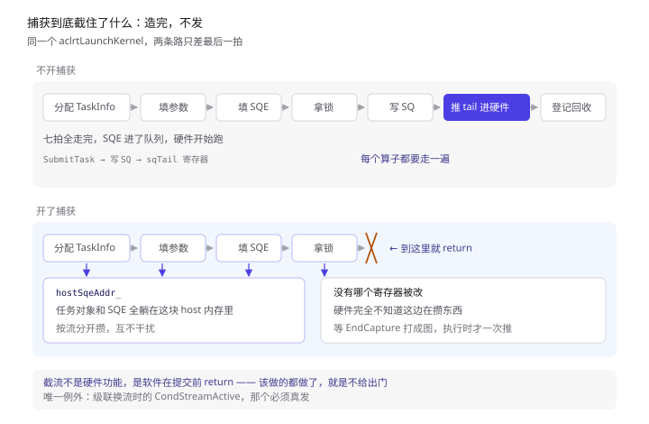
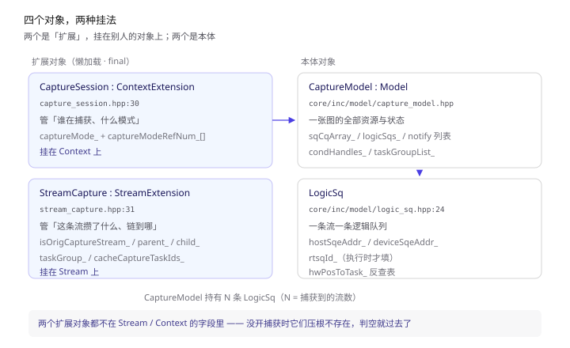
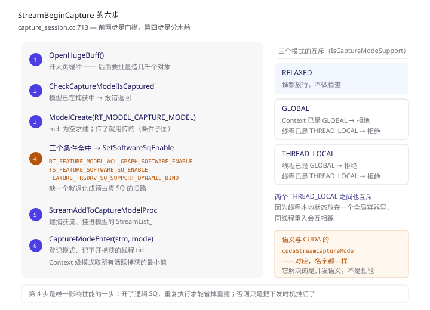
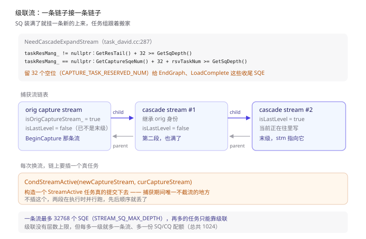
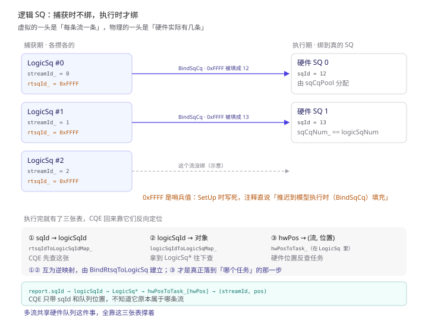
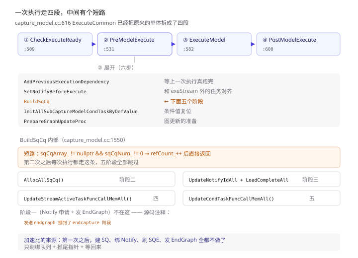
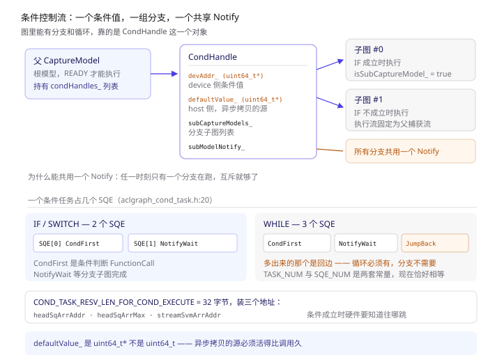

> 本文所有结论来自 CANN 开源仓库 `runtime`（本地路径 `cann-runtime/`），关键处标注 `文件:行号`。
> 与前三篇的关系：**前三篇讲一个任务怎么从 host 走到设备，这一篇讲怎么让成千上万个任务只走一次。**《CANN Runtime：一次 aclrtLaunchKernel 到底发生了什么》里那七拍，在捕获期间被砍掉了最后一拍。

一句话概括：

> **ACL Graph 的捕获，就是让 `LaunchKernel` 把任务造出来、但不提交。**
> 造出来的 `TaskInfo` 攒在一条「捕获流」上，`EndCapture` 时打成一张图，之后每次执行只需要一次下发，把整张图的 SQE 一次灌进队列。

想说清这件事，得回答五个递进的问题：

1. 捕获期间任务到底去了哪 —— 它被造出来了，但没进 SQ
2. 谁来记住「正在捕获」这件事 —— 不是 Stream 自己，是两个挂上去的扩展对象
3. SQ 深度不够装怎么办 —— 级联流，一条链子接一条链子
4. 攒下来的任务怎么变成一条硬件队列 —— 逻辑 SQ 与硬件 SQ 的绑定
5. 一次执行怎么触发整张图 —— 五个阶段 + 一次 `SetSqTail`

---

## 〇、先认 7 个词

这一节的词如果混了，后面全看不懂。特别是「捕获模型」和「捕获流」，一个管资源，一个管记录，是两层。

| 词 | 一句话 | 代码里的落点 |
|---|---|---|
| **CaptureModel** | 捕获模型，一张图的全部资源与状态。是 `Model` 的子类 | `core/inc/model/capture_model.hpp` |
| **CaptureSession** | 捕获会话，挂在 Context 上，管「谁在捕获、什么模式」 | `capture_session.hpp:30` |
| **StreamCapture** | 捕获态，挂在 Stream 上，管「这条流的捕获链和记录」 | `stream_capture.hpp:29` |
| **捕获流** | 一条专用于记录的流，任务被分配到它身上而不下发 | `Stream::GetCaptureStream()` |
| **级联流** | 捕获流装满了，再挂一条新的上来，形成链 | `AllocCascadeStream` |
| **逻辑 SQ** | 每条流各自的 SQE 缓冲区，执行时才绑到硬件 SQ | `logic_sq.hpp:24` |
| **TaskGroup** | 任务组，记录一段任务的 id 列表，供事后原地更新 | `stream.hpp` 里的 `struct TaskGroup` |

三个最容易搞混的：

**① CaptureModel 不是 Model 的一种「模式」，是它的子类。** 所有 Model 能做的事 `CaptureModel` 都能做，它额外加了 SQ/CQ 绑定、Notify 管理、条件子图管理。

**② CaptureSession 和 StreamCapture 都不是 Stream/Context 的成员**，是 `ContextExtension` / `StreamExtension`。这是懒加载的——没开捕获的流上，这两个对象根本不存在，`Get()` 返回 `nullptr`。所以代码里到处是 `if (capture == nullptr)` 的短路。

**③ 「Software SQ」这个文档里的名字，在代码里已经改叫 `LogicSq`。** 你搜 `SoftwareSq` 只能搜到几个开关函数，真正的实现在 `logic_sq.hpp`。这个改名很关键，后面第六节全靠它。

---

## 一、捕获到底截住了什么

先看最直观的对照。

不开捕获时，`aclrtLaunchKernel` 做七件事（详见《CANN Runtime》那篇）：分配 TaskInfo → 填参 → 填 SQE → 拿锁 → 写 SQ → 推 tail 寄存器 → 登记回收。**最后一拍是把 SQE 推进硬件队列**。

开了捕获之后，同一行代码走的路是这样的：

```cpp
// feature/aclgraph/stream_capture.cc:294
rtError_t StreamCapture::AllocTask(Stream* stm, tsTaskType_t taskType, uint32_t sqeNum, TaskInfo** task)
{
    std::unique_lock<std::mutex> lock(stm->GetCaptureLock());
    Stream* curCaptureStream = stm->GetCaptureStream();
    if (curCaptureStream == nullptr) {
        return RT_ERROR_STREAM_CAPTURE_EXIT;
    }
    // ... 级联流处理 ...
    if (curCaptureStream->taskResMang_ == nullptr) {
        rtError_t errCode = RT_ERROR_TASK_NEW;
        *task = stm->Device_()->GetTaskFactory()->Alloc(curCaptureStream, taskType, errCode);
        if (*task == nullptr) {
            Terminate(stm);
            return errCode;
        }
        curCaptureStream->AddCaptureSqeNum(sqeNum);
        Runtime::Instance()->AllocTaskSn((*task)->taskSn);
        SaveTaskCommonInfo(*task, curCaptureStream, sqeNum);
        // ...
        return RT_ERROR_NONE;          // ← 到这里就返回了，没有 SubmitTask
    }
    const rtError_t ret = AllocCaptureTaskByTaskRes(curCaptureStream, sqeNum, task);
    // ...
}
```

**注意最后没有 `SubmitTask`。** 函数拿到 `TaskInfo` 指针就返回了，谁调它谁继续往里填参数、填 SQE——但填完的 SQE 留在 host 内存里，不进队列。

这就是「截流」的全部实现。不需要什么特殊硬件，就是在提交那一步之前 return。


> 上：不开捕获，七拍照走完，最后一拍推 tail 进硬件队列。下：开了捕获，前四拍照做，走到「拿锁」之后被截断——任务对象和 SQE 全躺在 host 内存里，没有任何寄存器被改。

> **大白话**：捕获不是在硬件上开了个录像功能。它是软件层面「把该做的事都做了，就是不给出门」。任务对象造好了、参数填好了、SQE 也填好了，全都躺在内存里，只是没人按最后那个「推送」按钮。

这条路的入口在哪？在 launch 流程里判断这条流有没有捕获扩展：

```cpp
// core/src/stream/stream.cc:4966
TaskInfo* Stream::AllocCaptureTask(tsTaskType_t taskType, uint32_t sqeNum, TaskInfo* pTask, rtError_t& errorReason)
```

而 `StreamCapture::AllocTask` 是通过一张函数指针表挂进去的。这张表一共 **17 个口子**：

```cpp
// feature/aclgraph/capture_session.cc:1161
const CaptureFunc funcs = {
    .createContextExtension = &CreateCaptureSession,
    .createStreamExtension = &CreateStreamCapture,
    .createSubCaptureModels = &CreateSubCaptureModels,
    .detachCaptureEvent = &DetachCaptureEvent,
    .setTaskGroupErrCode = &SetTaskGroupErrCode,
    .allocCaptureTask = &StreamCapture::AllocTask,
    .generateSeqId = &GenerateSeqId,
    .getModelIfCapture = &GetModelIfCapture,
    .backupArgHandle = &BackupCaptureArgHandle,
    .isCaptureFinish = &IsCaptureFinish,
    .cacheCaptureTaskId = &CacheCaptureTaskId,
    .getCacheOpInfoSwitch = &GetStreamCacheOpInfoSwitch,
    .setCacheOpInfoOriginSwitch = &SetStreamCacheOpInfoOriginSwitch,
    .isOrigCaptureStream = &IsOriginalCaptureStream,
    .resetTaskGroup = &ResetStreamTaskGroup,
    .updateTask = &UpdateStreamTask,
    .packingTaskGroup = &PackStreamTaskGroup,
};
RegCaptureFunc(funcs);

// feature/aclgraph/capture_session.cc:1184
static bool g_captureFuncRegister = CaptureFuncRegister();
```

表结构定义在 `core/inc/model/capture_func.hpp:50`，里面那句注释是整段设计的总结：

```cpp
// Reduced builds only register stubs for callbacks reachable outside capture-specific state.
struct CaptureFunc {
    PfnCreateContextExtension createContextExtension;
    // ... 17 个函数指针
};
```

最后那行 `static bool g_captureFuncRegister = CaptureFuncRegister();` 是**静态初始化**——模块 `dlopen` 时就会跑，不用等谁调。**捕获能力在被需要之前，就已经把自己挂好了。**

**为什么要绕这一层指针？** 因为要支持「无捕获」的精简编译。`feature/aclgraph/tiny/capture_model_stub.cc` 里给的就是一整套空实现。没有这层，`stream.cc`、`launch/` 那些核心路径上就得满是 `#ifdef`。

**这 17 个口子就是「捕获」对外的全部接触面。** 核心层只通过这 17 个函数指针和捕获子系统打交道，一个都不多——这是很干净的可选能力设计：能力是插进来的，不是长在主干上的。

---

## 二、两个扩展对象

捕获状态不是存在 `Stream` 里的，也不是存在 `Context` 里的，而是两个挂上去的扩展对象。

```cpp
// feature/aclgraph/capture_session.hpp:30
class CaptureSession final : public ContextExtension {
    // ...
    Context* const ctx_;
    rtStreamCaptureMode captureMode_{RT_STREAM_CAPTURE_MODE_MAX};
    uint32_t captureModeRefNum_[RT_STREAM_CAPTURE_MODE_MAX] = {0U};
};
```

```cpp
// feature/aclgraph/stream_capture.hpp:29
class StreamCapture final : public StreamExtension {
    // ...
    std::list<uint16_t> cacheCaptureTaskIds_;      // 捕获到的 task id，按顺序
    uint32_t cacheOpInfoOriginSwitch_{0U};
    uint32_t cacheOpInfoSwitch_{0U};
    bool isOrigCaptureStream_{false};              // 是不是 BeginCapture 那条流
    bool isLastLevelCaptureStream_{true};          // 级联链的末级
    Stream* parentCaptureStream_{nullptr};         // ← 链
    Stream* childCaptureStream_{nullptr};          // ← 链
    rtStreamCaptureMode captureMode_{RT_STREAM_CAPTURE_MODE_MAX};
    std::unique_ptr<TaskGroup> taskGroup_;         // 当前任务组
    std::mutex taskGroupMutex_;
    TaskGroup* updateTaskGroup_{nullptr};          // 正在更新的任务组
    bool isSubCaptureModel_{false};                // 是不是条件子图
    uint32_t beginCaptureThreadId_{UINT32_MAX};    // 谁开的捕获
};
```

两个都叫 `final`，都不许继承。

分层的道理很清楚：

- **Context 级**管的是「模式」——线程能不能碰、几个流同时在捕获
- **Stream 级**管的是「记录」——这条流攒了哪些任务、链到哪了、任务组开到第几段

`CaptureSession` 里那个 `captureModeRefNum_` 是引用计数数组，因为可能同时有多层捕获。`GetContextCaptureMode()` 返回的是**当前所有活跃捕获里最严格的那个模式**（取最小值），`CaptureModeExit` 时递减、递减完才放开。

懒加载体现在这两个静态方法上：

```cpp
// feature/aclgraph/stream_capture.cc:123-134
StreamCapture* StreamCapture::GetOrCreate(const Stream* stm)
{
    if (stm == nullptr) {
        return nullptr;
    }
    return dynamic_cast<StreamCapture*>(stm->EnsureExtension());
}

StreamCapture* StreamCapture::Get(const Stream* stm)
{
    return (stm == nullptr) ? nullptr : dynamic_cast<StreamCapture*>(stm->GetExtension());
}
```

`EnsureExtension()` 没有就建，`GetExtension()` 没有就返回 `nullptr`。**读路径永远用 `Get`，写路径才用 `GetOrCreate`。** 所以 launch 的热路径上不会因为捕获功能而多一次分配。

> **大白话**：这是一个典型的「可选能力」设计。没开捕获的程序，这两个对象压根不存在，多态指针是空的，一次判断就过去了。开销就是一次指针判空。而开了捕获的程序，状态全在扩展对象里，`Stream` 和 `Context` 本身一个字段都没多。


> 左：两个扩展对象，分别挂在 Context 和 Stream 上，都是 `final`、都懒加载。右：两个本体——`CaptureModel` 管一张图的全部资源，`LogicSq` 管一条流的队列。`CaptureModel` 持有 N 条 `LogicSq`，N 就是捕获到的流数。

---

## 三、BeginCapture 六步

`aclmdlRICaptureBegin` 从 ACL 层到 runtime 层是两跳：`src/acl/aclrt_impl/model_ri.cpp:50` 的 `aclmdlRICaptureBeginImpl` → `api_c_standard_soc.cc` → 最终 `CaptureSession::StreamBeginCapture`。

真身在这里：

```cpp
// feature/aclgraph/capture_session.cc:713
rtError_t CaptureSession::StreamBeginCapture(Stream* const stm, const rtStreamCaptureMode mode, Model* const mdl)
{
    Model* captureModel = mdl;

    BufferAllocator::OpenHugeBuff();                     // ① 打开大页
    std::unique_lock<std::mutex> taskLock(ctx_->GetCaptureLock());

    rtError_t error = CheckCaptureModelIsCaptured(mdl);   // ② 模型已在捕获中？
    // ...
    const rtStreamCaptureStatus status = stm->GetCaptureStatus();
    COND_RETURN_AND_MSG_OUTER(
        status != RT_STREAM_CAPTURE_STATUS_NONE, RT_ERROR_STREAM_CAPTURED, ErrorCode::EE1016, "Stream begin capture",
        // ...

    if (captureModel == nullptr) {                        // ③ 建模型
        error = ctx_->ModelCreate(&captureModel, RT_MODEL_CAPTURE_MODEL);
        // ...
    }

    if ((stm->Device_()->IsSupportFeature(RtOptionalFeatureType::RT_FEATURE_MODEL_ACL_GRAPH_SOFTWARE_ENABLE)) &&
        (stm->Device_()->CheckFeatureSupport(TS_FEATURE_SOFTWARE_SQ_ENABLE)) &&
        (NpuDriver::CheckIsSupportFeature(ctx_->Device_()->Id(), FEATURE_TRSDRV_SQ_SUPPORT_DYNAMIC_BIND))) {
        CaptureModel* captureModelTmp = dynamic_cast<CaptureModel*>(captureModel);
        captureModelTmp->SetSoftwareSqEnable();            // ④ 三条件全中才开逻辑 SQ
    }

    error = StreamAddToCaptureModelProc(stm, captureModel, true);   // ⑤ 建捕获流
    // ...
    error = CaptureModeEnter(stm, mode);                  // ⑥ 登记模式
    // ...
}
```

六个动作里，两个值得单独说。

**① 那个 `OpenHugeBuff()`。** 捕获期间要攒大量小对象（TaskInfo、SQE），走普通分配器会有大量小内存块。提前打开大页缓冲区，是为了让后面几千次 `Alloc` 走同一条快路径。这是个很实用的细节：**捕获是「批量造对象」的场景，分配器行为直接影响捕获耗时**。

**④ 三个条件全中才开逻辑 SQ。** 缺一不可：

```cpp
设备支持该特性（RtOptionalFeatureType）
&& TS 报自己支持 SOFTWARE_SQ_ENABLE
&& 驱动报自己支持 SQ 动态绑定
```

第三个是关键。**没有驱动的 `FEATURE_TRSDRV_SQ_SUPPORT_DYNAMIC_BIND`，逻辑 SQ 就绑不上去，整条路白搭。** 这也解释了为什么有的环境上 ACL Graph 能用但性能没提升——它退化成非 SoftwareSQ 模式了，走的是「捕获时就预先占一条真 SQ」的旧路。

**⑥ 登记模式**里的互斥规则值得抄下来：

```cpp
// feature/aclgraph/capture_session.cc:60
bool CaptureSession::IsCaptureModeSupport(void) const
{
    const rtStreamCaptureMode contextCaptureMode = GetContextCaptureMode();
    /* no capture scene, support */
    if (contextCaptureMode == RT_STREAM_CAPTURE_MODE_MAX) {
        return true;
    }

    const rtStreamCaptureMode threadCaptureMode = InnerThreadLocalContainer::GetThreadCaptureMode();
    const rtStreamCaptureMode exchangeCaptureMode = InnerThreadLocalContainer::GetThreadExchangeCaptureMode();
    if (exchangeCaptureMode == RT_STREAM_CAPTURE_MODE_RELAXED) {
        return true;
    }

    if (exchangeCaptureMode == RT_STREAM_CAPTURE_MODE_GLOBAL) {
        if ((contextCaptureMode == RT_STREAM_CAPTURE_MODE_GLOBAL) ||
            (threadCaptureMode == RT_STREAM_CAPTURE_MODE_THREAD_LOCAL)) {
            return false;
        }
    }

    if (exchangeCaptureMode == RT_STREAM_CAPTURE_MODE_THREAD_LOCAL) {
        if ((threadCaptureMode == RT_STREAM_CAPTURE_MODE_GLOBAL) ||
            (threadCaptureMode == RT_STREAM_CAPTURE_MODE_THREAD_LOCAL)) {
            return false;
        }
    }
    return true;
}
```

拆成一张表就是三个模式的互斥矩阵：

| 本次请求 | Context 现态 | 线程现态 | 结果 |
|---|---|---|---|
| 任意 | 无捕获 | — | 放行 |
| **RELAXED** | 任意 | 任意 | **放行**（谁都能进） |
| GLOBAL | GLOBAL | — | 拒绝 |
| GLOBAL | — | THREAD_LOCAL | 拒绝 |
| THREAD_LOCAL | — | GLOBAL | 拒绝 |
| THREAD_LOCAL | — | THREAD_LOCAL | 拒绝 |

规律：**RELAXED 是「我不在乎别人在干什么」；GLOBAL 是「我要独占 Context」；THREAD_LOCAL 是「我只管我这个线程，但别人也别是 GLOBAL」。** 两个 THREAD_LOCAL 之间也互斥——因为线程本地状态是放在一个全局容器里的，同线程重入会把状态踩掉。


> 左：`StreamBeginCapture` 的六个动作，第 4 步是分水岭——三个条件全中才开逻辑 SQ。右：三个捕获模式的互斥规则，RELAXED 什么都不查，GLOBAL 和 THREAD_LOCAL 各有两条拒绝条件。

> **大白话**：这个模式语义和 CUDA 的 `cudaStreamCaptureMode` 一一对应，名字都一样。它要解决的不是性能问题，是「两个线程同时操作同一条流，谁该被拒绝」的问题。选 RELAXED 最省事但最危险——它不做任何检查，出问题你自己担。

---

## 四、级联流：SQ 装不下了怎么办

捕获时任务不下发，但要占位——万一整张图有 10 万个任务，一条流装不下。

判断在这里，两条分支对应两种模式：

```cpp
// core/src/task/task_submit/v200/task_david.cc:287
bool NeedCascadeExpandStream(Stream* captureStm)
{
    if (captureStm->taskResMang_ != nullptr) {
        return (static_cast<uint32_t>(captureStm->taskResMang_->GetResTail()) + CAPTURE_TASK_RESERVED_NUM) >=
               captureStm->GetSqDepth();
    }
    return (captureStm->GetCaptureSqeNum() + CAPTURE_TASK_RESERVED_NUM +
            captureStm->Device_()->GetDevProperties().expandStreamRsvTaskNum) >= captureStm->GetSqDepth();
}
```

`CAPTURE_TASK_RESERVED_NUM = 32U`（`stream.hpp:58`）。这个 32 是**预留给收尾的**：

```cpp
// core/src/launch/aix_stars.cc:376
/* 预留的CAPTURE_TASK_RESERVED_NUM(32)个SQE用于CaptureModel执行时申请的LoadComplete等SQE */
```

也就是说，一条流还剩不到 32 个空位时就必须换流，因为 `EndCapture` 和每次执行都要往流里塞 Notify、LoadComplete 之类的收尾 SQE，那些也不能没地方放。

`STREAM_SQ_MAX_DEPTH = 32768U`（`stream.hpp:60`）——一条流的 SQ 最多 32768 个 SQE。**所以一张图想超过 32768 个任务，就必须级联，绕不过去。**

级联怎么建链：

```cpp
// feature/aclgraph/stream_capture.cc:274
void StreamCapture::UpdateCascadeStreamInfo(Stream* stm, Stream* newCaptureStream, Stream* curCaptureStream)
{
    StreamCapture* const currentCapture = Get(curCaptureStream);
    StreamCapture* const newCapture = Get(newCaptureStream);
    currentCapture->CancelLastLevelCaptureStream();          // 老的不再是末级
    newCapture->MarkOrigCaptureStream(currentCapture->IsOrigCaptureStream());  // 继承「原始流」身份
    std::unique_ptr<TaskGroup>& taskGroup = currentCapture->GetCurrentTaskGroup();
    newCapture->UpdateCurrentTaskGroup(taskGroup);           // 任务组跨级联传递！
    newCapture->SetParentCaptureStream(curCaptureStream);    // ← 建链
    currentCapture->SetChildCaptureStream(newCaptureStream);
    currentCapture->ResetTaskGroup();
    // ...
    stm->UpdateCaptureStream(newCaptureStream);              // 流改指向新捕获流
}
```

三个细节很关键：

**① 任务组要跟着搬家。** `UpdateCurrentTaskGroup` 把正在进行的任务组交给新流。不这么做，一个 `TaskGrpBegin/End` 区间如果跨了级联点，任务组就断了。

**② 原始流身份要继承。** `MarkOrigCaptureStream` 传下去。`EndCapture` 时必须从「原始流」那条路进来，否则报 `RT_ERROR_STREAM_CAPTURE_UNMATCHED`——这就是 `IsOrigCaptureStream` 存在的意义。

**③ 中间有一个真的会下发的任务。**

```cpp
// feature/aclgraph/stream_capture.cc:319
error = CondStreamActive(newCaptureStream, curCaptureStream);
```

`CondStreamActive` 不是记账，它**真的构造一个 StreamActive 任务提交下去**：

```cpp
// core/src/launch/cond_starsv2.cc:55
rtError_t CondStreamActive(
    const Stream* const activeStream, Stream* const stm, Context* const ctx, const bool alreadyCascaded)
{
    // ...
    if ((strFlag & RT_STREAM_AICPU) != 0U) {
        return CondStreamActiveForAicpuStream(activeStream, stm);   // AICPU 流另一条路
    }
    // ...
    rtError_t error = CheckTaskCanSend(stm);
    // ...
}
```

**这是捕获期间唯一不截流的地方。** 为什么？因为新老两条捕获流之间必须有个硬件层面的顺序保证——不然执行时它们并行跑，顺序就乱了。StreamActive 正是干这个的：让 slave 流等 master 流。

而 AICPU 流不能用普通的 StreamActive 任务，得走 `CondStreamActiveForAicpuStream`——它从 Model 里取一个设备侧字符串 `RT_DEV_STRING_ACTIVE_STREAM`，当成 kernel 名去调 AI CPU 算子：

```cpp
// core/src/launch/cond_starsv2.cc:34-46
const void* const funcName = mdl->GetDevString(RT_DEV_STRING_ACTIVE_STREAM);
const uint32_t activeStreamId = static_cast<uint32_t>(activeStream->Id_());
// ...
(void)ActiveAicpuStreamTaskInit(
    tsk, RtPtrToValue<void*>(args), static_cast<uint32_t>(sizeof(int32_t)), RtPtrToValue<const void*>(funcName),
    TS_AICPU_KERNEL_CCE);
```

> **大白话**：捕获是「什么都不发」，但级联换流的那一瞬间必须发一个同步任务，否则新老两段在执行时没有先后关系。这个例外很能说明问题——**捕获可以省掉提交，但省不掉同步**。哪里的顺序是硬件必须知道的，哪里就得真发一个任务。


> 上：触发级联的两条判据，以及为什么要留 32 个空位。中：捕获流的双向链表——`child` 向右、`parent` 向左，原始流身份沿着链继承下去。下：每次换流必须插一个 `CondStreamActive`，那是整个捕获期间唯一真下发的任务。

---

## 五、EndCapture：为什么 EndGraph 在这里发

`EndCapture` 的检查链很长，跳过错误处理看主干：

```cpp
// feature/aclgraph/capture_session.cc:936
rtError_t CaptureSession::StreamEndCapture(Stream* const stm, Model** const captureMdl)
{
    // ... 状态检查、线程检查 ...
    CaptureModeExit(stm);

    // 条件子图都收尾了吗
    const bool isCaptureFinished = CheckSubModelsIsEndCapture(captureStream);
    COND_PROC_RETURN_AND_MSG_OUTER(
        !isCaptureFinished, RT_ERROR_STREAM_SUB_ACLGRAPH_IS_CAPTURING, ErrorCode::EE1016,
        // ...

    error = CheckCaptureModelValidity(captureModel);
    error = AddNotifyToAddedCaptureStream(stm, static_cast<CaptureModel*>(captureModelTmp));
    error = SetNotifyForExeModel(captureModelTmp);
    error = captureModelTmp->ResetCaptureEvents(stm);

    Api* const apiObj = Runtime::Instance()->ApiImpl_();
    captureStream = stm->GetCaptureStream();
    error = apiObj->ModelEndGraph(captureModel, captureStream, 0U);   // ← 这里发 EndGraph
    if ((error == RT_ERROR_DRV_NO_NOTIFY_RESOURCES) || (error == RT_ERROR_DRV_NO_RESOURCES)) {
        RT_LOG_OUTER_MSG_IMPL(
            ErrorCode::EE1023, "Alloc Notify resource", "Too many ACL graphs are executed concurrently");
    }
    UpdateEndGraphTaskSqeType(captureStream);                          // 改 SQE 类型

    error = captureModelTmp->EndCaptureAdapterProc();

    if (!captureModelTmp->IsSoftwareSqEnable()) {
        error = captureModel->LoadComplete();                          // 老路：装载完成
    } else if (Runtime::Instance()->GetConnectUbFlag()) {
        // ub + software sq enable
        for (Stream* innerStm : captureModelTmp->StreamList_()) {
            error = StreamJettyHandler::FillNopWqeOnCaptureEnd(innerStm, JettyType::JETTY_TYPE_H2D);
            error = StreamJettyHandler::FillNopWqeOnCaptureEnd(innerStm, JettyType::JETTY_TYPE_D2D_IN_BOARD);
            error = StreamJettyHandler::FillNopWqeOnCaptureEnd(innerStm, JettyType::JETTY_TYPE_D2D_CROSS_BOARD);
        }
    }

    (void)captureModel->ModelExecuteType();
    StreamCapture::ExitCapture(stm);
    *captureMdl = captureModel;
    // ...
}
```

`EndGraph` 在这里发，不在执行时发。这一点 `BuildSqCq` 的注释自己就说了：

```cpp
// feature/aclgraph/capture_model.cc:1583
// 阶段一：Notify申请，发送endgraph挪到了endcapture阶段
```

**为什么要挪？** 因为 EndGraph 的 SQE 数量是固定的、位置是固定的——它就是「这张图的最后一条」。执行时再发，就得每次往队列尾部追一条，反而多一次写。挪到捕获结束时一次性写死，执行时直接连着用。

还有个分支很值得注意：**UB（Unified Bus）场景下，逻辑 SQ 每条流要补 NOP WQE，而且要补三种 jetty 类型。**

```cpp
JettyType::JETTY_TYPE_H2D
JettyType::JETTY_TYPE_D2D_IN_BOARD
JettyType::JETTY_TYPE_D2D_CROSS_BOARD
```

见过《UnifiedBus 灵衢》系列的话应该认识 jetty —— 那是 UB 的通信端点。**ACL Graph 在 UB 上不再是纯 SQE 语义了，还要处理 WQE。** 这个分支在文档里完全没提，是后来加的适配。补 NOP WQE 的作用是占位对齐——UB 的 WQE 有对齐要求，尾部不满就得填。

> **大白话**：捕获结束时不是「把攒的东西打个包」这么简单。它要做四件事：确认所有条件子图收尾了、把 Notify 关系定下来、发一条 EndGraph 钉住结尾、按芯片类型补 WQE 或走 LoadComplete。**这些全是执行期不能再改的东西，所以只能在这一刻定死。**

---

## 六、LogicSq：一条流一条逻辑队列

这是整个特性的核心数据结构。

```cpp
// core/inc/model/logic_sq.hpp:24
class LogicSq {
public:
    rtError_t SetUp(const uint32_t logicSqId, const uint32_t reserveSqeNum);
    rtError_t AllocDeviceSqeAddr(const uint32_t additionalSqeNum);
    bool GetStreamIdAndPosByHwPos(const uint32_t hwPos, uint32_t& streamId, uint32_t& pos) const;
    void SetHwPosMapping(const uint32_t hwPos, const uint32_t streamId, const uint32_t pos);
    // ...
private:
    Device* device_{nullptr};
    uint32_t id_{UINT32_MAX};
    uint16_t rtsqId_{UINT16_MAX};               // ← 执行时才填
    uint8_t* hostSqeAddr_{nullptr};             // ← host 侧 SQE 缓冲区
    uint32_t hostSqeSize_{0U};
    void* deviceSqeAddr_{nullptr};              // ← device 侧 SQE 地址
    uint32_t deviceSqeSize_{0U};
    uint32_t sqMemOrderType_{UINT32_MAX};       // 内存梯度
    uint32_t sqeNum_{0U};
    uint32_t logicSqDepth_{0U};
    uint32_t reserveSqeNum_{32U};
    uint64_t sqIdMemAddr_{0UL};                 // ← device 侧的 sqId 存放地址
    uint32_t streamId_{UINT32_MAX};
    uint32_t nextLogicSqId_{UINT32_MAX};        // ← 链成链表的下一段
    std::map<uint32_t, std::pair<uint32_t, uint32_t>> hwPosToTask_;  // key: hwPos, pair<streamId, pos>
    mutable std::mutex deviceSqeAddrMutex_;
};
```

**一条逻辑 SQ 对应一条流。** 捕获期间，每个流边攒 SQE 边往自己的 `hostSqeAddr_` 里写，互不干扰。执行时才把 N 条逻辑 SQ 绑到 N 条硬件 SQ 上。


> 上：三条逻辑 SQ 的 `rtsqId_` 都是哨兵值 `0xFFFF`，`BindSqCq` 时才被填成真实 sqId。下：绑完之后就有了三张表——sqId→logicSqId、logicSqId→对象、hwPos→(流,位置)，CQE 回来靠它们三级反查。

`SetUp` 里有个细节：

```cpp
// feature/aclgraph/logic_sq.cc:46
rtError_t LogicSq::SetUp(const uint32_t logicSqId, const uint32_t reserveSqeNum)
{
    id_ = logicSqId;
    logicSqDepth_ = STREAM_SQ_MAX_DEPTH;                 // 32768
    reserveSqeNum_ = reserveSqeNum;
    rtsqId_ = UINT16_MAX; // 推迟到模型执行时（BindSqCq）填充
    hostSqeSize_ = logicSqDepth_ * static_cast<uint32_t>(sizeof(rtStarsSqe_t));
    auto* hostBuf = new (std::nothrow) uint8_t[hostSqeSize_];
    // ...
    (void)memset_s(hostBuf, hostSqeSize_, 0U, hostSqeSize_);
    hostSqeAddr_ = hostBuf;
    return RT_ERROR_NONE;
}
```

**`rtsqId_` 初始是 `UINT16_MAX`，注释直说是「推迟到模型执行时填充」。**

这是整个设计的精髓：**捕获阶段不知道也不关心这条流最后会绑到哪条硬件 SQ。** 捕获只管按流记录，绑定关系留到执行那一刻现算。所以同一张图可以被多次执行，每次都绑到不同的硬件 SQ 上——甚至可以并发绑。

device 侧地址是按「内存梯度」分配的：

```cpp
// feature/aclgraph/logic_sq.cc:60
rtError_t LogicSq::AllocDeviceSqeAddr(const uint32_t additionalSqeNum)
{
    const std::lock_guard<std::mutex> lock(deviceSqeAddrMutex_);
    if (deviceSqeAddr_ != nullptr) {
        return RT_ERROR_NONE;
    }

    SqAddrMemoryOrder* sqAddrMemoryManage = device_->GetSqAddrMemoryManage();
    // ...
    const uint32_t allocSqeNum = GetSqeNum() + additionalSqeNum;
    const uint32_t allocMemSize = allocSqeNum * static_cast<uint32_t>(sizeof(rtStarsSqe_t));
    const uint32_t memOrderType = sqAddrMemoryManage->GetMemOrderTypeByMemSize(allocMemSize);
    const uint32_t memOrderSize = sqAddrMemoryManage->GetMemOrderSizeByMemOrderType(memOrderType);
    const uint32_t sqDepthAfterUpdate = memOrderSize / static_cast<uint32_t>(sizeof(rtStarsSqe_t));

    uint64_t* sqBaseAddr = nullptr;
    const rtError_t ret = sqAddrMemoryManage->AllocSqAddr(memOrderType, &sqBaseAddr);
    // ...
    deviceSqeAddr_ = RtPtrToPtr<void*>(sqBaseAddr);
    SetDeviceSqeSize(allocMemSize);
    SetSqMemOrderType(memOrderType);

    // stars v2要求sq深度必须是8的整数倍+1，调用者给additionalSqeNum加了8个，结合sq addr mem pool的各个内存梯度，
    // 可以保证这里再减7也能放的下全部的sqe，同时满足stars v2的要求。
    SetLogicSqDepth(sqDepthAfterUpdate - device_->GetDevProperties().expandStreamSqDepthAdapt);
    return RT_ERROR_NONE;
}
```

注释信息量很大：

- **SQ 深度必须是 `8n+1`**（stars v2 的硬要求，因为环形队列要用空槽区分满和空）
- 调用方**先加了 8 个**，这里再**减 7 个**，净多 1。这个 +8/-7 的操作就是为了凑 `8n+1`
- 分配不是精确尺寸，而是按内存池的梯度取整（`GetMemOrderTypeByMemSize`），所以 `sqDepthAfterUpdate` 通常比请求的大

**然后是那个反查表**，这是逻辑 SQ 存在的真正原因：

```cpp
// core/inc/model/logic_sq.hpp:96
std::map<uint32_t, std::pair<uint32_t, uint32_t>> hwPosToTask_; // key: hwPos, pair<streamId, pos>

// feature/aclgraph/logic_sq.cc:98
bool LogicSq::GetStreamIdAndPosByHwPos(const uint32_t hwPos, uint32_t& streamId, uint32_t& pos) const
{
    const auto it = hwPosToTask_.find(hwPos);
    COND_RETURN_ERROR(
        it == hwPosToTask_.end(), false, "Get task failed, device_id=%u, logic_sq_id=%u, hw_pos=%u.", device_->Id_(),
        Id_(), hwPos);

    streamId = it->second.first;
    pos = it->second.second;
    return true;
}
```

**为什么需要这张表？** 想一个具体场景：

多个流被捕获进一张图，执行时它们的 SQE 可能被塞进少数几条硬件 SQ（甚至一条）。硬件回来的 CQE 只告诉你「SQ id + 队列里的位置」，**它不知道这个位置原本属于哪个流**。

`hwPosToTask_` 就是为此存在：硬件位置 → (流 id, 流内位置)。CQE 回收时拿 `hwPos` 查一次，就知道该唤醒哪个流、回收哪个任务。

`BindSqCq` 里的注释把这件事说明白了：

```cpp
// feature/aclgraph/capture_model.cc:1798
// rtsqId_ 已设置，绑定到 logicSqId（供 CQE 回收路径经 report.sqId 查 logicSq）
(void)mgr->BindRtsqToLogicSq(logicSq->GetRtsqId(), logicSq->Id_());
```

`LogicSqManage` 里正好两张互为逆映射的表：

```cpp
// core/inc/device/logic_sq_manage.hpp:39-40
std::map<uint32_t, uint32_t> rtsqIdToLogicSqIdMap_;      // 硬件 SQ → 逻辑 SQ
std::map<uint32_t, LogicSq*> logicSqIdToLogicSqMap_;     // 逻辑 SQ → 对象
```

**两级查表**：CQE 回来了，先 `sqId → logicSqId`，再 `logicSqId → LogicSq*`，最后 `hwPos → (streamId, pos)`。

> **大白话**：逻辑 SQ 的本质是「一张虚拟到物理的映射表」。捕获时按虚拟的（每条流一条）记录，执行时映射到物理的（硬件实际有几条就用几条），CQE 回来再反向查。**多流共享硬件队列这件事，全靠这三张表撑着。**

---

## 七、Execute：五阶段与一次短路

第一次执行走这条主路：

```cpp
// feature/aclgraph/capture_model.cc:531
rtError_t CaptureModel::PreModelExecute(
    Stream* const stm, ExternalEventRefreshInfo* refreshInfo, bool& executeRefAcquired)
{
    executeRefAcquired = false;
    rtError_t error = AddPreviousExecutionDependency(stm);      // ① 等上次执行完
    // ...
    error = SetNotifyBeforeExecute(stm, this);                  // ② 执行前同步
    // ...
    error = BuildSqCq(stm);                                     // ③ 建 SQ/CQ
    // ...
    executeRefAcquired = IsSoftwareSqEnable();

    error = InitAllSubCaptureModelCondTaskByDefValue(stm);      // ④ 条件值复位
    // ...
    error = PrepareGraphUpdateProc(stm);                        // ⑤ 图更新准备
    // ...
    error = PrepareExternalEventRefreshInfo(refreshInfo);       // ⑥ 外部事件刷新
    // ...
    error = SubmitExternalEventRefreshInfo(
        stm, refreshInfo, externalEventRefreshDeviceBase_, externalEventRefreshLayout_.totalSize, Id_());
    // ...
    CommitExternalEventRecords(refreshInfo);
    return RT_ERROR_NONE;
}
```

`BuildSqCq` 本体：

```cpp
// feature/aclgraph/capture_model.cc:1550
rtError_t CaptureModel::BuildSqCq(Stream* const exeStream)
{
    COND_PROC(!IsSoftwareSqEnable(), return RT_ERROR_NONE);      // ← 非逻辑 SQ 模式直接跳过
    const std::unique_lock<std::mutex> lk(sqBindMutex_);

    SetRootExeStreamIdAll(static_cast<uint32_t>(exeStream->Id_()));
    rtError_t error = BindJettyForUbdma();                       // UB DMA 的 jetty 绑定
    // ...
    /* model execute repeat */
    COND_PROC_RETURN_WARN(
        (sqCqArray_ != nullptr) && (sqCqNum_ != 0U), RT_ERROR_NONE, refCount_++, "sqCqNum_=%u", sqCqNum_);
    //  ↑ 已经建过了：只加引用计数就返回

    const uint32_t streamNum = static_cast<uint32_t>(StreamList_().size());
    // ...
    uint32_t totalSqcqNum = 0;
    const uint32_t sqcqPoolResNum = Context_()->Device_()->GetDeviceSqCqManage()->GetSqCqPoolTotalResNum();
    GetSqCqTotalNum(totalSqcqNum);
    COND_PROC_RETURN_AND_MSG_OUTER(
        (totalSqcqNum > RT_DEVICE_SQCQ_RES_MAX_NUM), RT_ERROR_DRV_NO_RESOURCES, ErrorCode::EE1023,
        // ...

    // 阶段一：Notify申请，发送endgraph挪到了endcapture阶段
    // 阶段二：SqCq申请
    error = AllocAllSqCq();
    // ...
    // 阶段三：LoadComplete 刷notify record与子model notify wait sqe
    error = UpdateNotifyIdAll(exeStream);
    // ...
    error = LoadCompleteAll(loadCompleteNotifyId_);
    // ...
    UpdateIsNeedUpdateEndGraphFlagAll();
    error = UpdateStreamActiveTaskFuncCallMemAll();              // 阶段四
    // ...
    error = UpdateCondTaskFuncCallMemAll();                      // 阶段五
    // ...
    refCount_++;
    return RT_ERROR_NONE;
}
```

**那个 `COND_PROC_RETURN_WARN` 是全篇最值得记的一行。**

```cpp
COND_PROC_RETURN_WARN((sqCqArray_ != nullptr) && (sqCqNum_ != 0U), RT_ERROR_NONE, refCount_++, ...);
```

意思是：**如果 SQ/CQ 已经建好了，这次执行就不建了，只把 `refCount_` 加一，直接返回。**

这就是「同一张图执行一万次」为什么便宜的一半原因。第一次建 SQ/CQ、绑 Notify、刷 SQE，之后每次执行只做一次查表加计数。另一半原因是 `EndGraph` 已经在 `EndCapture` 时写死了。

`RT_DEVICE_SQCQ_RES_MAX_NUM = 1024U`（`device_sq_cq_pool.hpp:23`）——一张图最多绑 1024 条 SQ/CQ。超了就是：

```
EE1023 / "Too many streams are captured to the ACL Graph"
```

`EE1023` 我们在这个系列里第三次见到了。前两次分别是「调度资源不足」和「Notify 不够」。**它是个通用资源类错误码，不是某一种资源专属的。**

真正的绑定动作在 `BindSqCq`：

```cpp
// feature/aclgraph/capture_model.cc:1755
rtError_t CaptureModel::BindSqCq(void)
{
    rtError_t error = RT_ERROR_NONE;
    uint32_t index = 0U;
    const uint32_t logicSqNum = static_cast<uint32_t>(logicSqs_.size());
    Device* const dev = Context_()->Device_();

    COND_RETURN_ERROR_MSG_INNER(
        (sqCqNum_ != logicSqNum), RT_ERROR_INVALID_VALUE,
        "SQ/CQ numbers must be equal to logic sq numbers, sq num=%u, logic sq num=%u.", sqCqNum_, logicSqNum);
    // ...
    /* bind sq to logic sq */
    for (LogicSq* logicSq : logicSqs_) {
        // ...
        Stream* stm = nullptr;
        error = dev->GetStreamSqCqManage()->GetStreamById(logicSq->GetStreamId(), &stm);
        // ...
        /* update sq cq info */
        stm->UpdateSqCq(&(sqCqArray_[index]));
        logicSq->SetRtsqId(static_cast<uint16_t>(sqCqArray_[index].sqId));
        uint64_t sqIdTmp = logicSq->GetRtsqId();

        /* prepare sq switch Info */
        switchInfo_[index].stream_id = static_cast<uint32_t>(stm->Id_());
        switchInfo_[index].sq_id = logicSq->GetRtsqId();
        switchInfo_[index].sq_depth = logicSq->GetLogicSqDepth();
        // only for A5
        switchInfo_[index].stream_mem = logicSq->GetDeviceSqeAddr();
        // sqIdMemAddr_ 已转移给 LogicSq（endcap 时 BuildOneLogicSq 中转移）。
        LogicSqManage* mgr = dev->GetLogicSqManage();
        // rtsqId_ 已设置，绑定到 logicSqId（供 CQE 回收路径经 report.sqId 查 logicSq）
        (void)mgr->BindRtsqToLogicSq(logicSq->GetRtsqId(), logicSq->Id_());
        error = dev->Driver_()->MemCopySync(
            RtValueToPtr<void*>(logicSq->GetSqIdMemAddr()), sizeof(uint64_t), RtPtrToPtr<void*>(&(sqIdTmp)),
            sizeof(uint64_t), RT_MEMCPY_HOST_TO_DEVICE);
        // ...
        index++;
    }

    /* switch stream to sq */
    error = dev->Driver_()->SqSwitchStreamBatch(dev->Id_(), switchInfo_, sqCqNum_);
    // ...
}
```

三件事：

**① `sqCqNum_` 必须等于 `logicSqNum`。** 一条逻辑 SQ 配一条真 SQ，一一对应，不许多不许少。

**② sqId 要 H2D 写到 device。** 因为 device 侧的图代码在运行时需要知道自己的 sqId（比如条件任务的跳转需要按 sq 索引）。注意这里明确把 `RT_ERROR_DRV_NOT_SUPPORT` 翻成了 `EE1016`——不支持同步 H2D 拷贝的驱动，这条路的就走不通。

**③ `SqSwitchStreamBatch` 一次批量切。** 不是一条一条 `SqSwitchStream`。这点和第一篇里讲「批量提交」的思路一致——**凡是 N 条流的同种操作，runtime 都尽量做成 batch 版本，一次陷内核。**

最后还要推尾巴：

```cpp
// feature/aclgraph/capture_model.cc:1837
rtError_t CaptureModel::ConfigLogicSqTail(void) const
{
    for (LogicSq* logicSq : logicSqs_) {
        COND_RETURN_ERROR(
            logicSq->GetRtsqId() == MAX_UINT16_NUM, RT_ERROR_INVALID_VALUE, /* ... */);
        error = dev->Driver_()->SetSqTail(dev->Id_(), dev->DevGetTsId(), logicSq->GetRtsqId(), logicSq->GetSqeNum());
        // ...
    }
    return RT_ERROR_NONE;
}
```

`SetSqTail(sqId, sqeNum)` —— 把尾巴一次推到第 `sqeNum` 个。**一条流上攒的所有 SQE，就靠这一次尾指针推进一步全部生效。** 这就是「一次下发」的物理实现：不是一条条发，是改一个寄存器。

> **大白话**：把捕获想成「预先把流水线的活都干完了」。执行时要做的只剩三件：把队列绑好、把尾巴推过去、等回来。而且第二件事和第一件事在重复执行时都能省掉。**所以 ACL Graph 的加速比不是来自算得更快，是来自「第一次之后就没活了」。**


> 上：`ExecuteCommon` 已经拆成四段，`PreModelExecute` 内部又是六步。中：`BuildSqCq` 开头的短路——SQ/CQ 建过就只加引用计数。下：五阶段里阶段一不在这（EndGraph 已在 EndCapture 发过），实际跑的是阶段二到五。

---

## 八、三个同步面

捕获把时间轴压扁了，但压不掉的还有同步。一共有三个面。

**① 执行前后的 Notify：和外部流对齐**

一张图执行时，它不是孤立的——`aclmdlRIExecuteAsync(model, exeStream)` 里的 `exeStream` 上可能前后还有别的任务。所以执行前后要插 Notify：

```cpp
// feature/aclgraph/capture_model.cc:295 / :330
rtError_t CaptureModel::SetNotifyBeforeExecute(Stream* const exeStm, CaptureModel* const captureMdl)
rtError_t CaptureModel::SetNotifyAfterExecute(Stream* const exeStm, CaptureModel* const captureMdl)
```

语义是：

```
执行前：AddStream 完成 → NotifyRecord(addStream) → NotifyWait(exeStream)
执行后：NotifyRecord(exeStream) → NotifyWait(addStream)
```

这样「图执行」对外表现成一个原子操作，前后的流不会被它插队。

**② 执行顺序 Event：同一个模型重复执行**

这是文档没提、但代码里确实存在的：

```cpp
// feature/aclgraph/capture_model.cc:600
rtError_t CaptureModel::PostModelExecute(Stream* const stm, ExternalEventRefreshInfo* refreshInfo)
{
    // ...
    error = EvtRecord(executionOrderEvent_, stm);      // ← 记一个 Event
    // ...
}
```

配合同一个文件里的 `executionOrderMutex_` 和 `AddPreviousExecutionDependency`：

```cpp
// feature/aclgraph/capture_model.cc:535
rtError_t error = AddPreviousExecutionDependency(stm);   // 等上次执行完
```

**两个用途**：一是同一个 CaptureModel 被连续执行多次时，前一次必须真跑完（因为 SQ 资源是复用的，第一次还没回收完就绑第二次会踩）；二是 `executionOrderEvent_` 可以被外部拿去做依赖。

**③ 外部事件刷新：图和图之间的 Event**

这块代码量最大——`AddExternalRecordEvent`（`:781`）、`AddExternalWaitEvent`（`:788`）、`BuildActualExternalRecordTasks`（`:821`）、`BuildActualExternalWaitTasks`（`:842`）、`RebuildAllExternalTaskSqes`（`:862`）、`PrepareExternalRecordsForReplay`（`:922`）这一串，但语义可以一句话概括：

> **捕获时记下的 Event，执行时要重新算一遍。**

为什么？因为 Event 的 id 是动态分配的。捕获时那条 `RecordEvent` 用的是一个 id，执行时这个 id 可能已经被别的用途占了。所以执行前要把所有外部 Event 的 id 重新刷一遍 SQE。

承载刷新信息的就是这个结构体：

```cpp
// core/inc/model/capture_model.hpp:66
struct ExternalEventRefreshInfo {
    // ...
};
```

**这就是「捕获与执行分离」付出的代价**：凡是捕获时依赖了「运行时才确定的值」（Event id、Notify id、SQ id），执行时都得刷一遍。这几百行代码，全是在付这个代价。

> **大白话**：捕获省下的是「造 SQE」的活，但「复用别人的资源 id」这件事省不掉。Event id、Notify id、sqId 都是运行时才分配的资源，捕获时只能用个占位符，执行前必须换成真的。**所以图不是真的一次成型，它是个「模板」，每次执行都要渲染一遍。**

---

## 九、条件控制流：CondHandle

到这儿是 ACL Graph 里最难的一块。前面所有内容都是「一张图 = 一串任务」，条件控制流打破了这个假设：**图里可以有分支和循环。**

先看数据结构：

```cpp
// core/inc/cond_handle/cond_handle.hpp
class CondHandle : public NoCopy {
public:
    rtError_t Setup(Context* ctx, uint32_t defaultValue);
    rtError_t Destroy();
    rtError_t InitCondTaskByDefValue(Stream* const stm);
    void SubModelDestroy();
    // ...
private:
    Model* model_{nullptr};
    uint64_t defaultValue_{0U};
    rtCondHandleFlag_t flag_;
    rtCondTaskType_t condType_{RT_COND_TASK_TYPE_MAX};
    uint32_t condSize_{0U};
    uint64_t* devAddr_{nullptr};                 // ← device 侧条件值
    Context* context_{nullptr};
    std::vector<Model*> subCaptureModels_;       // ← 分支列表
    Notify* subModelNotify_{nullptr};            // ← 所有分支共用一个
};
```

**一个 CondHandle 管三件事：一个条件值（device 内存）、一组分支子图、一个共享 Notify。**

`Setup` 里分配条件值：

```cpp
// feature/aclgraph/cond_handle.cc:73
rtError_t CondHandle::Setup(Context* ctx, uint32_t defaultValue)
{
    context_ = ctx;
    Device* dev = ctx->Device_();
    Driver* driver = dev->Driver_();

    void* devAddr = nullptr;
    rtError_t error = driver->DevMemAllocWithBackupFlag(
        &devAddr, sizeof(uint64_t), RT_MEMORY_DEFAULT, dev->Id_(), DevMemBackupType::SNAPSHOT_OPTIONAL_BACKUP);
    // ...
    devAddr_ = static_cast<uint64_t*>(devAddr);
    error = driver->MemSetSync(devAddr_, sizeof(uint64_t), 0U, sizeof(uint64_t));
    // ...
    void* hostPtr = nullptr;
    error = driver->HostMemAlloc(&hostPtr, sizeof(uint64_t), dev->Id_());
    // ...
    defaultValue_ = RtPtrToPtr<uint64_t*>(hostPtr);
    *defaultValue_ = defaultValue;      // ← 注意：存的是指针，不是值

    InitEmbeddedInnerHandle(this);
    CaptureModel* captureModel = dynamic_cast<CaptureModel*>(model_);
    captureModel->ModelPushBackCondHandle(this);
    return RT_ERROR_NONE;
}
```

**`defaultValue_` 的类型是 `uint64_t*` 而不是 `uint64_t`。** 为什么？因为默认值要用**异步拷贝**刷到 device：

```cpp
// feature/aclgraph/cond_handle.cc:146
rtError_t CondHandle::InitCondTaskByDefValue(Stream* const stm)
{
    if (flag_ != RT_COND_HANDLE_ASSIGN_DEFAULT) {
        return RT_ERROR_NONE;
    }
    // 默认值初始化须在模型执行任务之前，异步拷贝任务可以天然保证默认值刷新的时机正确性。
    // defaultValue_ 构造后不变，可直接作为拷贝任务的 host 源
    uint64_t realSize = 0;
    const rtError_t error = MemcopyAsync(
        devAddr_, sizeof(uint64_t), defaultValue_, sizeof(uint64_t), RT_MEMCPY_HOST_TO_DEVICE, stm, &realSize);
    // ...
}
```

**注释说得很清楚：`defaultValue_` 构造后不变，可以直接当异步拷贝的 host 源。** 如果它是个栈上的值，异步拷贝还没执行完函数就返回了，源地址就废了。**所以必须放堆上、必须活得比调用长。**

> **大白话**：这是一个很容易写错的点。异步拷贝的源地址必须比拷贝任务活得久。用 `uint64_t` 传值、在函数里取地址，是典型的 use-after-return。runtime 这里是拿 HostMemAlloc 单独分配一份来避开的。

条件任务的 SQE 布局，五个常量说清了：

```cpp
// core/src/task/inc/aclgraph_cond_task.h:20-24
constexpr uint8_t COND_TASK_IF_SWITCH_TASK_NUM = 2U;
constexpr uint8_t COND_TASK_WHILE_TASK_NUM = 3U;
constexpr uint8_t COND_TASK_RESV_LEN_FOR_COND_EXECUTE = 32U;   // 预留32字节存放headSqArrAddr等
constexpr uint8_t COND_TASK_IF_SWITCH_SQE_NUM = 2U;
constexpr uint8_t COND_TASK_WHILE_SQE_NUM = 3U;
```

**注意 `TASK_NUM` 和 `SQE_NUM` 是两套常量，值一样但含义不同。** 一个是「这个条件任务占几个 TaskInfo」，一个是「占几个 SQE」。现在恰好相等，但它们是分开的——因为一个 TaskInfo 可能对应多个 SQE（比如带参数的）。

32 字节预留是干什么的：

```cpp
constexpr uint8_t COND_TASK_RESV_LEN_FOR_COND_EXECUTE =
    32U; // 预留32字节长度，用于存放headSqArrAddr、headSqArrMax、streamSvmArrAddr
```

`headSqArrAddr` / `headSqArrMax` / `streamSvmArrAddr` —— 三个地址参数塞进 32 字节。这是**条件算子（FunctionCall）的入参**：条件成立时，硬件要知道往哪个 SQ 跳、跳到第几个、SVM 在哪。

| SQE 序号 | 名称 | 作用 | IF/SWITCH | WHILE |
|---|---|---|---|---|
| SQE[0] | CondFirst | 条件判断 FunctionCall | ✓ | ✓ |
| SQE[1] | NotifyWait | 等分支子图完成 | ✓ | ✓ |
| SQE[2] | JumpBack | 跳回循环头 | — | ✓ |

**IF/SWITCH 用 2 个 SQE，WHILE 用 3 个。** 差的那一个是 `JumpBack`——循环必须有回边，分支不需要。

还有一个资源管理上的关键决定：**所有分支共用一个 Notify。**

```cpp
Notify* subModelNotify_{nullptr};    // 所有条件子图共用同一个
```

为什么能共用？因为在任一时刻只有一个分支在跑。共用省下的是 Notify 资源——前面说过 Notify 是有配额的，`EE1023` 就是它不够时报的。**一张图里有 10 个条件分支，如果每个分支一个 Notify，很快就撞上限；共用一个就只占一个。**

> **大白话**：条件控制流最反直觉的地方是「分支之间共享同步资源」。直觉上每个分支应该独立，实际上 A 跑的时候 B 不跑，两者互斥，那为什么要两份 Notify？共用是安全的，而且省。**这是把「互斥」这个语义约束直接变成资源复用的依据。**


> 上：一个 CondHandle 连着父图和一组分支子图，所有分支共用一个 Notify。下：条件任务占几个 SQE——IF/SWITCH 两个，WHILE 三个，差的那个是回边 `JumpBack`。32 字节预留里装的是三个跳转地址。

---

## 十、几个能立刻用上的判断

**1. 想确认你的环境到底开没开逻辑 SQ。**
看三个条件，任一不满足就退化成旧模式（预占真 SQ）：

```cpp
RT_FEATURE_MODEL_ACL_GRAPH_SOFTWARE_ENABLE     // 设备特性
TS_FEATURE_SOFTWARE_SQ_ENABLE                  // TS 上报
FEATURE_TRSDRV_SQ_SUPPORT_DYNAMIC_BIND         // 驱动上报
```

日志里搜 `Capture model set software sq enable`，出现就是开了。

**2. 一张图最多能装多少任务？**
一条流 32768 个 SQE（`STREAM_SQ_MAX_DEPTH`），但实际可用要减掉 32（`CAPTURE_TASK_RESERVED_NUM`）和芯片额外的 `expandStreamRsvTaskNum`。超过就级联，级联没有层数限制，但每级联一次多一条流、多一份 SQ/CQ 配额。

**3. 一张图最多几条流？**
1024（`RT_DEVICE_SQCQ_RES_MAX_NUM`）。超了报 `EE1023`，消息是 `Too many streams are captured to the ACL Graph`。

**4. 捕获期间哪些操作会被拒绝？**
同步/查询类。`Synchronize`、`Query`、阻塞式 Memcpy 在捕获态下都是错的。`CondStreamActive` 是个例外——它必须真发任务。

**5. 捕获失败的三种状态要分清。**

```
RT_STREAM_CAPTURE_STATUS_NONE         → 没在捕获，EndCapture 报 RT_ERROR_STREAM_NOT_CAPTURED
RT_STREAM_CAPTURE_STATUS_ACTIVE       → 正常
RT_STREAM_CAPTURE_STATUS_INVALIDATED  → 捕获中途出错了，EndCapture 报 RT_ERROR_STREAM_CAPTURE_INVALIDATED
```

`INVALIDATED` 是「废了但没清」——`StreamCapture::Terminate` 会把状态置成它：

```cpp
// feature/aclgraph/stream_capture.cc:237
void StreamCapture::Terminate(Stream* stm)
{
    stm->SetCaptureStatus(RT_STREAM_CAPTURE_STATUS_INVALIDATED);
    Stream* const curCaptureStream = stm->GetCaptureStream();
    if (curCaptureStream != nullptr) {
        CaptureModel* const captureModel = static_cast<CaptureModel*>(curCaptureStream->Model_());
        if (captureModel != nullptr) {
            captureModel->TerminateCapture();
        }
    }
}
```

看到这个状态，**别想着救，直接销毁模型重来**。

**6. `EndCapture` 报 `RT_ERROR_STREAM_SUB_ACLGRAPH_IS_CAPTURING` 是什么意思？**
条件子图还没收尾。父图的 `EndCapture` 要求所有子图先 `EndCapture`。顺序不能反。

**7. 为什么第二次执行比第一次快很多？**
`BuildSqCq` 里那个短路：`sqCqArray_ != nullptr && sqCqNum_ != 0` 就直接返回。第一次建 SQ/CQ、绑 Notify、刷 SQE；之后只加引用计数。

---

## 十一、学习路径

如果你想自己把这些代码跑一遍、读一遍，我建议这个顺序：

**第一步：认对象。** 先把 `CaptureSession` / `StreamCapture` / `CaptureModel` / `LogicSq` / `CondHandle` 五个类的头文件读一遍，只看成员变量，不看方法。成员变量会告诉你每个对象「在乎什么」。

- `feature/aclgraph/capture_session.hpp`
- `feature/aclgraph/stream_capture.hpp`
- `core/inc/model/capture_model.hpp`
- `core/inc/model/logic_sq.hpp`
- `core/inc/cond_handle/cond_handle.hpp`

**第二步：走主路。** 按 `StreamBeginCapture` → `StreamCapture::AllocTask` → `StreamEndCapture` → `ExecuteCommon` 四处，每处只读主干，跳过所有 `COND_RETURN_*` 和错误日志。主干加起来大概 200 行。

**第三步：钻一处。** 挑一个你有疑问的点钻到底。三个值得钻的：

- `hwPosToTask_` 到底谁在写、谁在读——顺着 `SetHwPosMapping` 和 `GetStreamIdAndPosByHwPos` 双向 grep
- 级联流的链表在 `EndCapture` 时怎么遍历——从 `isLastLevelCaptureStream_` 入手
- 条件任务的 FunctionCall 内存长什么样——看 `ReConstructCaptureConditionTaskFc`

**第四步：对着文档挑错。** 这一篇里我列了七处设计文档与源码不一致的地方（见下节）。**自己去找第八处**，是最有效的读法。

---

## 十二、这一篇的边界，以及设计文档的七处过期

**边界**：本文只讲 `runtime` 仓里 ACL Graph 的实现。以下内容不在本文范围：

- **图下沉和融合本身**（`feature/fusion`）——那是另一套机制，讲的是多个算子合成一个任务
- **Model 的 ELF 加载与 `Model::Execute` 内部**——那是 `Model` 基类的活，`CaptureModel` 只是重写了前置和后置
- **真实环境上的性能数据**——仓里只有一份 `docs/zh/design/figures/aclgraph_performance.svg`，没有原始数据

**设计文档的七处过期**，读文档时务必对照源码：

| # | 文档的说法 | 源码实际 |
|---|---|---|
| 1 | `Context::StreamBeginCapture`，文件 `context_aclgraph.cc` | `CaptureSession::StreamBeginCapture`，文件 `capture_session.cc:713`；`context_aclgraph.cc` 已不存在 |
| 2 | `BuildSqCq` 在 `capture_model.cc:471-567`，后文又标 `:553-625` | 实际在 `capture_model.cc:1550`，文档两处行号都不对 |
| 3 | `ExecuteCommon` 是一整块，`:198-243` | 实际 `:616`，且已拆成 `CheckExecuteReady` / `PreModelExecute` / `ExecuteModel` / `PostModelExecute` 四段 |
| 4 | `CondHandle::Setup(ctx)` | 实际 `Setup(Context* ctx, uint32_t defaultValue)`，多一个参数 |
| 5 | `stream_capture.cc:76-131` 是 `AllocCaptureTaskWithoutLock` | 该函数不存在；`StreamCapture::AllocTask` 在 `:294` |
| 6 | 「Software SQ」 | 代码里叫 `LogicSq`，实现在 `logic_sq.hpp` / `logic_sq.cc` |
| 7 | 五阶段「阶段一：Notify 申请 + 发送 EndGraph」 | 源码注释：`// 阶段一：Notify申请，发送endgraph挪到了endcapture阶段` |

还有一批文档完全没提、但代码里存在的机制：

- **UB 场景补 NOP WQE**（三种 jetty 类型，`capture_session.cc:1064`）
- **外部事件刷新整条链**（`ExternalEventRefreshInfo` 系列的十几个函数）
- **执行顺序 Event**（`executionOrderEvent_` + `executionOrderMutex_`）
- **`BindJettyForUbdma`**（`BuildSqCq` 第一步）
- **`LogicSqManage` 的两张反向索引表**

> **为什么值得较这个真**：设计文档是「意图」，源码是「事实」。改了三年之后两者必然分叉。看文档能快速建立骨架，但**任何一个具体行号、函数签名、类归属，都得回源码确认**。这一篇里如果只让你记住一件事，就是这个。

---

## 参考

- 源码仓库：CANN `runtime`，本文所有路径相对于仓库根
  - `src/runtime/feature/aclgraph/`（6571 行，实现主体）
  - `src/runtime/core/inc/model/logic_sq.hpp`、`core/inc/device/logic_sq_manage.hpp`
  - `src/runtime/core/inc/cond_handle/cond_handle.hpp`
  - `src/runtime/core/src/task/inc/aclgraph_cond_task.h`
  - `src/acl/aclrt_impl/model_ri.cpp`（ACL 层入口）
- 官方设计文档：`docs/zh/design/features/aclgraph.md`（1458 行，全库最厚的一份，但已与源码分叉，见第十二节）
- 本站相关文章：
  - 《CANN Runtime：一次 aclrtLaunchKernel 到底发生了什么》—— 本系列的起点，讲那七拍。捕获砍掉的就是最后一拍
  - 《SQE 到了设备侧：AI CPU 调度器怎么接活》—— SQE 出用户态之后的去向
  - 《算子怎么被调起来：AI CPU Engine 解剖》—— `aeCallInterface` 往下到 `dlsym`
  - 《HCCL 的 CCU 模式》—— CCU 是另一种「把任务录制下来重复执行」的思路，和 ACL Graph 可以对照看：**CCU 录的是微码，ACL Graph 录的是 SQE**
  - 《UnifiedBus 灵衢》系列 —— 第六节提到的 jetty 与 WQE，在那几篇里有完整解释
