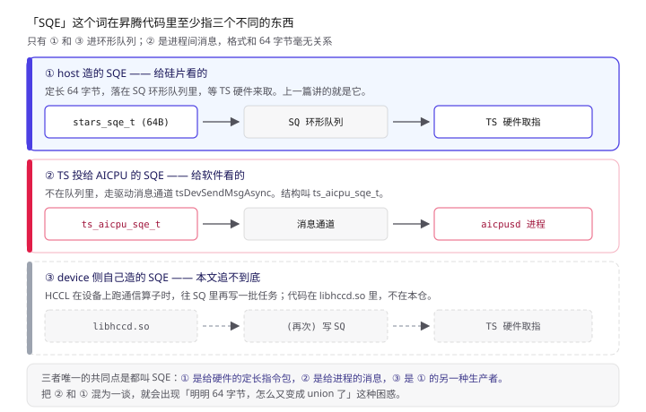
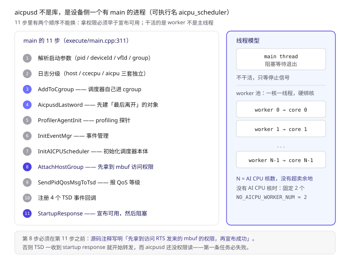
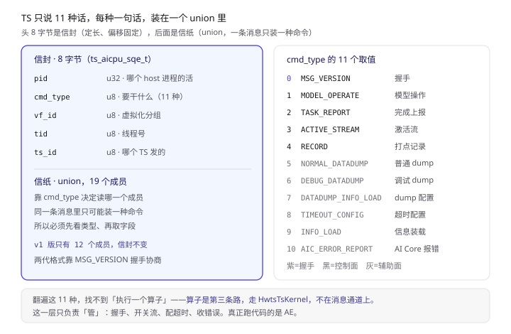
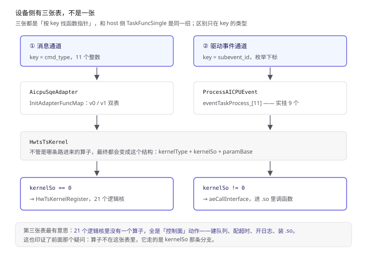
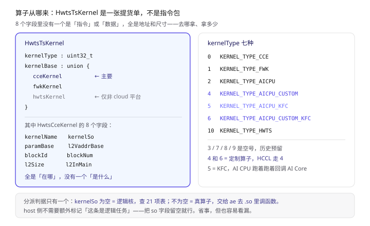
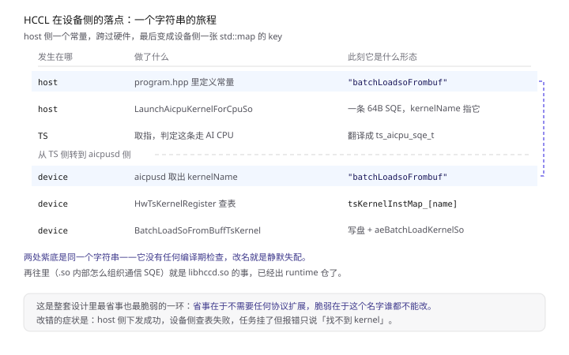

上一篇《CANN Runtime：一次 aclrtLaunchKernel 到底发生了什么》讲完了 host 侧：一次 launch 怎么变成 64 个字节，塞进环形队列，然后靠 `sqHead` 追平判断做完。

但那条故事的结尾其实是半句话——**「SQE 出了用户态」不等于「事情做完了」**。SQE 进了 SQ 之后，被谁取走、谁决定它在哪个核上跑、跑完谁把 `sqHead` 推上去，上一篇都留着了。

这篇补设备侧那一半。

一句话概括：

> **凡是判定要在 AI CPU 上执行的任务，TS 不会把那条 64 字节的 SQE 直接塞给 AI CPU，而是换成一个叫 `ts_aicpu_sqe_t` 的东西再投一次——它是第二个叫「SQE」的格式，也是 HCCL 在设备侧落地的真正入口。**

递进地看，四个角度：

- **进程**：`aicpusd` 不是个库，是 device 上一个有 main、有 cgroup、有线程池的独立进程；
- **协议**：TS 用一张 11 种命令的表跟它说话，v0/v1 两代格式并存；
- **分派**：设备侧有**三张**查表（命令适配器、子事件、逻辑核），和 host 侧 `TaskFuncSingle` 是同一套思路；
- **闭环**：host 侧一个字符串 `"batchLoadsoFrombuf"`，最后变成设备侧注册表的一个 key——这条链是整篇文章的重点。

> 本文所有结论来自 CANN 开源仓库 `runtime`（本地路径 `cann-runtime/`），关键处标注 `文件:行号`。
> 与上一篇的关系：**上一篇讲 SQE 怎么出厂，这一篇讲货到了之后谁签收。**《HCCL 的 AICPU 模式》里那句「device 侧自己生成 SQE」，落点就在本文第七节。
> 与下一篇的关系：**这一篇讲货到了谁签收，下一篇讲签收之后怎么上机床。** 接缝就是第六节末尾那行 `aeCallInterface`（`aicpusd_event_process.cpp:775`）——第三篇《算子怎么被调起来：AI CPU Engine 解剖》从它往下拆。
> 另见：《ACL Graph：流捕获到底捕获了什么》—— 同仓另一条线。本篇与本系列相邻几篇都在讲「一个任务怎么走完全程」，那一篇讲怎么让成千上万个任务只走一次。

---

## 〇、读之前：先认 6 个词

| 词 | 一句话 | 打个比方 |
| --- | --- | --- |
| **TS** | Task Scheduler，设备侧的硬件调度器。它从 SQ 里取指，把任务分派给 AI Core / AI CPU / 搬运单元 | **车间主任**，拿着工单往各工位派活 |
| **aicpusd** | AI CPU 侧的调度器进程（`aicpu_scheduler`），跑在设备上的 CPU 里 | **AI CPU 车间的班组长**，只接派给本车间的活 |
| **`ts_aicpu_sqe_t`** | TS 投给 aicpusd 的消息格式。名字里也有 SQE，但和 host 那 64 字节不是一回事 | **派工单**，和客户的**原始订单**不是一个东西 |
| **`HwtsTsKernel`** | aicpusd 收到算子任务后，用来描述「要跑哪个函数」的结构 | 一张**提货单**：函数名 + 所在的 .so + 参数在哪 |
| **逻辑核** | 不是算子，是 aicpusd 自己实现的一批「控制类任务」，按名字注册在表里 | 班组长的**行政事务**：开单、归档、报错，不用上机床 |
| **ae** | AICPU Engine，真正加载 .so、调函数、跑算子的运行库 | 车间的**机床**，班组长把提货单递过去就开动 |

把这六个词按时间顺序串起来：**TS 取到一条要 AI CPU 干的 SQE → 换成 `ts_aicpu_sqe_t` 投给 aicpusd → aicpusd 按 `cmd_type` 分派 → 算子类任务包成 `HwtsTsKernel` → 要么查逻辑核表自己处理，要么交给 ae 跑 .so → 跑完用同一套消息格式回一句「好了」**。

---

## 一、先把「SQE」这个歧义拆开

这个词在昇腾的代码里至少指三个不同的东西，混着说就会出现「明明 64 字节，怎么又变成 40 字节」这种困惑。先把三者的位置画清楚。

**第一个：host 造的 SQE。** 64 字节定长，落在 SQ 环形队列里，等 TS 硬件来取。这是上一篇的主角，源码里叫 `rtStarsSqe_t` / `stars_sqe_t`，构造入口是 `ToConstructSqe`。

**第二个：TS 投给 AICPU 的 SQE。** 就是 `ts_aicpu_sqe_t`（`src/aicpu_sched/extern_include/aicpu_msg.h:202`）。它**不在队列里**，走的是驱动消息通道 `tsDevSendMsgAsync`。字段是 `pid` + `cmd_type` + `vf_id` + `tid` + `ts_id` + 一个 19 成员的 union。

**第三个：device 侧自己造的 SQE。** HCCL 的 AICPU 模式在设备上跑通信算子，需要往 SQ 里再写任务。这部分代码在 `libhccd.so` / `libhccl_heterog.so` 里，**不在本仓**——本文只能追到它的边界，7.4 节会说清楚边界在哪。



> 上：host 那条 64 字节 SQE 走队列，被 TS 硬件取走。中：TS 判定要 AI CPU 执行时，把它「翻译」成 `ts_aicpu_sqe_t`，走消息通道投给 aicpusd。下：HCCL 的设备侧 .so 再造一条新的 64 字节 SQE 回队列——这条路本文追不到底，只能标出边界。

**为什么要「翻译」而不是直接递过去？** 因为两边关心的东西不一样。host 的 SQE 关心「在哪个流、第几个 pos、给哪个核、参数在哪」，是为了让**硬件**高效取指而设计的定长结构；TS 投给 AICPU 的消息关心「哪个进程、什么命令、要不要回话」，是**进程间通信**。前者是给硅片看的，后者是给软件看的，硬凑成一个格式只会两边都别扭。

所以别被名字骗了。**它们唯一的共同点是都叫 SQE。**

---

## 二、aicpusd 不是一个库，是一个进程

很多人以为 AI CPU 上的调度逻辑是「驱动里的一个函数」。不是。它在设备侧是一个**独立的用户态进程**，可执行文件名 `aicpu_scheduler`（`src/aicpu_sched/aicpu_schedule/CMakeLists.txt:450`），有完整的 main。

这个 main 不长，但每一步都有讲究。按顺序看（`src/aicpu_sched/aicpu_schedule/execute/main.cpp:311`）：

```cpp
int32_t main(int32_t argc, char* argv[])
{
    AicpuSchedule::ArgsParser startParams;
    startParams.ParseArgs(argc, argv);                       // 1. 解析启动参数
    AicpuSchedule::SetLogLevel(startParams);                 // 2. 日志分级
    AicpuSchedule::AddToCgroup(deviceId, vfId);              // 3. 进 cgroup
    AicpuSchedule::AicpusdLastword::GetInstance();           // 4. 先建"最后离开"的对象
    AicpuSchedule::AicpuProfiler::ProfilerAgentInit();       // 5. profiling
    AicpuSchedule::AicpuEventManager::GetInstance()
        .InitEventMgr(false, true, 0U);                      // 6. 事件管理
    AicpuScheduleInterface::GetInstance()
        .InitAICPUScheduler(deviceVec, pid, ...);            // 7. 初始化调度器
    AicpuSchedule::AttachHostGroup(...);                     // 8. attach host 的 group
    AicpuSchedule::SendPidQosMsgToTsd(...);                  // 9. 报 QoS 等级
    // 10. 注册四个 TSD 事件回调
    AicpuSchedule::StartupResponse(...);                     // 11. 告诉 TSD "我起来了"
    AicpuSchedule::WaitForShutDown(deviceVec[0U]);           // 阻塞在这里
}
```

几个值得停一下的地方：

**第 3 步 `AddToCgroup`。** 注意它的实现方式（`src/aicpu_sched/aicpu_schedule/core/aicpusd_resource_limit.cpp:21`）：不是调什么 cgroup API，而是拼一条命令去跑驱动自带的脚本：

```cpp
std::string command = "cd /var/ && sudo ./add_aicpu_cust_sd_to_cgroup.sh";
// 找不到就在 /usr/local/Ascend/driver/tools/ 下再找一次
if (access(pathStr.c_str(), F_OK) != 0) {
    aicpusd_info("Not find add_aicpu_cust_sd_to_cgroup.sh.");
    return true;        // ← 脚本不存在就当成成功，直接返回
}
command.append(" ").append(std::to_string(pid))
       .append(" ").append(std::to_string(deviceId))
       .append(" ").append(std::to_string(vfId));
```

两点值得记：**一是它要 `sudo`**（所以这个进程的启动权限不低）；**二是脚本找不到就静默跳过**，意味着 CPU 配额约束是可选的，不是所有部署形态都开。

**第 4 步 `AicpusdLastword`。** 注释写得很直白：`// Make sure AicpusdLastword are created first，to ensure the last exit`。先创建的对象最后析构，用来保证退出时还有能力把收尾日志吐出去。这是个很典型的「RAII 倒序析构」技巧。

**第 8 步 `AttachHostGroup`。** 为什么要在「告诉 TSD 我起来了」**之前**做？源码注释给了答案（`main.cpp:355`）：

> `// Attach group before send success to make sure aicpusd own the authority to access mbuff send by RTS`

翻译过来：**先把访问权限拿到，再宣布「我可以干活了」**。否则 TSD 一收到 startup response 就开始转发 mbuf，而 aicpusd 还没权限读，第一条任务就会失败。这是个顺序敏感的设计，改动这个顺序会引入难查的竞态。

**第 11 步 `StartupResponse` 之后，主线程就阻塞在 `WaitForShutDown` 了。** 也就是说：**干活的不是主线程**。

真正干活的是线程池。`ThreadPool::GetWorkerNum()` 的注释把规则写死了（`src/aicpu_sched/aicpu_schedule/core/aicpusd_worker.cpp:97`）：

```
// When there is no AICPU core, the AICPU schedule still starts NO_AICPU_WORKER_NUM work threads.
```

`NO_AICPU_WORKER_NUM = 2`（`aicpusd_worker.cpp:64`），而完整逻辑是 `(aicpuNum == 0) ? 2 : aicpuNum`：

**有一个 AI CPU 核，就开一个 worker 线程，并把它绑到那个核上**（`SetAffinity` / `WriteTidForAffinity`）。不是「开一堆线程抢核」，是「一核一线程，硬绑」。

这就解释了为什么 AI CPU 上的算子并发度上不去：**并发上限等于核数**，没有超卖的余地。想让 AI CPU 侧多跑几个算子，唯一的办法是给它更多核。



> 上：main 的 11 步，注意第 8 步（拿权限）必须早于第 11 步（宣布可用）。下：主线程阻塞在 WaitForShutDown，真正干活的是 N 个绑核 worker，N 等于 AI CPU 核数。

---

## 三、TS 跟它说什么：11 种命令，一个 union

消息格式的定义在 `src/aicpu_sched/extern_include/aicpu_msg.h`。先看 v0 那一版（`:202`，有删节）：

```c
typedef struct tag_ts_aicpu_sqe {
    volatile uint32_t pid;      // 这是哪个 host 进程的活
    volatile uint8_t  cmd_type; // 要干什么
    volatile uint8_t  vf_id;    // 虚拟化分组
    volatile uint8_t  tid;      // 线程号
    volatile uint8_t  ts_id;    // 哪个 TS 发的
    union {
        ts_aicpu_model_operate_t          aicpu_model_operate;
        ts_aicpu_model_operate_response_t aicpu_model_operate_resp;
        ts_to_aicpu_task_report_t         ts_to_aicpu_task_report;
        ts_aicpu_active_stream_t          aicpu_active_stream;
        ts_aicpu_notify_t                 aicpu_notify;
        ts_aicpu_record_t                 aicpu_record;
        // ... 共 19 个成员
        ts_aicpu_msg_version_t            aicpu_msg_version;
    } u;
} ts_aicpu_sqe_t;
```

**头 8 个字节是「信封」，后面的 union 是「信纸」。** 这个结构很难写错，因为：

1. 信封定长 8 字节（4 + 1×4），偏移固定，解析不用算；
2. 信纸是 union，**同一条消息只能是一种命令**，不存在「这条既有模型操作又有 datadump」；
3. 靠 `cmd_type` 决定读 union 的哪个成员——**先看类型再取字段**，不能反过来。

`cmd_type` 一共 11 个值（`aicpu_msg.h:233`）：

| 值 | 名字 | 干什么 |
| --- | --- | --- |
| 0 | `TS_AICPU_MSG_VERSION` | 握手，对协议版本（v0/v1 靠这个协商） |
| 1 | `TS_AICPU_MODEL_OPERATE` | 模型级操作：执行、重复执行 |
| 2 | `TS_AICPU_TASK_REPORT` | 任务完成上报（**这是完成回执的主路**） |
| 3 | `TS_AICPU_ACTIVE_STREAM` | 激活一条流，让它开始跑 |
| 4 | `TS_AICPU_RECORD` | record 类操作，带 record_id |
| 5 | `TS_AICPU_NORMAL_DATADUMP_REPORT` | 普通数据 dump |
| 6 | `TS_AICPU_DEBUG_DATADUMP_REPORT` | 调试 dump，多一个 debug_task_id |
| 7 | `TS_AICPU_DATADUMP_INFO_LOAD` | 把 dump 配置装进来 |
| 8 | `TS_AICPU_TIMEOUT_CONFIG` | 配超时阈值（等待超时 / 执行超时两条） |
| 9 | `TS_AICPU_INFO_LOAD` | 把 tiling key 之类的信息装进来 |
| 10 | `TS_AIC_ERROR_REPORT` | AI Core 侧的硬件错误上报 |

**注意这里没有「执行一个算子」。** 翻遍 11 种命令，找不到「跑 kernel」这一条。算子是走另一条路进来的——这就引出了下一节最容易搞混的地方。



> 上：8 字节信封 + union 信纸，靠 cmd_type 决定读哪个成员。下：11 种命令按用途分成三组——握手与版本、模型与流控制、dump 与超时与错误。

---

## 四、v0 和 v1：同一件事的两代格式

同一个头文件里还有第二个结构（`aicpu_msg.h:320`）：

```c
typedef struct tag_ts_aicpu_msg_info {
    uint32_t pid;
    uint8_t  cmd_type;
    uint8_t  vf_id;
    uint8_t  tid;
    uint8_t  ts_id;
    union { /* 12 个成员 */ } u;
} ts_aicpu_msg_info_t;
```

信封完全一样，信纸不一样。**v0 19 个成员，v1 只有 12 个**。少的那些去哪了？

| v0 有、v1 没有 | 说明 |
| --- | --- |
| `aicpu_notify` | 通知类操作，v1 合并进 `aicpu_record` |
| `callback_record` | 注释原话：`/* synchronized callback record from runtime, not for aicpu */`——本来就不是给 aicpu 的 |
| `ts_to_aicpu_datadump`（单一成员） | v1 拆成 normal / debug 两个 |

还有一处是**加字段**：v1 的 datadump 结构里多了 `debug_dump_task_id`，专门给调试 dump 用。

这套 v0/v1 并存不是历史包袱，是**协商出来的**。看握手怎么做的（`src/aicpu_sched/aicpu_schedule/core/aicpusd_event_process.cpp:424` 的 `ProcessMsgVersionEvent`）：aicpusd 收到 `TS_AICPU_MSG_VERSION`，把 magic number 和版本号回给 TS，之后双方就按这个版本选表。

而适配器里确实是**两套函数表**（`src/aicpu_sched/aicpu_schedule/common/aicpusd_sqe_adapter.cpp:70`）：

```cpp
void AicpuSqeAdapter::InitAdapterFuncMap()
{
    getModelOperateInfoFuncMap_[VERSION_0] = &AicpuSqeAdapter::GetAicpuModelOperateInfoV0;
    getModelOperateInfoFuncMap_[VERSION_1] = &AicpuSqeAdapter::GetAicpuModelOperateInfoV1;
    getModelOperateRspFuncMap_[VERSION_0] = &AicpuSqeAdapter::AicpuModelOperateResponseToTsV0;
    getModelOperateRspFuncMap_[VERSION_1] = &AicpuSqeAdapter::AicpuModelOperateResponseToTsV1;
    // ... 十几对
}
```

**每一类操作都有 V0/V1 两个实现，按版本号选。** 这就是为什么 `AicpuSqeAdapter` 有三个构造函数——分别接 `TsAicpuSqe`（v0）、`TsAicpuMsgInfo`（v1）、和「版本号 + 无效标记」（异常路径）。

这个设计的代价是代码量翻倍，好处是**新旧 TS 固件可以共存**。硬件代际不一致时，软件不用改，选表就行。

---

## 五、分派：设备侧有三张表

host 侧有一条 `TaskFuncSingle` 注册表（上一篇第四节）。设备侧**有三张**，各管一层。

### 5.1 第一张：命令适配器表

`InitAdapterFuncMap` 里挂了十几对 `std::map<uint16_t, 成员函数指针>`，按 `cmd_type` 分。《这就是把「消息」翻译成「业务参数」的那一层——适配器只做解析，不做业务。

### 5.2 第二张：子事件表

TS 除了发消息，还会通过驱动事件调度器发「子事件」。这类事件走的是 `halEschedAckEvent` 那套，入口是 `AicpuEventProcess::ProcessAICPUEvent`（`aicpusd_event_process.cpp:590`）：

```cpp
const AICPUSubEvent drvEventId = static_cast<AICPUSubEvent>(drvEventInfo.comm.subevent_id);
if (drvEventId >= AICPU_SUB_EVENT_MAX_NUM) {
    return AICPU_SCHEDULE_ERROR_UNKNOW_AICPU_EVENT;
}
const EventProcess taskProcess = eventTaskProcess_[drvEventId];   // ← 直接数组下标
if (taskProcess != nullptr) {
    ret = (this->*taskProcess)(*info);
}
```

表在构造函数里填（`aicpusd_event_process.cpp:61`），一共挂了 **9 个**：

| 下标 | 事件 | 干什么 |
| --- | --- | --- |
| 0 | `AICPU_SUB_EVENT_ACTIVE_STREAM` | 激活流 |
| 1 | `AICPU_SUB_EVENT_EXECUTE_MODEL` | 执行模型 |
| 2 | `AICPU_SUB_EVENT_REPEAT_MODEL` | 重复执行模型（Graph 重放） |
| 3 | `AICPU_SUB_EVENT_RECOVERY_STREAM` | 恢复被阻塞的流 |
| 4 | `AICPU_SUB_EVENT_UPDATE_PROFILING_MODE` | 切 profiling 开关 |
| 6 | `AICPU_SUB_EVENT_END_GRAPH` | 图结束 |
| 8 | `AICPU_SUB_EVENT_PREPARE_MEM` | 预备内存 |
| 9 | `AICPU_SUB_EVENT_TABLE_UNLOCK` | 解表锁 |
| 10 | `AICPU_SUB_EVENT_SUPPLY_ENQUEUE` | 补充入队 |

**注意下标不是连续的**：跳过了 5 和 7。

这里有个**值得记下来的不一致**：枚举 `AICPUSubEvent`（`pkg_inc/aicpu_sched/aicpu_schedule/aicpusd_info.h:60`）里其实有 11 项（0~10），比表里多两个——跳过的正是 `AICPU_SUB_EVENT_LOAD_SO`（下标 5）和 `AICPU_SUB_EVENT_ACTIVE_MODEL`（下标 7）。

**枚举里有，表里没挂。** 意味着这两个子事件真来了会走 `taskProcess == nullptr` 分支，打一条 `invalid` 日志然后返回错误。要么它们已经废弃、要么走的是第三节那条消息通道（不经过事件表）。读代码时看到「枚举 11 项、实挂 9 项」别以为是 bug，但也要知道这意味着这两条路在当前实现里是断的。

### 5.3 第三张：逻辑核表

这一张最有意思，因为它和 host 侧的模式**几乎一模一样**。宏定义在 `src/aicpu_sched/aicpu_schedule/core/hwts_kernel/hwts_kernel.h:48`：

```cpp
#define REGISTER_HWTS_KERNEL(kernelType, clazz)                      \
    bool g_##kernelType##_TsKernel_Creator __attribute__((unused)) = \
        RegisterHwTsKernel((kernelType), (CreatorFunction<clazz>()))
```

利用**全局变量在 main 之前构造**的副作用完成注册——和 host 侧 `TaskFuncSingle` 的静态注册是同一招。

注册的名字（`hwts_kernel_*.cpp`），一共 **21 个**：

| 类别 | 名字 |
| --- | --- |
| 定制算子 | `loadOpFromBuf`、`batchLoadsoFrombuf`、`deleteCustOp` |
| 模型控制 | `KERNEL_END_GRAPH`、`RECORD_NOTIFY`、`ACTIVE_ENTRY_STREAM`、`MODEL_STOP`、`MODEL_CLEAR_RESTART` |
| 模型配置 | `CFG_EXT_INFO`、`MODEL_CONFIG`、`SHAPE_CONFIG`、`ESCHED_PRIORITY`、`CHECK_SUPPORTED`、`PROCESS_DATA_EXCEPTION` |
| 队列 | `CREATE_QUEUE`、`DESTROY_QUEUE` |
| DFX | `CFG_LOG_ADDR`、`DUMP_DATA_INFO`、`SET_AICPU_DFX`、`CLOSE_AICPU_MONITOR` |
| 内存 | `SOMA_MEM_MNG` |

**注意这些名字里没有一个算子。** 全是「控制面」的动作：建队列、配超时、开日志、关监控、装载 .so。这也印证了第三节那个疑问——算子不在这张表里。



> 三层分派：TS 的消息先被适配器按 cmd_type 解析成参数，再按业务走；驱动子事件走 11 项枚举（实挂 9 项）的数组表；而不论走哪条，算子最终都要落到逻辑核表或 ae。三张表都是「按 key 找函数指针」，和 host 侧 TaskFuncSingle 同源。

---

## 六、算子任务到底怎么进来的

现在回答前面留下的问题：11 种命令里没有「跑算子」，21 个逻辑核里也没有算子，那算子从哪来？

答案是 **`HwtsTsKernel`**，一个独立于前面所有结构的第三种格式。定义在 `src/aicpu_sched/aicpu_processer/aicpu_event_struct.h:35`：

```cpp
struct HwtsTsKernel {
    uint32_t kernelType;
    union {
        HwtsCceKernel cceKernel;   // 最主要的一条
        HwtsFwkKernel fwkKernel;
        struct hwts_ts_kernel hwtsKernel;  // 仅非 cloud 平台
    } kernelBase;
};
```

而 `HwtsCceKernel`（`:19`）只有 8 个字段，全都指向「东西在哪」：

```cpp
struct HwtsCceKernel {
    uint64_t kernelName;  // 要调的函数名，在 kernel so 里
    uint64_t kernelSo;    // 含这个函数的 so
    uint64_t paramBase;   // 参数缓冲区地址
    uint64_t l2VaddrBase; // L2 缓冲地址
    uint32_t blockId;     // 块号
    uint32_t blockNum;    // 块数
    uint32_t l2Size;      // L2 用了多少页
    uint32_t l2InMain;    // L2 缓冲是否在主存
};
```

**这八个字段里没有任何一个是「指令」或「数据」。全是地址和尺寸。** 这是一个纯粹的「提货单」结构：告诉 aicpusd 去哪个 .so、调哪个函数、参数在哪。

`kernelType` 有七种（`aicpu_event_struct.h:46`）：

| 值 | 名字 | 走哪条路 |
| --- | --- | --- |
| 0 | `KERNEL_TYPE_CCE` | 若 `kernelSo == 0` → 逻辑核；否则走 ae |
| 1 | `KERNEL_TYPE_FWK` | 框架算子，走 `fwkKernel` |
| 2 | `KERNEL_TYPE_AICPU` | 同 CCE 的分支逻辑 |
| 4 | `KERNEL_TYPE_AICPU_CUSTOM` | **定制算子，HCCL 走这条** |
| 5 | `KERNEL_TYPE_AICPU_KFC` | Kernel Function Call，AI CPU 回调 AI Core |
| 6 | `KERNEL_TYPE_AICPU_CUSTOM_KFC` | 定制算子 + KFC |
| 10 | `KERNEL_TYPE_HWTS` | 直通 HWTS |

**注意编号 3、7、8、9 是空的。** 不是笔误，是历史预留。这种「枚举不连续」在老代码里很常见，看到别慌，但也不要去补——补了就是 ABI 变更。

分派逻辑在 `ExecuteTsKernelTask`（`aicpusd_event_process.cpp:735`），核心只有两个分支：

```cpp
const aicpu::KernelType kernelType = static_cast<aicpu::KernelType>(tsKernelInfo.kernelType);
// 分支一：CCE/AICPU 且没有 so —— 说明它是个"逻辑核"，查表自己处理
if (((kernelType == KERNEL_TYPE_CCE) || (kernelType == KERNEL_TYPE_AICPU)) &&
    (tsKernelInfo.kernelBase.cceKernel.kernelSo == 0UL)) {
    return ExecuteLogicKernel(tsKernelInfo);
}
// 分支二：真的要去跑 .so —— 交给 ae
const int32_t retAicpu = aeCallInterface(&tsKernelInfo);
```

**判据是 `kernelSo == 0`。** 有 .so 就去跑代码，没 .so 就查表。这个约定很省事：host 侧不需要额外标记「这是一条逻辑任务」，把 so 字段留空就行。

`ExecuteLogicKernel` 做的事就是取 `kernelName`、转成 `std::string`、查表（`:817`）：

```cpp
return HwTsKernelRegister::Instance().RunTsKernelTaskProcess(tsKernelInfo, kernelName);
```

`aeCallInterface` 是 AE 的入口（声明在 `src/aicpu_sched/aicpu_processer/aicpu_engine.h:48`），它负责在已经加载的 .so 里找符号、准备参数、调函数。



> 一条 `HwtsTsKernel` 进来，先看 kernelType，再看 kernelSo 是否为空。为空 = 逻辑核，查 21 项的表；不为空 = 真算子，交给 ae 去 .so 里调函数。第七种类型（KFC）是特例，AI CPU 跑着跑着要回调 AI Core。

---

## 七、HCCL 那一路：一个字符串的旅程

前面留了三次悬念，现在收口。**HCCL 的 AICPU 模式在设备侧到底怎么落地的？**

答案是：**它根本不特殊。** 它走的是「定制算子」这条通用路径，和任何自定义算子没有区别。整条链的钥匙，是一个字符串。

### 7.1 host 侧：把 .so 推下去

`src/runtime/core/src/kernel/program.cc:1409` 这一段的逻辑是：

```cpp
// 把 .so 二进制、so 名字、参数结构，三块内存分别拷到 device
CpuSoBuf cpuSoBuf = {
    .kernelSoBuf     = RtPtrToValue(devSoBuff),   // .so 二进制在 device 上的地址
    .kernelSoBufLen  = static_cast<uint32_t>(binarySize_),
    .kernelSoName    = RtPtrToValue(devSoName),   // .so 名字的地址
    .kernelSoNameLen = static_cast<uint32_t>(soName_.size())};

BatchProcCpuOpFromBufArgs batchCpuSo = {.soNum = 1U, .args = RtPtrToValue(args)};

const std::string opName = isLoadCpuSo ? LOAD_CPU_SO : DELETE_CPU_SO;  // ← 关键
const rtKernelLaunchNames_t launchName = {nullptr, opName.c_str(), ""};
LaunchAicpuKernelForCpuSo(&launchName, &argsInfo, stm.get());
stm->Synchronize(false, -1);   // 注意：同步等，-1 表示永不超时
```

三个细节值得记：

1. **它用的是「按名字 launch」**（`rtKernelLaunchNames_t`），不是按 binary handle。这条路径专门给逻辑核用。
2. **`Synchronize(false, -1)` 是同步的**，永不超时。装载 .so 是阻塞操作——这也解释了为什么「第一次跑某个自定义算子特别慢」。
3. `LOAD_CPU_SO` 的值定义在 `src/runtime/core/inc/kernel/program.hpp:26`：

```cpp
const std::string LOAD_CPU_SO   = "batchLoadsoFrombuf";
const std::string DELETE_CPU_SO = "deleteCustOp";
```

### 7.2 device 侧：同一个字符串，变成表的 key

设备侧注册的常量在 `hwts_kernel_cust_so.cpp:20`：

```cpp
const std::string LOADOP_FROM_BUFF      = "loadOpFromBuf";
const std::string BATCH_LOADSO_FROM_BUFF = "batchLoadsoFrombuf";
const std::string DELETE_CUSTOP          = "deleteCustOp";
```

**一模一样。** 于是整条链闭合了：

```
host: const std::string LOAD_CPU_SO = "batchLoadsoFrombuf"
   ↓ 作为 kernel name 塞进 SQE 的 paramBase / kernelName 字段
   ↓ TS 取指，发现要 AI CPU 执行
   ↓ 翻译成 ts_aicpu_sqe_t 投给 aicpusd
device: aicpusd 取 kernelName = "batchLoadsoFrombuf"
   ↓ HwTsKernelRegister::RunTsKernelTaskProcess(tsKernelInfo, kernelName)
   ↓ tsKernelInstMap_["batchLoadsoFrombuf"]
   ↓ BatchLoadSoFromBuffTsKernel::Compute(...)
```

**一个字符串，跨了 host / 硬件 / 设备侧进程三层，最后变成一张 `std::map` 的 key。** 这是整个设计里最省事也最脆弱的一环——省事在于不需要任何协议扩展，脆弱在于**这个字符串谁都不能改**，改了就是静默失配（host 发了，设备侧查不到，任务失败但你不知道为什么）。

### 7.3 落盘与加载

`BatchLoadSoFromBuffTsKernel::Compute`（`hwts_kernel_cust_so.cpp:330`）拿到 `soNum` 之后逐个处理，每个都走 `AicpuCustSoManager::CheckAndCreateSoFile`。落盘逻辑在 `aicpusd_cust_so_manager.cpp:209` 的 `CreateSoFile`：

```cpp
int32_t AicpuCustSoManager::CreateSoFile(const FileInfo& fileInfo)
{
    const std::string kernelSo(fileInfo.name);
    if (kernelSo.find_first_not_of(CP_PATTERN_FOR_SO_NAME) != std::string::npos) {
        return AICPU_SCHEDULE_ERROR_PARAMETER_NOT_VALID;   // 名字里有非法字符，直接拒
    }

    const int32_t ret = DoCreateSoFile(fileInfo);
    if (ret != AICPU_SCHEDULE_OK) {
        aicpusd_err("Create so failed, path=%s", fileInfo.name.c_str());
        return ret;
    }

    // load so if current aicpu mode is thread mode(minirc/ctrlcpu/lhisi)
    if (runMode_ == aicpu::AicpuRunMode::THREAD_MODE) {
        const char* soNames[1] = {fileInfo.name.c_str()};
        (void)aeBatchLoadKernelSo(aicpu::KERNEL_TYPE_AICPU_CUSTOM, 1U, &(soNames[0]));
    }
    aicpusd_info("Create so file %s success", fileInfo.name.c_str());
    return AICPU_SCHEDULE_OK;
}
```

两个安全设计、一个效率设计：

**① 名字白名单。** `CP_PATTERN_FOR_SO_NAME` 挡的是路径穿越（`../../` 这类）。设备侧要按 host 传来的名字写文件，不校验就是提权漏洞。

**② realpath 必查。** `WriteBufToSoFile` 里那句注释写得很重（`aicpusd_cust_so_manager.cpp:276`）：

```cpp
// serious security problem, must check realpath
ret = CheckSoFullPathValid(soName);
```

**③ 两级去重。** `PROCESS_PCIE_MODE` 下先算内容哈希：

```cpp
if (hashCalculator_.GetSameFileInfo(newFileInfo, existedFileInfo)) {
    ret = CreateSoftLinkToSoFile(softLinkPath, existedFileInfo.filePath);  // 命中：只建软链
} else {
    ret = WriteBufToSoFile(newFileInfo, GetPathForCustAicpuRealSo());      // 未命中：写真身
    if (ret == AICPU_SCHEDULE_OK) {
        ret = CreateSoftLinkToSoFile(softLinkPath, soFullPath);
    }
}
```

第一级是**内容哈希**（同一个 .so 换个名字下发也能命中），第二级在 `WriteBufToSoFile` 里还有一道 `access(soName, F_OK) == 0` 的**同名已存在**检查。所以同一个算子被多个进程反复装载时，物理文件只落一份，其余都是软链。

**④ 两种运行模式的分叉**：
- `THREAD_MODE`（minirc / ctrlcpu / lhisi 这类）：写完立刻 `aeBatchLoadKernelSo` 加载，因为这种模式下 AE 不监听文件变化；
- `PROCESS_PCIE_MODE`：只落盘，等真正要跑的时候再加载。

### 7.4 边界在哪

到这里必须说清楚一件事：**上面这条路只负责「把 .so 装上、让它能被调用」**。

HCCL 真正跑通信算子时，是在这个 .so 里做事的——而它内部要不要再造 SQE 写回 SQ，这部分代码在 `libhccd.so` / `libhccl_heterog.so` 里面，**不在 runtime 仓**。

runtime 仓里能看到的是它**怎么把这两个 so 拿起来**（`src/aicpu_sched/aicpu_schedule/common/aicpusd_hccl_api.cpp:61`）：

```cpp
void HcclSoManager::LoadHccdSo()
{
    hccdSoHandle_ = dlopen("libhccd.so", RTLD_LAZY);
    const std::string funcName[] = {
        "HcclInitCsComm", "HcclFinalizeCsComm", "HcclGetLookupRequest",
        "HcclIsetLookupResponse", "HcclWaitSome", "HcclAbortSelf",
        "HddsServiceCancel", "HddsCollRecvUpdateRequest", "HddsIsendUpdateResponse",
        "HddsCollRecvLookupRequest", "HddsIsendLookupResponse",
        "HcclDestroyResouce", "HcclRpcRegisterGlobalMemory",
        "HcclRpcUnregisterGlobalMemory", "HcclPsAssociateWorkers"};
    // 逐个 dlsym 存进 funcMap_
}
```

注意函数名里的两种前缀：`Hccl*` 和 `Hdds*`。`Hdds` 是更早的一套数据服务接口，两者并存说明这块也是渐进演化的。

还有一个 `libhccl_heterog.so`（`:99`），取的是 `Hcom*` 系列（`HcomPrepareStart` / `HcomSendByOS` / `HcomReceiveByOS` / `HcomInitByRankTable` …）。名字里的 **heterog** 和 **ByOS** 说明它是「异构 / 走 OS 栈」的那条路——也就是当通信没法直接走硬件时的兜底。

**所以精确的说法是**：

> runtime 负责把 HCCL 的设备侧 .so 装好、把符号表挂好、把算子调度到正确的核上；**至于通信逻辑本身怎么组织 SQE，那是 hcomm / hccl 仓的事**。

这也是上一篇末尾说「这条路还没对齐」的原因——它在两个仓的交界处，必须两边一起看才能拼完整。



> 上：host 侧 `"batchLoadsoFrombuf"` 作为 kernel name 下发，TS 取指后翻译成 aicpu 消息。下：设备侧同一个字符串变成 `std::map` 的 key，命中后写 .so 到设备盘、加载、返回。中间那条竖线是两个仓的边界——跨过去就是 hcomm/hccl 的地盘。

---

## 八、做完怎么回话：三种回法

有下发就有回执。和 host 侧「三种完成判据」一样，设备侧回话也有三条路，都在 `aicpusd_sqe_adapter.cpp` 里，同名重载 `ResponseToTs`。

**第一种：v0 格式回消息**（`:865`）

```cpp
int32_t AicpuSqeAdapter::ResponseToTs(
    TsAicpuSqe& aicpuSqe, unsigned int handleId, unsigned int devId, unsigned int tsId) const
{
    const auto ret = tsDevSendMsgAsync(
        devId, static_cast<uint32_t>(tsId),
        PtrToPtr<TsAicpuSqe, char_t>(&aicpuSqe),
        static_cast<uint32_t>(sizeof(TsAicpuSqe)), handleId);
}
```

**第二种：v1 格式回消息**（`:884`），除了结构体类型，其余一字不差。

**第三种：事件确认**（`:903`）

```cpp
int32_t AicpuSqeAdapter::ResponseToTs(
    hwts_response_t& hwtsResp, uint32_t devId, EVENT_ID eventId, uint32_t subeventId) const
{
    if (FeatureCtrl::GetAicpuSchedMode() == SCHED_MODE_MSGQ) {
        MessageQueue::SendResponse(hwtsResp.result, hwtsResp.status);
    }
    const drvError_t ret = halEschedAckEvent(
        devId, eventId, subeventId, PtrToPtr<hwts_response_t, char_t>(&hwtsResp),
        static_cast<uint32_t>(sizeof(hwts_response_t)));
}
```

关键区别：

| 回法 | 驱动接口 | 用在哪 |
| --- | --- | --- |
| 消息回执 | `tsDevSendMsgAsync` | 第三节那 11 种 `cmd_type` 的应答 |
| 事件确认 | `halEschedAckEvent` | 驱动事件调度器那条路（第二节那 9 个子事件） |

**这是两条不同的驱动通道**，不是同一件事的两种写法。前者是「我收到一条消息，回一条消息」，后者是「我收到一个事件，得显式 ack 一下，否则调度器不会派下一条」。

还有一个 `SCHED_MODE_MSGQ` 的判断散落在各处（`aicpusd_info.h:54`）：

```cpp
enum AicpuSchedMode {
    SCHED_MODE_INTERRUPT = 0,  // 中断驱动
    SCHED_MODE_MSGQ,           // 消息队列驱动
    SCHED_MODE_INVALID
};
```

消息队列模式下，除了走驱动，还要额外调一次 `MessageQueue::SendResponse`。这意味着**同一套调度器代码要能跑在两种驱动模型上**，判断点就散在这些地方。

---

## 九、两套调度器，不是一套

最后补一个容易忽略的结构事实：设备侧其实有**两个**调度器进程。

| | 标准调度器 | 定制调度器 |
| --- | --- | --- |
| 目录 | `src/aicpu_sched/aicpu_schedule/` | `src/aicpu_sched/aicpu_cust_schedule/` |
| 可执行 | `aicpu_scheduler` | `aicpu_custom_scheduler` |
| 管什么 | 算子、模型、控制流、datadump | 定制算子（HCCL / MC2） |
| 编译条件 | 总是编译 | 由 CMake 开关控制（`CMakeLists.txt:71`） |

两边目录结构高度对称（都有自己的 `main.cpp`、`event_manager`、`worker`、`sqe_adapter`），但有实质差异：定制调度器多了 `cust_mc2_maintenance`（MC2 通信维护）和 `cust_platform_info`（平台信息对接），少了 datadump 的一大坨。

**为什么要拆两套？** 因为定制算子的生命周期模型不一样：标准算子是「一条流上的一次执行」，定制算子是「装载 → 反复调用 → 卸载」的长生命周期，中间还要维护通信资源（MC2 的维护线程就是干这个的）。塞进一套调度器里会让状态机复杂度爆炸。

代价是**代码重复**：`aicpusd_worker.cpp` 里 `NO_AICPU_WORKER_NUM = 2UL` 这个常量两边各定义了一份，`aicpusd_sqe_adapter` 也是两份。改一处忘了另一处，就是经典的「只在定制算子路径上复现的 bug」。

---

## 十、几个能立刻用上的判断

**1. AI CPU 侧算子并发上不去，别查线程池配置，查核数。**
`GetWorkerNum()` 的实现是 `(aicpuNum == 0) ? 2 : aicpuNum`，一核一线程硬绑。没有超卖空间，想加并发只能加核。

**2. 「第一次跑自定义算子特别慢」是装载，不是编译。**
host 侧 `LaunchAicpuKernelForCpuSo` 之后跟了一句 `stm->Synchronize(false, -1)`——**同步等，永不超时**。装载 .so + 落盘 + `aeBatchLoadKernelSo` 全在这段里。

**3. 自定义算子装载失败但没有明确报错，先看名字。**
host 的 `"batchLoadsoFrombuf"` 和设备侧注册的 key 必须逐字节相同。这个名字没有任何编译期检查，失配就是运行期查表失败。同理 `.so` 文件名要过 `CP_PATTERN_FOR_SO_NAME` 白名单。

**4. 看到「枚举有 11 项、实挂 9 项」不要当 bug，但要知道哪两条是断的。**
`AICPU_SUB_EVENT_LOAD_SO` 和 `AICPU_SUB_EVENT_ACTIVE_MODEL` 在枚举里但没进分发表，真来了会返回 `UNKNOW_AICPU_EVENT`。

**5. `kernelSo == 0` 是「逻辑任务」的判据。**
不是靠 task type、不是靠额外 flag。host 侧把 so 字段留空，设备侧就知道该查表而不是跑代码。

---

## 十一、学习路径

1. **先读三个结构体**，把「三种格式」分清：`ts_aicpu_sqe_t`（`aicpu_msg.h:202`）、`ts_aicpu_msg_info_t`（`:320`）、`HwtsTsKernel`（`aicpu_event_struct.h:35`）。半小时能读完，但能省掉后面所有的困惑。
2. **再读 main**：`src/aicpu_sched/aicpu_schedule/execute/main.cpp:311`。重点看第 8 步和第 11 步的顺序。
3. **然后读两个分派入口**：`ProcessAICPUEvent`（事件表）和 `ExecuteTsKernelTask`（kernelType 分支）。这两个函数读完，整个骨架就有了。
4. **最后追字符串**：从 `program.hpp:26` 的 `LOAD_CPU_SO` 一路 grep 到 `hwts_kernel_cust_so.cpp:20` 的 `BATCH_LOADSO_FROM_BUFF`。这是理解「host 与 device 怎么对上号」最快的一次练习。
5. **动手**：`aicpusd` 的日志前缀很好认（`aicpusd_info` / `aicpusd_err`），抓一次自定义算子首次加载的日志，能看到 `Begin to process ts kernel loadOpFromBuf` 这条。对照本文第 7.3 节看它落在哪一步。

**还没搞清楚的（留给后面）**：

- **TS 硬件的取指与 `sqHead` 推进时机**。本文讲的是「TS 把活派给 AICPU 之后」，但 TS 自己怎么从 SQ 取指、什么时候推 `sqHead`，需要 TS 侧材料，runtime 仓里没有。
- **`libhccd.so` 内部怎么组织通信 SQE**。这是 hcomm / hccl 仓的地盘，也是上一篇末尾点名的那个交界。
- **KFC（Kernel Function Call）的完整机制**。第三篇已经把 KFC 的**加载与调用入口**拆开了（`kernelSo` 可为空、允许 `dlsym(RTLD_DEFAULT)` 全进程搜符号、错误码 1000~1099 原样穿透给 RTS），但「AI CPU 跑着跑着回调 AI Core」的那套状态机还没读透。
- **`SCHED_MODE_MSGQ` 与 `SCHED_MODE_INTERRUPT` 的性能差异**。代码里判断点很多，但没有任何量化数据。

---

## 参考

- CANN 开源仓库 `runtime`（`gitcode.com/cann/runtime`），本文所有源码引用均来自该仓 `master` 分支。
  - `src/aicpu_sched/extern_include/aicpu_msg.h` —— TS↔AICPU 消息格式（v0/v1）、11 种 `cmd_type`
  - `src/aicpu_sched/aicpu_processer/aicpu_event_struct.h` —— `HwtsTsKernel`、`HwtsCceKernel`、7 种 `KernelType`
  - `src/aicpu_sched/aicpu_schedule/execute/main.cpp` —— aicpusd 启动 11 步
  - `src/aicpu_sched/aicpu_schedule/core/aicpusd_event_process.cpp` —— 子事件表、`ExecuteTsKernelTask`、`ExecuteLogicKernel`
  - `src/aicpu_sched/aicpu_schedule/core/hwts_kernel/` —— 21 个逻辑核的实现与注册
  - `src/aicpu_sched/aicpu_schedule/core/aicpusd_cust_so_manager.cpp` —— 定制算子 .so 落盘、哈希去重、加载
  - `src/aicpu_sched/aicpu_schedule/common/aicpusd_hccl_api.cpp` —— `libhccd.so` / `libhccl_heterog.so` 的符号表
  - `pkg_inc/aicpu_sched/aicpu_schedule/aicpusd_info.h` —— `LoadOpFromBufArgs`、`AICPUSubEvent`、`AicpuSchedMode`
- 本站相关文章：
  - 《CANN Runtime：一次 aclrtLaunchKernel 到底发生了什么》—— 本文的上一篇，host 侧那 64 字节怎么造出来、怎么出门
  - 《算子怎么被调起来：AI CPU Engine 解剖》—— 本文的下一篇，`aeCallInterface` 往下怎么 `dlopen`、`dlsym`、调函数
  - 《HCCL 的 AICPU 模式：通信任务到底在哪展开》—— 通信算子下沉到 AI CPU 的整体设计，本文第 7.4 节接着它讲
  - 《HCCL 实现原理》—— 通信域、算子算法与「下发—完成往返」的账
