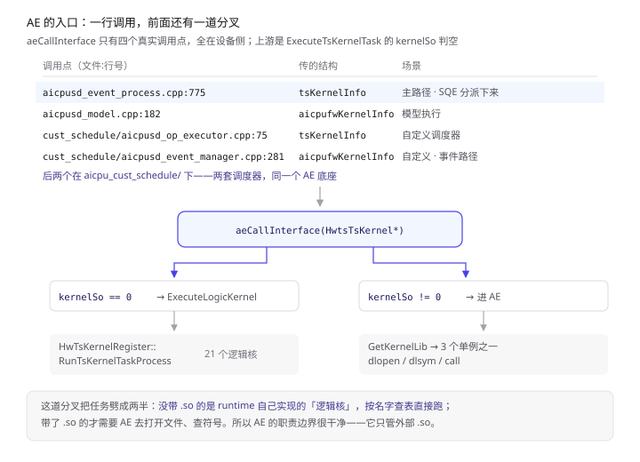
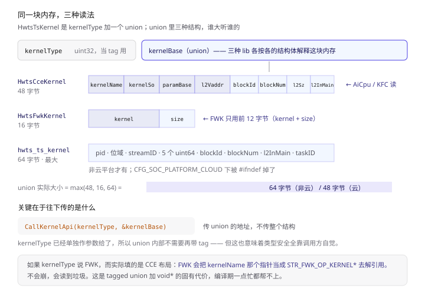
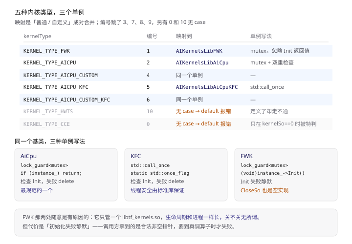
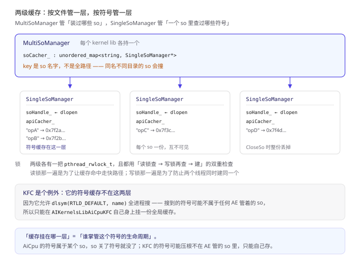
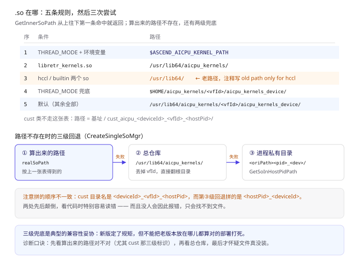
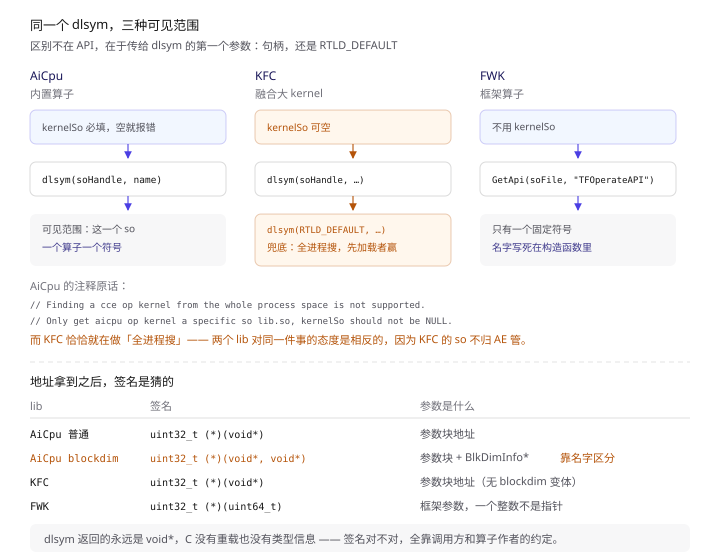
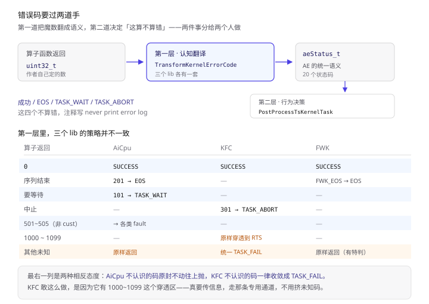

前两篇讲了两段路：

- 第一篇《CANN Runtime：一次 aclrtLaunchKernel 到底发生了什么》——**host 侧**：一次 launch 怎么变成 64 个字节，进 SQ 环。
- 第二篇《SQE 到了设备侧：AI CPU 调度器怎么接活》——**设备侧入口**：`aicpusd` 怎么收 TS 的消息、怎么分派、怎么把算子 `.so` 落进 cust 目录。

第二篇结尾留了个动作没写：第七节讲完 `.so` 怎么落盘，第六节讲完 `HwtsTsKernel` 怎么描述「要跑哪个函数」，但**这些描述最后是被谁拿去用的**，只有一句「交给 ae 跑」。

这篇就把那一句展开。

一句话概括：

> **`aeCallInterface` 是 AI CPU 上唯一的算子调用出口。它只有两步：按 `kernelType` 挑一个 kernel lib 单例，然后把这个 lib 的 `CallKernelApi` 调下去。剩下所有复杂度都在「挑」和「调」之间——`.so` 从哪来、符号怎么查、函数怎么签名、错误码怎么翻译。**

递进地看，五个角度：

- **入口**：`aeCallInterface` 只有四个真实调用点，且它前面还有一道 `kernelSo == 0` 的分叉，把任务劈成「逻辑核」和「真算子」；
- **内存**：`HwtsTsKernel` 是个 `kernelType` 加一个 union，**三种 lib 看同一块内存、各按各的结构体解释**——这是整个设计的枢纽；
- **分派**：5 种有效 `kernelType` 映射到 3 个单例 lib，而**批量加载 `.so` 时只分两路，KFC 根本不在其中**；
- **路径**：`.so` 的目录是算出来的，不是配的。算错还有两级回退；
- **调用**：`dlopen` + `dlsym` 拿到地址之后，函数签名是猜的——除了一个特殊名字 `RunCpuKernelWithBlock`。

> 本文所有结论来自 CANN 开源仓库 `runtime`（本地路径 `cann-runtime/`），代码集中在 `src/aicpu_sched/aicpu_processer/`（18 个文件 / 2772 行），关键处标注 `文件:行号`。
> 与上一篇的关系：**上一篇讲货到了谁签收，这一篇讲签收之后怎么上机床。** 接缝就是 `aicpusd_event_process.cpp:775` 那一行 `aeCallInterface`。
> 另见：《ACL Graph：流捕获到底捕获了什么》—— 同仓另一条线。本系列三篇都在讲「一个任务怎么走完全程」，那一篇讲怎么让成千上万个任务只走一次。

---

## 〇、读之前：先认 6 个词

| 词 | 一句话 | 打个比方 |
| --- | --- | --- |
| **AE** | AICPU Engine，本文的主角。设备侧加载算子 `.so`、查符号、调函数的运行库 | 车间的**机床本体** |
| **kernel lib** | AE 内部的三条产线：`AIKernelsLibFWK` / `AIKernelsLibAiCpu` / `AIKernelsLibAiCpuKFC` | 三台**不同的机床**，各吃一种料 |
| **`HwtsTsKernel`** | 描述「要跑什么」的结构：一个 `kernelType` + 一个 union | 一张**提货单**，格式按货类变 |
| **so manager** | 管 `.so` 的两级缓存：`MultiSoManager`（按名字管一堆）+ `SingleSoManager`（管一个 handle 和它的符号表） | **仓库管理员**和他的**每个货架** |
| **`dlopen` / `dlsym`** | glibc 的两个函数：把 `.so` 映射进进程、按名字取函数地址 | 把货架**搬进车间**、按标签**找零件** |
| **kernel name** | 字符串，就是 `.so` 里的一个导出符号名。AE 靠它查地址 | 零件上的**标签** |

串起来一句话：**`aeCallInterface(HwtsTsKernel*)` → 按 `kernelType` 选 kernel lib → 从 union 里取 `kernelName` 和 `kernelSo` → so manager 把 `.so` `dlopen` 进来 → `dlsym` 查符号 → 强转成函数指针调过去。**

六个词里，「kernel lib」和「so manager」是两个容易混的层次——前者按**内核类型**分工，后者按**文件**分工，它们是两层，不是一回事。第四节和第五节各拆一个。

---

## 一、先接上上一篇：那行 `aeCallInterface` 长在哪

第二篇第六节讲到 `ExecuteTsKernelTask`，但没贴完。补上（`aicpusd_event_process.cpp:735`）：

```cpp
int32_t AicpuEventProcess::ExecuteTsKernelTask(
    aicpu::HwtsTsKernel& tsKernelInfo, const uint32_t threadIndex, const uint64_t drvSubmitTick,
    const uint64_t drvSchedTick, const uint64_t streamId, const uint64_t taskId) const
{
    const aicpu::KernelType kernelType = static_cast<const aicpu::KernelType>(tsKernelInfo.kernelType);
    // ① 关键分叉：逻辑核，不进 AE
    if (((kernelType == aicpu::KernelType::KERNEL_TYPE_CCE) ||
         (kernelType == aicpu::KernelType::KERNEL_TYPE_AICPU)) &&
        (tsKernelInfo.kernelBase.cceKernel.kernelSo == 0UL)) {
        return ExecuteLogicKernel(tsKernelInfo);
    }

    // ② CUSTOM 类必须跑在 thread 模式
    if ((kernelType == aicpu::KernelType::KERNEL_TYPE_AICPU_CUSTOM) &&
        (AicpuUtil::CheckCustAicpuThreadMode() != AICPU_SCHEDULE_OK)) {
        return AICPU_SCHEDULE_ERROR_INNER_ERROR;
    }

    // ③ 省略：profiling 上下文准备（profFlag 为真才走）
    ...
    AicpuMonitor::GetInstance().SetTaskStartTime(threadIndex);
    const int32_t retAicpu = aeCallInterface(&tsKernelInfo);   // ← 就是这一行
    AicpuMonitor::GetInstance().SetTaskEndTime(threadIndex);
    ...
    PostProcessTsKernelTask(retAicpu, streamId, taskId);
    return retAicpu;
}
```

这条分叉是全文的分水岭，值得单独说清楚：

**`kernelSo == 0` 的走 `ExecuteLogicKernel`，非 0 的才进 AE。**

`ExecuteLogicKernel`（`:817`）干什么？它把 `kernelName` 拷出来，然后：

```cpp
// aicpusd_event_process.cpp:836
return HwTsKernelRegister::Instance().RunTsKernelTaskProcess(tsKernelInfo, kernelName);
```

`HwTsKernelRegister` 就是第二篇第五节第三张表——那 21 个 `REGISTER_HWTS_KERNEL`。也就是说：

> **没给 `.so` 的算子，是 runtime 自己在设备侧实现好的「逻辑核」，按名字查表直接执行；给了 `.so` 的，才需要 AE 去 `dlopen`。**

大白话：提货单上写了仓库名（`kernelSo`），就得去仓库提货；没写仓库名的，说明货就在班组长的柜子里，直接拿。

所以 AE 的职责边界非常干净：**它只处理「外部 `.so` 里的算子」**。runtime 内置的那些根本不经过它。

### 四个调用点，全在这儿

grep `aeCallInterface` 的实现侧调用点，排除 test 和 stub，只剩四条：

| 调用点 | 传的结构 | 场景 |
| --- | --- | --- |
| `aicpu_schedule/core/aicpusd_event_process.cpp:775` | `tsKernelInfo` | **主路径**：SQE 事件分派下来的算子任务 |
| `aicpu_schedule/core/aicpusd_model.cpp:182` | `aicpufwKernelInfo` | 模型执行（fwk 类） |
| `aicpu_cust_schedule/core/aicpusd_op_executor.cpp:75` | `tsKernelInfo` | 自定义调度器（cust 版） |
| `aicpu_cust_schedule/core/aicpusd_event_manager.cpp:281` | `aicpufwKernelInfo` | 自定义调度器的事件路径 |

注意后两个在 `aicpu_cust_schedule/` 下——第二篇第九节讲过，那是**另一套调度器**（`aicpu_custom_scheduler`）。两套调度器各有自己的事件处理，但最后都汇到同一个 `aeCallInterface`。

**AE 是共用底座，调度器是两套。** 这个结构在 `aicpu_engine.h:48` 一眼就能看出来：它是个 `extern "C"` 的扁平接口，不隶属任何调度器。


> 上半是设备侧四个真实调用点（排除 test 与 stub），两套调度器各有两条，最后都汇到同一个 `aeCallInterface`；下半是它前面那道 `kernelSo` 判空——为 0 走 `ExecuteLogicKernel` 查 21 个逻辑核，非 0 才进 AE 的 `dlopen` 路径。左侧两列分别是文件名与传进去的结构。

---

## 二、AE 只对外开 6 个口子

`aicpu_engine.h` 一共 99 行，导出的函数就 6 个，全在 `extern "C"` 里：

```cpp
// aicpu_engine.h:48
int32_t aeCallInterface(const void* const addr);                      // 调算子
void aeClear();                                                        // 清掉所有 kernel lib
aeStatus_t aeBatchLoadKernelSo(const uint32_t kernelType,
                               const uint32_t loadSoNum,
                               const char_t* const* const soNames);    // 批量装 so
aeStatus_t aeCloseSo(const uint32_t kernelType, const char_t* const soName);
aeStatus_t __attribute__((weak)) AeAddSoInWhiteList(const char_t* const soName);
void __attribute__((weak)) AeDeleteSoInWhiteList(const char_t* const soName);
```

六个里面，**只有第一个是「跑」，其余五个都是「管」**：

- `aeBatchLoadKernelSo` —— 批量把 `.so` 装进进程。第二篇第七节那个 `"batchLoadsoFrombuf"` 链路的最后一跳，落点就是它；
- `aeCloseSo` —— 卸一个；
- `aeClear` —— 全清，`aeCallInterface` 的逆操作；
- 两个白名单函数是 `weak` 符号，允许未实现。这一对是**给外部扩展用的钩子**，不是主流程。

### 一个过时的注释

`aicpu_engine.h:45` 写着：

```cpp
 * @param [in] addr     void *,  should be STR_KERNEL * format
```

而实现里（`aicpu_processer.cc:29`）：

```cpp
const auto strKernel = static_cast<const aicpu::HwtsTsKernel*>(addr);
```

**头文件说 `STR_KERNEL`，实现里是 `HwtsTsKernel`。** `STR_KERNEL` 这个类型在今天的代码里已经不存在了——那是老版本的名字。头文件注释没跟着改。

这种小错在大型 C 接口里很常见，但读的时候要小心：**注释和实现对不上时，永远信实现**。接口是 `void*`，编译期谁也管不了，只能靠人。

### `aeStatus_t` 的错误码分布

`aicpu_engine.h:19` 定义了 19 个状态码，编号分布很不均匀，看得出历史：

| 区段 | 编号 | 含义 |
| --- | --- | --- |
| 成功 | 0 | `AE_STATUS_SUCCESS` |
| 特殊「非错」态 | 6 / 7 / 8 / 9 / 10 / 11 / 12 / 101 | EOS / 静默故障 / abort / 各类检测故障 / task wait |
| 参数与内部错 | 11001 ~ 11006 | bad param / 开 so 失败 / 取 kernel 名失败 / API 参数非法 / API 内部错 / 内部错 |
| 名字非法 | 11007 / 11008 | so 名非法 / kernel 名非法 |
| 占位 | 11009 | `AE_STATUS_RESERVED` |

**为什么「特殊非错态」占了 6~12 和 101 这么散的编号？** 因为这几个值不是 AE 自己定的，是**算子函数返回给 AE 的约定值**——第十节会看到，AE 要把这些魔数翻译成 `aeStatus_t`。编号散，正说明它们来自不同的历史约定。

而 11001~11009 这一段是后来统一加的，前缀一致。

---

## 三、`HwtsTsKernel`：三种 lib 看同一块内存

这是全文最重要的一个结构。

```cpp
// aicpu_event_struct.h:19
struct HwtsCceKernel {
    uint64_t kernelName;   // 要调的函数名（地址，不是内容）
    uint64_t kernelSo;     // 函数所在的 so 文件名（地址）
    uint64_t paramBase;    // 参数块地址
    uint64_t l2VaddrBase;
    uint32_t blockId;
    uint32_t blockNum;
    uint32_t l2Size;
    uint32_t l2InMain;
};

// aicpu_event_struct.h:30
struct HwtsFwkKernel {
    uint64_t kernel;   // 指向 STR_FWK_OP_KERNEL
    uint32_t size;
};

// aicpu_event_struct.h:35
struct HwtsTsKernel {
    uint32_t kernelType;
    union {
        HwtsCceKernel cceKernel;
        HwtsFwkKernel fwkKernel;
#ifndef CFG_SOC_PLATFORM_CLOUD
        struct hwts_ts_kernel hwtsKernel;
#endif
    } kernelBase;
};
```

### 三个成员，三种字节数

按 x86_64 / AArch64 的 LP64 布局算：

| 成员 | 字段 | 大小 |
| --- | --- | --- |
| `cceKernel` | 4×`uint64` + 4×`uint32` | 32 + 16 = **48** |
| `fwkKernel` | 1×`uint64` + 1×`uint32`（补 4 字节对齐） | 8 + 4 + 4 = **16** |
| `hwtsKernel` | `pid_t`(4) + 位域(2) + `streamID`(2) + 5×`uint64`(40) + 2×`uint16`(4) + `uint32`(4) + `uint64`(8) | **64** |

union 的大小由最大的决定，所以非云平台下 `kernelBase` 是 **64 字节**，`HwtsTsKernel` 整体 72 字节（4 + 4 对齐 + 64）。云平台把 `hwtsKernel` 编译掉了，union 退化成 48。

> 顺带一句：这个 64 和 host 侧 SQE 的 64、`ts_aicpu_sqe_t` 的 64 纯属巧合。三处 64 没有任何继承关系——一个是硬件队列条目长度，一个是消息信封体尺寸，一个是结构体布局凑出来的。别串。

### 关键：只传 union 的地址

`aeCallInterface` 拿到整个结构后，往下传的是：

```cpp
// aicpu_processer.cc:38
ret = targetKernelLib->CallKernelApi(kernelType, static_cast<const void*>(&strKernel->kernelBase));
```

**传的是 `&kernelBase`，不是 `&strKernel`。** 也就是说，`kernelBase` 的地址被当成 `void*` 交给 lib，lib 内部再 `static_cast` 回自己认识的类型：

| lib | 强转成 | 读哪些字段 |
| --- | --- | --- |
| `AIKernelsLibAiCpu` | `const HwtsCceKernel*`（`:100`） | `kernelName` / `kernelSo` / `paramBase` / `blockId` / `blockNum` |
| `AIKernelsLibAiCpuKFC` | `const HwtsCceKernel*`（`:142`） | 同上，但 `kernelSo` 允许为空 |
| `AIKernelsLibFWK` | `const HwtsFwkKernel*`（`:70`） | 只有 `kernel` 一个有效字段 |

大白话：**同一块 64 字节内存，AiCpu 按「提货单」读，FWK 按「转包单」读**。FWK 只读前 8 个字节（`kernel` 指针），后面 56 字节它当不存在。

这是 C 语言里典型的「tagged union in disguise」——`kernelType` 在结构体外层当 tag，union 在内层当 payload。设计上没问题，但代价是**类型安全全靠 `kernelType` 和各 lib 的自觉**。如果 `kernelType` 说 FWK 而实际填的是 CCE 布局，FWK 会把 `kernelName` 那个指针当 `STR_FWK_OP_KERNEL*` 去解引用——**不会崩，会读到垃圾**。


> 上半三行是 union 的三个成员各自占多少字节：`HwtsCceKernel` 48、`HwtsFwkKernel` 16、`hwts_ts_kernel` 64，union 大小取最大；每个小方格是一种字段。中部那条蓝底是「max 之后到底多大」，云平台因为 `#ifndef CFG_SOC_PLATFORM_CLOUD` 少了最大那个成员，union 退化成 48。下半说明往下传的是 `&kernelBase` 而不是整个结构。

### 一个定义了却走不通的成员

`KernelType` 里有 `KERNEL_TYPE_HWTS = 10`（`:53`），union 里也有对应的 `hwtsKernel` 成员。看起来是完整支持。

但 `GetKernelLib`（下一节）**没有 `KERNEL_TYPE_HWTS` 这个 case**，会落到 `default` 报错。

所以这个成员的实际状态是：**结构上预留了，分派上没接。** 云平台甚至连成员都编译掉了。读代码时看到「定义齐全」不要假设「支持」——得去分派表验证。

---

## 四、5 种 `kernelType` 映射到 3 个单例

`aeCallInterface` 的第一步就是这一句（`aicpu_processer.cc:35`）：

```cpp
int32_t ret = cce::AIKernelsLibManger::GetKernelLib(kernelType, targetKernelLib);
```

`GetKernelLib` 的实现短得很（`ae_kernel_lib_manager.cc:25`）：

```cpp
aeStatus_t AIKernelsLibManger::GetKernelLib(const aicpu::KernelType kernelType, AIKernelsLibBase*& kernelLib)
{
    switch (kernelType) {
        case aicpu::KERNEL_TYPE_FWK:
            kernelLib = AIKernelsLibFWK::GetInstance();
            break;
        case aicpu::KERNEL_TYPE_AICPU:
        case aicpu::KERNEL_TYPE_AICPU_CUSTOM:
            kernelLib = AIKernelsLibAiCpu::GetInstance();
            break;
        case aicpu::KERNEL_TYPE_AICPU_KFC:
        case aicpu::KERNEL_TYPE_AICPU_CUSTOM_KFC:
            kernelLib = AIKernelsLibAiCpuKFC::GetInstance();
            break;
        default:
            AE_ERR_LOG(AE_MODULE_ID,
                "Input param kernelType is invalid :%d, supported types are KERNEL_TYPE_FWK[1], KERNEL_TYPE_AICPU[2], "
                "KERNEL_TYPE_AICPU_CUSTOM[4], KERNEL_TYPE_AICPU_KFC[5], KERNEL_TYPE_AICPU_CUSTOM_KFC[6]",
                kernelType);
            break;
    }
    if (kernelLib == nullptr) { ... return AE_STATUS_BAD_PARAM; }
    return AE_STATUS_SUCCESS;
}
```

5 种类型，3 个单例，映射是「普通 / 自定义」成对合并：

| `kernelType` | 编号 | → lib | 说明 |
| --- | --- | --- | --- |
| `KERNEL_TYPE_FWK` | 1 | `AIKernelsLibFWK` | 框架算子（今天只剩 TensorFlow 一路） |
| `KERNEL_TYPE_AICPU` | 2 | `AIKernelsLibAiCpu` | 内置 AI CPU 算子，`.so` 必填 |
| `KERNEL_TYPE_AICPU_CUSTOM` | 4 | `AIKernelsLibAiCpu` | **同一个单例** |
| `KERNEL_TYPE_AICPU_KFC` | 5 | `AIKernelsLibAiCpuKFC` | Kernel Fusion Center，`.so` 可空 |
| `KERNEL_TYPE_AICPU_CUSTOM_KFC` | 6 | `AIKernelsLibAiCpuKFC` | **同一个单例** |
| `KERNEL_TYPE_HWTS` | 10 | —— | 无 case，落 default |
| `KERNEL_TYPE_CCE` | 0 | —— | 无 case，落 default |

两个细节：

**① 编号跳号。** 0/1/2/4/5/6/10，**3、7、8、9 全空**。日志里那句「supported types are ... [1] [2] [4] [5] [6]」把跳号暴露得很清楚。跳过 3 大概是早期规划过 CCE 的某个变体，没实现。

**② `KERNEL_TYPE_CCE = 0` 也进不来。** 但第一节那个分叉里，CCE 是被显式处理的——**只有当 `kernelSo == 0` 时才走 `ExecuteLogicKernel`**。所以一个 `kernelType = CCE` 且带了 `.so` 的任务，会一路走到 AE，然后在这里被 `default` 打回。这是一个真实存在的「不该出现但会出现」的边界。

### 三个单例，三种写法

`AIKernelsLibBase`（`ae_kernel_lib_base.hpp:31`）定了四个虚函数：

```cpp
virtual aeStatus_t Init();
virtual int32_t CallKernelApi(const aicpu::KernelType, const void* const kernelBase) = 0;
virtual aeStatus_t CloseSo(const char_t* const soName) = 0;
virtual aeStatus_t BatchLoadKernelSo(const aicpu::KernelType, std::vector<std::string>& soVec) = 0;
```

三个子类各实现一套，**连单例的写法都不统一**：

| lib | 单例实现 | `Init` 返回值处理 | `CloseSo` |
| --- | --- | --- | --- |
| `AIKernelsLibAiCpu`（`:42`） | `std::mutex` + 双重检查 | 检查，失败就 `delete` 并返回 `nullptr` | 转发给 `soMngr_` |
| `AIKernelsLibAiCpuKFC`（`:25`） | `std::call_once` | 检查，失败就 `delete` | 转发给 `soMngr_` |
| `AIKernelsLibFWK`（`:35`） | `std::mutex` | **`(void)instance_->Init()` 忽略返回值** | **空实现，直接返回 SUCCESS**（`:62`） |

FWK 这两处都很随意：初始化失败不报错，关 so 什么也不做。原因是它只管一个 `.so`（`libtf_kernels.so`），生命周期跟进程一样长，关不关无所谓。

但「初始化失败静默」这件事有代价：**FWK 的 `soFile_` 可能是错的，而调用方拿到的 `GetInstance()` 是合法的非空指针。** 要到真调算子时才在 `FWKKernelTfImpl::CallKernelApi` 里失败。


> 上半七行是 `KernelType` 枚举的全部值，灰色两行（10 和 0）在 `GetKernelLib` 里没有 case，会落到 default 报错；2 和 4 共用一个单例，5 和 6 共用一个单例。下半三个卡片是同一基类的三种单例写法差异，注意最右 FWK 那两处「随意」的地方。

---

## 五、`BatchLoadKernelSo`：只分两路，KFC 不在其中

第二篇第七节讲过，host 侧一个字符串 `"batchLoadsoFrombuf"` 会把一批 `.so` 名送到设备侧。设备侧拿到之后，走的是 `aeBatchLoadKernelSo`。

`AIKernelsLibManger::BatchLoadKernelSo`（`ae_kernel_lib_manager.cc:77`）干了件很奇怪的事：

```cpp
    std::vector<std::string> aicpuSoVec;
    std::vector<std::string> tfSoVec;
    for (uint32_t index = 0U; index < loadSoNum; index++) {
        if (soNames[index] == nullptr) { continue; }
        std::string soName(soNames[index]);
        if (soName == "libtf_kernels.so") {      // ← 硬编码字符串
            tfSoVec.emplace_back(soName);
        } else {
            aicpuSoVec.push_back(soName);
        }
    }

    if (!tfSoVec.empty()) {
        AIKernelsLibFWK::GetInstance()->BatchLoadKernelSo(kernelType, tfSoVec);
    }
    if (!aicpuSoVec.empty()) {
        AIKernelsLibAiCpu::GetInstance()->BatchLoadKernelSo(kernelType, aicpuSoVec);
    }
```

三个观察：

**① 传进来的 `kernelType` 只被转发，没参与分流。** 分流判据是**文件名是不是 `libtf_kernels.so`**。所以哪怕你传 `kernelType = KERNEL_TYPE_AICPU_KFC` 过来，它还是会分到 `AIKernelsLibAiCpu` 去装。

**② KFC 完全没有分支。** 三个 lib 里两个接了批量加载，`AIKernelsLibAiCpuKFC` 一个字都没提。这不是漏写——看第八节就明白：**KFC 的符号查找允许「全进程搜」，它不需要按文件名预装。**

**③ 这个字符串写了两份。** 这里 `:93` 是**硬编码的字面量**，而 `ae_kernel_lib_fwk.cc:20` 另有一个 `TF_SO_NAME` 常量，`ae_so_manager.cc` 里反而没有。同一个文件名在两条路径上各写一遍，改的时候容易漏。

装完就完了，`BatchLoadKernelSo` 的返回值恒为 `AE_STATUS_SUCCESS`（`:111`）——单个 `.so` 装载失败只打 WARN，不影响整体返回。这个取舍合理：一批里有坏的，不该把好的也废掉。


> 上层 `MultiSoManager` 用一张 `soCacher_` 按名字管 `SingleSoManager*`，注意 key 是 so 名而不是全路径；下层每个 `SingleSoManager` 各持一个 `dlopen` 句柄和一张 `apiCacher_` 符号表，符号缓存挂在第二层。最下方灰色块是例外：KFC 允许全进程搜符号，搜到的东西可能不归任何 AE 管着的 so，所以它的缓存只能自己存一份。

---

## 六、`.so` 的路径是算出来的

`SingleSoManager::Init` 第一步是 `CheckSoFile(guardDirName, soFile)`，而 `soFile` 是 `realSoPath + soName` 拼出来的。所以「`.so` 在哪」这个问题，答案全在 `MultiSoManager::GetInnerSoPath` 和 `GetCustSoPath` 里。

### 内置 so 的路径决策（`ae_so_manager.cc:393`）

按优先级从上往下，第一条命中就返回：

| 序 | 条件 | 路径 |
| --- | --- | --- |
| 1 | `runMode == THREAD_MODE` 且环境变量 `ASCEND_AICPU_KERNEL_PATH` 非空 | 环境变量原值 |
| 2 | `soName == "libretr_kernels.so"` | `/usr/lib64/aicpu_kernels/` |
| 3 | `soName == "libhccl_operator_call.so"` 或 `"libbuiltin_kernels.so"` | **`/usr/lib64/`**（老路径） |
| 4 | `runMode == THREAD_MODE` | `$HOME/aicpu_kernels/<vfId>/aicpu_kernels_device/` |
| 5 | 默认 | `/usr/lib64/aicpu_kernels/<uniqueVfId>/aicpu_kernels_device/` |

`libhccl_operator_call.so` 和 `libbuiltin_kernels.so` 为什么单独走 `/usr/lib64/`？源码注释写得很直白（`:30`）：

```cpp
// aicpu so root dir, old path only for hccl
const std::string AICPU_SO_ROOT_DIR_OLD_PATH = "/usr/lib64/";
```

**`old path only for hccl`** —— 这两个 `.so` 的历史包袱最重，从老版本就摆在那儿，动不了。

这些路径规则正好给第二篇第七节那条链补上了后半段。上一篇看到的是 cust so 被写进用户目录下（`aicpusd_cust_so_manager.cpp:404` 的 `GetCustAicpuUserPath`，PCIe 模式走 `/home/` 下一层，其余走 `$HOME`），这一篇看到的是内置 so 被**从 `/usr/lib64/aicpu_kernels/` 读走**——两篇各看一头，中间没有搬运，只是写侧和读侧各自算各的路径。

**两处的根完全不同**：cust 走用户目录，内置走系统目录。所以「同名 so」在两侧不会撞，但 `MultiSoManager` 的 `soCacher_` 是按 so 名做 key 的——如果同一个名字的 cust so 和内置 so 都被加载，缓存就会互相顶掉。这个取舍在上一节的缓存图里标过。

### cust so 的路径是三级拼接

`GetCustSoPath`（`:482`）的后半段是拼目录名（`:503`）：

```cpp
(void)soPath.append(CUSTOM_SO_DIR_NAME_PREFIX)          // "cust_aicpu_"
    .append(std::to_string(currentAicpuCtx.deviceId))
    .append("_")
    .append(std::to_string(uniqueVfId))
    .append("_")
    .append(std::to_string(static_cast<int32_t>(currentAicpuCtx.hostPid)))
    .append("/");
```

`cust_aicpu_<deviceId>_<vfId>_<hostPid>/` —— **三级标识**：哪个设备、哪个虚拟功能、哪个 host 进程。

为什么带 `hostPid`？因为同一台设备上可能有多个 host 进程各跑各的模型，**它们的自定义算子不能混**。带上 pid 就是天然的进程隔离。

`uniqueVfId` 不是直接用，`GetCustSoPathByUniqueVfId`（`:158`）里有个映射：

```cpp
if (uniqueVfId == DEFAULT_VFID) {                       // 0
    soPath.append("/");
} else if (uniqueVfId >= 32 && uniqueVfId < 64) {        // VDEVICE_MIN/MAX_CPU_NUM
    const uint32_t custNum = (uniqueVfId - 32) / 2 + 1U; // DIV_NUM = 2
    soPath.append(std::to_string(custNum)).append("/");
} else {
    soPath.append(std::to_string(uniqueVfId)).append("/");
}
```

**32~63 这 32 个 vfId 被压成 16 个编号**（`(vfId-32)/2+1`）。两个 vfId 共用一个目录——说明这 32 个虚拟功能是两两配对的。

### 三级回退：算错了还有两次机会

路径算出来不一定存在。`CreateSingleSoMgr`（`:561`）的处理是**连试三次**：

```cpp
ret = newSSoMngr->Init(realSoPath, soFile);          // ① 按算法算出的路径
if (ret != AE_STATUS_SUCCESS) {
    if (realSoPath != AICPU_SO_ROOT_DIR) {
        realSoPath = AICPU_SO_ROOT_DIR;               // ② 退到 /usr/lib64/aicpu_kernels/
        soFile = realSoPath + soName;
        ret = newSSoMngr->Init(realSoPath, soFile);
        if (ret != AE_STATUS_SUCCESS) {
            ret = GetSoInHostPidPath(soName, oriPath, newSSoMngr, soFile);   // ③ 退到 <oriPath><pid>_<dev>/
        }
    }
}
```

第三条路 `GetSoInHostPidPath`（`:637`）是在原路径后面再拼一层：

```cpp
oriPath.append(std::to_string(currentAicpuCtx.hostPid))
    .append("_")
    .append(std::to_string(currentAicpuCtx.deviceId))
    .append("/");
```

注意拼的顺序反过来：目录名是 `<deviceId>_<vfId>_<hostPid>`，这个回退路径是 `<hostPid>_<deviceId>`。**两处顺序不一致**，容易看晕。

大白话：**AE 找 `.so` 的策略是「先按规矩找，找不到就去总仓库翻一遍，还找不到就去进程私有目录再翻一次」。** 三次都失败才放弃。

这是一种典型的兼容性妥协——老版本把 `.so` 放在哪都有可能，新版定了规矩但不能把老的打死，于是三级兜底。


> 上半是 `GetInnerSoPath` 的五条判断，从上往下第一条命中就返回；橙色那行是 HCCL 与 builtin 两个 so 的特例，走 `/usr/lib64/` 而不是 `/usr/lib64/aicpu_kernels/`，源码注释写的是 `old path only for hccl`。下半是路径不存在时的三次尝试，注意第③级的拼接顺序与 cust 目录名正好相反。

---

## 七、`dlopen` 之前：三个必须做的检查

真正打开 `.so` 的是 `SingleSoManager::OpenSo`（`:170`）：

```cpp
if (realpath(soFile.data(), path.get()) == nullptr) {
    AE_WARN_LOG(AE_MODULE_ID, "Format to realpath failed:[%s], path:[%s]", soFile.data(), path.get());
    return AE_STATUS_OPEN_SO_FAILED;
}
void* const handle = dlopen(
    path.get(), static_cast<int32_t>((static_cast<uint32_t>(RTLD_LAZY)) | (static_cast<uint32_t>(RTLD_GLOBAL))));
```

`RTLD_LAZY | RTLD_GLOBAL` 这个组合值得说：

| flag | 作用 | 为什么这里要它 |
| --- | --- | --- |
| `RTLD_LAZY` | 延迟绑定，调用时才解析符号 | 加载快；算子 `.so` 里的符号多，全都急切解析太慢 |
| `RTLD_GLOBAL` | 导出符号进全局符号表 | **KFC 靠 `dlsym(RTLD_DEFAULT, ...)` 全进程搜，所以必须 GLOBAL** |

第二条是关键。如果用了 `RTLD_LOCAL`，KFC 的 `GetApiGlobal`（第八节）就会全部失效。**一个 flag 决定了另一种加载方式的可行性。**

### 检查一：`realpath` 守卫

`CheckSoFile`（`:99`）是 `dlopen` 之前的门槛，逻辑是：

```cpp
if (realpath(soFile.data(), path.get()) == nullptr) {          // ① 必须先能解析
    return AE_STATUS_OPEN_SO_FAILED;
}
...
const std::string realSoPath = GetRealCustSoPath();
if ((strncmp(path.get(), tmpGuardDirName.c_str(), tmpGuardDirName.length()) != 0) &&
    (pathStr.find(realSoPath) == std::string::npos)) {           // ② 双条件，都不满足才拒
    AE_ERR_LOG(AE_MODULE_ID, "Invalid so file with dir:%s so:%s, should be %s or %s", ...);
    return AE_STATUS_OPEN_SO_FAILED;
}
```

`realpath` 的作用是把 `..`、软链接、相对路径**全部展开成规范绝对路径**，这样前缀比对才有意义。

但两个条件的**松紧度不一样**：

- `strncmp(path, guardDirName, len)` 是**前缀比对**——严格；
- `pathStr.find(realSoPath) != npos` 是**子串包含**——宽松得多。

所以守卫实际强度是「**要么严格符合前缀，要么路径里任何位置含 cust 目录串**」。第二篇第七节提到 `aicpusd_cust_so_manager.cpp:276` 有句注释 `// serious security problem, must check realpath`，那是写侧（落盘）的检查；这里是**读侧（装载）**的检查，两处各做一遍。

**写入时查一次，读出时再查一次** —— 这是对的，因为两次之间文件可能被换掉。

### 检查二：名字字符集

`CreateSingleSoMgr:565` 在拼路径之前先验名字：

```cpp
constexpr const char_t* PATTERN_FOR_SO_NAME("abcdefghijklmnopqrstuvwxyz"
                                            "ABCDEFGHIJKLMNOPQRSTUVWXYZ01234567890-_.");
...
if (soName.find_first_not_of(PATTERN_FOR_SO_NAME) != std::string::npos) {
    AE_ERR_LOG(AE_MODULE_ID, "So name %s is invalid. Please check!", soName.c_str());
    return AE_STATUS_BAD_PARAM;
}
```

白名单字符集：大小写字母、数字、`-`、`_`、`.`。**没有 `/`**，所以路径穿越（`../../etc/passwd`）在这一步就被挡了。

顺带一个细节：`01234567890` —— 最后那个 `0` 是重复的，`0` 出现了两次。无害，但看得出是手敲的。

### 检查三：长度

两处长度检查，都是 `PATH_MAX`（4096）：

```cpp
// CheckSoFile:106
if (soFile.length() >= static_cast<std::string::size_type>(PATH_MAX)) { ... }
// MultiSoManager::Init:319
if ((len == 0U) || (len >= static_cast<std::size_t>(PATH_MAX))) { ... }
```

外加 `AE_MAX_SO_NAME = 100`（`ae_kernel_lib_base.hpp:25`）和 `AE_MAX_KERNEL_NAME = 200`（`:23`），这两个是拷贝时的边界，用 `strncpy_s` / `strnlen` 保证。

**三个长度上限、三个不同的数字**：4096 / 100 / 200。各有各的理由（路径上限 / so 名 / 符号名），但记的时候容易混。

---

## 八、三种查符号方式，三种安全假设

拿到 handle 之后要查符号。这里是三个 lib 分道扬镳最明显的地方。

### AiCpu：必须给 so，不许全进程搜

`AIKernelsLibAiCpu::CallKernelApi`（`ae_kernel_lib_aicpu.cc:98`）第一件事就是验 `kernelSo`：

```cpp
char_t* paramKernelSo = PtrToPtr<void, char_t>(ValueToPtr(cceKernelBase->kernelSo));
// Finding a cce op kernel from the whole process space is not supported.
// Only get aicpu op kernel a specific so lib.so, kernelSo should not be NULL.
if (paramKernelSo == nullptr) {
    AE_ERR_LOG(AE_MODULE_ID, "Input param kernelSo is NULL.");
    return AE_STATUS_BAD_PARAM;
}
```

注释把态度写得很清楚：**不支持全进程搜，必须指定 `.so`**。然后：

```cpp
ret = soMngr_.GetApi(kernelType, &kernelSoName[0], &kernelName[0], &funcAddr);   // :122
```

`MultiSoManager::GetApi` → `LoadSo` → `SingleSoManager::GetApi` → `dlsym(soHandle_, funcName)`。

**符号的可见范围被严格限制在一个 `.so` 里。**

### KFC：优先 so，没有就全进程搜

`AIKernelsLibAiCpuKFC::GetApiBySoname`（`ae_kernel_lib_aicpu_kfc.cpp:108`）的逻辑是两层兜底：

```cpp
const uint32_t soNameLen = strnlen(kernelSoName, AE_MAX_SO_NAME + 1);
if (soNameLen == 0) {
    // ① so 名为空 → 直接全进程搜
    if (GetApiGlobal(opFuncPtr, kernelName) != AE_STATUS_SUCCESS) { ... }
} else {
    void* funcAddr = nullptr;
    if (GetApiWhenSonameNotEmpty(kernelType, soNameLen, kernelSoName, kernelName, funcAddr) == AE_STATUS_SUCCESS) {
        opFuncPtr = PtrToFunctionPtr<void, AicpuKFCOpFuncPtr>(funcAddr);          // ② so 里找到了
    } else {
        if (GetApiGlobal(opFuncPtr, kernelName) != AE_STATUS_SUCCESS) { ... }     // ③ so 里没找到，还是全进程搜
    }
}
```

而 `GetApiGlobal`（`:72`）就一行：

```cpp
opFuncPtr = PtrToFunctionPtr<void, AicpuKFCOpFuncPtr>(dlsym(RTLD_DEFAULT, kernelName));
```

`RTLD_DEFAULT` 是 `dlsym` 的特殊 handle，意思是「**在当前进程所有已加载的 `.so` 的全局符号表里找**」。

这就和 AiCpu 那句注释**正面冲突**了：AiCpu 说「不支持全进程搜」，KFC 说「找不到就全进程搜」。

为什么可以这样？回到第五节：KFC 的 `.so` **不走 `BatchLoadKernelSo`**。它可能被别的方式加载（比如框架侧自己 `dlopen`），也可能就是靠 `RTLD_GLOBAL` 已经进了全局表。**AE 不掌握 KFC 的 `.so` 清单，所以只能允许它自己去找。**

代价是安全性：`RTLD_DEFAULT` 搜的是**整个进程**。如果两个 `.so` 有同名符号，谁先加载谁赢——**没有确定的优先级**。

### FWK：只有一个符号，写死在构造函数里

`FWKKernelTfImpl` 的构造函数（`ae_kernel_lib_fwk.cc:114`）：

```cpp
FWKKernelTfImpl::FWKKernelTfImpl()
    : kernelName_("TFOperateAPI"), funcAddr_(nullptr), soHandle_(nullptr), soTensorflowHandle_(nullptr)
{}
```

**`"TFOperateAPI"` 是硬编码的。** 不管来什么算子，FWK 都调这一个函数，区别只在参数（`fwkKernelParam`）。

这也解释了为什么 FWK 的成员只有一个 `funcAddr_`，而不是一张符号表——**它只需要一个地址**。

FWK 的 `CallKernelApi` 还要再往下分一层（`:86`）：

```cpp
switch (static_cast<FwkkernelType_t>(fwkOpKernel->fwkKernelType)) {
    case FMK_KERNEL_TYPE_TF:
        ret = tfImpl_.CallKernelApi(...);
        break;
    default:
        AE_ERR_LOG(AE_MODULE_ID, "... only FMK_KERNEL_TYPE_TF[%d] is supported", ..., FMK_KERNEL_TYPE_TF);
        ret = AE_STATUS_BAD_PARAM;
        break;
}
```

而 `FwkkernelType_t`（`aicpu_engine_struct.h:23`）定义了三个值：

```cpp
typedef enum {
    FMK_KERNEL_TYPE_TF = 0,
    FMK_KERNEL_TYPE_CF = 10,
    FMK_KERNEL_TYPE_PT = 20,
    FMK_KERNEL_TYPE_RESERVED
} FwkkernelType_t;
```

**TF（TensorFlow）、CF、PT（PyTorch）三个都有定义，只实现 TF 一个。** CF 和 PT 走到这里会吃 `BAD_PARAM`。

这是**第二个「定义了却没实现」**（第一个是 `KERNEL_TYPE_HWTS`）。模式一样：枚举留全，实现挑一个。

### 三种方式对比

| | AiCpu | KFC | FWK |
| --- | --- | --- | --- |
| `kernelSo` 必填？ | **必填** | 可空 | 不用（固定 `libtf_kernels.so`） |
| 找符号的 API | `dlsym(soHandle, name)` | `dlsym(soHandle, name)` **或** `dlsym(RTLD_DEFAULT, name)` | `dlsym(soHandle, "TFOperateAPI")` |
| 符号来源 | 每个算子一个符号 | 一个 KFC 符号带一串子 op | 一个固定符号 |
| 符号缓存在哪 | `SingleSoManager::apiCacher_` | `AIKernelsLibAiCpuKFC::apiCacher_` | 单个 `funcAddr_` |
| 缓存粒度 | 每 `.so` 一份 | 全局一份 | 一个变量 |

**缓存放哪，说明了谁在管生命周期。** AiCpu 的符号属于某个 `.so`，`.so` 关了符号就没了，所以缓存挂在 `SingleSoManager` 上；KFC 的符号可能不在任何 AE 管的 `.so` 里，所以只能自己存一份；FWK 只有一个，一个变量够了。


> 上半三列是三个 lib 拿函数地址的路：AiCpu 必须给 so 名、只在一个 so 里查；KFC 的 so 名可空，查不到还退到 `RTLD_DEFAULT` 全进程搜；FWK 只有一个写死的符号名。下半四行是拿到地址之后的签名对照——`dlsym` 返回的永远是 `void*`，签名对不对全靠约定。

---

## 九、函数怎么被真正调用

地址拿到了，强转成函数指针，调过去。这一步最容易被忽略，但有一个坑。

### 两个函数指针类型

`ae_kernel_lib_aicpu.cc:28`：

```cpp
using AicpuOpFuncPtr = uint32_t (*)(void*);                    // 一个参数
using AicpuOpFuncPtrWithBlockDim = uint32_t (*)(void*, void*);  // 两个参数
```

然后在 `RunAicpuFunc`（`:138`）里按**函数名**选：

```cpp
if (strcmp(funcName, kRunFuncName) == 0) {
    AE_INFO_LOG(AE_MODULE_ID, "opFuncPtr is RunCpuKernelWithBlockDim.");
    struct BlkDimInfo blkInfo = {};
    blkInfo.blockId = cceKernelBase->blockId;
    blkInfo.blockNum = cceKernelBase->blockNum;
    const auto opFuncPtr = PtrToFunctionPtr<void, AicpuOpFuncPtrWithBlockDim>(funcAddr);
    result = opFuncPtr(param, &blkInfo);       // 两参
} else {
    const auto opFuncPtr = PtrToFunctionPtr<void, AicpuOpFuncPtr>(funcAddr);
    result = opFuncPtr(param);                 // 一参
}
```

`kRunFuncName` 是（`:24`）：

```cpp
constexpr char const* kRunFuncName = "RunCpuKernelWithBlock";
```

**这一个字符串决定调用约定。**

大白话：AI CPU 上的算子函数有两种签名——

- 普通算子：`uint32_t f(void* param)`，参数块自己从 `param` 里拆；
- blockdim 算子：`uint32_t f(void* param, void* blkInfo)`，额外告诉它「总共几个 block、我是第几个」。

而**这两种签名在 `.so` 的符号表里长得一模一样**（都是 `uint32_t f(...)`，`dlsym` 返回的都是 `void*`）。C 没有重载，没有类型信息，**唯一能区分的线索就是名字**。

所以只能用 `strcmp(funcName, "RunCpuKernelWithBlock")` 这种「按名字约定」的方式。

这是个很脆的设计，但也是 C 里唯一可行的办法。代价是：**如果你写了个算子恰好叫 `RunCpuKernelWithBlock` 但只有一参，就会崩**。

`BlkDimInfo` 也值得一提（`:32`）：

```cpp
struct BlkDimInfo {
    uint32_t blockNum;   // blockdim number
    uint32_t blockId;    // block id
};
```

注意字段顺序：**`blockNum` 在前，`blockId` 在后**。而 `HwtsCceKernel` 里的顺序是 `blockId` 在前（`aicpu_event_struct.h:24`）。

赋值时是显式按名赋的（`blkInfo.blockId = ...`），所以对；但如果哪天有人图省事写 `memcpy(&blkInfo, &cceKernelBase->blockId, 8)`，**两个字段就换位了**，而且不会报错，只会行为诡异。

### KFC 和 FWK 的签名

KFC 只有一个签名（`ae_kernel_lib_aicpu_kfc.cpp:200`）：

```cpp
result = opFuncPtr(param);      // AicpuKFCOpFuncPtr 就是 uint32_t (*)(void*)
```

**KFC 没有 blockdim 变体。** 它的 `RunAicpuFunc` 虽然也调 `SetBlockIdxAndBlockNum`（`:190`），但那是**写给上下文用的**，不通过参数传。

FWK 不同（`ae_kernel_lib_fwk.cc:273`）：

```cpp
const uint32_t tfRet = (reinterpret_cast<FwkTfOpFuncPtr>(theFuncAddr))(fwkKernelParam);
```

参数是 `uint64_t fwkKernelParam`——**一个 64 位整数，不是指针**。这是 TensorFlow 那边的约定，AE 只是转发。

三种 lib，三种签名：

| lib | 签名 | 参数含义 |
| --- | --- | --- |
| AiCpu（普通） | `uint32_t (*)(void*)` | 参数块地址 |
| AiCpu（blockdim） | `uint32_t (*)(void*, void*)` | 参数块 + `BlkDimInfo*` |
| KFC | `uint32_t (*)(void*)` | 参数块地址 |
| FWK | `uint32_t (*)(uint64_t)` | 框架参数（整数） |

### 调用前后还做了什么

`CallKernelApi` 里除了查符号和调函数，还夹着三件事：

**① 设置算子名**（`ae_kernel_lib_aicpu.cc:132`）

```cpp
(void)aicpu::SetOpname(kernelName);
```

这是给 profiling 和日志用的，把当前线程的「正在跑什么算子」记下来。KFC **没有这一步**——所以 KFC 场景下 `GetOpname` 拿到的是 `"null"`。

**② 设置 block 信息**（`:149`）

```cpp
(void)aicpu::SetBlockIdxAndBlockNum(cceKernelBase->blockId, cceKernelBase->blockNum);
```

写进线程上下文，算子内部可以用 `GetBlockIdx()` 读出来。

**③ profiling 打点**（`:144` ~ `:176`，`AICPU_PROFILING` 宏控制）

`GetMicrosAndSysTick` 取前后时间，塞进 `ProfMessage`。这段在三个 lib 里各有一份，写法还有差异：AiCpu 用 `std::make_shared`（在更上层的 `ExecuteTsKernelTask` 里），KFC 用 `aicpu::GetProfHandle()` 取现成的。

---

## 十、错误码翻译：两层，且 KFC 能穿透

算子函数返回 `uint32_t`。这个数不是 `aeStatus_t`，得翻译。三个 lib 各有一套翻译器。

### 魔数约定

`ae_def.hpp:36`：

```cpp
enum class AicpuOpErrorCode : uint32_t {
    AICPU_TASK_WATI_FLAG = 101U,             // aicpu task wait flag
    AICPU_END_OF_SEQUENCE_FLAG = 201U,       // aicpu end of sequence flag
    AICPU_TASK_ABORT = 301U,                 // ccl kernel task abort flag
    AICPU_SILENT_FAULT = 501U,               // aicpu silent fault flag
    AICPU_DETECT_FAULT = 502U,
    AICPU_DETECT_FAULT_NORAS = 503U,
    AICPU_DETECT_LOW_BIT_FAULT = 504U,
    AICPU_DETECT_LOW_BIT_FAULT_NORAS = 505U,
    AICPU_KFC_PASSTHROUGH_START = 1000U,     // aicpu will passthrough errcode to rts
    AICPU_KFC_PASSTHROUGH_END = 1099U
};
```

**这些数字是算子作者要背的契约。** 你的算子返回 201，AE 就知道「序列结束」；返回 101，就是「我要等」；返回 501，是「静默故障」。

`AICPU_TASK_WATI_FLAG` 里的 `WATI` 是 `WAIT` 拼错了，原样留在代码里。

### AiCpu 的翻译表

`AIKernelsLibAiCpu::TransformKernelErrorCode`（`:206`）：

| 算子返回 | → `aeStatus_t` | 备注 |
| --- | --- | --- |
| 0 | `AE_STATUS_SUCCESS` | 用 `likely()` 包了，走快路径 |
| 201 | `AE_STATUS_END_OF_SEQUENCE` | |
| 101 | `AE_STATUS_TASK_WAIT` | |
| 501 | `AE_STATUS_SILENT_FAULT` | **仅当 `!IsCustAicpuSd()`** |
| 502 | `AE_STATUS_DETECT_FAULT` | 同上 |
| 503 | `AE_STATUS_DETECT_FAULT_NORAS` | 同上 |
| 504 | `AE_STATUS_DETECT_LOW_BIT_FAULT` | 同上 |
| 505 | `AE_STATUS_DETECT_LOW_BIT_FAULT_NORAS` | 同上 |
| 其他 | **原样返回**（`:250`） | `static_cast<aeStatus_t>(errCode)` |

那个 `!IsCustAicpuSd()` 门禁（`:222`）的意思是：**自定义 AI CPU 场景下，501~505 这些「故障」语义不成立**，直接当普通错误码往上抛。因为自定义算子的故障处理归 cust 调度器管，AE 不该替它解释。

最后一行「其他原样返回」也很关键：**AE 不认识的错误码不作废**，原封不动传给上层。上层（`PostProcessTsKernelTask`）再判。

### KFC 的翻译表，少得多但多了一个穿透区

`AIKernelsLibAiCpuKFC::TransformKernelErrorCode`（`:215`）：

| 算子返回 | → `aeStatus_t` | 备注 |
| --- | --- | --- |
| 0 | `AE_STATUS_SUCCESS` | |
| 301 | `AE_STATUS_TASK_ABORT` | |
| **1000 ~ 1099** | **原样返回** | 注释：`KFC %s run passthrough ret[%u]` |
| 其他 | `AE_STATUS_TASK_FAIL` | **注意：不是原样，是统一成 TASK_FAIL** |

**1000~1099 这个区间叫 passthrough（穿透）**，`ae_def.hpp:45` 的注释是 `aicpu will passthrough errcode to rts`——**原样送到 RTS**。

为什么 KFC 需要这个？因为 KFC 是「大 kernel 融合」场景，一个 KFC 函数内部可能调用了通信库、可能嵌套了别的任务，**真正的错误码在更下层，AE 看不懂也不该懂**。给它一个专用区间，让它直接透传给 RTS 处理。

而「其他一律 `TASK_FAIL`」和 AiCpu 的「其他原样返回」是**相反的策略**：KFC 不允许未知错误码乱跑，统一收敛成一个。

### 两层翻译

```
算子函数返回 uint32_t
      ↓ 第一层：lib 内的 TransformKernelErrorCode（认知翻译）
aeStatus_t
      ↓ 第二层：PostProcessTsKernelTask（行为决策）
      成功 / 特殊非错态 / 真错误
```

第二层在 `aicpusd_event_process.cpp:790`：

```cpp
void AicpuEventProcess::PostProcessTsKernelTask(const int32_t errorCode, ...) const
{
    if (errorCode == AE_STATUS_SUCCESS) { ... SetOpname("null"); return; }
    // This status is not error, so never print error log
    if ((errorCode == AE_STATUS_END_OF_SEQUENCE) || (errorCode == AE_STATUS_TASK_WAIT) ||
        (errorCode == AE_STATUS_TASK_ABORT)) {
        (void)aicpu::SetOpname("null");
        aicpusd_info("Aicpu engine process success in special status, result[%d].", errorCode);
        return;
    }
    ... // 剩下的才当错误，取 opname 打 error 日志
}
```

`EOS` / `TASK_WAIT` / `TASK_ABORT` 三个是「**特殊状态，不是错误**」，注释写得很清楚 `never print error log`。

同时注意：**不管成不成功，最后都会 `SetOpname("null")`** —— 把线程上下文里的算子名清掉，防止下个任务串味。


> 上半是两道手：第一道把算子返回的魔数翻成 `aeStatus_t`，三个 lib 各有一套翻译器；第二道由 `PostProcessTsKernelTask` 决定这算不算错，其中成功、EOS、`TASK_WAIT`、`TASK_ABORT` 四个都走「不算错」分支。下半七行表格是三个翻译器的逐条对照，橙色两行是最值得记的差异。

---

## 十一、几个能立刻用上的判断

**1. 算子跑不起来，先看 `kernelSo` 是不是空的。**
空了不进 AE，走 `ExecuteLogicKernel` 查 `HwTsKernelRegister` 那张表。查不到就是「逻辑核未注册」，不是 `.so` 问题。

**2. 报 `AE_STATUS_OPEN_SO_FAILED`，按三级回退顺序查。**
① 算出来的路径（注意 `cust` 类带 `deviceId_vfId_hostPid` 三级）；② `/usr/lib64/aicpu_kernels/`；③ `<原路径><hostPid>_<deviceId>/`。三处都没有，才是真没有。

**3. `libhccl_operator_call.so` 和 `libbuiltin_kernels.so` 去 `/usr/lib64/` 找，不在 `/usr/lib64/aicpu_kernels/`。**
源码注释 `old path only for hccl`，别按常规路径猜。

**4. 自定义算子只在 `THREAD_MODE` 下能装。**
`MultiSoManager::LoadSo:527` 的门口：非 cust 场景下，`runMode != THREAD_MODE` 且 `kernelType` 是 `CUSTOM` / `CUSTOM_KFC`，直接 `BAD_PARAM`。

**5. 报 `AE_STATUS_BAD_PARAM` 且日志是 `Input param kernelType is invalid`，看编号。**
有效的是 1/2/4/5/6。传了 0（CCE）或 10（HWTS）必然报错——这两个枚举定义了但没接分派。

**6. KFC 的算子名冲突会静默串。**
KFC 允许 `dlsym(RTLD_DEFAULT, name)` 全进程搜，同名符号谁先加载谁赢。如果你有两个 `.so` 导出了同名 KFC 符号，**看到的现象是「调到了别人的实现」**，不是报错。

**7. 算子函数名不要叫 `RunCpuKernelWithBlock`，除非你确实要 blockdim 签名。**
这个名字被 `strcmp` 硬判，撞上就按两参调用，一参函数会崩。

**8. 写算子返回错误码，别乱用 1000~1099。**
那是 KFC 的 passthrough 区，会原样穿到 RTS。普通算子用其他值，或者干脆用 11001 起的 `AE_STATUS_*`。

**9. `libtf_kernels.so` 是硬编码判断的。**
改名就分不到 FWK 去了。而且这个字符串在 `ae_kernel_lib_manager.cc:93` 和 `ae_kernel_lib_fwk.cc:20` 各写了一份，改的时候两处都要动。

**10. 想知道算子有没有真跑起来，看 `GetOpname`。**
AiCpu 路径会在调用前 `SetOpname(kernelName)`，KFC 路径不设。所以 KFC 场景下 `GetOpname` 恒为 `"null"` —— 这不是「没跑」，是「没记」。

---

## 十二、学习路径

如果要把这一层吃透，建议这个顺序：

**第一步：把结构体的字节数算清楚。**
`HwtsCceKernel`(48) / `HwtsFwkKernel`(16) / `hwts_ts_kernel`(64) / union(64) / 整体(72)。算一遍就知道为什么三种 lib 能共用一块内存，也能看出 `#pragma pack(1)` 在哪个结构上起作用（`STR_FWK_OP_KERNEL`，不是这几个）。

**第二步：跟着 `kernelSo` 走一遍三条路。**
空 → 逻辑核；非空 + AiCpu → `dlsym(soHandle, name)`；非空 + KFC → 先 `dlsym(soHandle, name)` 再 `dlsym(RTLD_DEFAULT, name)`。这三条路的差别就是「AE 对符号可见范围的控制强度」。

**第三步：读一遍 `ae_so_manager.cc` 的路径函数。**
`GetInnerSoPath` / `GetCustSoPath` / `BuildCustSoPath` / `GetThreadModeSoPath` 四个函数加起来不到 150 行，但把「运行模式 × 内核类型 × 环境变量」的组合全覆盖了。这是理解 CANN 路径约定的最短路径。

**第四步：手写一个最小算子 `.so` 试。**
导出一个 `uint32_t my_op(void* param)`，`kernelName` 填 `"my_op"`，`kernelSo` 填 `"libmy.so"`，扔到 `/usr/lib64/aicpu_kernels/<vfId>/aicpu_kernels_device/` 下面。跑通了，整条链就闭环了。

**第五步：回头对照 hccl 仓。**
第二篇第七节那个 `"batchLoadsoFrombuf"` 的落点是本文第五节的 `BatchLoadKernelSo`。但 HCCL 的 `.so` 装进去之后，里面导出的符号是什么、KFC 怎么用它，那是 hcomm / hccl 仓的事——**AE 只负责把符号地址交出去，不关心符号里面写了什么**。

这一步也是本系列的边界。再往下走，就出了 runtime 仓。

### 还没写到的

诚实列一下这篇没碰的：

- **cust so 写侧与读侧的目录命名对不上**——写侧的注释是 `cust_aicpu_vf<vfId>/cust_aicpu_pid<hostpid>/`（`aicpusd_cust_so_manager.cpp:406`），读侧拼的是 `cust_aicpu_<deviceId>_<vfId>_<hostPid>/`（`ae_so_manager.cc:503`）。是注释过时还是中间还有一层转换，我没验完；
- **`HwTsKernelRegister` 那 21 个逻辑核的实现**——`ExecuteLogicKernel` 把活交给了它，但每个逻辑核内部干什么，散在 `aicpu_schedule/core/hwts_kernel/` 下；
- **`KERNEL_TYPE_HWTS` 到底打算干什么**——枚举留了、union 成员留了、分派没接，看代码看不出设计意图；
- **`FMK_KERNEL_TYPE_CF` / `FMK_KERNEL_TYPE_PT` 的落地**——只实现 TF，CF 和 PT 是历史残留还是待补，代码里没线索；
- **`aeClear` 的真实触发时机**——谁在什么时候调它，是进程退出还是模型卸载。

---

## 参考

- 姊妹篇《CANN Runtime：一次 aclrtLaunchKernel 到底发生了什么》——host 侧 SQE 怎么生出来
- 姊妹篇《SQE 到了设备侧：AI CPU 调度器怎么接活》——设备侧谁签收、怎么分派、`.so` 怎么落盘
- 《HCCL 的 AICPU 模式》——`batchLoadsoFrombuf` 那条链的上游
- CANN 开源仓库 `runtime`：`src/aicpu_sched/aicpu_processer/`
  - `aicpu_engine.h` —— 6 个导出接口、`aeStatus_t`
  - `aicpu_processer.cc` —— `aeCallInterface` 的实现（103 行，全篇的入口）
  - `aicpu_event_struct.h` —— `HwtsTsKernel` / `HwtsCceKernel` / `HwtsFwkKernel` / `KernelType`
  - `ae_def.hpp` —— `AicpuOpErrorCode` 里那 10 个魔数
  - `ae_kernel_lib_manager.cc` —— `GetKernelLib` 的分派表
  - `ae_kernel_lib_aicpu.cc` —— 普通算子：必须给 so、两种签名
  - `ae_kernel_lib_aicpu_kfc.cpp` —— KFC：可全进程搜、错误码穿透
  - `ae_kernel_lib_fwk.cc` —— FWK：一个固定符号 `TFOperateAPI`
  - `ae_so_manager.cc` —— 最厚的一份（653 行）：两级缓存、路径决策、三级回退
- `pkg_inc/aicpu_sched/common/aicpu_engine_struct.h` —— `STR_FWK_OP_KERNEL`、`FwkkernelType_t`
- `pkg_inc/driver/ascend_hal_base.h:4138` —— `struct hwts_ts_kernel`（union 里最大那个成员）
- `src/aicpu_sched/aicpu_schedule/core/aicpusd_event_process.cpp:735` —— `ExecuteTsKernelTask` 的完整分叉
